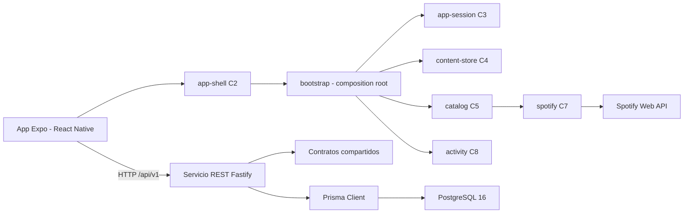
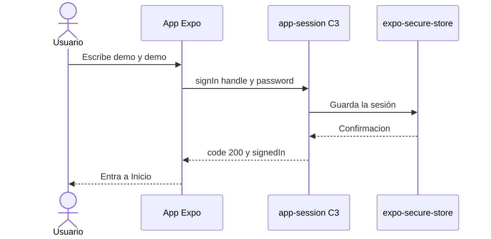
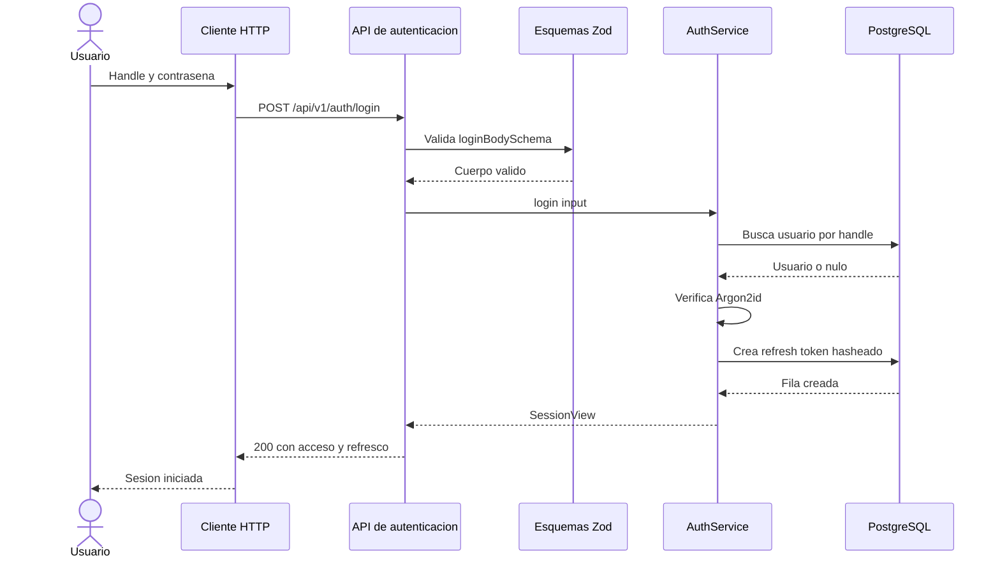
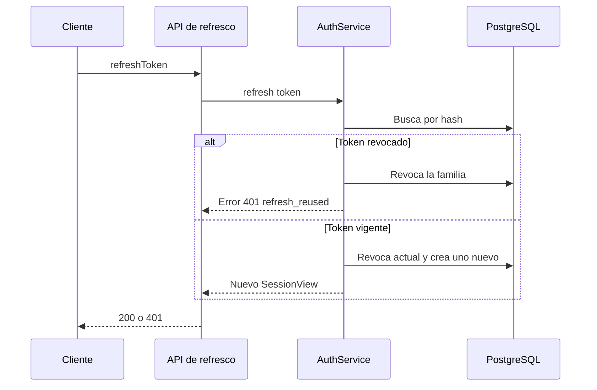

## Architecture Analysis

### System Overview

Monorepo npm con dos caras: una app Expo que hoy resuelve todo en memoria y un servidor Fastify modular que ya provee base de datos y autenticación. El acoplamiento permitido entre ambas es `@melodify/contracts` (tipos y esquemas Zod); está prohibido que el servidor importe paquetes de la app y viceversa.

### Architectural Style

- **Mobile**: composición raíz en `app/src/bootstrap/`, arquitectura de puertos y adaptadores en `packages/spotify`, `packages/catalog` y `packages/connectivity`; reductor inmutable en `packages/content-store`.
- **Server**: modular monolith de Fastify; cada módulo registra sus rutas en `src/app.ts`; Prisma como único acceso a PostgreSQL.
- **Contratos**: `packages/contracts` publica tipos desde `.` y esquemas Zod desde `./schemas` para no arrastrar runtime al bundle móvil.
- **Persistencia**: solo relacional, en PostgreSQL; sin Redis, colas ni caché en el código actual.

### Component Relationships

Text fallback: la app compone la cáscara con sesión, contenido, catálogo, actividad y conectividad; el catálogo usa el adaptador de Spotify; el servidor Fastify comparte contratos, usa Prisma y persiste en PostgreSQL. No hay flecha de Spotify al servidor.

### Data Flow

1. La app crea una sola instancia de sesión, almacén, catálogo, actividad y conectividad en `app/src/bootstrap/instances.ts`.
2. Las pantallas reciben esos servicios por `app/src/screens/dependencies.ts`; el estado se deriva con `viewerId` para `isOwn`, `likedByMe` y `followedByMe`.
3. En el servidor, cada request pasa por CORS/helmet, rate limit, validación Zod, JWT opcional y manejador de errores.
4. Las mutaciones de autenticación escriben `users` y `refresh_sessions` mediante Prisma; las respuestas se validan contra `SessionView` y `UserView`.

### Key Design Decisions

- `buildApp()` es una fábrica pura para poder usar `app.inject()` en pruebas; `server.ts` es el único punto con `listen()` y señales de proceso.
- Rotación de refresh: se guarda solo el SHA-256 del token y se revoca la familia ante reutilización.
- OpenAPI se genera desde los mismos esquemas que validan el cuerpo, evitando documentación huérfana.
- Las vistas de contenido se duplican entre `contracts` y `content-store` para que el servidor no dependa de la app; se preveía una prueba de asignabilidad en `@melodify/data-access`.

### Improvement Opportunities

- Definir el adaptador HTTP que traduzca `SessionView`/`UserView` a la sesión actual de la app.
- Publicar los recursos sociales con paginación por cursor (`DEFAULT_PAGE_SIZE=20`, `MAX_PAGE_SIZE=50`).
- Añadir request id a `ApiErrorBody` y ejecutar la suite Vitest del API en CI.

## Interaction Diagrams

### Inicio de sesión simulado en la app

Text fallback: el usuario entra con demo/demo; `app-session` guarda la sesión en almacenamiento seguro y la app navega a Inicio.

### Inicio de sesión en el API

Text fallback: el API valida con Zod, verifica la contraseña con Argon2id, crea el token de refresco hasheado y devuelve el par de tokens.

### Rotación de refresh con detección de reutilización

Text fallback: un refresh vigente se rota en transacción; uno ya revocado invalida toda la familia y responde 401.
