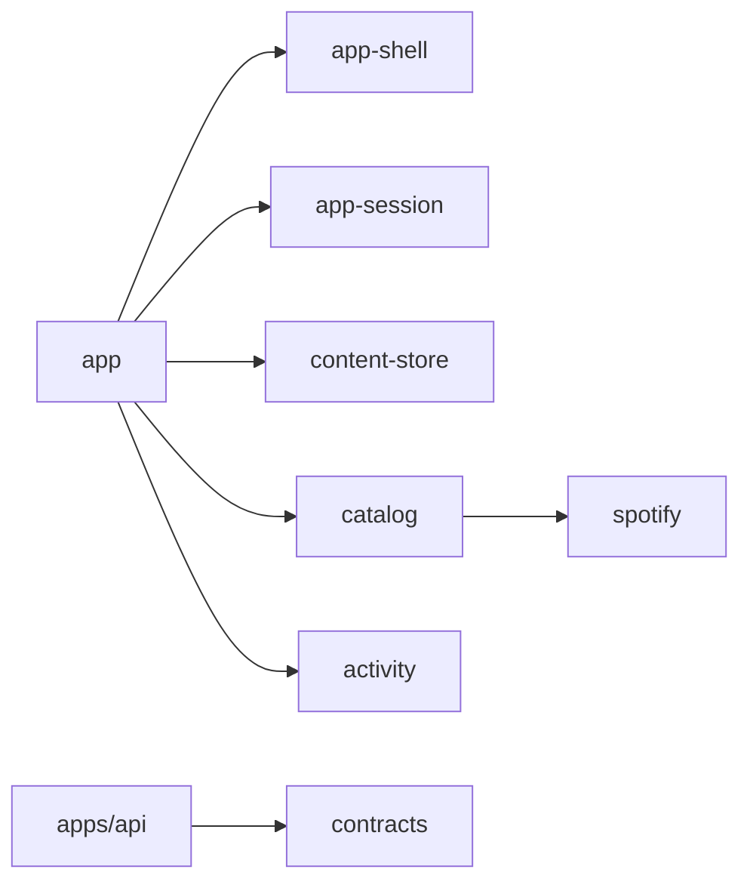

# Dependencies

## Dependencias internas del workspace

- `@melodify/app` → ocho paquetes móviles (`app-shell`, `design-system`, `app-session`, `content-store`, `catalog`, `connectivity`, `spotify`, `activity`); versiones fijadas en `app/package.json`.
- `@melodify/api` → `@melodify/contracts` (única dependencia interna); el código de producción nunca importa paquetes móviles.
- `@melodify/app-shell` / `@melodify/design-system` → primitivas de UI y tarjeta de opinión compartida; sin camino de vuelta a `app/src`.
- `@melodify/activity` + `@melodify/connectivity` → derivan del estado de `content-store`; sin capa de persistencia.
- `@melodify/data-access` aún no existe: es la costura prevista para las futuras llamadas HTTP al API.

Text fallback: la app depende de los paquetes móviles; el catálogo depende del adaptador de Spotify; la API depende solo de `contracts`. No hay dependencia cruzada app↔API.

## Dependencias externas de ejecución

- **API**: `fastify`, `@fastify/{cors,helmet,jwt,rate-limit,swagger,swagger-ui}`, `fastify-type-provider-zod`, `zod`, `@prisma/client`, `@node-rs/argon2`, `dotenv`, `openapi-types`.
- **App**: `expo`, `react`, `react-native`, `@react-navigation/native`, `react-native-{screens,safe-area-context}`, `@expo/vector-icons` y módulos Expo (`auth-session`, `crypto`, `network`, `secure-store`, `splash-screen`, `status-bar`, `web-browser`, `asset`, `font`).
- **Base de datos**: PostgreSQL 16 (`postgres:16-alpine`) con `DATABASE_URL`; `TEST_DATABASE_URL` para la suite Vitest.

## Dependencias de desarrollo y CI

- TypeScript 5.9.3, ESLint 9.39.5 + `eslint-config-expo`, Prettier 3.9.10, commitlint 21.2.4.
- Jest 29.7.0 + `jest-expo` + Testing Library RN; Vitest 5.1.2 + `@vitest/coverage-v8`; `tsx` para ejecutar la API en desarrollo; Prisma CLI para migraciones.
- Actions de GitHub: `actions/checkout@v6`, `actions/setup-node@v6` (según `ci.yml`).

## Aplicación de las fronteras

- `eslint.config.js` prohíbe importar `app-shell`/`design-system` desde `app/src`, y prohíbe que servidor/paquetes importen la app.
- `packages/contracts/src/index.ts` exporta solo tipos; `src/schemas.ts` es el único punto con Zod; así se evita meter runtime de validación en la app vía tipos.
- Frontera de red: la app habla con Spotify Web API y, en el futuro, con `/api/v1`; el servidor no llama a Spotify ni recibe tokens de la app.

## Variables de entorno

- App: `EXPO_PUBLIC_SPOTIFY_CLIENT_ID` (documentada en `app/.env.example`).
- API: `DATABASE_URL`, `JWT_ACCESS_SECRET`, `PORT`, `HOST`, `ACCESS_TOKEN_TTL`, `REFRESH_TOKEN_TTL_DAYS`, `CORS_ORIGINS`, `TRUST_PROXY`, `SWAGGER_ENABLED`, `LOG_LEVEL`, `SEED_DEMO` (documentadas en `apps/api/.env.example` y validadas en `src/config/env.ts`).
- Pruebas API: `TEST_DATABASE_URL`, creada por `apps/api/docker/init-test-db.sql`.
