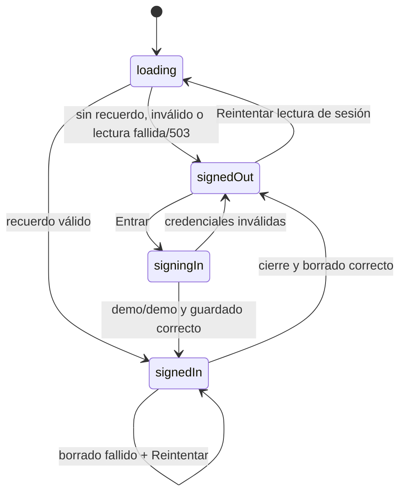
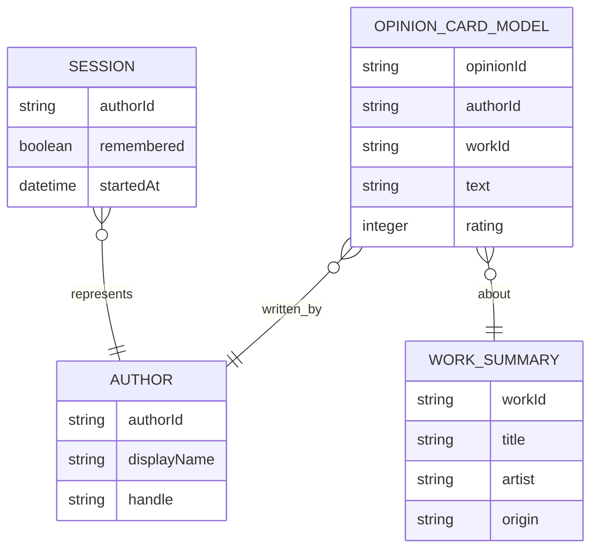

# Especificación funcional — U1 Esqueleto que corre

## Alcance

U1 entrega Login, sesión demo recordada, cinco pestañas hermanas y una tarjeta
local determinista en Inicio. Explorar, Crear, Actividad y Perfil son
contenedores vacíos; Perfil conserva solo «Cerrar sesión». No se implementan
Spotify, backend, detalle ni acciones sociales.

## Decisiones cerradas

| Pregunta | Decisión aplicada |
|---|---|
| Q1 | Cada pestaña conserva su propia pila y posición, incluido desplazamiento. |
| Q2 | Atrás en una pestaña raíz sale de la app; atrás en Login no permite abandonarlo. |
| Q3 | Error «Usuario o contraseña incorrectos» bajo Contraseña; conserva ambos valores y mantiene el foco en Contraseña. |
| Q4 | Contraseña oculta y control accesible para mostrarla u ocultarla. |
| Q5 | Lectura fallida o valor inválido equivale a sin sesión; se borra si es posible, se muestra Login y no se bloquea la app. Si la lectura devuelve 503, Login ofrece «Reintentar» explícitamente; la acción vuelve a leer el almacenamiento y puede repetirse sin impedir el acceso al formulario. |
| Q6 | Inicio muestra esqueletos breves; ausencia o fallo de la semilla muestra mensaje claro y «Reintentar». |
| Q7 | Las cuatro pestañas vacías muestran título y «No hay contenido todavía», sin acción. |
| Q8 | Tarjeta de lectura; texto truncado, portada con inicial, `♡` y `💬` con contadores de ejemplo como controles visuales no interactivos, y sin detalle al tocar. |
| Q9 | Obra local estable, autor Demo, valoración 4, texto breve en español y contadores cero. |

## Flujos

### F1 — Arranque

1. La aplicación carga el estado de sesión; el estado interno de preparación no
   se emite como `SessionView`.
2. Recuerdo válido `demo` emite `SessionView { status: signedIn, authorId:
   demo }` y lleva a Inicio; ausencia emite `signedOut` y lleva a Login.
3. Una lectura fallida o valor inválido se trata como ausencia, se elimina si
   es posible y permite entrar de nuevo sin bloquear la app.
4. Si la lectura devuelve 503, Login se muestra como sin sesión y ofrece
   «Reintentar» de forma explícita. Al pulsarlo, `AppSession.retry` vuelve a
   ejecutar la lectura; mientras tanto el formulario sigue disponible y otro
   503 deja visible la misma acción.

### F2 — Entrada

1. Login muestra Melodify, Usuario, Contraseña, Entrar y la pista demo.
2. El campo Contraseña usa entrada segura y un control accesible de visibilidad.
3. Se recortan espacios extremos para validar, sin alterar los valores
   conservados en el formulario.
5. `demo`/`demo` crea el recuerdo y navega a Inicio.
6. Otro valor mantiene Login, conserva ambos campos, muestra el mensaje bajo
   Contraseña y mantiene allí el foco.

### F3 — Inicio

1. Tras la entrada se prepara una semilla local y se muestran esqueletos breves.
2. En estado listo se muestra una sola `OpinionCardModel` de Demo, obra local,
   valoración 4, texto breve en español y contadores cero.
3. La portada nula o fallida muestra la inicial de la obra.
4. La tarjeta muestra `♡ 0` y `💬 0` (o los contadores del modelo), pero ambos
   son controles visuales no interactivos: no tienen callbacks ni ejecutan
   acciones sociales; tampoco abre detalle al tocarla.
5. Si falta la semilla se muestra «Todavía no hay opiniones» con «Reintentar»;
   si falla la preparación, se muestra error en lenguaje llano con «Reintentar».

### F4 — Navegación y cierre

1. Con sesión, la barra contiene exactamente Inicio, Explorar, Crear, Actividad
   y Perfil.
2. Cada pestaña conserva su propia pila y posición al cambiar y regresar.
3. Una raíz autenticada permite que atrás salga de la aplicación.
4. Perfil ofrece «Cerrar sesión»; tras borrar correctamente el recuerdo, vuelve
   a Login y elimina la barra. Si falla el borrado, conserva la sesión y ofrece
   «Reintentar».
5. Explorar, Crear, Actividad y Perfil muestran su título y «No hay contenido
   todavía»; Perfil además muestra «Cerrar sesión».

## Estados

`loading` y `signingIn` son estados internos de `AppSession`; la vista
observable `SessionView` solo emite `signedIn` o `signedOut`, conforme a C3.

## Modelo de relaciones derivado

## Resumen derivado de reglas

`BR1.1`–`BR1.2` gobiernan Login; `BR1.3` la recuperación y el cierre;
`BR1.4`–`BR1.5` la navegación; `BR1.6` la tarjeta local; y `BR1.7` los
estados de interfaz. Todas las reglas están detalladas en `rules.md`.

## Trazabilidad funcional

U1 implementa `US1.1`, `US1.2` y `US1.3`, y sus criterios de aceptación
correspondientes se declaran en `traceability.json`.

Las decisiones Q1-Q9 fueron confirmadas antes de generar este diseño.

## Pruebas esperadas de sesión y tarjeta

- La forma observable nunca emite `loading` ni `signingIn`; `signedIn` incluye
  siempre `authorId=demo` y `signedOut` mantiene la forma C3.
- Una respuesta de lectura 503 muestra Login como sin sesión, mantiene el
  formulario desbloqueado y muestra «Reintentar»; pulsarlo vuelve a invocar la
  lectura y un segundo 503 mantiene la misma recuperación disponible.
- Una lectura válida emite `signedIn` y abre Inicio; una lectura ausente o
  inválida emite `signedOut` sin bloquear la entrada.
- `OpinionCard` renderiza `♡` y `💬` con sus contadores, pero no invoca
  callbacks ni cambia contadores al tocarlos.
