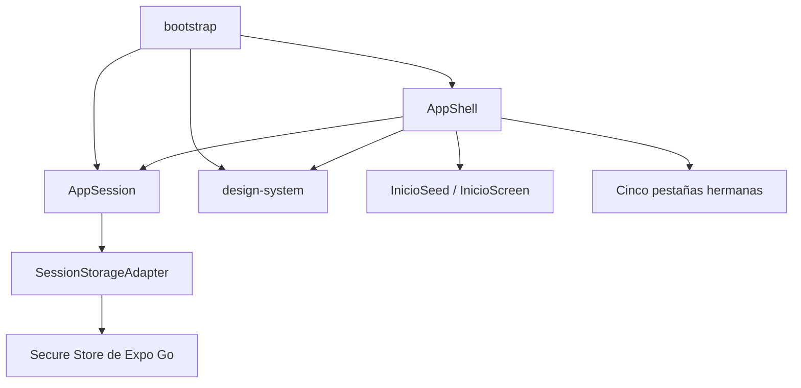

# Componentes lógicos — U1 `u1-app-skeleton`

```yaml
components:
  - name: AppShell
    kind: ui
    owns: [authenticated-visibility, five-tab-navigation, login-boundary]
    depends_on: [AppSession, design-system]
    contracts: [C1, C2, C3]
  - name: AppSession
    kind: library
    owns: [session-state, demo-credential-validation, remembered-session]
    depends_on: [SessionStoragePort]
    contracts: [C3]
  - name: design-system
    kind: library
    owns: [theme-tokens, shared-controls, presentation-models]
    depends_on: []
    contracts: [C1]
  - name: bootstrap
    kind: library
    owns: [composition-root, default-shell-services, dependency-injection]
    depends_on: [AppShell, AppSession, design-system]
    contracts: [C1, C2, C3]
  - name: SessionStorageAdapter
    kind: library
    owns: [secure-store-translation]
    depends_on: [ExpoGoSecureStore]
    contracts: [C3]
  - name: InicioSeed
    kind: library
    owns: [single-local-opinion-seed]
    depends_on: []
    contracts: []
ownership_rules:
  - "Cada entidad de sesión pertenece a AppSession; AppShell no persiste."
  - "Cada token y control visual pertenece a design-system; las pantallas no duplican OpinionCard."
  - "bootstrap compone, pero no posee reglas de sesión ni navegación."
  - "InicioSeed posee la semilla; no la exporta a almacenamiento ni red."
failure_domains:
  - { component: SessionStorageAdapter, blast_radius: "sesión; Login sigue disponible" }
  - { component: InicioSeed, blast_radius: "Inicio; ErrorState con Reintentar" }
  - { component: design-system, blast_radius: "toda UI; fallo de compilación, no runtime remoto" }
```

## Diagrama y flujo



`bootstrap` construye dependencias. `AppSession` publica C3; `AppShell`
consume únicamente la vista observable y monta Login o la navegación
autenticada. `design-system` define los tokens y controles C1. `InicioSeed`
alimenta el estado local de Inicio y no conoce C2 ni C3.

## Contratos y dependencias

- **C1:** AppShell usa `ThemeProvider`, `tokens`, `BottomTabBar`,
  `OpinionCard`, `ErrorState`, `Skeleton` y campos/botones; consumidores
  posteriores importan el esquema, no detalles internos.
- **C2:** AppShell exporta módulos de pantalla y servicios por inyección. U1
  arranca con `ShellServices` no-op; no importa conectividad, Spotify ni
  comentarios.
- **C3:** AppSession expone `getSession`, `signIn`, `signOut` y suscripción.
  La lectura 503 permite reintentar; el cierre requiere la enmienda 503
  indicada en `security-design.md`.

No existen bases compartidas, eventos remotos, sockets, colas ni llamadas de
red. El único adaptador externo es el almacenamiento seguro local.

## ADR-COMP-01 — Separación de cuatro responsabilidades

### Contexto
U1 debe servir como esqueleto y dejar puntos de extensión para U2–U6 sin
mezclar sesión, navegación, estilo y composición.

### Decisión
Mantener separados `AppShell`, `AppSession`, `design-system` y `bootstrap`,
con dependencias dirigidas hacia contratos C1–C3 y sin ciclos. Cada componente
posee exactamente el estado que declara.

### Consecuencias
Las pruebas pueden sustituir adaptadores y servicios; U2–U6 extienden mediante
contratos sin modificar la autoridad de sesión. Hay más archivos y una pequeña
ceremonia de inyección, pero se reduce el acoplamiento futuro.

### Alternativas rechazadas
- **Un `App.tsx` monolítico:** mezcla composición, navegación, persistencia y
  UI; hace difícil aislar fallos y viola C1–C3.
- **Estado global compartido sin puertos:** permite escrituras cruzadas y
  dependencias implícitas.
- **Microservicios o módulos remotos:** no son ejecutables sin backend y son
  desproporcionados para Expo Go.

## ADR-COMP-02 — Fallos aislados y degradación local

### Contexto
No hay redundancia de despliegue ni telemetría. Los únicos fallos previsibles
son almacenamiento corrupto/indisponible y preparación local de la semilla.

### Decisión
Limitar cada fallo al componente propietario: Login sigue accesible ante fallo
de lectura, Inicio ofrece semilla/estado de error con reintento y el cierre no
desmonta sesión si falla el borrado.

### Consecuencias
La app permanece recorrible y los estados son observables manualmente. No hay
recuperación automática de datos persistentes ni diagnóstico remoto.

### Alternativas rechazadas
- **Error global fatal:** contradice la degradación requerida.
- **SDK de observabilidad remoto:** contradice NFR4.1, privacidad y alcance.

## Sources

- `aidlc/spaces/default/intents/261105-melodify-mobile-app/construction/u1-app-skeleton/nfr-requirements/scalability-requirements.md`
- `aidlc/spaces/default/intents/261105-melodify-mobile-app/construction/u1-app-skeleton/nfr-requirements/observability-requirements.md`
- `aidlc/spaces/default/intents/261105-melodify-mobile-app/construction/u1-app-skeleton/nfr-requirements/tech-stack-decisions.md`
