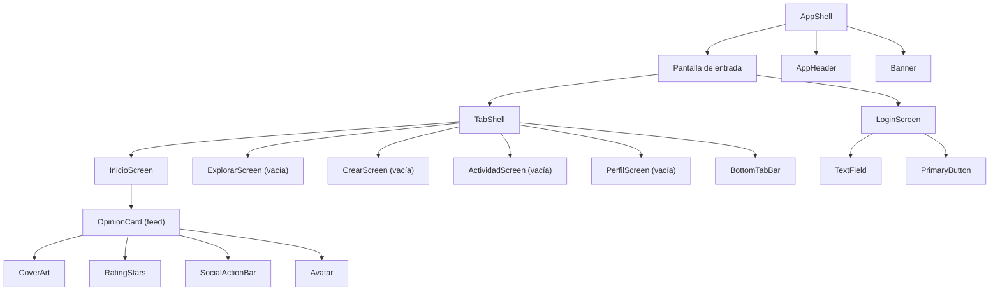

# Componentes de interfaz — U1 `u1-app-skeleton`

> **Provenance**: deriva de `inception/contract-design/contract-summary.md` (C1, C2, C3), `inception/domain-design/components.md` (DesignSystem, AppShell, AppSession), `inception/refined-mockups/mockups.md` (Pantalla 1, Pantalla 2, Sistema de navegación), `inception/refined-mockups/design-system-mapping.md`, `inception/refined-mockups/interaction-spec.md` y las respuestas de `functional-design-questions.md` (Q1–Q6).
> Fecha: 2026-11-11. Etapa: Functional Design · Unidad: `u1-app-skeleton`.

Este documento fija la forma de la interfaz de U1: qué componentes existen, qué reciben, qué estado guardan y cómo se comportan. Es diseño, no código: las props se nombran como las fija el contrato C1 y ninguna implementación se escribe aquí.

## Jerarquía

**Respaldo en texto**: `AppShell` decide entre `LoginScreen` y `TabShell`; `TabShell` compone la pestaña activa y la `BottomTabBar`; cada pantalla compone sus piezas de `DesignSystem`. `AppSession` no se pinta: alimenta la decisión de la cáscara.

## Paquetes y responsabilidad

| Paquete | Dueño | Qué aporta a la interfaz de U1 |
|---|---|---|
| `@melodify/design-system` (C1) | U1 | Tokens completos y las doce piezas que la versión 1.0.0 exporta (las que el esqueleto pinta o deja montadas). |
| `@melodify/app-shell` (C2) | U1 | La cáscara, la navegación, el estado de la barra y los servicios globales con sus valores por defecto. |
| `@melodify/app-session` (C3) | U1 | Lectura, entrada y salida de la sesión de la app. |
| `@melodify/app` | U1 | Punto de composición (`bootstrap/`) y las cinco pantallas registradas. |

## `@melodify/design-system`

### Tokens

Se exportan **completos**, con los valores de `design-system-mapping.md`: `color` (superficies, texto, bordes, primario, error, aviso, esqueleto, foco, inversos), `type` (display, title1, title2, headline, body, bodySmall, label, caption), `space` (1–12), `radius` (sm, md, lg, xl, pill) y `size` (header, tabBar, touch, cover, field, button, avatar, icon). El tema se resuelve con `useColorScheme()`: `dark` usa la paleta oscura; `light` y `null` usan la clara. Ningún componente consume un token crudo: todos pasan por el tema activo.

### Componentes que entrega U1

Las props son exactamente las de C1; esta tabla solo fija dónde se usan y qué estados visuales cubren en esta unidad.

| Componente | Props (C1) | Estados que cubre U1 | Dónde se usa |
|---|---|---|---|
| `AppHeader` | `title`, `rightSlot?` | Estático con o sin ranura derecha | Inicio (con chip) y las cuatro pantallas vacías |
| `BottomTabBar` | `items`, `activeIndex`, `onSelect` | Activo e inactivo | Cáscara, en las cinco pestañas |
| `OpinionCard` | `opinion`, `variant`, `isOwn`, `onPress?`, `onLike?`, `onComment?`, `onFollow?`, `onEdit?` | Solo `feed`, sin acciones (`isOwn` falso, callbacks ausentes) | Inicio |
| `CoverArt` | `title`, `coverUrl`, `size` | Bloque con inicial (`coverUrl` nulo) | Dentro de `OpinionCard` |
| `RatingStars` | `rating`, `max?`, `showValue?` | Valor con número visible | Dentro de `OpinionCard` |
| `Avatar` | `author`, `size?` | Inicial del autor | Dentro de `OpinionCard` |
| `SocialActionBar` | `likeCount`, `commentCount`, `likedByMe`, `onLike`, `onComment` | Contadores en cero, sin `likedByMe` | Dentro de `OpinionCard` (inactiva) |
| `TextField` | `label`, `value`, `onChange`, `error?`, `maxLength?` | Normal, enfocado y con error | Login, campos Usuario y Contraseña |
| `PrimaryButton` | `label`, `onPress`, `disabled?`, `loading?` | Habilitado y deshabilitado | Login, botón «Entrar» |
| `EmptyState` | `title`, `body`, `actionLabel?`, `onAction?` | Sin acción | Inicio sin semilla |
| `Banner` | `message`, `actionLabel?`, `onAction?` | Informativo | No se pinta en U1; queda listo para el aviso de sin conexión de U2 |
| `Skeleton` | `shape`, `count` | `card` | No se pinta en U1; queda listo para U2 |

Las trece piezas restantes del inventario llegan con la unidad que las necesita, en una versión posterior de C1, siempre aditiva (ver `functional-spec.md` § Enmienda a C1 y `contract-summary.md` § C1 → «Enmienda de la revisión 9»):

| Versión | Unidad | Piezas |
|---|---|---|
| 1.1.0 | U2 | `ErrorState`, `TextButton` |
| 1.2.0 | U4 | `SearchField`, `ConnectionCard`, `SpotifyCard`, `WorkResultRow` |
| 1.3.0 | U3 | `RatingInput`, `MultilineField`, `SecondaryButton`, `CommentSheet`, `Snackbar` |
| 1.4.0 | U5 | `ActivityRow`, `DayHeader` |

`Snackbar` y `CommentSheet` son las dos únicas piezas posteriores que la cáscara de U1 **nombra** sin poder pintarlas: declara sus puntos de montaje, pero ambos son condicionales y en el esqueleto no llegan a cumplirse. Cuando U3 las entregue, el dueño de C2 sube la versión menor y `AppShell` empieza a pintarlas sin que ninguna pantalla cambie.

## `@melodify/app-shell`

### `AppShell`

Recibe `screens`, `initialRoute` y `services`. Pinta la pantalla de entrada, monta el tema y el `SafeAreaProvider`, compone la barra inferior en las pestañas y presenta una sola vez el banner y el snackbar.

| Aspecto | Decisión de U1 |
|---|---|
| Pantalla de entrada | Lee la sesión; mientras no resuelve, mantiene el splash. Decide `Login` o `Inicio`. |
| Barra inferior | Solo dentro de las pestañas; nunca en Login. |
| Orden de destinos | Inicio, Explorar, Crear, Actividad y Perfil, con sus iconos. |
| Tema | `ThemeProvider` con el esquema del sistema. |
| Banner | Montado y oculto por defecto; queda listo para el aviso de sin conexión de U2. |
| Snackbar | Solo el punto de montaje y `showSnackbar` en `GlobalServices`; en U1 no se pinta nada porque ninguna acción produce avisos. La pieza llega con U3 (C1 1.3.0). |
| Hoja de comentarios | El controlador vive en `ShellServices.comments`, vacío y cerrado; se pinta solo con `opinionId` no nulo, que en U1 nunca ocurre. La pieza llega con U3 (C1 1.3.0). |

### `ShellServices` y sus valores por defecto

La cáscara no conoce `@melodify/connectivity` ni `@melodify/spotify`: recibe los servicios inyectados. U1 arranca con estos valores, que son los que U2 y U4 sustituirán en el punto de composición sin tocar la cáscara:

| Servicio | Valor por defecto en U1 | Quién lo sustituye |
|---|---|---|
| `network` | `online: true`, suscripción que no emite | U2 (`@melodify/connectivity`) |
| `spotify` | `status: 'disconnected'`, acciones sin efecto | U4 (`@melodify/spotify`) |
| `comments` | `opinionId: null`, lista vacía, `status: 'empty'`, acciones sin efecto | U3 (controlador de comentarios) |

### `GlobalServices`

Se exponen completos desde el primer día —`showSnackbar`, `setHeader`, `openWorkDetail`, `openOpinionDetail`, `openCreate`, `openEdit`, `closeCreate`, `goToTab`— aunque en U1 solo `goToTab` y `setHeader` tienen efecto, porque no existe todavía ninguna pantalla de detalle ni formulario. Una pantalla de U2 puede llamar a `openWorkDetail` sin que la cáscara cambie de versión mayor.

### Navegación y estado

| Pieza | Modelo |
|---|---|
| Pestañas | Cinco, hermanas, con Inicio como índice activo inicial. |
| Pila por pestaña | Cada pestaña guarda su lista de pantallas internas y su desplazamiento. Cambiar de pestaña **no** la reinicia (BR2.2). |
| Detalle | El tipo `DetailScreen` y la operación que apila existen; U1 no registra ninguno, así que la pila de cada pestaña solo contiene su raíz. |
| Atrás | Login atrapa el gesto; en raíz cierra la app; con algo apilado, desapila (BR2.4). |
| Snackbar | Punto de montaje declarado sobre la barra inferior; en U1 no se pinta nada porque ningún aviso se dispara. Con la pieza de U3, el aviso dura 4 s o desaparece al cambiar de pantalla. |

### `BottomTabBar`

Props de C1: `items` (nombre, etiqueta e icono), `activeIndex` y `onSelect`. Cada destino mide al menos 44×44 y su etiqueta siempre está visible: el estado activo no se comunica solo por color.

## `@melodify/app-session`

| Operación (C3) | Comportamiento en U1 |
|---|---|
| `getSession` | Devuelve `signedIn`/`signedOut` con `authorId` y `remembered`. Un fallo de lectura (`503`) responde como «sin sesión» tras intentar limpiar el valor: la cáscara abre Login sin aviso ni reintento. |
| `signIn({ handle, password })` | Aplica BR1.1 y BR1.2; responde `200` con la sesión; `401` se pinta como «Usuario o contraseña incorrectos» y `503` como «No pudimos guardar tu sesión. Inténtalo de nuevo.» con el botón en «Reintentar». |
| `signOut` | Borra el recuerdo y responde sin contenido. |
| `subscribeSession` | Emite el valor actual al suscribirse y el completo tras cada cambio. |

El autor de la sesión es siempre el autor demo (`authorId` `demo`): las credenciales válidas son solo las suyas, así que no se consulta ningún almacén de contenido.

## `@melodify/app` — pantallas y composición

### `app/src/bootstrap/`

Punto de composición. Construye los servicios por defecto, el registro de las cinco pantallas y la sesión, y monta `AppShell`. Es el único sitio que U2, U3 y U4 tocan para sustituir implementaciones. Aquí viven también los dos puntos de extensión que los contratos asignan a U1:

| Archivo | Qué deja U1 |
|---|---|
| `bootstrap/shell-services.ts` | Los valores por defecto de `ShellServices` (red en línea, Spotify desconectado, controlador de comentarios vacío), todos con suscripción nula. |
| `bootstrap/ports.ts` | Los tres puertos del catálogo —`SpotifySessionPort`, `SpotifySearchPort` y `SpotifyResolvePort`— **declarados y sin implementación**, tal como exige C5 (`created_by: U1`, `filled_by: U4`). Sin implementación registrada, el catálogo de ejemplo y los bloques de inicial funcionan solos. |

### `app/src/screens/login/`

| Aspecto | Diseño |
|---|---|
| Estado | `handle`, `password`, `passwordVisible`, `error`. |
| Foco | El campo Usuario recibe el foco al abrirse la pantalla. |
| Validación | «Entrar» se habilita con los dos campos no vacíos; al tocar, se recortan los espacios y se comparan con `demo`/`demo` (BR1.1). |
| Error de credenciales | «Usuario o contraseña incorrectos», bajo Contraseña, en línea, sin mover el botón y sin acción propia. Se limpia al volver a tocar «Entrar». |
| Error de guardado | «No pudimos guardar tu sesión. Inténtalo de nuevo.» bajo el botón, en línea, y el botón pasa a «Reintentar», que repite la entrada con lo escrito (BR1.2). Es el único estado de Login con acción. |
| Contraseña | Oculta; el control de ojo (44×44) alterna la visibilidad y conserva el texto. |
| Marcador | El campo Usuario muestra «demo» mientras está vacío (BR1.6). |
| Teclado | `KeyboardAvoidingView`: los campos y el botón se desplazan; «Entrar» cierra el teclado. |
| Barra inferior | Ausente. |
| Gesto atrás | Sin efecto. |

### `app/src/screens/inicio/`

| Aspecto | Diseño |
|---|---|
| Datos | Una opinión sembrada y su obra, en un módulo de presentación local de la carpeta de la pantalla. U2 lo sustituye por `ContentStore` y `Catalog`. |
| Mapeo | La pantalla construye un `OpinionCardModel` de C1 a partir de la semilla; el sistema de diseño no conoce tipos de contenido. |
| Cabecera | «Inicio» y el chip de Spotify a la derecha, siempre «Conectar» en U1. |
| Lista | Encabezado «Para ti» y una tarjeta `feed` con texto a tres líneas. |
| Interacción | Ninguna: ni navegación, ni me gusta, ni comentarios, ni seguir (BR3.2). |
| Estados | Contenido, y vacío si la semilla no tuviera elementos. Sin carga ni error (BR3.1). |

### Pantallas contenedoras

Explorar, Crear, Actividad y Perfil se registran como `ScreenModule` con su nombre y su título. Cada una pinta su `AppHeader` y deja el cuerpo vacío; no muestran mensajes de «próximamente» ni estados de error inventados. Al llegar su unidad, se reemplaza el componente y el resto de la cáscara no cambia.

## Flujos de interacción

| Flujo | Pasos visibles |
|---|---|
| Abrir la app | Splash → Login o Inicio según la sesión recordada. |
| Entrar | Escribir usuario y contraseña → «Entrar» se habilita → tocar → Inicio. Con credenciales incorrectas, el error aparece y no se pierde nada. Si el guardado de la sesión falla, el error es otro y el botón se convierte en «Reintentar». |
| Cambiar de pestaña | Tocar un destino → se muestra su pila; volver a una pestaña anterior recupera su pantalla y su scroll. |
| Atrás | En raíz cierra la app; en Login no hace nada. |
| Ver Inicio | Cabecera, «Para ti» y la tarjeta; ningún toque produce cambios. |

## Puntos de integración de la interfaz

| Punto | Unidad que lo usa | Qué debe respetar |
|---|---|---|
| `ShellServices` | U2 (red), U4 (Spotify) | Sustituir la implementación en `bootstrap/`, nunca en la cáscara. |
| `ScreenModule` y `DetailScreen` | U2, U3 | Registrar el detalle en la pestaña de origen, con `{ workId }` o `{ opinionId }` según su tipo. |
| `CreateEntry` y `useCreateEntry` | U3 | Leer modo, obra, opinión y origen; no cambiar la firma. |
| `goToTab` | U2, U3 | Volver a Inicio tras publicar. |
| `signOut` | U2 (Perfil) | El botón «Cerrar sesión» monta la operación de U1; nada más. Hasta entonces AC1.3.1 sigue abierto. |
| Punto de montaje del snackbar | U3 | `showSnackbar` y el lugar donde se pinta, sin pieza todavía. |
| Punto de montaje de la hoja de comentarios | U3 | El controlador de `ShellServices.comments` y la condición de pintado. |
| `OpinionCardModel` | U2, U3, U5 | La pantalla mapea desde su vista; el sistema de diseño no importa C4, C5 ni C8. |
| Esquema `melodify` | U4 | `app.json` ya declara el esquema y el redirect acordado es `melodify://spotify-callback`. |

## Assumptions & Open Questions

- `[assumption]` U1 no construye `ErrorState`: sin red ni almacenes externos, no hay error que mostrar en el esqueleto. Entra en U2 con el feed.
- `[assumption]` El chip de Spotify de Inicio es un `AppHeader` con ranura derecha; su contenido exacto se implementa con el estado por defecto `disconnected` y se especifica en U4.
- `[assumption]` Las etiquetas de lector de pantalla quedan fuera de esta versión (NFR6), pero las áreas táctiles de 44×44 y el contraste sí se respetan desde U1.
- **Open question**: ninguna bloquea la construcción de la interfaz. El límite de texto del formulario de opinión (OQ1) llega con U3 y no afecta a las piezas de U1.
