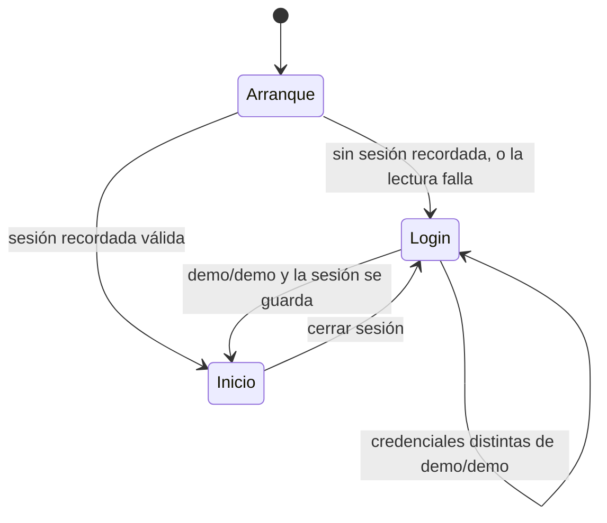

# Especificación funcional — U1 `u1-app-skeleton`

> **Provenance**: deriva de `inception/units-generation/unit-of-work.md` (U1), `inception/units-generation/unit-of-work-story-map.md` (US1.1–US1.3), `inception/user-stories/stories.md` (AC1.1.1–AC1.3.4), `inception/requirements-analysis/requirements.md` (FR1, FR2, FR3.2, FR3.4, FR11.5, FR2.4, RC-01, A6), `inception/domain-design/components.md` (AppShell, DesignSystem, AppSession), `inception/contract-design/contract-summary.md` (C1, C2, C3), `inception/refined-mockups/mockups.md` (Arranque, Login, Inicio, Sistema de navegación), `inception/refined-mockups/design-system-mapping.md` y las respuestas de `functional-design-questions.md` (Q1–Q6).
> Fecha: 2026-11-11. Etapa: Functional Design · Unidad: `u1-app-skeleton` · Agente: aidlc-architect-agent · Profundidad: Standard.

## Alcance de esta especificación

U1 entrega el tramo mínimo que corre de punta a punta: proyecto Expo, tema, navegación de cinco pestañas, login simulado con sesión recordada y una pantalla Inicio con una sola tarjeta de opinión sembrada. Esta especificación fija **el comportamiento** de ese tramo: los flujos ordenados, los estados por los que pasa la sesión y la navegación, y los textos exactos que la persona ve.

Lo que **no** entra aquí y se especifica en su unidad: el feed completo y el detalle (U2), Crear y las acciones sociales (U3), Spotify (U4), Actividad (U5) y el recorrido de las seis pantallas (U6). Las cuatro pestañas restantes existen y navegan, pero muestran un contenedor con su título.

Esta unidad no introduce un modelo de entidades propio. La única entidad que toca —`Session`— viene de `components.md` § AppSession, con identificador `authorId` (`demo`) y atributos `startedAt` y `remembered`; el contrato C3 expone su vista `SessionView`, que declara `status`, `authorId` y `remembered` y no `startedAt`. Por eso este documento no depende de `entities.md` ni de `rules.md` para leerse, y fija aquí la única pieza que ningún contrato fijaba: **la forma del registro que se guarda**.

**Registro persistido de la sesión de la app** (clave propia, distinta de la del token de Spotify):

| Campo | Tipo | Regla |
|---|---|---|
| `authorId` | texto | Constante `demo`. |
| `startedAt` | texto ISO 8601 con zona | Momento de la entrada. |

`remembered` no se guarda: se deriva de la presencia de un registro válido. Un registro con `authorId` distinto de `demo`, con `startedAt` ausente o ilegible, o con un JSON que no se puede leer, es **inválido** y se trata como «sin sesión» (BR1.3).

Las reglas de decisión viven en `rules.md`, y la tabla «Reglas derivadas» de más abajo es su vista de lectura.

## Vocabulario y actores

| Término | Significado en esta unidad |
|---|---|
| **Persona** | Quien usa la app en el teléfono. En esta versión siempre es la persona de la cuenta demo. |
| **Sesión de la app** | El recuerdo de que la persona entró. Es independiente de la sesión de Spotify y no la toca. |
| **Arranque** | La decisión de entrada que ocurre antes de pintar Login o Inicio (Pantalla 0 de los mockups). No es una pantalla visible. |
| **Pestaña** | Uno de los cinco destinos de la barra inferior. Cada una tiene su propia pila interna. |
| **Cáscara** | `AppShell`: quien compone la navegación, la barra, el banner y los puntos de montaje del aviso y de la hoja de comentarios. |
| **Semilla mínima** | La única opinión de ejemplo que U1 pinta en Inicio; U2 la sustituye por la siembra completa. |

## Máquina de estados de la sesión de la app

**Respaldo en texto** (la tabla es la lectura equivalente del diagrama):

| Estado | Cómo se llega | Qué ve la persona | Salidas |
|---|---|---|---|
| `Arranque` | Se abre la app. | El splash del sistema con el fondo del tema; nunca un formulario intermedio. | A `Login` si no hay sesión recordada o la lectura falla; a `Inicio` si la hay. |
| `Login` | No hay sesión recordada válida, o la persona cerró sesión. | Formulario de acceso sin barra inferior. | Sigue en `Login` con credenciales incorrectas; pasa a `Inicio` con `demo`/`demo`. |
| `Inicio` | Entrada correcta o sesión recordada. | Barra inferior con cinco destinos y la tarjeta sembrada. | Vuelve a `Login` al cerrar sesión. |

**Invariante de la máquina**: `Login` e `Inicio` nunca se muestran a la vez, y no existe ningún estado intermedio en el que la persona vea un formulario a medio pintar. Cerrar sesión de la app **no** cambia el estado de Spotify (C3, `components.md` § AppSession).

## Flujo F1 — Arrancar la app

1. La app se abre y **mantiene el splash del sistema** con el fondo del tema activo.
2. `AppSession` lee el recuerdo de sesión de su clave propia en el almacenamiento seguro del dispositivo.
3. Si la lectura devuelve una sesión válida (`authorId` `demo`, `remembered` verdadero), el arranque termina en **Inicio**, con la pestaña Inicio activa.
4. Si la lectura devuelve un valor vacío, un valor inválido o falla, el arranque termina en **Login** y, cuando es posible, borra la entrada inválida. La app no se bloquea ni muestra un error de arranque: la persona puede entrar de nuevo. El `503` de `getSession` **no** produce aviso ni reintento en esta versión: se trata como «sin sesión», que es lo que la deja entrar de nuevo (enmienda a C3, registrada en `contract-summary.md` § C3 y en «Enmiendas a los contratos» de más abajo).
5. Mientras el arranque no termina, no se pinta Login ni Inicio.

**Casos límite**

| Caso | Comportamiento |
|---|---|
| Almacenamiento vacío (primer arranque) | Login. |
| Valor guardado corrupto o de otra forma | Se trata como «sin sesión», se intenta borrar y se abre Login. |
| La lectura falla con `503` | Mismo camino: Login, sin aviso y sin reintento. La persona entra de nuevo. |
| El almacenamiento tarda | Splash del sistema; no hay límite visible ni mensaje. |
| El recuerdo existe, pero la persona había cerrado sesión | No existe: cerrar sesión lo borra (F3). |

## Flujo F2 — Entrar con la cuenta de demostración

1. La persona ve la marca «Melodify», el lema «Opiniones sobre música», los campos «Usuario» y «Contraseña» —el de Usuario con el marcador «demo»—, el botón «Entrar» y la pista «Demo: usuario y contraseña: demo». No hay barra inferior.
2. El campo «Usuario» recibe el foco al abrir. La autocapitalización está desactivada y el teclado no sugiere mayúsculas.
3. «Entrar» está **deshabilitado** mientras alguno de los dos campos esté vacío.
4. Al tocar «Entrar» con contenido en los dos campos, la app compara los valores con las credenciales demo, **ignorando los espacios al principio y al final** de cada campo.
5. **Coinciden**: se guarda la sesión en el almacenamiento seguro bajo la clave propia de la sesión de la app y se navega a Inicio, con Inicio como pestaña activa. Si el guardado falla (`503`), **no se entra**: el botón pasa a «Reintentar» y, en línea bajo el botón, aparece «No pudimos guardar tu sesión. Inténtalo de nuevo.»; la persona sigue en Login con lo escrito y «Reintentar» repite la entrada con esos mismos valores.
6. **No coinciden**: aparece el mensaje «Usuario o contraseña incorrectos» en línea, bajo el campo de Contraseña, sin mover el botón, sin limpiar ningún campo y sin abandonar la pantalla.
7. La Contraseña se escribe oculta; el control de ojo, de 44×44, alterna entre ocultarla y mostrarla. La pista demo permanece visible y no interactiva.

**Casos límite**

| Caso | Comportamiento |
|---|---|
| Credenciales con espacios alrededor | Se aceptan si al recortarlos son `demo`/`demo`. |
| Solo un campo relleno | «Entrar» sigue deshabilitado; no hay mensaje. |
| Varios intentos fallidos | El mismo mensaje en el mismo sitio; nunca se bloquea la cuenta ni se cuenta el número de intentos. |
| Teclado abierto | Los campos y el botón se desplazan para seguir visibles; «Entrar» cierra el teclado. |
| Gesto o botón atrás | No hace nada: no se sale de Login sin entrar (BR1.5). |
| Fallo al guardar la sesión | «No pudimos guardar tu sesión. Inténtalo de nuevo.» bajo el botón, que pasa a «Reintentar»; ni un campo se limpia y no se entra. |
| Se toca «Reintentar» y vuelve a fallar | El mismo mensaje, en el mismo sitio; no se cuenta el número de intentos. |
| Se toca «Entrar» o «Reintentar» y el mensaje anterior era de credenciales | El mensaje anterior se limpia antes de resolver el nuevo intento; solo se pinta el que corresponda a ese intento. |

## Flujo F3 — Cerrar sesión

1. La acción «Cerrar sesión» vive en Perfil (FR1.5, FR9.3). U1 entrega el destino completo de la acción —borrar el recuerdo y volver a Login—, pero **no pinta el botón**: Perfil es un contenedor y el botón real llega con la pantalla completa en U2, que lo cablea a `signOut` (ver «Puntos de integración con las unidades siguientes»). Por eso AC1.3.1 queda `Deferred` en la traza: el criterio se cierra cuando U2 monte el botón, no en esta unidad.
2. Cuando la acción se dispara, `AppSession` borra el recuerdo de sesión del almacenamiento seguro.
3. La app vuelve a **Login** y limpia el estado de navegación: al llegar, la pestaña activa vuelve a ser Inicio para la próxima entrada.
4. El contenido de ejemplo **no** se borra: al volver a entrar con `demo`/`demo`, Inicio muestra la misma tarjeta sembrada (AC1.3.4).
5. El cierre de sesión de la app no toca el token de Spotify ni su estado de conexión.

**Caso límite**: si el borrado del recuerdo falla, la app vuelve a Login igualmente y el error se registra en la superficie de diagnóstico; el arranque siguiente vuelve a tratar lo que haya como «sin sesión válida» solo si el valor no es válido. Para esta versión se acepta que un borrado fallido deje la sesión recordada y se comporte como tal al reabrir, porque el almacenamiento es local y no hay red de por medio.

## Flujo F4 — Navegar entre pestañas

1. La barra inferior muestra cinco destinos, siempre en el mismo orden: **Inicio, Explorar, Crear, Actividad y Perfil**, cada uno con su icono y su etiqueta.
2. La pestaña activa se distingue por color primario e icono relleno; las inactivas, por `textMuted` e icono de contorno. El estado nunca se comunica solo por color: la etiqueta siempre está visible.
3. La app arranca en Inicio. Al tocar otro destino, se muestra su pila y su posición de desplazamiento tal como estaba.
4. Cada pestaña conserva **su propia pila** y su scroll: salir de una pestaña a mitad de una pantalla interna y volver la devuelve a esa pantalla, no a la raíz (Q2 = A).
5. La barra inferior no aparece en Login.
6. El detalle de una obra o de una opinión se apilará **dentro** de la pestaña de origen (FR2.3). U1 no trae detalle, pero `AppShell` ya expone la operación con la que se abre y el punto donde se apila.

## Flujo F5 — Botón atrás del sistema

| Dónde está la persona | Qué ocurre |
|---|---|
| Login | No pasa nada: la app no se cierra ni cambia de pantalla (FR1.6). |
| Raíz de una pestaña | La app se cierra y queda en segundo plano (comportamiento por defecto de Android); al reabrir, se aplica F1 (Q3 = B). |
| Sobre una pantalla interna (cuando exista detalle) | Se desapila y vuelve a la pestaña de origen en la posición de scroll anterior, igual que «← Volver». |

## Flujo F6 — Ver Inicio con la opinión sembrada

1. Inicio se pinta en cuanto el arranque resuelve Inicio: no hay espera ni esqueleto, porque la semilla es una constante en memoria (Q4 = A).
2. La cabecera muestra «Inicio» y, a la derecha, el chip de estado de Spotify. En U1 el chip muestra siempre «Conectar», porque no hay sesión de Spotify; su acción queda sin efecto hasta U4.
3. Bajo la cabecera aparece el encabezado de sección «Para ti» y **una** tarjeta de opinión, en variante `feed`.
4. La tarjeta muestra: bloque de portada con la inicial de la obra, título de la obra, artista, estrellas con el número de valoración, el texto recortado a tres líneas con elipsis, autor y tiempo transcurrido, y `♡` y `💬` con contador en cero.
5. La tarjeta es **de lectura**: tocar la tarjeta no navega, `♡` y `💬` no responden y no hay «Seguir autor» (Q5 = A). Nada de lo que se toque en ella cambia datos.
6. El autor de la semilla es un autor de ejemplo, **no** `demo`: la tarjeta no se pinta como opinión propia y no muestra «Editar».
7. Si la semilla estuviera vacía, Inicio muestra el estado vacío «Aún no hay opiniones. Sé el primero.» sin botón de acción. No hay estado de carga ni de error en U1; los tres estados de FR11.1 se implementan y se prueban en U2, cuando exista el feed y la portada real.
8. La semilla usa una obra real de Spotify por su identificador (`workId`) y guarda su título y artista; no hay petición de red ni credencial alguna en este flujo.

**Caso límite**: si el identificador de la obra no estuviera en el catálogo local, la tarjeta se pinta igual con el título y el artista que trae la semilla y el bloque con la inicial; la portada nunca deja un hueco roto (FR11.3).

## Reglas derivadas

Esta tabla es la vista de lectura de `rules.md`; la fuente de verdad de las reglas es ese archivo.

| Regla | Enunciado | Origen |
|---|---|---|
| BR1.1 | Solo `demo`/`demo` entra; con otras credenciales se muestra el error en línea, se conserva lo escrito y no se abandona Login. | FR1.2 |
| BR1.2 | Al entrar se guarda la sesión y se navega a Inicio; si el guardado falla, no se entra y se ofrece «Reintentar». | FR1.3 |
| BR1.3 | Al arrancar se lee la sesión recordada y se decide Login o Inicio; una lectura fallida o inválida se trata como «sin sesión», sin aviso ni reintento. | FR1.4 |
| BR1.4 | Cerrar sesión borra el recuerdo y vuelve a Login; no toca Spotify ni el contenido. | FR1.5 |
| BR1.5 | Login no muestra barra inferior y no se puede abandonar sin entrar. | FR1.6 |
| BR1.6 | Login muestra la marca, el lema, los dos campos con su marcador, el botón «Entrar» y la pista demo, y nada más. | FR1.1 |
| BR2.1 | Cinco pestañas hermanas con Inicio como llegada. | FR2.1, FR2.2 |
| BR2.2 | Cada pestaña conserva su pila y su scroll. | Q2 = A |
| BR2.3 | El detalle se apila dentro de la pestaña de origen, nunca como sexto destino. | FR2.3 |
| BR2.4 | Atrás cierra la app en una raíz, desapila en una pantalla interna y no hace nada en Login. | FR1.6; Q3 = B |
| BR2.5 | La app sigue el tema claro u oscuro del sistema, sin selector manual. | FR2.4 |
| BR3.1 | Inicio pinta la semilla de una opinión; sin semilla, estado vacío sin acción; sin estados de carga ni error en U1. | FR3.1; Q4 = A |
| BR3.2 | La tarjeta sembrada es de lectura: sus acciones sociales no responden y no navega. | FR3.1; Q5 = A |
| BR3.3 | La semilla referencia una obra real por su identificador y nunca depende de la red. | FR3.2 |
| BR3.4 | Todo texto visible está en español y en lenguaje llano. | FR11.5 |

## Textos exactos de la interfaz

| Dónde | Texto | Notas |
|---|---|---|
| Login, marca | «Melodify» | Título de la pantalla. |
| Login, lema | «Opiniones sobre música» | Estático. |
| Login, campo | «Usuario» / «Contraseña» | Etiquetas. |
| Login, marcador | «demo» | Marcador del campo Usuario, solo mientras está vacío. |
| Login, botón | «Entrar» | Deshabilitado con un campo vacío. |
| Login, pista | «Demo: usuario y contraseña: demo» | Estática, no interactiva. |
| Login, error de credenciales | «Usuario o contraseña incorrectos» | Bajo Contraseña, en línea; sin acción propia. |
| Login, error de guardado | «No pudimos guardar tu sesión. Inténtalo de nuevo.» | Bajo el botón, en línea; el botón pasa a «Reintentar». |
| Login, botón tras fallo de guardado | «Reintentar» | Vuelve a intentar la entrada con lo escrito. |
| Inicio, cabecera | «Inicio» | Título de la pestaña. |
| Inicio, chip sin sesión | «Conectar» | Sin efecto en U1. |
| Inicio, sección | «Para ti» | Fijo sobre la lista. |
| Inicio, vacío | «Aún no hay opiniones. Sé el primero.» | Sin acción en U1. |
| Pestañas vacías | «Explorar», «Crear», «Actividad», «Perfil» | Solo el título en la cabecera. |

Ningún texto visible se escribe en inglés ni muestra códigos técnicos. El único error **con acción** de esta unidad es el del guardado de la sesión: se pinta con «Reintentar», como pide FR11.2, porque el intento se puede repetir sin salir de la pantalla. El error de credenciales no lleva acción propia —lo que hay que corregir está en los campos y el botón «Entrar» sigue ahí— y el fallo de lectura del arranque no se pinta: desemboca en Login, que es la acción. Las unidades que traen operaciones de red (U2–U5) añaden «Reintentar» a sus propios errores con `ErrorState`.

## Contratos que U1 posee y consume

| Contrato | Papel de U1 | Qué se entrega en esta unidad |
|---|---|---|
| **C1** `@melodify/design-system` | Proveedor | La versión 1.0.0: tokens completos, `ThemeProvider` y las doce piezas del esqueleto (ver enmienda). |
| **C2** `@melodify/app-shell` | Proveedor | `AppShell`, `ShellServices` con sus valores por defecto, `useShellServices`, `GlobalServices`, `useGlobalServices`, `CreateEntry`, `useCreateEntry`, `ScreenModule`, `DetailScreen`, `SpotifyStatus` y `CommentSheetState`. |
| **C3** `@melodify/app-session` | Proveedor | `getSession`, `signIn`, `signOut` y `subscribeSession` con sus códigos de respuesta; el fallo de lectura se trata como «sin sesión» (enmienda registrada en C3). |
| **C4–C8** | Consumidor futuro | U1 no los importa: la cáscara recibe `ShellServices` inyectado y arranca con valores por defecto. |

### Enmienda a C1 — alcance del inventario en U1

C1 se entrega de forma **incremental** (Q1 = A). La enmienda está registrada en el propio contrato, en `contract-summary.md` § C1 → «Enmienda de la revisión 9», que fija qué exporta cada versión y sustituye las dos frases que prometían el inventario completo en U1. Aquí queda el reparto visto desde esta unidad.

La razón de fondo sigue siendo la misma: la cobertura se mide por paquete con umbral del 80 %, así que una pieza que ninguna pantalla usa hay que probarla igual; y un esqueleto que solo pinta una tarjeta no necesita `CommentSheet` ni `DayHeader` para demostrar que las piezas encajan.

**Lo que entrega la 1.0.0 de C1 con U1**:

- **Tokens completos**: `color`, `type`, `space`, `radius` y `size`, con los valores de `design-system-mapping.md`, resueltos por `useColorScheme()` al tema del sistema (`null` se trata como claro), más `ThemeProvider`.
- **Doce componentes**: `AppHeader`, `BottomTabBar`, `OpinionCard`, `CoverArt`, `RatingStars`, `Avatar`, `SocialActionBar`, `TextField`, `PrimaryButton`, `EmptyState`, `Banner` y `Skeleton`, con las props que C1 les fija.

**Las trece piezas que U1 no entrega**, con la versión y la unidad que las trae —el orden sigue la secuencia de Bolts acordada, U1 → U2 → U4 → U3 → U5 → U6—:

| Pieza | Versión | Unidad | Qué la hace entrar |
|---|---|---|---|
| `ErrorState` | 1.1.0 | U2 | Los estados de error del feed y de Perfil (FR11.1, FR11.2). |
| `TextButton` | 1.1.0 | U2 | Es el botón de reintento de `ErrorState`. |
| `SearchField` | 1.2.0 | U4 | La búsqueda de Explorar (FR4.1); U3 lo reutiliza en el buscador de Crear, que ya encuentra en 1.2.0. |
| `ConnectionCard` | 1.2.0 | U4 | La invitación de Explorar sin sesión de Spotify (FR4.5). |
| `SpotifyCard` | 1.2.0 | U4 | El estado de conexión en Perfil (FR9.2). |
| `WorkResultRow` | 1.2.0 | U4 | Las filas de resultados de Explorar (FR4.3). |
| `RatingInput` | 1.3.0 | U3 | La valoración del formulario de Crear (FR5.1). |
| `MultilineField` | 1.3.0 | U3 | El texto de la opinión en Crear (FR5.1). |
| `SecondaryButton` | 1.3.0 | U3 | El «Cancelar» de Crear y el cierre secundario de la hoja de comentarios. |
| `CommentSheet` | 1.3.0 | U3 | La hoja de comentarios (FR7.x), que el mapa de historias asigna a U3. |
| `Snackbar` | 1.3.0 | U3 | Los avisos que acompañan a publicar, comentar y seguir; también lo asigna U3 el mapa de historias. |
| `ActivityRow` | 1.4.0 | U5 | Las filas de Actividad (FR8.x). |
| `DayHeader` | 1.4.0 | U5 | La agrupación por día de Actividad (FR8.x). |

**Cómo monta la cáscara el snackbar y la hoja de comentarios en U1 si las piezas aún no existen.** No las pinta. `AppShell` declara los dos puntos de montaje y `GlobalServices.showSnackbar` existe desde el primer día, pero en U1 ninguna acción produce un aviso, así que el aviso no llega a tener contenido que pintar; y la hoja solo se pinta cuando `ShellServices.comments.state.opinionId` no es nulo, valor que en el esqueleto nunca se escribe. Los dos son renders condicionales que en U1 no se cumplen, y por eso no necesitan la pieza: cuando U3 entregue `Snackbar` y `CommentSheet` en C1, el dueño de C2 sube la versión menor y la cáscara empieza a pintarlas. Ninguna otra pieza depende de estar montada antes de existir.

**Consecuencia**: el inventario de `design-system-mapping.md` sigue siendo la lista autoritativa de componentes y su entrega se reparte por versiones. La invariante de C1 «ninguna pantalla reimplementa una pieza» se mantiene intacta: cada pieza que una pantalla necesita existe en `@melodify/design-system` antes de que esa pantalla se construya, y un import de una pieza que aún no ha entrado simplemente no compila.

### Enmiendas a C3 — fallo de lectura del arranque

`getSession` responde `503` cuando el almacenamiento seguro no se puede leer. C3 decía que «la interfaz ofrece reintentar»; esta unidad adopta el comportamiento contrario, lo registra en el propio contrato (`contract-summary.md` § C3 → «Revisión 9 — enmienda de C3 al fallo de lectura») y lo resume aquí:

| Aspecto | Decisión de U1 |
|---|---|
| Qué ve la persona | Login, sin aviso y sin reintento (F1 paso 4). |
| Por qué | Es lo que fija `mockups.md` Pantalla 0; el fallo es del almacenamiento local y la salida natural —entrar de nuevo— es la propia pantalla. |
| FR11.2 | No se incumple: esa regla pide «Reintentar» para los errores **que se muestran**, y aquí no se muestra ninguno. |
| `signIn` | Conserva su `503` de guardado, y ese sí se pinta con acción (F2 paso 5): «No pudimos guardar tu sesión. Inténtalo de nuevo.» con el botón en «Reintentar». |
| Si el fallo fuera de red | No aplica en U1: leer la sesión no toca la red. |

## Puntos de integración con las unidades siguientes

| Punto | Quién lo consume | Qué deja U1 listo |
|---|---|---|
| `ShellServices` inyectado | U2 (red), U4 (Spotify) | Valores por defecto en `app/src/bootstrap/shell-services.ts`: red siempre en línea, Spotify desconectado y hoja de comentarios vacía, todos con suscripción nula. |
| `app/src/bootstrap/ports.ts` | U4 | El archivo existe con los tres puertos del catálogo —`SpotifySessionPort`, `SpotifySearchPort` y `SpotifyResolvePort`— **declarados y sin implementación**, como exige C5 (`created_by: U1`, `filled_by: U4`). Sin implementación registrada, el catálogo de ejemplo y los bloques de inicial funcionan solos. |
| Registro de `ScreenModule` | U2, U3, U4, U5 | Las cinco pestañas registradas con su título; el arranque y el orden de la barra ya fijados. |
| `DetailScreen` | U2 (obra), U3 (opinión) | El tipo y la operación que apila el detalle dentro de la pestaña, sin ninguna pantalla de detalle todavía. |
| `CreateEntry` | U3 | El tipo y el hook, con el valor por defecto vacío. |
| `signOut` → Perfil | U2 | La operación completa (borra el recuerdo, responde `204`, la cáscara vuelve a Login con Inicio como pestaña activa) y el flujo F3. U2 solo monta el botón «Cerrar sesión» en Perfil y lo llama; hasta entonces AC1.3.1 queda `Deferred`. |
| Punto de montaje del snackbar | U3 | `GlobalServices.showSnackbar` existe y la cáscara declara dónde se pinta; en U1 no se pinta nada porque ningún aviso se dispara. U3 entrega `Snackbar` y el dueño de C2 sube la versión menor. |
| Punto de montaje de la hoja de comentarios | U3 | `ShellServices.comments` con su controlador vacío y la condición de pintado (`opinionId` no nulo). En U1 nunca se cumple y la hoja no se pinta. |
| `ThemeProvider` | Todas | Tema completo exportado y montado por la carcasa. |
| Esquema `melodify` | U4 | `scheme: "melodify"` en `app.json`; el redirect de PKCE acordado es `melodify://spotify-callback` (A6). |
| Semilla mínima | U2 | Una opinión y una obra de ejemplo en un módulo de presentación de la pantalla Inicio, sustituible sin tocar la cáscara. |

## Historias implementadas

| Historia | Título | Criterios cubiertos |
|---|---|---|
| US1.1 | Entrar con la cuenta de demostración | AC1.1.1, AC1.1.2, AC1.1.3, AC1.1.4 |
| US1.2 | Volver a la app y caer en Inicio | AC1.2.1, AC1.2.2, AC1.2.3 |
| US1.3 | Cerrar sesión y volver al Login | AC1.3.1 (`Deferred`: el botón de Perfil llega con U2), AC1.3.2, AC1.3.3, AC1.3.4 |

## Assumptions & Open Questions

- `[assumption]` El splash del sistema es el único estado de espera del arranque: no se construye una pantalla de carga propia.
- `[assumption]` La sesión recordada se guarda bajo una clave propia del almacenamiento seguro, distinta de la del token de Spotify (C3, `components.md`), con la forma de registro que fija esta especificación.
- `[assumption]` U1 no pinta el botón «Cerrar sesión»: la pantalla Perfil completa llega en U2 y lo cablea entonces a `signOut`, que U1 ya entrega completo. AC1.3.1 queda `Deferred` por eso.
- `[assumption]` El chip de Spotify de Inicio se pinta siempre como «Conectar» y no responde en U1; su comportamiento se especifica en U4.
- `[assumption]` Los espacios al principio y al final de las credenciales se ignoran al comparar; es la única normalización aplicada y no distingue mayúsculas de minúsculas (solo hay una credencial válida y está en minúsculas).
- **Open question para U4**: el panel de Spotify debe aceptar `melodify://spotify-callback`. Si lo rechazara, la conexión real no se puede demostrar desde Expo Go y se decide entonces entre el proxy local y demostrar solo el recorrido sin sesión; no cambia nada de esta unidad.

## Sources

- `unit-of-work` — `inception/units-generation/unit-of-work.md` (§ U1).
- `unit-of-work-story-map` — `inception/units-generation/unit-of-work-story-map.md` (US1.1–US1.3, filas transversales).
- `stories` — `inception/user-stories/stories.md` (US1.1–US1.3, AC1.1.1–AC1.3.4).
- `requirements` — `inception/requirements-analysis/requirements.md` (FR1, FR2, FR3.2, FR3.4, FR11, A6, RC-01).
- `components` — `inception/domain-design/components.md` (AppShell, DesignSystem, AppSession).
- `contract-summary` — `inception/contract-design/contract-summary.md` (C1, C2, C3 y estructura del monorepo).
- `mockups` — `inception/refined-mockups/mockups.md` (Pantalla 0, Pantalla 1, Pantalla 2, Sistema de navegación).
- `design-system-mapping` — `inception/refined-mockups/design-system-mapping.md` (tokens e inventario).
- `functional-design-questions` — `construction/u1-app-skeleton/functional-design/functional-design-questions.md` (Q1–Q6).
