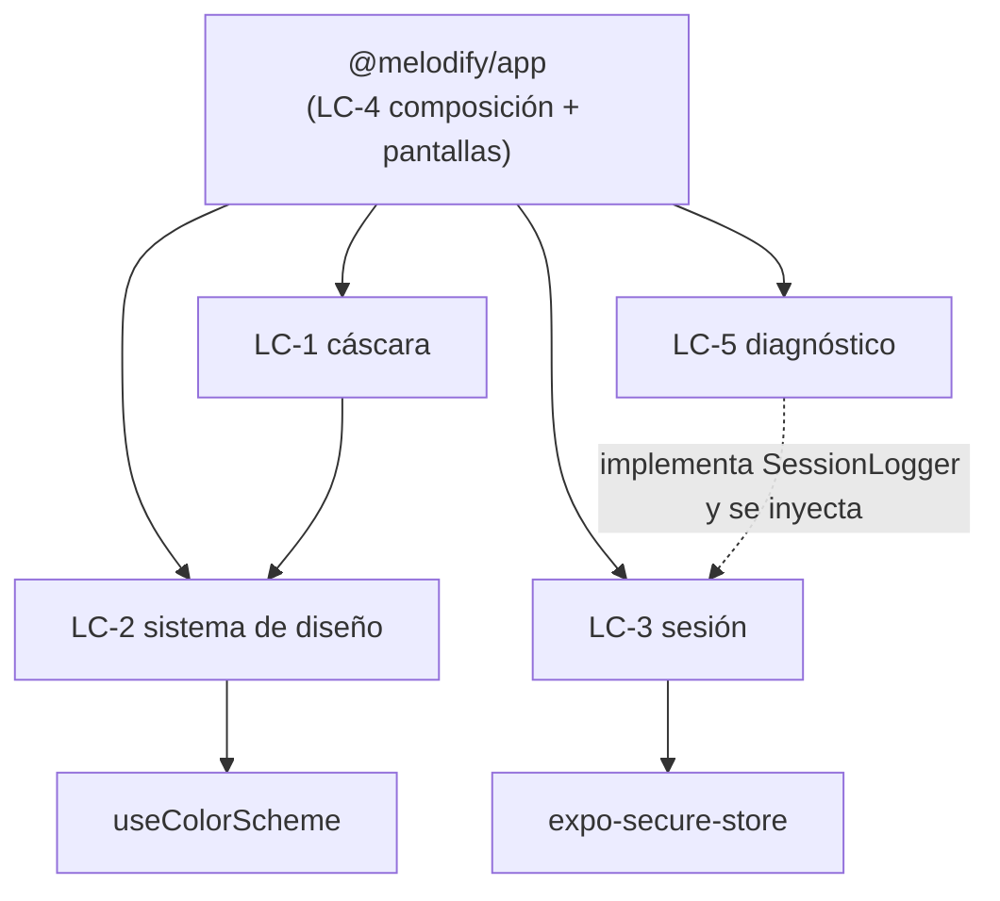

# Componentes lógicos — U1 `u1-app-skeleton`

> **Provenance**: deriva de `inception/domain-design/components.md` (AppShell, DesignSystem, AppSession), de `inception/contract-design/contract-summary.md` (§ Estructura del monorepo, C1, C2, C3, C5), de `nfr-requirements/tech-stack-decisions.md` (TS-03, TS-07, TS-09, TS-14, TS-15), de `nfr-requirements/performance-requirements.md` (NFR6.4), de `nfr-requirements/security-requirements.md` (NFR9.1), de `functional-design/functional-spec.md` (§ Puntos de integración) y de las respuestas de `nfr-design-questions.md` (Q5 = A).
> Fecha: 2026-11-11. Etapa: NFR Design · Unidad: `u1-app-skeleton` · Agente: aidlc-architect-agent · Profundidad: Standard.

## Qué describe este archivo

`logical-components.md` pide un inventario de componentes, dominios de fallo y radio de impacto. Esta unidad es una app de cliente sin servidor: no hay servicios que aislar ni réplicas que repartir. Lo que sí hay son **áreas de ejecución con un fallo propio y distinguible**, y son las que se describen aquí (Q5 = A): si una falla, se sabe qué se degrada y qué sigue funcionando.

**Lo que queda fuera de alcance**: `scalability-design.md`, `reliability-design.md` y `observability-design.md` no se producen para esta unidad porque el motor los filtra para unidades de tipo `ui`. La fiabilidad se diseña en `performance-design.md` § NFR1 y la observabilidad en `security-design.md` § NFR9. **La escalabilidad no se diseña porque no hay nada que escalar**: `requirements.md` no fija ningún objetivo de escalabilidad y una app de un solo usuario, sin servidor y con el contenido en memoria (RC-02, RC-03) no añade ninguno. Su ausencia aquí es una decisión, no un olvido.

## Inventario

| ID | Componente lógico | Dónde vive | Responsabilidad | Dueño |
|---|---|---|---|---|
| **LC-1** | Cáscara y navegación | `packages/app-shell/` (`@melodify/app-shell`) | `AppShell`, contenedor de navegación, barra de cinco pestañas, puntos de montaje de aviso y hoja, `ShellServices` con sus valores por defecto | U1 |
| **LC-2** | Sistema de diseño | `packages/design-system/` (`@melodify/design-system`) | Tokens, temas claro y oscuro, `ThemeProvider`, `useTheme` y las doce piezas de la versión 1.0.0 | U1 |
| **LC-3** | Sesión de la app | `packages/app-session/` (`@melodify/app-session`) | `getSession`, `signIn`, `signOut`, `subscribeSession`, la guarda del registro, la clave del almacenamiento y el **adaptador real de `expo-secure-store`** (único archivo que lo importa); declara el puerto `SessionLogger` | U1 |
| **LC-4** | Arranque y composición | `app/src/bootstrap/` | Punto de composición: construye la sesión pasándole el logger, inyecta `ShellServices`, monta el proveedor de tema y la navegación, controla el splash, declara `ports.ts` | U1 |
| **LC-5** | Diagnóstico | `app/src/bootstrap/logger.ts` | El logger del proyecto: **implementa el puerto `SessionLogger`** que declara LC-3 (y, cuando lleguen, los puertos con la misma forma que declaren U2, U4 y U5), dos niveles, códigos cerrados heredados de cada puerto y `__DEV__` | U1 |

Las pantallas de esta unidad —Login e Inicio— cuelgan de LC-1 y consumen LC-2 y LC-3; no son componentes propios porque no tienen estado que sobreviva a su montaje ni fallo independiente.

## Dependencias entre componentes

**Respaldo en texto**: la app depende de la cáscara, la sesión, el sistema de diseño y el diagnóstico. La cáscara depende del sistema de diseño. La flecha punteada es una **inyección, no un import**: el logger de LC-5 implementa el puerto `SessionLogger` que declara LC-3 y la app se lo pasa al construir la sesión; el paquete nunca importa código de `app/`. La sesión depende del adaptador del almacenamiento y el sistema de diseño del esquema de color del sistema. La app es el único punto que conoce a todos.

### Reglas de importación que hacen que ese grafo se mantenga

| Regla | Qué compuerta la hace cumplir | Por qué |
|---|---|---|
| `design-system` no importa nada de la app ni de los otros paquetes | **Type-check** (referencias de proyecto) | Es la base: si dependiera de alguien, se cerraría un ciclo y ninguno de los dos podría probarse solo |
| `app-shell` importa `design-system` y nada más del proyecto | Type-check | La cáscara recibe sus servicios inyectados (C2): no conoce la sesión, ni el contenido, ni Spotify |
| `app-session` no importa la cáscara ni el sistema de diseño | Type-check | Una sesión no sabe cómo se pinta; devuelve códigos y vistas |
| `packages/*` no importan `@melodify/app` ni `app/` | **ESLint** (`no-restricted-imports`) **y** type-check | El type-check no lo ve si el import es relativo y la ruta existe; la regla de lint sí |
| Nadie importa `expo-secure-store` salvo el adaptador de `@melodify/app-session` (y, cuando llegue, el de `@melodify/spotify`) | **ESLint** (`no-restricted-imports`) | Es una dependencia externa: cualquiera puede importarla y compilar. Los tipos no dicen nada aquí |
| Nadie importa `@react-native-async-storage/async-storage` | **ESLint** (`no-restricted-imports`) | Lo que ADR-011 decidió no añadir no puede reaparecer como atajo en U4 |
| Solo `app/src/bootstrap/` conoce a todos y los conecta | Revisión del PR y el propio diseño | El punto de composición es el único sitio con el mapa completo; las pantallas piden, no construyen |

**Cada regla tiene una compuerta real, y no todas son la misma.** El type-check cierra las aristas entre paquetes internos porque las referencias de proyecto no compilan si aparecen. No cierra las dependencias externas ni las rutas relativas hacia `app/`: para eso está la regla `no-restricted-imports` que U1 entrega en `eslint.config.js`, y `npm run lint` es la puerta que ya existe en el CI. Sin ella, la regla que protege NFR3.2 sería una recomendación.

## Dominios de fallo y radio de impacto

| ID | Qué falla | Qué se degrada | Qué sigue funcionando | Radio |
|---|---|---|---|---|
| **LC-1** | La navegación no monta (excepción en la cáscara) | Nada: la app no pasa de la primera pantalla | El arranque ya resolvió; el fallo es total y visible | Todo el tramo |
| **LC-2** | Un token o un componente del sistema falla | La pantalla que lo usa se pinta sin ese elemento; el tema cae al claro si `useColorScheme` no responde (`null`) | El resto de pantallas | Una pantalla |
| **LC-3** | La lectura del registro falla (`503`) | La app abre en Login en lugar de Inicio | Login completo: se puede volver a entrar | Una decisión de arranque |
| **LC-3** | El guardado falla (`503`) | No se entra; «Reintentar» queda disponible | Todo lo anterior a la escritura, incluido el formulario con lo escrito | Una entrada |
| **LC-3** | El borrado falla al cerrar sesión | Vuelve a Login igualmente; el registro puede sobrevivir | Login y el contenido de ejemplo | Una sesión |
| **LC-4** | La composición no monta (falta una inyección) | La app no arranca: es el fallo que la unidad no puede permitirse | — | Todo el tramo |
| **LC-5** | El logger falla | Nada visible: los fallos no registrados se pierden | Todo el resto | Diagnóstico solamente |

**La regla que se lee de esta tabla**: los fallos de LC-3 degradan a Login, que es siempre accionable; los de LC-2 degradan a una pantalla; los de LC-1 y LC-4 son totales, y por eso son los dos que se prueban primero al recorrer el tramo en el teléfono.

### Los dos fallos que la unidad trata como intolerables

- **LC-4 con una inyección a medias**: si `ShellServices` llegara vacío, la cáscara se pintaría sin valores y fallaría al primer uso, lejos de la causa. Por eso los valores por defecto viven en `app/src/bootstrap/shell-services.ts` y no son opcionales en el tipo.
- **LC-1 sin la rama de sesión**: si el contenedor de navegación se montara también en Login, la barra aparecería donde BR1.5 la prohíbe. La rama se decide por estado, no por estilo.

## Recursos compartidos y quién los posee

| Recurso | Cuántas instancias | Quién lo crea | Regla |
|---|---|---|---|
| Almacenamiento seguro | Uno, con **dos claves y dos dueños** | LC-3 es dueño del adaptador y de la clave `melodify.session`; el arranque no lo construye | U4 añadirá `melodify.spotify.token` con su propio adaptador en `@melodify/spotify`; ninguna unidad lee la de la otra |
| `ThemeProvider` | Uno | LC-4 lo monta en la raíz | Un solo proveedor: dos temas activos a la vez no tienen sentido y el segundo gana por orden de montaje, que es un fallo difícil de ver |
| Contenedor de navegación | Uno | LC-4 | Cada pestaña tiene su pila; un segundo contenedor rompería el gesto de atrás |
| Registro de `ScreenModule` | Una lista | LC-1 la recibe de la app | El orden de la barra se declara una vez; no hay una segunda lista que desincronizar |
| Logger | Un módulo | LC-4 lo importa donde haga falta | Sin estado, sin red; el único sitio que llama a `console` |

## Sistema de diseño: dónde se cumple NFR6

| Requisito | Cómo lo cumple LC-2 |
|---|---|
| **NFR6.1 — Contraste** | Los pares de token que usan las pantallas se comprueban con una utilidad de ratio en el paquete y una prueba que recorre claro y oscuro y falla por debajo de 4.5:1 (texto normal) o 3:1 (texto grande e iconos). La tabla de `design-system-mapping.md` deja de ser una promesa y pasa a ser una aserción (Q4 = A). |
| **NFR6.2 — Áreas táctiles** | Los tamaños mínimos viven en los tokens (`size`), no en cada pantalla: la barra inferior, los botones principales y los iconos de la tarjeta toman su altura de ahí. Una prueba comprueba las piezas interactivas que se montan en U1. |
| **NFR6.3 — Tema del sistema** | `useColorScheme()` dentro del proveedor, sin selector ni persistencia; `null` se trata como claro. Los componentes usan roles semánticos (`color.text`), nunca valores crudos. |
| **NFR6.4 — Estado no solo por color** | La pestaña activa cambia de color **y** de icono (relleno frente a contorno), y su etiqueta siempre está visible. Se comprueba en el teléfono con el tema claro y el oscuro. |

**Por qué la utilidad de contraste vive en el paquete y no en las pruebas**: porque también sirve para razonar sobre un par nuevo cuando alguien añade un componente. Una prueba que solo vive en `__tests__` se lee una vez y se olvida.

## Frontera con las unidades siguientes

| Punto que U1 deja listo | Quién lo usa | Qué contrato lo fija |
|---|---|---|
| `ShellServices` inyectado con valores por defecto | U2 (red), U4 (Spotify) | C2 |
| `app/src/bootstrap/ports.ts` con los tres puertos declarados y sin implementación | U4 | C5 |
| Registro de las cinco pestañas con su título | U2, U3, U4, U5 | C2 |
| `DetailScreen` y `CreateEntry` como tipos y operaciones, sin pantalla | U2, U3 | C2 |
| `signOut` completo, sin botón todavía | U2 monta el botón en Perfil | C3 |
| Puntos de montaje del aviso y de la hoja de comentarios, sin contenido en U1 | U3 | C2, C1 |
| `ThemeProvider` y tokens completos | Todas | C1 |
| Esquema `melodify` en `app.json` | U4 | A6 |
| Semilla mínima en un módulo de presentación de Inicio | U2 la sustituye | — |

**Lo que este archivo no decide**: la topología de despliegue (no aplica: no hay despliegue, `team.md` § Deployment) ni el reparto de unidades (ya fijado en `unit-of-work.md`). Describe dónde vive cada cosa y qué se rompe si falla.

## Assumptions & Open Questions

- `[assumption]` Las cinco áreas de LC-1 a LC-5 son las que tienen fallo propio en esta unidad; si una unidad posterior introduce una sexta —por ejemplo la conectividad de U2—, la declara en su propio `logical-components.md` y actualiza esta frontera.
- `[assumption]` La utilidad de contraste calcula el ratio con la fórmula de luminancia relativa de WCAG; el umbral es el de NFR6.1 y no se recalibra por token.
- `[assumption]` Los tamaños mínimos de NFR6.2 se expresan en los tokens de `size` y no como valores sueltos en cada componente.
- **Open question para U2**: la conectividad entra como área propia (LC-6 de esa unidad) y probablemente como paquete `@melodify/connectivity`; su dominio de fallo —qué se degrada sin red— se diseña allí.
- **Open question para U4**: el adaptador del token y su clave se añaden a la tabla de recursos compartidos sin cambiar el dueño del almacenamiento.

## Sources

- `components` — `inception/domain-design/components.md` (AppShell, DesignSystem, AppSession).
- `contract-summary` — `inception/contract-design/contract-summary.md` (§ Estructura del monorepo, C1, C2, C3, C5).
- `tech-stack-decisions` — `construction/u1-app-skeleton/nfr-requirements/tech-stack-decisions.md` (TS-03, TS-07, TS-09, TS-14, TS-15).
- `performance-requirements` — `construction/u1-app-skeleton/nfr-requirements/performance-requirements.md` (NFR6.4).
- `security-requirements` — `construction/u1-app-skeleton/nfr-requirements/security-requirements.md` (NFR9.1).
- `functional-spec` — `construction/u1-app-skeleton/functional-design/functional-spec.md` (§ Puntos de integración, F4).
- `design-system-mapping` — `inception/refined-mockups/design-system-mapping.md` (tokens, contraste, inventario).
- `nfr-design-questions` — `construction/u1-app-skeleton/nfr-design/nfr-design-questions.md` (Q4 = A, Q5 = A, confirmadas).
