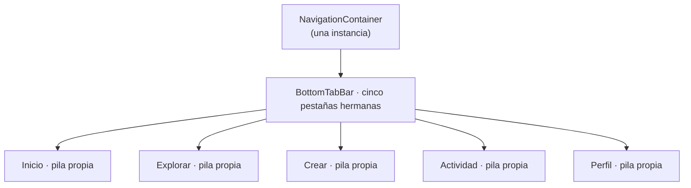

# Diseño de rendimiento, usabilidad y fiabilidad — U1 `u1-app-skeleton`

> **Provenance**: deriva de `nfr-requirements/performance-requirements.md` (NFR8.1–8.3, NFR2.1–2.3, NFR1.1–1.3, NFR6.4), de `functional-design/functional-spec.md` (F1–F6), de `inception/domain-design/decisions.md` (ADR-009, ADR-010, ADR-011), de `inception/contract-design/contract-summary.md` (C2, C3) y de las respuestas de `nfr-design-questions.md` (Q1 = A, Q5 = A).
> Fecha: 2026-11-11. Etapa: NFR Design · Unidad: `u1-app-skeleton` · Agente: aidlc-architect-agent · Profundidad: Standard.

## Qué resuelve este diseño

Los requisitos dicen **qué** hay que cumplir. Este archivo dice **cómo**, con el detalle suficiente para que Code Generation no tenga que decidirlo. Tres cosas se diseñan aquí:

1. **El arranque**: cómo se cubre el presupuesto de 2 s sin esperas artificiales y sin que aparezca un fotograma en blanco (NFR8.1, NFR8.2).
2. **La navegación y la presentación**: cómo se llega a cada pestaña en un toque y cómo se pinta un error que se puede reintentar (NFR2).
3. **La resiliencia del tramo**: qué pasa en cada fallo del almacenamiento para que nadie se quede fuera (NFR1).

NFR8.3 —el resto del recorrido sin número— no necesita diseño: lo que pide es no añadir trabajo, y lo que sigue lo demuestra. NFR6.4 vive en `logical-components.md` § Sistema de diseño, porque se comprueba en el renderizado de la barra.

## NFR8.1 / NFR8.2 — El arranque

### Qué ocurre entre el toque y la primera pantalla

| Paso | Qué pasa | Tiempo |
|---|---|---|
| 0 | El paquete ya está cargado en el contexto de JavaScript de Expo Go. | — |
| 1 | El módulo de entrada llama a `SplashScreen.preventAutoHideAsync()`. | Inmediato |
| 2 | Se monta la raíz: `ThemeProvider` y el contenedor de navegación, sin decidir aún Login o Inicio. El splash del sistema sigue visible. | Unos milisegundos |
| 3 | Arranca la lectura del recuerdo de sesión en el almacenamiento seguro (`getSession`, C3). | El tramo dominante |
| 4 | Resuelve la lectura → se fija el estado `Arranque` a Login o a Inicio y se pinta esa pantalla. | Un fotograma |
| 5 | Se llama a `SplashScreen.hideAsync()`, siempre, incluso si el paso 4 dejó una pantalla de Login por un valor inválido. | Inmediato |

**Lo que este diseño evita expresamente**: no hay `setTimeout` de cortesía, ni retardo mínimo, ni pantalla de carga propia, ni animación de entrada que retrase el primer fotograma (NFR8.2). Tampoco hay dos decisiones: la lectura resuelve una vez y la app no vuelve a preguntar hasta el siguiente arranque.

**Lo que el paso 3 no hace**: no valida contra la red, no comprueba la caducidad de nada y no espera a ningún otro servicio. La sesión de la app no depende de Spotify (C3, `components.md` § AppSession). Todo lo que la lectura añade al arranque es la latencia del almacenamiento seguro, que es exactamente lo que el presupuesto de 2 s tiene que absorber.

### El splash se oculta cuando hay una pantalla, no antes

```text
// Ilustrativo, no implementación.
const [state, setState] = useState<"arranque" | "login" | "inicio">("arranque");

useEffect(() => {
  getSession()
    .then((view) => setState(view.status === "signedIn" ? "inicio" : "login"))
    .catch(() => setState("login"))        // NFR1.2: un fallo nunca deja el splash colgado
    .finally(() => void SplashScreen.hideAsync());
}, []);
```

Tres decisiones dentro de ese fragmento:

- **`preventAutoHideAsync()` en el módulo de entrada, no en un componente.** Si dependiera del montaje de un componente, una excepción temprana dejaría el splash oculto a medias; llamándolo al importar el módulo, se ejecuta antes que cualquier render.
- **`hideAsync()` en un `finally`.** Es lo que convierte «el splash termina cuando resuelve la lectura» en «termina siempre»: un fallo inesperado deja a la persona en Login, no en un splash infinito (NFR1.1).
- **El estado empieza en `"arranque"` y no se pinta nada para él.** Mientras vale `"arranque"`, la raíz devuelve `null` y el splash del sistema cubre la pantalla. Es la forma de cumplir F1 paso 5 sin inventar un componente.

### Cómo se comprueba el presupuesto

El protocolo es el de NFR8.1 y no se repite aquí. Lo que este diseño aporta es que **no hay nada que descontar**: entre el toque y la primera pantalla solo existen el montaje, el tema, la navegación y la lectura. Si la medida se pasa de 2 s, la causa está en uno de esos cuatro, y el logger deja rastro de si la lectura falló (NFR9.2).

## NFR2.1 / NFR2.2 — Navegación y presentación

### Una estructura, cinco destinos, un toque



**Respaldo en texto**: un `NavigationContainer` único contiene una barra de pestañas con cinco destinos hermanos; cada destino tiene su propia pila, aunque en U1 todas las pilas tengan solo su pantalla raíz.

- **Un toque, no dos.** Los cinco destinos son hermanos en la misma barra: no hay un menú intermedio, ni un cajón lateral, ni un «más». Es lo que NFR2.1 exige y lo que F4 fija.
- **Orden fijo**: Inicio, Explorar, Crear, Actividad, Perfil. El orden se declara una vez, en el registro de `ScreenModule`, y la barra lo lee de ahí: no hay dos listas que puedan desincronizarse.
- **Login no monta la barra** (BR1.5). El contenedor de navegación existe solo en la rama de sesión iniciada; no se oculta con un estilo, no se monta.
- **La pila se conserva porque no se desmonta.** Cada pestaña mantiene su navegador mientras la app vive; volver a una pestaña devuelve a su última pantalla y a su scroll (F4 paso 4, BR2.2). No hay que guardar nada a mano.

### La acción principal, en dos toques

| Acción de U1 | Camino | Toques |
|---|---|---|
| Entrar con `demo`/`demo` | Login ya visible → «Entrar» | 1 |
| Reintentar tras un fallo de guardado | Login ya visible → «Reintentar» | 1 |
| Cambiar de pestaña | Barra siempre visible → destino | 1 |
| Ver la tarjeta sembrada | Llegar a Inicio la pinta | 0 |

**El diseño que hace posible el «1 toque» de entrar**: el formulario de Login no está detrás de nada —ni bienvenida, ni tutorial, ni selector de cuenta—, y «Entrar» está siempre en pantalla salvo que el teclado lo tape, caso en que el contenido se desplaza (F2, caso límite). No hay paso de confirmación: las credenciales correctas entran directamente.

### Los tres estados de una acción

Toda acción de esta unidad se pinta en uno de tres estados, y ninguno depende de un temporizador:

| Estado | Cómo se ve | Qué lo saca |
|---|---|---|
| **Reposo** | El control en su forma normal. | Un toque. |
| **En curso** | El control se deshabilita y no acepta un segundo toque; no se pinta un spinner nuevo porque la operación es local y dura un fotograma. | La operación termina. |
| **Error accionable** | Mensaje en línea bajo el control, en lenguaje llano, y el control pasa a su forma de reintento («Reintentar»). | Un toque en «Reintentar» repite la operación con los mismos valores. |

El estado «en curso» importa más de lo que parece: sin él, dos toques rápidos en «Entrar» disparan dos escrituras al almacenamiento y la segunda puede fallar después de que la primera ya entró. Deshabilitar mientras se resuelve es lo que evita ese doble camino, y no cuesta ni una línea de espera artificial.

### El error que se muestra y el que no

NFR2.3 exige que todo error visible diga qué pasó y ofrezca acción. Este diseño lo traduce a una regla de una línea:

> **Un error se pinta solo si la persona puede hacer algo en esa pantalla. Si no puede, no se pinta: se registra.**

Aplicado a esta unidad:

| Fallo | ¿Se pinta? | Por qué |
|---|---|---|
| Credenciales incorrectas | Sí, bajo Contraseña, sin botón propio | Lo que hay que corregir son los campos, y «Entrar» sigue ahí. |
| Guardado de la sesión (`503`) | Sí, bajo el botón, con «Reintentar» | La operación se puede repetir sin salir de la pantalla. |
| Lectura del arranque (`503`) o valor inválido | No | La salida es Login, que es la pantalla a la que se llega. Un «Reintentar» sobre el almacenamiento local prometería una recuperación que no existe. |

La frontera es la acción, no el código de respuesta: dos fallos con el mismo `503` se tratan distinto porque uno se puede reintentar desde donde está la persona y el otro no.

## NFR1 — Fiabilidad del tramo

### El arranque es una decisión, no una carrera

`AppSession` lee una vez y resuelve a uno de dos destinos. No hay un estado intermedio en el que Login e Inicio coexistan, ni un render que dependa de dos fuentes. La máquina de estados de la especificación funcional se implementa como un valor único (`"arranque" | "login" | "inicio"`), no como dos banderas: con dos banderas existe el estado imposible «las dos a la vez», y con un valor no.

### Matriz de fallos: nadie se queda fuera

| Fallo | Dónde se detecta | Qué ve la persona | Qué queda registrado |
|---|---|---|---|
| Almacenamiento vacío (primer arranque) | `getSession` → `signedOut` | Login | Nada: es el caso normal. |
| Registro con JSON ilegible | `parseSessionRecord` → `null` | Login | `warn`, `SESSION_RECORD_INVALID` |
| Registro con `authorId` distinto de `demo` | `parseSessionRecord` → `null` | Login | `warn`, `SESSION_RECORD_INVALID` |
| Registro con `startedAt` ausente o ilegible | `parseSessionRecord` → `null` | Login | `warn`, `SESSION_RECORD_INVALID` |
| Lectura con `503` | `getSession` responde `503` | Login, sin aviso | `warn`, `SESSION_READ_FAILED` |
| Borrado del valor inválido que falla | `signOut`/borrado interno | Nada distinto: sigue a Login | `warn`, `SESSION_DELETE_FAILED` |
| Guardado con `503` al entrar | `signIn` responde `503` | «No pudimos guardar tu sesión…» + «Reintentar» | `error`, `SESSION_SAVE_FAILED` |
| Borrado al cerrar sesión que falla | `signOut` | Vuelve a Login igualmente | `error`, `SESSION_DELETE_FAILED` |

**La regla detrás de la columna «qué ve»**: ningún fallo del almacenamiento produce una pantalla de error de arranque, porque el almacenamiento es local y la persona no tiene una acción que lo arregle. El peor resultado posible es Login, y Login es siempre accionable: se puede volver a entrar.

### Lo que no puede pasar

| Escenario | Por qué no puede pasar | Qué lo impide |
|---|---|---|
| Splash infinito | La lectura podría no resolver nunca o lanzar | `hideAsync()` en `finally` |
| Login e Inicio a la vez | Dos banderas permitirían el estado imposible | Un solo valor de estado |
| Formulario a medio pintar | Se pintaría antes de decidir | La raíz devuelve `null` mientras el estado es `arranque` |
| Cierre al tocar «Entrar» | Una excepción sin manejar en el manejador del botón | `signIn` devuelve códigos, no lanza; el manejador no puede propagar |
| Doble entrada por doble toque | Dos escrituras concurrentes | El control se deshabilita mientras resuelve |
| Tarjeta con hueco roto | Portada sin imagen | Bloque con la inicial como respaldo (FR11.3, F6 caso límite) |

### La semilla no depende de nada

Inicio se pinta con una constante en memoria: una opinión y una obra de ejemplo en un módulo de presentación de la pantalla. No hay petición, ni estado de carga, ni esqueleto, ni error posible (F6 paso 1). El único cálculo es derivar la inicial del título de la obra para el bloque de portada, y eso no falla.

## Assumptions & Open Questions

- `[assumption]` `expo-splash-screen` viene incluido con el SDK 57 y funciona igual en Expo Go; si no estuviera, la alternativa es ocultar el splash nativo y aceptar el fondo del tema durante la lectura, anotándolo.
- `[assumption]` La lectura de `expo-secure-store` resuelve en un tiempo estable; si en el teléfono variara mucho entre arranques, la mediana de tres aperturas del protocolo lo absorbe sin cambiar el diseño.
- `[assumption]` Deshabilitar el control mientras la operación resuelve no cuenta como espera artificial de NFR8.2: no añade tiempo, solo evita un segundo disparo.
- **Open question para U2**: cuando lleguen el feed y las portadas reales, los estados de carga y error de FR11.1 tendrán su propio diseño en esa unidad; esta deja el patrón de tres estados y no lo extrapola.
- **Open question para U6**: el recorrido de las seis pantallas puede añadir una comprobación de arranque en la demostración; se formaliza allí.

## Sources

- `performance-requirements` — `construction/u1-app-skeleton/nfr-requirements/performance-requirements.md` (NFR8.1–8.3, NFR2.1–2.3, NFR1.1–1.3, NFR6.4).
- `security-requirements` — `construction/u1-app-skeleton/nfr-requirements/security-requirements.md` (NFR9.2, para la tabla de fallos registrados).
- `tech-stack-decisions` — `construction/u1-app-skeleton/nfr-requirements/tech-stack-decisions.md` (TS-01, TS-04, TS-05).
- `functional-spec` — `construction/u1-app-skeleton/functional-design/functional-spec.md` (F1, F2, F3, F4, F6).
- `rules` — `construction/u1-app-skeleton/functional-design/rules.md` (BR1.2, BR1.3, BR1.5, BR2.1, BR2.2, BR3.3).
- `contract-summary` — `inception/contract-design/contract-summary.md` (C2, C3).
- `decisions` — `inception/domain-design/decisions.md` (ADR-009, ADR-010, ADR-011).
- `nfr-design-questions` — `construction/u1-app-skeleton/nfr-design/nfr-design-questions.md` (Q1 = A, Q5 = A, confirmadas).
