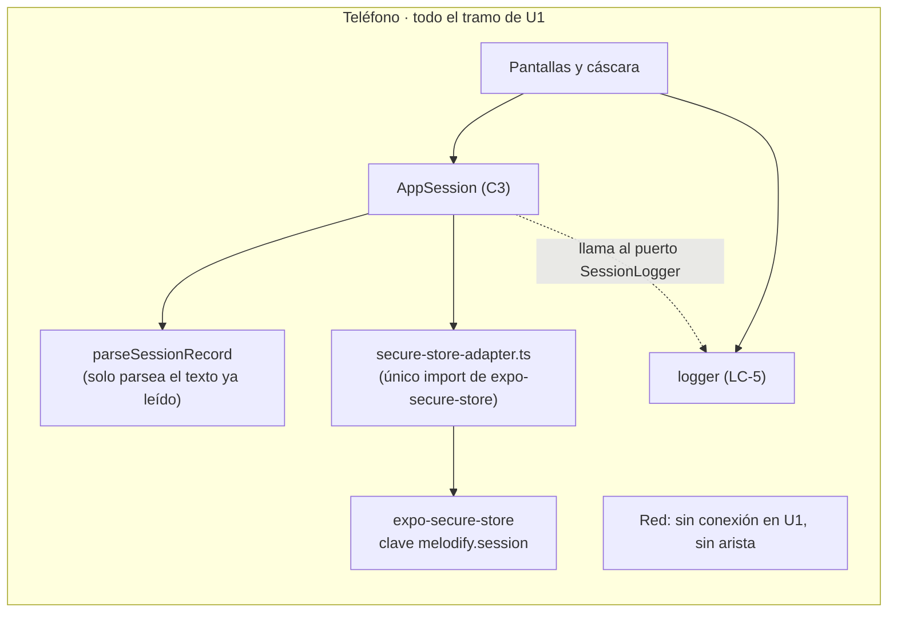

# Diseño de seguridad, privacidad y diagnóstico — U1 `u1-app-skeleton`

> **Provenance**: deriva de `nfr-requirements/security-requirements.md` (NFR3.1–3.5, NFR4.1–4.3, NFR9.1–9.3), de `functional-design/functional-spec.md` (F1, F2, F3), de `inception/domain-design/decisions.md` (ADR-011), de `inception/contract-design/contract-summary.md` (C3, C5), de `aidlc/spaces/default/memory/project.md` (§Forbidden, §Mandated) y de las respuestas de `nfr-design-questions.md` (Q2 = A, Q3 = A).
> Fecha: 2026-11-11. Etapa: NFR Design · Unidad: `u1-app-skeleton` · Agente: aidlc-architect-agent · Profundidad: Standard.

## Fronteras de confianza de esta unidad



**Respaldo en texto**: la interfaz habla con `AppSession`. La sesión habla con el almacenamiento **solo a través de su adaptador** (`packages/app-session/src/secure-store-adapter.ts`), que es el único archivo que importa `expo-secure-store`. El texto que el adaptador devuelve pasa por `parseSessionRecord`, que únicamente lo parsea: la guarda no lee ni escribe nada. La sesión **no importa** el logger: recibe un puerto `SessionLogger` y la app le pasa el logger del proyecto, que es la flecha punteada. El logger es la única salida hacia fuera del código y no tiene red. **El nodo de red está aislado a propósito**: no hay flecha hacia él porque U1 no abre ninguna conexión.

Hay exactamente **un** punto donde entra dato no confiable: lo que devuelve el almacenamiento seguro. Todo lo demás que entra en esta unidad lo escribe la propia app o lo teclea la persona en un formulario de dos campos.

## NFR3.3 / NFR3.5 — El registro de la sesión

### Forma y clave

| Aspecto | Decisión |
|---|---|
| Clave | `melodify.session`. Constante exportada por `@melodify/app-session` en su propio `storage-keys.ts`. |
| Por qué esa clave | El paquete que escribe el registro es el único que conoce su nombre. U4 declarará `melodify.spotify.token` en su propio paquete; ninguna unidad importa la clave de otra. Una clave con prefijo común hace legible el contenido del almacenamiento y deja ver de un vistazo que son dos cosas distintas (ADR-011). |
| Forma | JSON con dos campos: `authorId` (texto, siempre `demo`) y `startedAt` (texto ISO 8601 con zona). |
| Lo que **no** se guarda | La contraseña, el nombre tecleado en el campo, el número de intentos, la fecha de cada intento fallido, nada de Spotify. |
| Tamaño | Menos de 100 bytes. Muy por debajo del límite de valor del almacenamiento seguro. |
| `remembered` | No se guarda: se deriva de que exista un registro válido. Dos fuentes para el mismo hecho acaban discrepando. |

### La guarda

Una sola función, sin dependencias, con el fallo como valor:

```text
// Ilustrativo, no implementación.
export function parseSessionRecord(raw: string | null): SessionRecord | null {
  if (!raw) return null;
  let value: unknown;
  try { value = JSON.parse(raw); } catch { return null; }
  if (!isObject(value)) return null;
  if (value.authorId !== "demo") return null;
  if (!isIsoTimestamp(value.startedAt)) return null;
  return { authorId: "demo", startedAt: value.startedAt };
}
```

Cuatro decisiones dentro de esas ocho líneas:

- **Devuelve `null`, no lanza.** Quien llama no tiene que distinguir «no hay sesión» de «hay una sesión rota»: las dos significan lo mismo para el arranque (F1 paso 4) y ninguna merece una pantalla propia.
- **Construye un objeto nuevo.** No se devuelve `value` con un `as SessionRecord`: si el JSON trae campos extra, no se propagan al resto de la app.
- **`authorId` se compara con la constante, no con `Boolean`.** Un registro con `authorId: "ana"` de una versión anterior es inválido, no una sesión de otra persona.
- **La fecha se valida como ISO con zona, no con `Date.parse` suelto.** `Date.parse("demo")` no falla, y aceptar cualquier cosa que devuelva un número convertiría la validación en un trámite.

### Las tres puertas del almacenamiento

| Operación | Cuándo | Qué hace | Qué pasa si falla |
|---|---|---|---|
| **Leer** | Al arrancar (F1 paso 2) | `getSession()` lee la clave, pasa el valor por la guarda y responde `signedIn` o `signedOut`. Si la guarda devuelve `null` y había un valor, intenta borrarlo. | Responde `503`; la interfaz lo trata como `signedOut` y abre Login sin aviso (enmienda a C3). Registra `SESSION_READ_FAILED`. |
| **Escribir** | Al entrar con credenciales correctas (F2 paso 5) | Comprueba credenciales, serializa el registro y escribe la clave. Solo responde `200` si la escritura terminó bien. | Responde `503` y **no** se entra: la app se queda en Login con «Reintentar» (BR1.2). Registra `SESSION_SAVE_FAILED`. |
| **Borrar** | Al cerrar sesión (F3 paso 2) y al detectar un valor inválido | Borra la clave y responde `204`. | La app vuelve a Login igualmente; registra `SESSION_DELETE_FAILED`. |

**La asimetría de los tres fallos es deliberada**: leer mal y borrar mal desembocan en Login, que es accionable; escribir mal **no** deja entrar, porque una app que entra sin haber guardado promete una sesión que el siguiente arranque no va a recordar (FR1.3, NFR1.2).

### El adaptador del almacenamiento vive en el paquete

**Dueño único: `@melodify/app-session`.** El adaptador real —el único archivo del repositorio que importa `expo-secure-store` para la sesión— es `packages/app-session/src/secure-store-adapter.ts`, y la dependencia se declara en `packages/app-session/package.json`. El arranque no lo construye ni lo pasa: llama a la fábrica del paquete y esta usa el adaptador real por defecto.

```text
// Ilustrativo, no implementación.
export interface SecureStorePort {
  getItemAsync(key: string): Promise<string | null>;
  setItemAsync(key: string, value: string): Promise<void>;
  deleteItemAsync(key: string): Promise<void>;
}

export const createAppSession = (options?: { store?: SecureStorePort; logger?: SessionLogger }) => {
  const store = options?.store ?? secureStoreAdapter;   // el real, solo aquí
  const logger = options?.logger ?? silentLogger;       // sin logger, sin ruido
  /* … */
};
```

Motivos:

- **Se puede probar sin almacenamiento.** Las pruebas pasan un doble en memoria y cubren los tres caminos —éxito, `503` de lectura y `503` de escritura— sin tocar el dispositivo. El adaptador real, además, tiene su propia prueba con `expo-secure-store` doblado por `jest.mock`, que comprueba que escribe, lee y borra la clave correcta y ninguna otra.
- **La superficie de seguridad queda en un archivo.** NFR3.2 se verifica con un solo adaptador y un solo doble, que es lo que `components.md` § SpotifyAuth ya previó para el token y aquí se extiende al registro de sesión.
- **El arranque queda más simple.** LC-4 solo conecta; no conoce el almacenamiento. U4 repetirá el patrón en su propio paquete con su propia clave, sin tocar esta unidad.

**Lo que impide una segunda ruta**: una regla `no-restricted-imports` de ESLint que prohíbe importar `expo-secure-store` en cualquier archivo que no sea ese adaptador (y, cuando llegue, el de `@melodify/spotify`), y que prohíbe a `packages/*` importar `app/`. Es la compuerta que el type-check no puede dar, porque `expo-secure-store` es una dependencia externa que cualquiera puede importar y compilar.

## NFR3.1 / NFR3.2 — Secretos y la ruta hacia el token

### Lo que existe y lo que no

| Elemento | En U1 | Regla |
|---|---|---|
| `EXPO_PUBLIC_SPOTIFY_CLIENT_ID` | Documentada **vacía** en `.env.example` | Es un identificador público por diseño de PKCE. La rellena U4 en su `.env` local. |
| Client secret de Spotify | **No existe** | PKCE no lo necesita; nunca se declara, ni siquiera en `.env.example`. Un `.env.example` que nombre la variable es una invitación a rellenarla. |
| `.env` y `.env.*` | Ignorados por git | `.env.example` es la única excepción declarada en `.gitignore`. |
| Token de Spotify | **No existe en U1** | Lo guarda U4 en `melodify.spotify.token`, con su adaptador. |

### Por qué U1 no puede dejar una puerta abierta

El riesgo real de esta unidad no es manejar mal el token —no lo tiene— sino dejar preparado un camino alternativo que U4 acabe usando. Tres decisiones lo cierran:

1. **`app/src/bootstrap/ports.ts` declara los tres puertos de Spotify sin implementación** (C5: `created_by: U1`, `filled_by: U4`). Sin implementación registrada no existe una función a la que llamar; el catálogo de ejemplo funciona solo.
2. **No se añade `AsyncStorage` ni ningún otro almacén.** Si existiera un segundo mecanismo, la tentación de guardar ahí el token «porque es más rápido» aparecería en U4 (ADR-011).
3. **La clave de la sesión no se reutiliza para nada más.** Una clave por dueño, y `melodify.session` no admite un tercer campo.

### Un cliente público no guarda secretos, ni siquiera «un momentito»

El paquete de JavaScript que Metro sirve es legible en el dispositivo. Cualquier valor que entre por `EXPO_PUBLIC_*` viaja en ese paquete y deja de ser secreto en el instante en que se escribe. Por eso la única variable pública de este proyecto es el client ID, y el día que alguien proponga una segunda hay que preguntar primero si de verdad es pública.

## NFR3.4 — Las credenciales en memoria

| Regla | Cómo se cumple |
|---|---|
| La contraseña no se persiste | `signIn` recibe `handle` y `password`, los compara y **no** los escribe en ningún sitio. El registro guardado no los contiene. |
| La contraseña no se registra | El logger recibe códigos y mensajes literales; ninguna llamada le pasa el objeto del formulario. Lo impide una regla, no la disciplina: el logger no acepta objetos (`logger.warn(code, message)`, no `logger.warn({...})`). |
| La contraseña no se muestra | El campo se declara `secureTextEntry`; el control de ojo, de 44×44, la alterna. |
| La comparación es una sola | Recortar espacios y comparar con `demo` es la única normalización. No hay «recuerda el último usuario» ni relleno automático que guarde lo tecleado. |
| El mensaje no revela cuál campo falló | «Usuario o contraseña incorrectos», siempre el mismo. Con una sola credencial válida y publicada en la propia pantalla, distinguir el campo no aportaría seguridad y sí ruido. |

**Lo que se descarta a propósito**: límite de intentos, bloqueo temporal y retardo progresivo. No protegen de nada cuando la credencial está escrita en la pantalla («Demo: usuario y contraseña: demo»), y sí convierten una prueba manual en una espera. Queda anotado aquí para que no se lea como un olvido.

## NFR9.1 / NFR9.2 — El logger

### Interfaz y comportamiento

```text
// Ilustrativo, no implementación. Vive en app/src/bootstrap/logger.ts.
import type { SessionLogger } from "@melodify/app-session";

export const logger: SessionLogger = {
  warn(code, message) {
    if (__DEV__) console.warn(`[melodify] ${code}: ${message}`);
  },
  error(code, message) {
    console.error(`[melodify] ${code}: ${message}`);
  },
};
```

- **`__DEV__` (Q3 = A)**: verdadero en desarrollo, falso en release. Los avisos desaparecen en el binario; los errores se quedan.
- **Firma cerrada a dos cadenas.** No hay sobrecarga que acepte un objeto: así es imposible «pasar el registro por si acaso» y arrastrar la contraseña o el token a un mensaje.
- **`code` es una unión de literales, y la unión no se declara aquí.** Viene del puerto `SessionLogger` de `@melodify/app-session` (siguiente apartado): el logger solo la implementa. Un código nuevo obliga a tocar el tipo donde nace el evento, y por tanto a pensarlo en el paquete que lo emite. Es también lo que hace que el mensaje sea estable y buscable.
- **El prefijo `[melodify]`** distingue los mensajes propios de los de Metro y de React Native en la consola compartida.

**Qué sobrevive en release, dicho sin ambigüedad**: `warn` está condicionado por `__DEV__`, así que en un binario de release **desaparecen** `SESSION_READ_FAILED`, `SESSION_RECORD_INVALID` y el aviso de `SESSION_DELETE_FAILED`. NFR9.1 lo fija así («en release solo registra errores; los avisos se descartan»), y por tanto NFR9.2 es para esos tres eventos una **garantía de desarrollo**, no una promesa sobre el binario. En release el único rastro que queda es `error`: los dos fallos del sistema —no se pudo guardar y no se pudo borrar—. No es una pérdida silenciosa de diagnóstico: en los tres casos la app degrada igual de bien sin el aviso (a Login, que es accionable), y esta versión no produce binarios de release (solo Expo Go, `team.md` § Deployment), así que el binario que se demuestra es el de desarrollo y ahí sí se registran.

### Quién declara los códigos y quién los emite

El logger vive en `app/src/bootstrap/logger.ts` y **no lo importa ningún paquete**. La dirección de la dependencia va al revés:

```text
// Ilustrativo, no implementación. Vive en @melodify/app-session.
export type SessionLogCode =
  | "SESSION_READ_FAILED" | "SESSION_RECORD_INVALID"
  | "SESSION_SAVE_FAILED" | "SESSION_DELETE_FAILED";

export interface SessionLogger {
  warn(code: SessionLogCode, message: string): void;
  error(code: SessionLogCode, message: string): void;
}
```

- **`@melodify/app-session` declara la unión y el puerto**, porque es quien sabe cuándo ocurre cada cosa: es el único que lee el valor crudo y por tanto el único que puede distinguir «no había registro» de «había uno inválido».
- **`logger.ts` implementa el puerto**: importa el tipo del paquete (la app sí puede importar paquetes) y añade `__DEV__`. Es la app quien se lo pasa a la sesión al construirla.
- **El vocabulario crece por unidad, no por paquete ajeno.** La regla que evita que U2 tenga que añadir códigos a un paquete de sesión: **cada paquete que registra declara su propio puerto de códigos con esta misma forma** (`warn`/`error` sobre su propia unión), y LC-5 —el logger del proyecto— implementa cada uno de esos puertos y los recibe por inyección. U2 declarará `CatalogLogCode` en su paquete y la app le pasará el mismo logger; U4 hará lo mismo con el suyo. Nadie importa el logger del proyecto, y el logger sigue siendo el único sitio del repositorio que llama a `console` (NFR9.1).
- **C3 no cambia en su comportamiento.** La distinción entre vacío e inválido no cruza el contrato: `getSession` sigue respondiendo `signedOut` en los dos casos, porque a la interfaz le da igual. Lo que se registra es información interna de la sesión, no una vista pública nueva. **Su superficie sí crece de forma aditiva**: `SessionLogger`, `SessionLogCode` y las opciones de `createAppSession({ store?, logger? })` son exportaciones nuevas del paquete, y quedan registradas en `contract-summary.md` § C3, «Revisión 10», con la versión de C3 a `1.1.0` (cambio aditivo → versión menor, § Reglas de propiedad y versionado). Ninguna operación ni respuesta existente cambia, así que U2, U3 y U5 no se enteran.
- **Sin logger inyectado, la sesión no falla**: usa un logger silencioso. Así las pruebas de la sesión no tienen que construir uno, y una unidad futura que la instancie sin logger no rompe.

### Catálogo de eventos de esta unidad

| Código | Nivel | Cuándo | Qué lleva el mensaje |
|---|---|---|---|
| `SESSION_READ_FAILED` | `warn` | `getSession` responde `503` | «no se pudo leer la sesión recordada» |
| `SESSION_RECORD_INVALID` | `warn` | La guarda devuelve `null` habiendo un valor | «se descartó un registro de sesión inválido» |
| `SESSION_DELETE_FAILED` | `error` / `warn` | El borrado falla | «no se pudo borrar el recuerdo de sesión» |
| `SESSION_SAVE_FAILED` | `error` | `signIn` responde `503` | «no se pudo guardar la sesión» |

**Ningún evento lleva datos**: ni el valor leído, ni el `authorId` leído, ni el contenido del registro. Un registro corrupto puede contener lo que sea —incluso algo que alguien metió a mano— y volcarlo a la consola sería filtrar exactamente lo que la guarda acaba de rechazar.

### La regla de no duplicar

Si la persona ve el aviso en pantalla, el logger no repite el aviso; si no lo ve, el logger lo registra (NFR9.2). El único caso con las dos cosas es el fallo de guardado, que se pinta **y** se registra como `error`, porque es un fallo del sistema además de un mensaje comprensible para la persona. **En release la regla se cumple con lo que sobrevive**: los tres avisos `warn` se descartan (NFR9.1) y NFR9.2 sigue cumpliéndose para los dos fallos del sistema, que son los que se registran como `error`; la cobertura de los tres avisos es, por tanto, la del binario de desarrollo, que es el que esta versión produce y demuestra.

### La puerta que lo mantiene así

`no-console` en `error` en `eslint.config.js`, con un bloque de excepción declarado solo para `app/src/bootstrap/logger.ts`. Sin ese bloque, el propio logger se marcaría a sí mismo; sin la regla, el logger sería una sugerencia. La configuración la entrega U1 junto con el módulo.

### NFR9.3 — Sin panel, sin telemetría, sin alertas

No hay panel de control, ni trazas distribuidas, ni servicio externo de errores, ni alertas que enviar a nadie: no hay servicio que observar, porque la app corre en el teléfono de quien la usa y no tiene servidor. La única superficie de diagnóstico es el logger local y lo que la app muestra en pantalla.

- **No se define ningún SLI, SLO ni umbral de alerta.** Un objetivo de disponibilidad sobre un proceso que dura lo que dura una sesión de teléfono no significa nada, y escribirlo daría una falsa sensación de cobertura.
- **Se descarta expresamente Sentry y cualquier equivalente**: añade dependencia, cuenta y envío de datos, y choca con NFR4 y con RC-04 (coste cero).
- **Si alguna vez hay servidor**, el diseño de observabilidad entra con él, en la etapa que lo introduzca. No se deja preparado un hueco vacío.

## NFR4 — Privacidad

| Dato | Dónde | Se envía | Se borra |
|---|---|---|---|
| `authorId` = `demo` | Almacenamiento seguro, `melodify.session` | No | Al cerrar sesión |
| `startedAt` | Almacenamiento seguro, `melodify.session` | No | Al cerrar sesión |
| Credenciales tecleadas | Memoria de la pantalla | No | Al salir de Login |
| Contenido de ejemplo | Memoria del proceso | No | Al recargar |
| Mensajes del logger | Consola del dispositivo | No | Con el proceso |

- **No hay red en esta unidad.** Ni una petición, ni una URL configurada, ni un cliente HTTP instalado. La app no tiene a quién enviar nada.
- **No hay identificador de dispositivo ni de instalación.** El logger no los recibe; el almacenamiento no los guarda.
- **No hay analítica ni telemetría**, y no se añade un servicio de errores externo (NFR9.3, RC-04).
- **El inventario de la tabla es el inventario completo.** Si una unidad posterior añade un dato persistido, lo declara en su propio diseño; esta tabla es la referencia de lo que U1 deja escrito.

### NFR4.3 — El registro de restricciones se reescribe antes de tener usuarios reales

El registro de restricciones del proyecto (**CR-03**) debe reescribirse antes de que existan usuarios reales. Esta versión **no se distribuye**: no hay tiendas, ni build de release, ni cuenta de desarrollador (RC-07), y la app se demuestra en un teléfono con Expo Go. Por tanto la condición no se cumple todavía y el trabajo queda anotado, no ejecutado: si el proyecto crece hasta publicarse, esa reescritura es requisito previo, junto con la decisión de publicación que `team.md` § Deployment deja fuera de esta versión. No es un olvido de esta unidad ni algo que una prueba pueda cerrar; es una obligación con fecha atada a la primera distribución real.

## Cómo se demuestra cada requisito

| Requisito | Prueba con la que se demuestra |
|---|---|
| NFR3.1 | Revisión del árbol: `.env` no versionado, `.env.example` sin valor, ninguna cadena con forma de secreto. El CI corre sin `.env`. |
| NFR3.2 | Inspección: `ports.ts` declara los puertos sin implementación y ningún módulo de U1 importa el paquete de Spotify. |
| NFR3.3 | Pruebas de `signIn`, `getSession` y `signOut` contra el doble del almacenamiento: se guarda la clave propia, se borra al cerrar sesión, y ninguna otra clave se toca. |
| NFR3.4 | Prueba de `signIn` con credenciales incorrectas: responde `401`, no escribe en el almacenamiento y el mensaje es exactamente «Usuario o contraseña incorrectos». |
| NFR3.5 | Pruebas de la guarda con seis entradas: `null`, cadena vacía, JSON roto, objeto sin `authorId`, `authorId` distinto de `demo`, fecha ilegible. Todas devuelven `null`; un registro válido devuelve el objeto y descarta campos extra. |
| NFR4.1 | **Revisión de dependencias y de `package.json`**: no hay cliente HTTP instalado, ninguna URL configurada y ninguna llamada de red en el tramo. Una prueba no puede demostrar la ausencia de red, y la revisión sí. |
| NFR4.2 | Prueba del adaptador con `expo-secure-store` doblado: escribe y borra solo la clave `melodify.session` y no toca ninguna otra. |
| NFR9.1 | Prueba del logger con `__DEV__` verdadero y falso: en desarrollo registra aviso y error; en release solo el error. |
| NFR9.2 | Cuatro pruebas, una por evento del catálogo, todas con `__DEV__` verdadero: (a) `getSession` con `503` registra `SESSION_READ_FAILED` y la interfaz abre Login sin mensaje visible; (b) un registro inválido registra `SESSION_RECORD_INVALID` y abre Login; (c) `signIn` con `503` registra `SESSION_SAVE_FAILED` **y** pinta «Reintentar»; (d) un borrado fallido al cerrar sesión registra `SESSION_DELETE_FAILED` con `error` (y con `warn` cuando el borrado es el del valor inválido del arranque) y la app vuelve a Login. Las cuatro comparten el mismo doble del almacenamiento y el mismo logger espía: es una tabla de casos, no cuatro mecanismos. |
| NFR9.3 | Revisión de dependencias: no hay cliente HTTP, ni SDK de analítica, ni servicio de errores. |

## Riesgos asumidos y su porqué

| Riesgo | Por qué se acepta |
|---|---|
| Cualquiera con el teléfono desbloqueado puede leer el registro de sesión si encuentra la forma de inspeccionar el almacenamiento seguro. | El registro no es una credencial: `authorId` es `demo` y `startedAt` una fecha. No hay nada que robar que no esté ya escrito en la pantalla de Login. |
| Un borrado fallido puede dejar la sesión recordada. | Es local, sin red, y el arranque siguiente trata lo que no sea válido como «sin sesión» (F3 caso límite). La alternativa —bloquear el cierre de sesión hasta que el borrado funcione— sería peor para la persona. |
| El logger en release registra mensajes que quedan en el logcat del dispositivo. | No llevan datos personales ni credenciales (firma cerrada a literales), y es la única forma de diagnosticar un fallo que no se muestra. |
| No hay límite de intentos en Login. | La credencial está publicada en la pantalla; un límite solo molesta a quien prueba la app. |

## Assumptions & Open Questions

- `[assumption]` `expo-secure-store` cifra el valor en reposo en Android y lo conserva entre reinicios; es lo que ADR-011 asume y lo que NFR3.3 necesita. No se añade cifrado propio por encima.
- `[assumption]` El adaptador real del almacenamiento vive en `@melodify/app-session` y la dependencia de `expo-secure-store` se declara en `packages/app-session/package.json`; las pruebas del paquete nunca tocan el módulo nativo, y la prueba del adaptador lo dobla con `jest.mock`.
- `[assumption]` `__DEV__` está disponible sin importación en el entorno de pruebas de Jest con `jest-expo`, y se puede forzar por prueba.
- **Open question para U4**: el nombre definitivo de la clave del token y el alcance de `@melodify/spotify` como único dueño de esa clave se confirman allí. Aquí solo se garantiza que U1 no abre otra ruta.
- **Open question para U6**: si el recorrido final añade una comprobación de secretos en el árbol, se formaliza en esa unidad.

## Sources

- `security-requirements` — `construction/u1-app-skeleton/nfr-requirements/security-requirements.md` (NFR3.1–3.5, NFR4.1–4.3, NFR9.1–9.3).
- `performance-requirements` — `construction/u1-app-skeleton/nfr-requirements/performance-requirements.md` (NFR1.2, NFR2.3).
- `tech-stack-decisions` — `construction/u1-app-skeleton/nfr-requirements/tech-stack-decisions.md` (TS-06, TS-11, TS-12).
- `functional-spec` — `construction/u1-app-skeleton/functional-design/functional-spec.md` (F1, F2, F3).
- `rules` — `construction/u1-app-skeleton/functional-design/rules.md` (BR1.1, BR1.2, BR1.3, BR1.4).
- `contract-summary` — `inception/contract-design/contract-summary.md` (C3 y sus § Revisión 9 y § Revisión 10, C5).
- `decisions` — `inception/domain-design/decisions.md` (ADR-011).
- `project.md` — `aidlc/spaces/default/memory/project.md` (§Forbidden, §Mandated).
- `nfr-design-questions` — `construction/u1-app-skeleton/nfr-design/nfr-design-questions.md` (Q2 = A, Q3 = A, confirmadas).
