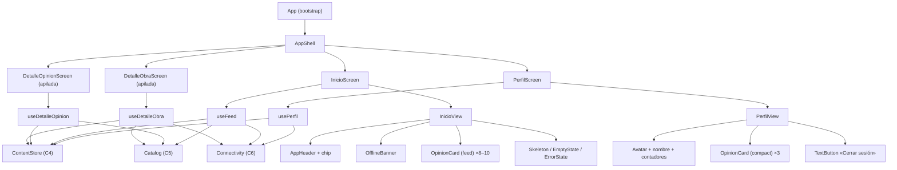

# Componentes de interfaz — U2 `u2-content-core`

> **Provenance**: deriva de `inception/contract-design/contract-summary.md` (C1 1.2.0, C2, C3, C4, C5, C6), `inception/domain-design/components.md` (ContentStore, Catalog, Connectivity, AppShell), `inception/refined-mockups/mockups.md` (Inicio, Perfil, detalle de obra, navegación, matriz de estados), `inception/refined-mockups/design-system-mapping.md`, `inception/refined-mockups/interaction-spec.md` y las respuestas de `functional-design-questions.md` (Q1 = A, Q2 = A, Q3 = A).
> Fecha: 2026-11-12. Etapa: Functional Design · Unidad: `u2-content-core`.

Este documento fija la forma de la interfaz de U2: qué piezas existen, quién posee el estado, cómo se separan contenedor y vista, y qué se mapea a los modelos de C1. Es diseño, no código: las props se nombran como las fija el contrato y ninguna implementación se escribe aquí.

## Jerarquía

**Respaldo en texto**: `App` construye una sola instancia de `ContentStore`, `Catalog` y `Connectivity` y las entrega a las pantallas; `AppShell` decide qué pantalla raíz se ve y apila los dos detalles dentro de la pestaña activa. Cada pantalla se parte en un **contenedor** (hook que se suscribe a C4, C5 y C6) y una **vista** pura que recibe datos y callbacks. Las vistas solo usan piezas de C1; ninguna reimplementa la tarjeta de opinión.

## Paquetes y responsabilidad

| Paquete | Dueño | Qué aporta a la interfaz de U2 |
|---|---|---|
| `@melodify/design-system` (C1) | U1, publicado por U2 a la 1.2.0 | `ErrorState` y `TextButton`, más las enmiendas aditivas de `AppHeader`, `EmptyState` y `OpinionCard`. |
| `@melodify/app-shell` (C2) | U1, publicado por U2 a la 1.2.0 | La cáscara, el apilado de detalles que conserva la raíz montada y la cabecera de detalle con «‹ Volver». |
| `@melodify/app-session` (C3) | U1 | El `viewerId` y el «Cerrar sesión» por la instancia única. |
| `@melodify/content-store` (C4) | U2 | Opiniones, autores, me gusta, comentarios, seguimientos y siembra, en memoria. |
| `@melodify/catalog` (C5) | U2 | Obras de ejemplo, resolución por identificador, decisión de portada, recuento y aviso de portadas (`subscribe`, `getCoverFailure`, `retryCovers`). |
| `@melodify/connectivity` (C6) | U2 | Estado de red real con `expo-network`. |
| `@melodify/app` | U2 en sus carpetas | El punto de composición de las tres instancias, las cuatro pantallas y los mapeos. |

## `@melodify/design-system` — lo que añade la 1.2.0

| Pieza | Props / cambio | Estados que cubre U2 |
|---|---|---|
| `ErrorState` | `message`, `retryLabel`, `onRetry` | Error de contenido, de detalle y de Perfil; siempre con «Reintentar». |
| `TextButton` | `label`, `onPress`, `tone?: "default" \| "danger"`, `disabled?` | «Cerrar sesión» en Perfil (tono de error) y «‹ Volver» en la cabecera de la cáscara. |
| `AppHeader` | **enmienda**: `leftSlot?: ReactNode` | La cabecera de detalle pone «‹ Volver» a la izquierda del título. |
| `EmptyState` | **enmienda**: `body?` opcional | Vacío de Perfil con una sola frase y su acción. |
| `OpinionCard` | **enmienda**: estado `own` en `detail` con `isOwn` —fondo `color.primaryContainer`, etiqueta «Tu opinión» dentro de la tarjeta, «Editar» (pintado con `isOwn`, no con `onEdit`; sin efecto hasta que U3 pase la acción) y línea de fechas en lugar del tiempo relativo—; exporta `formatCalendarDate` | Opinión propia en el detalle de obra y en el de opinión; es lo que hace observable «destacada» (AC4.2.1). |

El resto de piezas que U2 usa ya existen en la 1.1.0: `AppHeader`, `Banner`, `Skeleton`, `EmptyState`, `Avatar`, `CoverArt`, `RatingStars`, `SocialActionBar`, `OpinionCard`, `BottomTabBar`.

**Regla de uso**: la tarjeta de opinión es la única pieza que pinta una opinión. Las pantallas solo la configuran con `variant`, `isOwn` y callbacks; no dibujan autor, estrellas, texto ni contadores por su cuenta.

## `@melodify/content-store` (C4)

**Sin React dentro del paquete.** C4 publica una fábrica (`createContentStore`) con suscripción y lecturas; un hook dentro del paquete ataría el almacén a React y las pruebas tendrían que montar componentes para comprobar un reducer. Esto **se aparta de ADR-010**, que eligió «Context y `useReducer`» para el estado de la app: lo que ADR-010 sigue gobernando es el estado propio de la interfaz (sesión de la app, navegación), que la cáscara ya resuelve; el contenido es una fuente externa que varias pantallas leen a la vez y que C4 congeló como objeto con suscripción. La parte que ADR-010 sí conserva aquí es la de fondo: un reductor puro, acciones explícitas, sin librería de estado, y el reductor probado directamente sin montar interfaz.

### Estructura

| Archivo | Responsabilidad |
|---|---|
| `src/store.ts` | `createContentStore({ now?, seed? })`: estado con un reductor propio sobre estado inmutable (**sin React**), operaciones de C4 y emisión. |
| `src/seed.ts` | La siembra de § Semilla de `functional-spec.md`, con edades relativas a `now`. |
| `src/views.ts` | Los tipos `OpinionView`, `AuthorView`, `AuthorDetailView`, `CommentView`, `LikeView` y los resultados con código. |
| `src/index.ts` | Superficie pública: `createContentStore` y los tipos. |

### Forma del estado

| Campo | Contenido |
|---|---|
| `authors` | `demo`, `lucia`, `ana`, `bruno`, `marcos` con nombre y handle. |
| `opinions` | Las 10 opiniones de la siembra (o la semilla que llegue). |
| `likes` | Pares `(opinionId, authorId)` con fecha. |
| `comments` | Comentarios con `opinionId`, autor, texto y fecha. |
| `follows` | Pares `(followerId, authorId)` con fecha. |
| `revision` | Entero que sube en cada escritura y viaja en cada emisión. |

Nada de esto se persiste: al cerrar la app se pierde y el arranque vuelve a sembrar (BR4.1). El estado no guarda `isOwn`, `likedByMe` ni `followedByMe`: se calculan en cada lectura contra `viewerId` (BR4.6).

### Contrato de construcción

- `createContentStore()` siembra la tabla completa.
- `createContentStore({ now })` fija el reloj de la siembra (pruebas deterministas de «hace 2 h» y de «Editada el …»).
- `createContentStore({ seed })` sustituye la siembra por una mínima: lista vacía (estados vacíos), una sola opinión (detalle de opinión), varias obras (variantes del detalle de obra).
- `subscribeContent(viewerId)` emite de inmediato y devuelve la baja (BR4.7).

## `@melodify/catalog` (C5)

| Archivo | Responsabilidad |
|---|---|
| `src/catalog.ts` | `createCatalog({ content, connectivity, session, search, resolve })` con las operaciones de C5, la caché de búsqueda y la decisión de portada. |
| `src/ports.ts` | Los tipos `SpotifySessionPort`, `SpotifySearchPort`, `SpotifyResolvePort` y sus resultados (los importa el punto de composición con `import type`). |
| `src/sample.ts` | Las 8 obras del catálogo de ejemplo. |
| `src/index.ts` | Superficie pública y tipos. |

**Decisión de portada**: `coverFor(workId)` devuelve `url` solo si `session?.isConnected()` es verdadero, `connectivity` informa conexión y la obra tiene `coverUrl`; en cualquier otro caso `initialBlock` (BR5.3). La decisión no se guarda por obra: se recalcula, y `subscribe` avisa cuando cambia una portada o el resultado de metadatos. Los tres puertos conservan `null` hasta U4; la firma con dos entradas nuevas (`content`, `connectivity`) es la enmienda de C5 a `1.1.0` de la revisión 12.

**Sin puertos** (U2): `searchWorks` responde `{ status: "offline", works: [] }` sin tocar la red (BR5.5); `retryCovers` no hace nada; `getCoverFailure` es falso salvo que un doble lo fuerce.

## `@melodify/connectivity` (C6)

| Archivo | Responsabilidad |
|---|---|
| `src/connectivity.ts` | `createConnectivity({ network })`: estado, lectura inicial y suscripción. |
| `src/expo-network-adapter.ts` | El único archivo que importa `expo-network`: `getNetworkStateAsync` y `addNetworkStateListener`. |
| `src/index.ts` | Superficie pública y el tipo `NetworkAdapter` para las pruebas. |

`expo-network` (57.0.3) entra como dependencia de la app y del paquete; corre en Expo Go y no exige compilación propia (CT-05, Q1 = A). El adaptador traduce `isConnected`/`isInternetReachable` a un solo booleano: hay conexión cuando `isConnected` es verdadero y `isInternetReachable` no es explícitamente falso. Si el módulo falta o falla, la instancia arranca en línea (BR6.3).

## `@melodify/app` — composición y pantallas

### `app/src/bootstrap/`

| Archivo | Cambio de U2 |
|---|---|
| `instances.ts` **(nuevo)** | Construye una sola vez `contentStore`, `connectivity` y `catalog` —`createCatalog({ content, connectivity, session, search, resolve })` con los tres puertos en `null`— y los exporta. Sigue el patrón de `session.ts`: una instancia, no una por pantalla. |
| `shell-services.ts` | Pasa a construir los servicios con `connectivity`: `network.online` y `network.subscribe` dejan de ser el valor fijo de U1 (BR6.4). Spotify y comentarios siguen con sus valores por defecto. |
| `ports.ts` | Los tipos de los tres puertos pasan a importarse de `@melodify/catalog` con `import type` (TS-21); en el archivo quedan el objeto con los tres en `null` y el tipo que los agrupa. |
| `App.tsx` | Registra Inicio completo, Perfil y las pantallas de detalle; sigue decidiendo Login/Inicio con `appSession`. |

### `app/src/state/`

| Archivo | Responsabilidad |
|---|---|
| `useViewerId.ts` | Lee el `authorId` de `appSession.getSession()` y lo refresca con `subscribeSession`; devuelve `null` mientras no llega. Lo usan las cuatro pantallas: los dos detalles también lo necesitan porque `listOpinions`, `getOpinion` y `subscribeContent` responden `422` sin `viewerId`. |
| `useContent.ts` | `useContent(viewerId)`; se suscribe a `contentStore.subscribeContent(viewerId)` y devuelve `{ status, opinions, revision, retry }`; `loading` hasta la primera emisión, `error` si la suscripción falla o el `viewerId` no llega. |
| `useNetwork.ts` | Se suscribe a `shellServices.network` y devuelve `online`. |
| `useCatalog.ts` | Se suscribe a `catalog.subscribe` y devuelve el catálogo y un contador que incrementa en cada emisión, para repintar portadas. |
| `opinionCardModel.ts` | `toOpinionCardModel({ opinion, cover })`: el único mapeo de `OpinionView` a `OpinionCardModel`; pone `coverUrl` solo si la decisión es `url` (BR7.10). |

### `app/src/components/`

| Archivo | Responsabilidad |
|---|---|
| `OfflineBanner.tsx` | Envoltorio de `Banner` con el texto único de sin conexión y su «Reintentar»; lo usan las cuatro pantallas (precisión de C2). |
| `WorkHeader.tsx` | Composición de `CoverArt` 96, título, artista, `RatingStars` con la media y «N opiniones». No es una pieza de C1: vive en la app porque solo la usan los dos detalles (los mockups la llaman `WorkHeader`). |

### `app/src/screens/inicio/` — Inicio

| Archivo | Responsabilidad |
|---|---|
| `InicioScreen.tsx` | Contenedor: `useViewerId`, `useContent`, `useNetwork`, `useCatalog`; cablea navegación, chip y reintentos. |
| `InicioView.tsx` | Vista pura: props `{ status, cards, online, metadataError, spotifyStatus, onOpenOpinion, onRetry, onRetryCovers, onCreate }`. |
| `InicioHeader.tsx` | `AppHeader` con el chip de Spotify («Conectado» / «Conectar»), sin acción en U2 (BR7.9). |
| `seed.ts` | **Se elimina**: la siembra pasa a `@melodify/content-store`. |

Estados de la vista: `loading` (3 `Skeleton` + «Para ti»), `ready` con tarjetas, `ready` vacío (`EmptyState` + «Crear opinión»), `error` (`ErrorState`). El banner de metadatos y el de sin conexión se pintan bajo la cabecera, en ese orden.

### `app/src/screens/detalle-obra/` — Detalle de obra

| Archivo | Responsabilidad |
|---|---|
| `DetalleObraScreen.tsx` | Contenedor con `workId`; `useViewerId`, `useDetalleObra(workId, viewerId)` y `useNetwork` para el aviso de sin conexión; `setHeader({ title: "Detalle de obra" })`; «‹ Volver» lo pone la cáscara. |
| `DetalleObraView.tsx` | Vista pura con las cuatro variantes (mía + ajenas, mía sola, ajenas sin mía, sin opiniones); recibe `online` para pintar el `OfflineBanner`. |
| `useDetalleObra.ts` | Lee la obra (`getWork`), sus opiniones (`listOpinions({ workId, viewerId })`), el recuento y la portada; devuelve `{ status, work, own, others, average, opinionCount, cover, retry }`. |

Reglas de composición: la tarjeta propia primero, en estado `own` —fondo `primaryContainer` y etiqueta «Tu opinión» dentro de la tarjeta, «Editar» y fechas—, sin encabezado de sección aparte; «Otras opiniones» después; el botón «Opinar sobre esta obra» solo sin opinión propia; «Nadie más ha opinado todavía.» cuando hay propia y no ajenas. La cabecera de obra usa `WorkHeader`.

### `app/src/screens/detalle-opinion/` — Detalle de opinión

| Archivo | Responsabilidad |
|---|---|
| `DetalleOpinionScreen.tsx` | Contenedor con `opinionId`; `useViewerId`, `useDetalleOpinion(opinionId, viewerId)` y `useNetwork` para el aviso de sin conexión; `setHeader({ title: "Detalle de opinión" })`. |
| `DetalleOpinionView.tsx` | Vista pura: `WorkHeader`, la tarjeta `detail` de la opinión, estados de carga y error, y el `OfflineBanner` cuando `online` es falso. |
| `useDetalleOpinion.ts` | Lee la opinión (`getOpinion({ opinionId, viewerId })`), resuelve su obra y su recuento con `countOpinions` y la media de las opiniones de esa obra; devuelve `{ status, opinion, work, average, opinionCount, cover, retry }`. |

Si la obra no está en el catálogo, la cabecera usa `workTitle` y `workArtist` de la opinión (BR5.2). Si la opinión es propia, la tarjeta pinta «Editar» y las fechas; el cableado de «Editar» es de U3.

### `app/src/screens/perfil/` — Perfil

| Archivo | Responsabilidad |
|---|---|
| `PerfilScreen.tsx` | Contenedor: `useViewerId`, `usePerfil(viewerId)`, `useNetwork`; «Cerrar sesión» llama a `appSession.signOut()` (R-01). |
| `PerfilView.tsx` | Vista pura: identidad, contadores, «Mis opiniones», estado vacío, error y esqueletos; recibe `online` para el `OfflineBanner`. |
| `usePerfil.ts` | Lee `getAuthor(viewerId)` y `listFollowing`, más las opiniones propias; devuelve `{ status, author, opinions, retry }`. |

Perfil **no** pinta la tarjeta de Spotify en U2 (BR9.9); el hueco lo llena U4 con `SpotifyCard`.

### Registro y navegación

| Pestaña | Pantalla raíz | Detalles registrados |
|---|---|---|
| Inicio | `InicioScreen` | `{ kind: "work", component: DetalleObraScreen }`, `{ kind: "opinion", component: DetalleOpinionScreen }` |
| Explorar | contenedor de U1 | — (U4 registrará `work`) |
| Crear | contenedor de U1 | — (U3) |
| Actividad | contenedor de U1 | — (U5) |
| Perfil | `PerfilScreen` | `{ kind: "opinion", component: DetalleOpinionScreen }` |

`openWorkDetail` y `openOpinionDetail` son de C2 y no cambian. Tocar una tarjeta de Inicio o de Perfil llama a `openOpinionDetail`; el detalle de obra solo se abre desde una prueba o desde Explorar en U4 (Q3 = A).

**Reparto del detalle de opinión**: esta unidad **entrega y registra** `DetalleOpinionScreen`, porque US2.3 (AC2.3.1–AC2.3.3) es suya y Perfil lo necesita para AC9.1.4. `unit-of-work.md` § U2 no lo lista y C2 dice que U3 aporta el detalle de opinión; la divergencia se registra en `functional-spec.md` § Assumptions y se eleva a la persona. **U3 no lo rehace**: solo cablea `openEdit({ opinionId })` desde la tarjeta.

**Pila de la pestaña**: la cáscara de C2 1.2.0 monta todas las entradas de la pila y oculta las de debajo, así que al abrir un detalle la raíz sigue viva y al volver conserva su desplazamiento (AC2.3.2). El cambio se hace en `packages/app-shell/src/AppShell.tsx` —el panel pinta la pila entera en lugar de su última entrada— y se prueba comprobando que la raíz sigue montada y que su estado sobrevive al abrir y cerrar el detalle. Que el desplazamiento concreto se conserve no lo observa Jest: es el paso manual del teléfono que fija `functional-spec.md` § Recorrido en el teléfono.

## Flujos de interacción de la interfaz

| Acción | Qué hace la vista | Qué hace el contenedor |
|---|---|---|
| Tocar una tarjeta de Inicio | Llama a `onOpenOpinion(opinionId)` | `openOpinionDetail({ opinionId })` |
| Tocar una tarjeta de Perfil | Llama a `onOpenOpinion(opinionId)` | `openOpinionDetail({ opinionId })` |
| «Crear opinión» en un vacío | Llama a `onCreate()` | `goToTab({ name: "crear" })` |
| «Reintentar» en un error | Llama a `onRetry()` | Vuelve a suscribirse y relee; pasa por `loading` |
| «Reintentar» en el banner de metadatos | Llama a `onRetryCovers()` | `catalog.retryCovers()` |
| Tocar el chip «Conectar» | Nada (U2) | Nada hasta U4 |
| Tocar «Opinar sobre esta obra» | Llama a `onCreateOpinion(workId)` | `openCreate({ workId })` |
| Tocar «Editar» de la propia | Nada en U2 | U3 cablea `openEdit({ opinionId })` |
| Tocar «Cerrar sesión» | Llama a `onSignOut()` | `appSession.signOut()` |
| «‹ Volver» / atrás | — | La cáscara desapila y limpia el título |

## Puntos de integración de la interfaz

| Punto | Quién lo consume | Qué deja U2 listo |
|---|---|---|
| `instances.ts` | U3, U4, U5 | Una sola instancia de contenido, catálogo y red, construida en el arranque. |
| `useContent` y `useViewerId` | U3, U5 | El patrón de suscripción y el `viewerId` ya resueltos; las pantallas de escritura solo añaden acciones. |
| `OfflineBanner` | U4, U5 | El aviso de sin conexión con su texto único, reutilizable bajo cualquier cabecera. |
| `WorkHeader` | U4 | La identidad de obra de los dos detalles, reutilizable en Explorar si hace falta. |
| Registro de detalles | U4 | Inicio ya registra `work`; U4 registra el mismo componente en Explorar y abre con `openWorkDetail`. |
| Detalle de opinión entregado | U3 | La pantalla ya existe y está registrada en Inicio y Perfil; U3 solo cablea `openEdit({ opinionId })` y no la rehace. |
| Pila que conserva la raíz | U3, U4, U5 | Cualquier pantalla que apile un detalle conserva su estado y su posición sin trabajo propio (C2 1.2.0). |
| «Opinar sobre esta obra» | U3 | `openCreate({ workId })` ya cableado; U3 lee `CreateEntry.preselectedWorkId`. |
| «Editar» de la propia | U3 | La acción se pinta; U3 la cablea a `openEdit({ opinionId })`. |
| Tarjeta de Spotify | U4 | Perfil deja el hueco sin tarjeta; U4 añade `SpotifyCard` y cablea el chip de Inicio. |

## Assumptions & Open Questions

- `[assumption]` Las vistas son puras: reciben datos y callbacks, no leen contextos de contenido ni construyen instancias. Eso permite probar los estados vacío, carga y error sin montar el almacén real.
- `[assumption]` `WorkHeader` no entra en C1 porque solo lo usan los dos detalles; si U4 lo necesita en Explorar, se decide entonces si sube al sistema de diseño.
- `[assumption]` El chip de Spotify se queda como en U1 («Conectar» sin efecto) hasta U4 (Q2 = A), y por eso `InicioHeader` no recibe acción de conexión.
- `[assumption]` El detalle de obra no tiene entrada visible en U2: el registro existe para que C2 tenga destino y para probar la pantalla (Q3 = A).
- `[assumption]` Las cuatro vistas reciben `online` y pintan el `OfflineBanner` bajo su propia cabecera; el dato sale de `shellServices.network` en el contenedor, no de un contexto propio, para que todas las pantallas lean la misma fuente (C6).
- `[assumption]` El cambio de la pila vive en `packages/app-shell` y se publica como C2 1.2.0 aunque el paquete lo creara U1: lo exige AC2.3.2, que es de esta unidad, y no cambia props ni exportaciones.
- **Open question para U3**: la etiqueta «Seguir autor» de los mockups frente al «Seguir» que pinta hoy `OpinionCard`.
