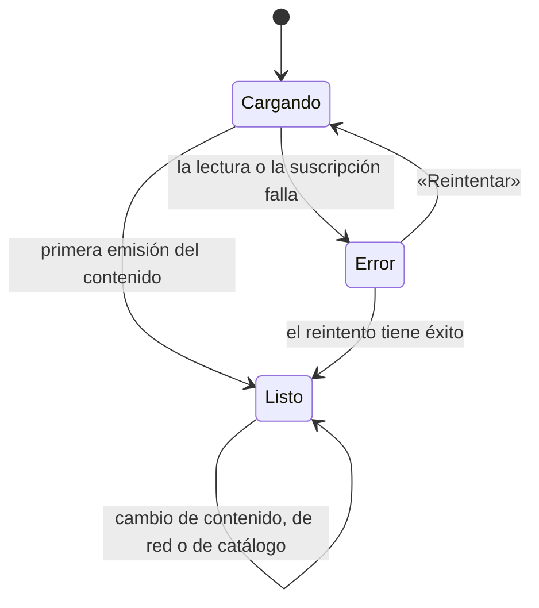

# Especificación funcional — U2 `u2-content-core`

> **Provenance**: deriva de `inception/units-generation/unit-of-work.md` (U2), `inception/units-generation/unit-of-work-story-map.md` (US2.1–US2.3, US4.1–US4.3, US9.1), `inception/user-stories/stories.md` (AC2.1.1–AC2.3.3, AC4.1.1–AC4.3.3, AC9.1.1–AC9.1.8), `inception/requirements-analysis/requirements.md` (FR3, FR6, FR9, FR11, FR2.3, NFR2), `inception/domain-design/components.md` (ContentStore, Catalog, Connectivity, AppShell), `inception/contract-design/contract-summary.md` (C1 1.2.0, C2, C4, C5, C6), `inception/refined-mockups/mockups.md` (Inicio, Perfil, detalle de obra, matriz de estados, navegación), `inception/refined-mockups/interaction-spec.md` y las respuestas de `functional-design-questions.md` (Q1 = A, Q2 = A, Q3 = A).
> Fecha: 2026-11-12. Etapa: Functional Design · Unidad: `u2-content-core` · Agente: aidlc-architect-agent · Profundidad: Standard.

## Alcance de esta especificación

U2 entrega el corazón del producto sin sesión de Spotify: `ContentStore` completo con el contenido de ejemplo, `Catalog` con el catálogo local y la decisión de portada, `Connectivity` con el estado real de red, y las pantallas **Inicio** (feed completo), **Detalle de obra**, **Detalle de opinión** y **Perfil**, con sus estados de carga, vacío y error.

Lo que **no** entra: escribir (publicar, editar, dar me gusta, comentar, seguir), Spotify (conexión, token, búsqueda, portadas reales), Explorar y Actividad. Las escrituras de `ContentStore` se **especifican** aquí —forman parte de C4 y U3 las usa— pero en esta unidad no tienen entrada de interfaz. Las tarjetas se pintan en modo lectura.

El detalle de obra se construye y se registra, pero **no tiene entrada visible** hasta que U4 lo abra desde Explorar (Q3 = A). Se verifica con pruebas de pantalla y de navegación.

## Vocabulario y actores

| Término | Significado en esta unidad |
|---|---|
| **Persona / quien mira** | Quien usa la app. En esta versión siempre la cuenta demo (`authorId` `demo`), pero el contenido no lo asume: cada lectura recibe `viewerId`. |
| **Contenido** | Opiniones, autores, me gusta, comentarios y seguimientos. Vive en memoria y se pierde al cerrar la app. |
| **Siembra** | El contenido de ejemplo que `ContentStore` crea al arrancar (tabla de § Semilla). |
| **Obra** | Una canción real identificada por su `workId` de Spotify, con título y artista guardados en local. |
| **Catálogo de ejemplo** | Las 8 obras que `Catalog` tiene siempre, con o sin sesión. |
| **Portada disponible** | La decisión de `Catalog`: URL real (sesión + red + `coverUrl`) o bloque con la inicial de la obra. |
| **Estado de pantalla** | `loading`, `ready` o `error`. El vacío es una variante de `ready`, no un estado aparte, porque la cabecera y la identidad siguen visibles. |

## Modelo de datos que U2 implementa

U2 no introduce entidades nuevas: implementa las de `components.md` § ContentStore y § Catalog. Lo que esta especificación fija es la **forma de las vistas** que cruzan C4 y la **forma del estado interno**, no una tabla nueva.

| Vista (C4) | Campos que usa U2 | Regla |
|---|---|---|
| `OpinionView` | `opinionId`, `workId`, `workTitle`, `workArtist`, `author`, `text`, `rating`, `createdAt`, `updatedAt`, `likeCount`, `commentCount`, `likedByMe`, `isOwn` | `author` es `AuthorView`; los derivados se calculan contra `viewerId` (BR4.6). No lleva `coverUrl`: la portada la decide `Catalog` (BR7.10). |
| `AuthorView` | `authorId`, `displayName`, `handle`, `followedByMe` | El `displayName` de la cuenta demo es «Usuario demo» y su `handle`, `demo`. |
| `AuthorDetailView` | los anteriores más `opinionCount`, `followingCount` | Alimenta los contadores de Perfil (BR4.8, BR9.2). |
| `CommentView`, `LikeView` | `commentId`/`opinionId`, `author`, `text`, `createdAt` | U2 los siembra y los lee; la hoja de comentarios es de U3, la Actividad de U5. |

**Estado interno de `ContentStore`** (no cruza el contrato, salvo por las vistas): `authors`, `works` (título y artista que viajan con cada opinión), `opinions`, `likes`, `comments`, `follows` y `revision`. Toda escritura produce un estado nuevo y sube `revision`. Se implementa con **un reductor propio sobre estado inmutable, sin React**: el paquete es una fuente externa a React que la app lee por suscripción (C4, TS-18/TS-19), no un hook ni un contexto. No se añade librería de estado.

## Semilla

El almacén se construye al arrancar y siembra el contenido de BR4.2. Las edades son desfases respecto al instante de construcción (`now`), de modo que «hace 2 h» siga siendo cierto en cada ejecución y las pruebas puedan fijar el reloj.

### Autores (5)

| `authorId` | `displayName` | `handle` | Papel |
|---|---|---|---|
| `demo` | Usuario demo | `demo` | La cuenta que usa la app; 3 opiniones y 2 seguidos. |
| `lucia` | Lucía Ferrer | `lucia` | Autora de ejemplo; seguida por `demo`. |
| `ana` | Ana Ríos | `ana` | Autora de ejemplo; seguida por `demo`. |
| `bruno` | Bruno Salas | `bruno` | Autor de ejemplo. |
| `marcos` | Marcos Vega | `marcos` | Autor de ejemplo. |

### Obras (8, catálogo de ejemplo)

| `workId` | Título | Artista |
|---|---|---|
| `4u7EnebtmKWzUH433Rbtpz` | Bohemian Rhapsody | Queen |
| `0VjIjW4GlUZAMYd2vXMi3b` | Blinding Lights | The Weeknd |
| `2Fxmhks0bxGSBdJ92vM42m` | bad guy | Billie Eilish |
| `7qiZfU4dY1lWllzX7mPBI3` | Shape of You | Ed Sheeran |
| `4OSBTYWVwsQhGLF9NHvIbR` | Rolling in the Deep | Adele |
| `5ghIJDpPoe3CfHMGu71E6T` | Smells Like Teen Spirit | Nirvana |
| `4LRPiXqCikLlN15c3yImP7` | As It Was | Harry Styles |
| `0yLdNVWF3Srea0uzk55zFn` | Flowers | Miley Cyrus |

La obra 7 (`As It Was`) **no tiene opiniones**: es la variante de obra vacía (BR8.5) con datos reales. `coverUrl` de la siembra es `null` en las ocho: en U2 no hay sesión de Spotify, así que todas las portadas son bloque con la inicial (BR5.3).

### Opiniones (10)

| `opinionId` | Autor | Obra | Valoración | Edad de creación | ¿Editada? | Texto |
|---|---|---|---|---|---|---|
| `op-001` | `demo` | 1 | 5 | 3 d | no | «Seis minutos que no se sienten como seis minutos. Cada vez que la pongo encuentro una capa nueva: el piano, las voces, ese silencio antes del final.» |
| `op-002` | `lucia` | 1 | 4 | 2 h | no | «La escuché por primera vez en un viaje largo y desde entonces es mi canción de carretera. La segunda mitad es otra canción y las dos funcionan.» |
| `op-003` | `ana` | 2 | 4 | 5 h | no | «Suena a noche de viernes. El sintetizador hace todo el trabajo y no me quejo: hay canciones que existen para eso.» |
| `op-004` | `demo` | 2 | 5 | 1 d | sí (4 h) | «Me costó entenderla hasta que la escuché con auriculares. La producción es una clase de cómo hacer mucho con poco.» |
| `op-005` | `bruno` | 3 | 3 | 1 d | no | «Me gusta la actitud más que la canción. El susurro funciona en el estribillo y se agota un poco antes del final.» |
| `op-006` | `marcos` | 4 | 2 | 2 d | no | «Pegadiza hasta el cansancio. La guitarra está bien, pero la letra no me dice nada nuevo.» |
| `op-007` | `lucia` | 5 | 5 | 3 d | no | «Una voz que llena la habitación. La escucho cuando necesito cantar a gritos en el coche y no me importa quién mire.» |
| `op-008` | `demo` | 6 | 4 | 4 d | no | «Ese riff no envejece. La producción suena a garaje y eso es exactamente lo que la hace funcionar.» |
| `op-009` | `ana` | 8 | 3 | 6 h | no | «La melodía se queda, aunque siento que ya la había escuchado. Igual la pongo cuando necesito energía rápida.» |
| `op-010` | `bruno` | 8 | 4 | 2 d | no | «Más directa que sus discos anteriores. La producción limpia y la letra corta; para bailar en la cocina.» |

Orden del feed por `createdAt` descendente (BR4.5): `op-002`, `op-003`, `op-009`, `op-004`, `op-005`, `op-006`, `op-010`, `op-001`, `op-007`, `op-008`.

### Seguimientos (2), me gusta (4) y comentarios recibidos (3)

| Tipo | Quién | Sobre | Edad |
|---|---|---|---|
| Seguimiento | `demo` → `lucia` | — | 5 d |
| Seguimiento | `demo` → `ana` | — | 4 d |
| Me gusta recibido | `lucia` | `op-001` | 2 d |
| Me gusta recibido | `ana` | `op-004` | 3 h |
| Me gusta de otro autor | `bruno` | `op-002` | 1 h |
| Me gusta de otro autor | `marcos` | `op-009` | 5 h |
| Comentario recibido | `ana` | `op-001`: «Totalmente de acuerdo.» | 1 d |
| Comentario recibido | `bruno` | `op-004`: «El puente es lo mejor.» | 2 h |
| Comentario recibido | `lucia` | `op-008`: «Ese riff no envejece.» | 3 d |

Los dos me gusta de `bruno` y `marcos` existen para que los contadores del feed no estén todos a cero; **no** son recibidos por `demo` y por tanto no generan actividad para ella (FR8.1: la Actividad cuenta solo lo que le pasó a la cuenta).

**Invariantes de la siembra**: 10 opiniones, 5 autores, 8 obras, 3 opiniones de `demo`, 2 seguidos, 4 me gusta en total —2 recibidos por `demo` y 2 de otros autores sobre opiniones ajenas— y 3 comentarios recibidos. Cualquier prueba que sustituya la siembra puede cambiar los números, pero la app arranca con estos.

## Máquina de estados de una pantalla

Las cuatro pantallas comparten la misma lectura: se suscriben al contenido (que emite de inmediato) y, en el detalle y en Perfil, además resuelven la obra y sus contadores. La carga dura el primer fotograma, mientras llega esa primera emisión; el vacío es una variante de `ready`.

**Respaldo en texto**:

| Estado | Cómo se llega | Qué ve la persona | Salidas |
|---|---|---|---|
| `loading` | La pantalla monta y aún no hay datos. | Esqueletos con la forma del contenido final; cabecera y encabezados fijos ya visibles. | A `ready` con la primera emisión; a `error` si la lectura falla. |
| `ready` | Llega la primera emisión. | El contenido, o su variante vacía si la lista no tiene elementos. | Sigue en `ready` al cambiar contenido, red o catálogo. |
| `error` | La lectura del contenido, del autor o de la obra falla. | `ErrorState` con el texto de la pantalla y «Reintentar». | A `loading` al tocar «Reintentar». |

**Invariante**: ninguna pantalla se queda en `loading` después de la primera emisión; ninguna pasa a `error` por falta de red (eso es el banner de BR10.5). El estado de red y el de Spotify se leen aparte y no cambian el estado de la pantalla.

## Flujo F7 — Cargar Inicio

1. La persona entra en la app con sesión de la app (U1, F2) y cae en Inicio.
2. La pantalla se suscribe a `ContentStore` con el `viewerId` de la sesión y a `shellServices.network`. Mientras no llega la primera emisión pinta la cabecera «Inicio» con el chip, el encabezado «Para ti» y **3 esqueletos** de tarjeta (BR7.2).
3. Llega la primera emisión: se pintan las 10 opiniones de la siembra bajo «Para ti», en variante `feed` (BR7.1). La pantalla mapea cada opinión con `toOpinionCardModel` y resuelve su portada con una llamada a `Catalog.coverFor(workId)` por opinión —no por tarjeta—; sin sesión de Spotify, todas son bloque con la inicial (BR7.10, F12 paso 1).
4. El chip de la cabecera muestra «Conectar» y no responde (BR7.9); el estado de Spotify de la cáscara es `disconnected`.
5. Si la lista llegara vacía, se pinta «Aún no hay opiniones. Sé el primero.» con «Crear opinión» (BR7.3).
6. Si la lectura falla, se pinta «No pudimos cargar las opiniones.» con «Reintentar» (BR7.4).
7. Si `Catalog` registra un fallo de metadatos, la lista se sigue viendo con bloques y aparece el banner «No pudimos actualizar las portadas.» con «Reintentar» (BR7.5).
8. Sin conexión, se conserva la lista, las portadas pasan a bloque y aparece el banner «Sin conexión. Estás viendo lo último que cargamos.» con «Reintentar» (BR7.6). Al volver la red, el banner desaparece y se reintenta la resolución.

**Casos límite**

| Caso | Comportamiento |
|---|---|
| La app vuelve del segundo plano | El almacén sigue en memoria, la suscripción sigue viva y el feed no se recarga desde cero. |
| Llega una emisión mientras la persona lee | La lista se actualiza conservando el desplazamiento. |
| La resolución de una portada falla sola | Esa tarjeta queda en bloque; el banner de metadatos no aparece por una portada suelta (BR5.3). |
| Se toca «Reintentar» del banner sin conexión | Se reintenta la resolución de portadas; el banner de red solo desaparece cuando Connectivity informa de conexión. |

## Flujo F8 — Abrir una opinión desde Inicio y volver

1. La persona toca una tarjeta de Inicio. La tarjeta tiene `onPress`; las acciones sociales no responden en U2 (BR7.8).
2. La app llama a `openOpinionDetail({ opinionId })` y la cáscara apila el detalle **dentro** de la pestaña Inicio (BR7.7, BR10.1). La barra inferior sigue visible y la pestaña activa no cambia.
3. El detalle se monta con esqueletos de cabecera y de texto (BR8.12), resuelve la obra con `getWork`, cuenta sus opiniones y lee la opinión con `getOpinion`.
4. Al llegar los datos, pinta la cabecera de la obra (portada, título, artista, media y recuento) y la opinión **completa**, sin recortar (BR8.10, BR8.11). Si es de `demo`, se pinta como propia: «Editar» y la línea de fechas (BR8.10).
5. La cáscara pone el título «Detalle de opinión» en su cabecera (BR8.11).
6. «‹ Volver» o el atrás del sistema desapilan el detalle y devuelven a Inicio en la misma posición del feed: la cáscara no desmonta la raíz al apilar, la oculta debajo del detalle (BR10.1, C2 1.2.0).
7. Si la obra no está en el catálogo, la cabecera usa el título y el artista de la opinión y el bloque con la inicial (BR5.2).

**Casos límite**

| Caso | Comportamiento |
|---|---|
| La opinión no existe (identificador inválido) | `getOpinion` responde `404`; la pantalla muestra «No pudimos cargar esta opinión.» con «Reintentar» (BR8.12). |
| La portada real falla | Bloque con la inicial en el hueco de 96×96; el resto se ve (BR8.7). |
| Se toca «Editar» | En U2 no hay formulario de edición: la acción se pinta porque la opinión es propia, pero su cableado a Crear llega en U3. La prueba de U2 comprueba que la acción existe y que la fecha de modificación se ve. |

## Flujo F9 — Abrir el detalle de una obra

1. En U2 **no hay entrada visible**: Explorar llega en U4 y es quien abre el detalle con `openWorkDetail({ workId })`. La pantalla se registra en Inicio para que la operación de C2 tenga destino y para probarla (Q3 = A).
2. Si se invoca (prueba de navegación o U4), la cáscara apila el detalle dentro de la pestaña activa y muestra la cabecera «Detalle de obra» con «‹ Volver» (BR8.9).
3. Carga: esqueletos de cabecera (96×96) y de dos opiniones (BR8.6).
4. Con datos, la pantalla pinta:
   - la identidad de la obra y el recuento de opiniones (BR8.1);
   - si hay opinión propia: la tarjeta propia primero, en estado `own` —fondo `color.primaryContainer`, etiqueta «Tu opinión» dentro de la tarjeta, «Editar» y fechas—, y debajo «Otras opiniones»; si no hay ajenas, «Nadie más ha opinado todavía.» (BR8.4);
   - si no hay opinión propia y hay ajenas: la lista de ajenas y el botón «Opinar sobre esta obra» (BR8.3);
   - si no hay ninguna: solo identidad, «Todavía nadie ha opinado sobre esta obra.» y el botón (BR8.5).
5. «Opinar sobre esta obra» abre Crear con la obra preseleccionada (BR8.3). El formulario es de U3.
6. Error de contenido: «No pudimos cargar esta obra.» con «Reintentar»; si la identidad ya estaba pintada, se conserva (BR8.8).
7. Sin conexión o sin Spotify, la identidad y las opiniones se siguen viendo; la portada es bloque (BR8.7, BR10.5).

**Variantes con la siembra real** (útiles para el recorrido y las pruebas):

| Obra | Variante | Qué se ve |
|---|---|---|
| `Bohemian Rhapsody` | mía + ajena | Tarjeta propia destacada (`own`, solo con fecha de creación: 5/5) y «Otras opiniones» con la de Lucía (4/5). |
| `Blinding Lights` | mía editada | Tarjeta propia `own` con **«Creada el …» y «Editada el …»**: es la única opinión de la siembra con fecha de modificación, y por tanto el punto de observación de AC4.2.4. |
| `bad guy` | ajena y ninguna mía | Opinión de Bruno y botón «Opinar sobre esta obra». |
| `Smells Like Teen Spirit` | mía y ninguna otra | Tarjeta propia `own` y «Nadie más ha opinado todavía.». |
| `As It Was` | sin opiniones | Identidad, «Todavía nadie ha opinado sobre esta obra.» y botón. |

La media de la obra es la media de sus valoraciones redondeada al entero más cercano (`.5` hacia arriba): `Bohemian Rhapsody` (5 y 4) muestra 5/5; el recuento va en singular cuando es 1 («1 opinión»).

## Flujo F10 — Ver Perfil y cerrar sesión

1. La persona abre Perfil. La pantalla se suscribe al contenido y lee el autor `demo` y sus seguimientos.
2. Carga: esqueletos de identidad (avatar y contadores) y de lista (BR9.6).
3. Con datos: avatar de 72 con la inicial «D», «Usuario demo», «@demo» y «3 opiniones · 2 siguiendo» (BR9.1, BR9.2). Debajo, «Mis opiniones» con las 3 opiniones propias en variante `compact`, de la más reciente a la más antigua (BR9.3).
4. Tocar una opinión abre su detalle dentro de Perfil, con el texto completo y «Editar» (BR9.4).
5. Si la persona no tuviera opiniones: «Todavía no has publicado opiniones.» con «Crear opinión» (BR9.5).
6. Si la lectura falla: «No pudimos cargar tu perfil.» con «Reintentar» (BR9.7).
7. «Cerrar sesión» llama a `appSession.signOut()`; la suscripción del arranque devuelve la app a Login con Inicio como pestaña activa. No se borra el contenido ni el estado de Spotify (BR9.8).
8. En U2 **no hay tarjeta de Spotify** en Perfil (BR9.9).

**Casos límite**

| Caso | Comportamiento |
|---|---|
| Se cierra sesión y se vuelve a entrar | El contenido sigue igual (la app no se reinició); la siembra no se repite. |
| La app se reinicia | El contenido se vuelve a sembrar y las fechas se recalculan respecto al nuevo arranque. |
| Sin conexión | La identidad, los contadores y las opiniones se siguen viendo; el banner aparece bajo la cabecera (BR10.5). |
| Un contador es 1 | «1 opinión» y «1 siguiendo», en singular. |

## Flujo F11 — Leer sin conexión

1. `Connectivity` informa `online: false` y cada pantalla suscrita lo recibe.
2. La pantalla **no** cambia de estado: conserva la lista, la identidad y los contadores ya cargados.
3. Las portadas pasan a bloque con la inicial (la decisión de `Catalog` es `initialBlock` porque no hay red).
4. Bajo la cabecera aparece el banner «Sin conexión. Estás viendo lo último que cargamos.» con «Reintentar», que empuja el contenido y no lo tapa.
5. Se puede seguir leyendo, abrir detalles y volver: todo el contenido es local.
6. Al volver la red, el banner desaparece y `Catalog` vuelve a intentar las portadas reales cuando haya sesión de Spotify (U4).
7. «Cerrar sesión» y el resto de acciones de lectura siguen disponibles.

**Por qué el banner no es un error**: `Connectivity` distingue «sin conexión» de «la petición falló» (C6). Sin red no hay petición que haya fallado y el contenido local está íntegro; pintar un error de servidor sería mentir sobre lo que pasó (BR10.5).

## Flujo F12 — Degradar portadas y metadatos

1. Cada pantalla mapea una opinión a `OpinionCardModel` pidiendo a `Catalog.coverFor(workId)`.
2. `Catalog` decide: `{ kind: "url", value }` solo si hay sesión de Spotify, hay conexión y la obra tiene `coverUrl`; en cualquier otro caso `{ kind: "initialBlock", value: null }` (BR5.3).
3. El mapeo pone `coverUrl: null` cuando la decisión es bloque, y la tarjeta pinta el bloque con la inicial. No hay hueco roto ni imagen a medio cargar (BR5.3, FR11.3).
4. Si `Catalog` intenta resolver metadatos y falla, registra el fallo; Inicio pinta el banner «No pudimos actualizar las portadas.» y mantiene la lista con bloques (BR7.5). El resto de pantallas siguen mostrando bloques sin banner propio: el aviso de metadatos es de Inicio, que es donde se ve el feed completo.
5. «Reintentar» del banner pide a `Catalog` que reintente la resolución; si termina bien, el aviso se retira y las portadas pasan a URL.
6. En U2 no hay sesión ni puerto de resolución, así que el paso 4 nunca se cumple en la app real: se prueba con un doble (ver Assumptions).

## Comportamiento de los tres componentes

### `ContentStore` (C4)

| Operación | Entrada | Respuesta | Regla |
|---|---|---|---|
| `createOpinion` | `authorId`, `workId`, `workTitle`, `workArtist`, `text`, `rating` | `201` con `OpinionView`, `409` si ya existe, `422` si el texto o la valoración no son válidos | BR4.3; la validación fina del formulario es de U3. |
| `getOpinion` | `opinionId`, `viewerId` | `200` con `OpinionView`, `404` | BR4.6. |
| `listOpinions` | `viewerId`, `workId?`, `authorId?` | `200` con `OpinionView[]` ordenada | BR4.5. |
| `updateOpinion` | `opinionId`, `authorId`, `viewerId`, texto y valoración | `200`, `403`, `404`, `422` | BR4.4. |
| `toggleLike` | `opinionId`, `authorId` | `200` con `{ opinionId, likeCount, likedByMe }` | U3 lo usa; la siembra ya trae los recibidos. |
| `listLikes` | `opinionId` | `200` con `{ opinionId, likeCount, likes }` | Alimenta la Actividad de U5. |
| `addComment`, `listComments` | `opinionId` (+ `authorId`, `text`) | `201`/`200`, `422` | U3 y U5. |
| `toggleFollow` | `authorId`, `followerId` | `200` con `{ authorId, followedByMe, followerCount, viewerFollowingCount }`, `409` contra uno mismo | U3. |
| `listFollowing` | `authorId`, `viewerId` | `200` con `{ authorId, followingCount, following }` | BR4.8. |
| `getAuthor` | `authorId`, `viewerId` | `200` con `AuthorDetailView`, `404` | BR4.8. |
| `subscribeContent` | `viewerId` | Emisión inmediata y tras cada escritura con `{ revision, opinions }`; devuelve la baja | BR4.7. |

**Construcción**: `createContentStore({ now?, seed? })` en `@melodify/content-store`. `now` permite fijar el reloj en las pruebas y `seed` sustituir la siembra por una mínima (lista vacía, una sola opinión, varias obras) para ejercitar los estados de las pantallas. Sin argumentos, siembra la tabla de § Semilla.

### `Catalog` (C5)

| Operación | Respuesta | Regla |
|---|---|---|
| `listSampleWorks` | `{ works: WorkView[] }` con las 8 obras, orden estable | BR5.1. |
| `getWork` | `WorkView` o `404` | BR5.2. |
| `countOpinions` | `{ workId, count }` desde `ContentStore` | BR5.4. |
| `coverFor` | `{ kind: "url" \| "initialBlock", value: string \| null }` | BR5.3. |
| `searchWorks` | `{ status: "offline", works: [] }` sin puerto; con puerto, `ok \| empty \| offline \| error` y caché en memoria | BR5.5. |
| `subscribe` | Avisa de cada cambio de catálogo (portada resuelta, fallo de metadatos) | Lo usan las pantallas para repintar sin volver a preguntar. |
| `getCoverFailure` | `boolean` con el último resultado de metadatos | BR7.5. |
| `retryCovers` | Vuelve a intentar las portadas pendientes; sin puerto, no hace nada | BR7.5. |

**Construcción**: `createCatalog({ content, connectivity, session, search, resolve })` en `@melodify/catalog`; `session`, `search` y `resolve` son los tres puertos de `app/src/bootstrap/ports.ts` y valen `null` en U2 (enmienda de C5 en la revisión 12). La decisión de portada consulta `session?.isConnected()` y `connectivity.getNetworkState().online`, nunca el último error (BR5.3).

### `Connectivity` (C6)

| Operación | Respuesta | Regla |
|---|---|---|
| `getNetworkState` | `{ online, measuredAt }` | BR6.1. |
| `subscribeNetwork` | Emisión inmediata del estado actual y de cada cambio; devuelve la baja | BR6.2. |

**Construcción**: `createConnectivity({ network })` en `@melodify/connectivity`, con un adaptador `expo-network` en el mismo paquete (`getNetworkStateAsync` + `addNetworkStateListener`) que se pasa como `network`. Si la lectura del adaptador falla, arranca en línea (BR6.3). `app/src/bootstrap/shell-services.ts` pasa a construir los servicios con esta instancia (BR6.4).

## Textos exactos de la interfaz

| Dónde | Texto | Notas |
|---|---|---|
| Inicio, cabecera | «Inicio» | Título de la pestaña. |
| Inicio, chip conectado | «Conectado» | Solo si `spotify.status` es `connected`; en U2 no ocurre. |
| Inicio, chip sin sesión | «Conectar» | Sin efecto en U2. |
| Inicio, sección | «Para ti» | Fijo sobre la lista. |
| Inicio, vacío | «Aún no hay opiniones.» + «Sé el primero.» | Título y cuerpo del estado vacío; acción «Crear opinión». |
| Inicio, error de contenido | «No pudimos cargar las opiniones.» | `ErrorState` con «Reintentar». |
| Inicio, error de metadatos | «No pudimos actualizar las portadas.» | `Banner` con «Reintentar»; la lista sigue visible. |
| Sin conexión (todas) | «Sin conexión. Estás viendo lo último que cargamos.» | `Banner` con «Reintentar». |
| Botón de reintento | «Reintentar» | Único texto de acción de los errores. |
| Detalle de obra, título | «Detalle de obra» | En la cabecera de la cáscara. |
| Detalle de obra, volver | «‹ Volver» | En la cabecera de la cáscara. |
| Detalle de obra, opinión propia | «Tu opinión» | Etiqueta **dentro** de la tarjeta propia (estado `own`), no un encabezado de sección. |
| Detalle de obra, sección ajena | «Otras opiniones» | Sobre la lista ajena. |
| Detalle de obra, sin ajenas | «Nadie más ha opinado todavía.» | Solo si hay opinión propia y ninguna ajena. |
| Detalle de obra, sin opiniones | «Todavía nadie ha opinado sobre esta obra.» | Con el botón debajo. |
| Detalle de obra, acción | «Opinar sobre esta obra» | Solo sin opinión propia. |
| Detalle de obra, error | «No pudimos cargar esta obra.» | `ErrorState` con «Reintentar». |
| Detalle de opinión, título | «Detalle de opinión» | En la cabecera de la cáscara. |
| Detalle de opinión, error | «No pudimos cargar esta opinión.» | `ErrorState` con «Reintentar». |
| Opinión propia, fechas | «Creada el 4 nov 2026» · «Editada el 6 nov 2026» | La segunda solo si `updatedAt` es posterior; formato «d mmm aaaa», separadas por « · ». |
| Perfil, título | «Perfil» | Título de la pestaña. |
| Perfil, identidad | «Usuario demo» / «@demo» | Nombre y handle. |
| Perfil, contadores | «3 opiniones · 2 siguiendo» | Singular: «1 opinión» / «1 siguiendo». |
| Perfil, sección | «Mis opiniones» | Sobre la lista propia. |
| Perfil, vacío | «Todavía no has publicado opiniones.» | Acción «Crear opinión». |
| Perfil, error | «No pudimos cargar tu perfil.» | `ErrorState` con «Reintentar». |
| Perfil, cerrar sesión | «Cerrar sesión» | `TextButton` en tono de error. |

Ningún texto visible se escribe en inglés ni muestra códigos técnicos. Todo error que se muestra lleva «Reintentar» porque en los cuatro casos la carga se puede repetir; el único error sin acción propia es el de credenciales de la app, que es de U1.

## Reglas derivadas

Esta tabla es la vista de lectura de `rules.md`; la fuente de verdad es ese archivo.

| Regla | Enunciado corto | Origen |
|---|---|---|
| BR4.1–BR4.9 | Contenido único en memoria, siembra, unicidad, edición, orden, derivados, suscripción, contadores y español. | FR3, FR6, FR9 |
| BR5.1–BR5.6 | Catálogo de ejemplo, resolución por `workId`, decisión de portada, recuento, caché y puertos vacíos. | FR3.4, FR11.3, C5 |
| BR6.1–BR6.5 | Red desde `expo-network`, emisión, degradación, inyección en la cáscara y cero peticiones. | FR11.4, C6 |
| BR7.1–BR7.10 | Inicio: feed, carga, vacío, tres errores, navegación, lectura y chip. | FR3, FR11 |
| BR8.1–BR8.12 | Detalle de obra y de opinión: identidad, listas, botón, estados y volver. | FR6, AC4.x |
| BR9.1–BR9.9 | Perfil: identidad, contadores, lista, vacío, estados, cerrar sesión y sin Spotify. | FR9, AC9.1.x |
| BR10.1–BR10.6 | Detalle apilado, volver, esqueletos, errores con acción, sin conexión y español. | FR2.3, FR11 |

## Contratos que U2 posee y consume

| Contrato | Papel de U2 | Qué se entrega |
|---|---|---|
| **C1** `@melodify/design-system` | Consumidor y publicador de la 1.2.0 | `ErrorState` y `TextButton` (piezas contratadas para U2) y tres enmiendas aditivas (abajo). |
| **C2** `@melodify/app-shell` | Consumidor y publicador de la 1.2.0 | Sin cambios de props ni exportaciones; una precisión de composición (el aviso de sin conexión) y un cambio de comportamiento de la pila (abajo). |
| **C3** `@melodify/app-session` | Consumidor | `getSession` para el `viewerId` y `signOut` por la instancia única `appSession` (R-01). |
| **C4** `@melodify/content-store` | Dueño | El paquete completo, versión `1.0.0`, con su superficie de construcción declarada (abajo). |
| **C5** `@melodify/catalog` | Dueño | El paquete completo, versión `1.1.0`, con los tres puertos declarados y vacíos (enmienda abajo). |
| **C6** `@melodify/connectivity` | Dueño | El paquete completo, versión `1.0.0`, con el adaptador de `expo-network`. |
| **C7, C8** | Consumidor futuro | No se importan en U2. |

Las cinco enmiendas están escritas en `inception/contract-design/contract-summary.md` § Revisión 12; aquí queda la lectura de por qué U2 las necesita.

### Enmiendas a C1 1.2.0 — superficie aditiva de U2

La 1.2.0 ya estaba contratada para `ErrorState` y `TextButton` (`contract-summary.md` § Enmienda de la revisión 9). Estas tres adiciones entran en la misma versión porque las tres son opcionales y ningún consumidor existente tiene que cambiar: U2 es la primera unidad que pinta estas piezas.

| Pieza | Enmienda | Por qué |
|---|---|---|
| `AppHeader` | Añade `leftSlot?: ReactNode`, que se pinta a la izquierda del título. | Los mockups piden «‹ Volver» en la cabecera del detalle y C1 solo ofrecía ranura derecha. La ranura izquierda deja que la cáscara ponga un `TextButton` sin que C1 conozca la navegación. **Divergencia anotada**: `interaction-spec.md` § AppHeader declara el estado `back` con una prop `onBack` («si existe, muestra «‹ Volver» y ocupa el hueco izquierdo»). Se prefiere `leftSlot` porque `onBack` obliga a C1 a conocer una operación de navegación que solo la cáscara posee y deja sin resolver qué se pinta cuando quien vuelve no es un botón (un icono, un chip o nada); la ranura deja la decisión entera en quien compone la cabecera. El botón que se pinta es el `TextButton` de C1, así que el resultado visual es el del mockup; la spec de interacción se alinea en la revisión del contrato. |
| `EmptyState` | `body` pasa a ser opcional. | El vacío de Perfil tiene una sola frase («Todavía no has publicado opiniones.») y sus acciones; inventar un cuerpo que los mockups no traen sería texto de relleno. |
| `OpinionCard` | Implementa el estado `own` del `interaction-spec.md`: en variante `detail` con `isOwn` verdadero, fondo `color.primaryContainer`, la etiqueta «Tu opinión» dentro de la tarjeta, «Editar» y la línea de fechas («Creada el …» y, si procede, «Editada el …») en lugar del tiempo relativo. «Editar» se pinta con `isOwn` y **no** con la llegada de `onEdit`: hoy la tarjeta lo condiciona a `onEdit` (`OpinionCard.tsx`, `isOwn && onEdit !== undefined`) y con esa condición AC4.2.1 no se vería hasta U3. En U2 la acción se pinta sin efecto —el mismo trato que el chip «Conectar» hasta U4 (Q2 = A)— y U3 le pasa `onEdit`. Exporta `formatCalendarDate(iso)` para el formato «4 nov 2026». | AC4.2.1 pide la opinión propia «destacada» y AC4.2.4 ver creación y modificación; el mockup y el `interaction-spec.md` ya definen ese estado, pero la tarjeta pintaba siempre el fondo habitual y solo el tiempo relativo. Se hace en la tarjeta para que ninguna pantalla reimplemente la opinión, y el fondo destacado le da a «destacada» un token y un punto de observación. |

La etiqueta de seguir sigue siendo «Seguir»; U2 no la usa porque las tarjetas son de lectura. Queda anotado para U3.

### Precisión a C2 — el aviso de sin conexión

En lo que toca al aviso, C2 no cambia de superficie: lo pinta cada pantalla bajo **su propia** cabecera, con la pieza `Banner` y el texto único de § Textos exactos; la cáscara no lo pinta. La cáscara solo posee la cabecera de los detalles, mientras que las raíces de pestaña pintan su `AppHeader` dentro de la pantalla; poner el banner en la cáscara lo dejaría **encima** de la cabecera, al revés que el mockup. Se conserva la invariante de fondo: una sola pieza y un solo texto, sin duplicar el aviso. Por eso los cuatro contenedores leen `useNetwork` y sus vistas reciben `online`.

### Enmienda a C2 1.2.0 — la pila mantiene la raíz montada

C2 sube a `1.2.0` por **comportamiento**: no cambia ningún tipo, exportación ni prop, pero `AppShell` apilaba pintando solo la entrada superior del panel de cada pestaña (`renderEntry((stacks[nombre] ?? []).at(-1))`), de modo que abrir un detalle desmontaba la pantalla raíz y al volver se recomponía desde cero. Con eso AC2.3.2 —«vuelvo a Inicio en la misma posición del feed»— no se podía cumplir.

La lectura de U2, que es la que se implementa en este Bolt:

| Punto | Cómo queda | Por qué |
|---|---|---|
| Pila de la pestaña | El panel pinta **todas** las entradas de la pila y oculta las que no están en la cima con `display: none`, igual que la cáscara ya hace entre pestañas. | Es la técnica que la cáscara ya usa para conservar el estado de cada pestaña; reutilizarla evita inventar una restauración de desplazamiento a mano y deja la raíz viva con sus suscripciones. |
| Cabecera de detalle | La cáscara pinta «‹ Volver» en el `leftSlot` de su `AppHeader` (C1 1.2.0) y desapila con la misma operación que el atrás del sistema; al desapilar, limpia el título. | FR2.3 y AC2.3.2 piden volver desde el detalle y la cáscara es la dueña de esa cabecera. |
| Lo que **no** cambia | `GlobalServices` sigue sin `goBack`: la acción vive donde vive la cabecera. Ninguna prop de `AppShell` ni de sus contextos cambia. | Si U3 necesita desapilar desde una pantalla que no es la cáscara, se decide entonces y se sube la versión que corresponda. |

Que el cambio es de esta unidad no es una invasion de U1: lo exige AC2.3.2, que es de U2, y se publica como versión menor de C2 con el detalle escrito en `contract-summary.md` § Revisión 12.

### Superficie de construcción de C4

C4 define las operaciones pero no cómo se construye el almacén. U2 publica `createContentStore({ now?, seed? })` en `@melodify/content-store`:

| Opción | Efecto | Por qué |
|---|---|---|
| ninguna | Siembra la tabla de § Semilla con el reloj real. | Es el arranque de la app. |
| `now` | Fija el instante desde el que se calculan las edades de la siembra. | Pruebas deterministas de «hace 2 h» y de «Editada el …». |
| `seed` | Sustituye la siembra por una mínima: lista vacía, una sola opinión, varias obras. | Es la única forma de ejercitar los estados vacío, detalle y variantes sin tocar la app. |

Además, la enmienda de la revisión 12 declara el `422` de lectura cuando falta `viewerId`, que es lo que `x-identity` ya exigía: `listOpinions`, `getOpinion`, `updateOpinion`, `listFollowing`, `getAuthor` y `subscribeContent` lo devuelven en lugar de inventar los campos derivados (BR4.6).

### Enmienda a C5 1.1.0 — lo que AC2.1.6 necesita

C5 se publica en `1.1.0`. Es la primera publicación del paquete —no hay consumidor anterior— y el contrato escrito no tenía todo lo que el banner de metadatos y su «Reintentar» necesitan:

| Añadido | Forma | Para qué |
|---|---|---|
| `subscribe` | `(listener) => () => void`; avisa al suscribirse y tras cada cambio de catálogo o de resultado de portada | Repintar las portadas sin volver a preguntar por cada tarjeta. |
| `getCoverFailure` | `() => boolean` | Es lo que enciende el banner «No pudimos actualizar las portadas.» (BR7.5). |
| `retryCovers` | `() => void`; sin puerto de resolución no hace nada | Es la acción «Reintentar» del banner. |
| `createCatalog({ content, connectivity, session, search, resolve })` | `content` (C4) y `connectivity` (C6) son entradas nuevas; los tres puertos conservan nombre, forma y dueño y viajan en `null` hasta U4 | El recuento de opiniones por obra sale de C4 y la decisión de portada consulta C6; sin esas dos entradas el catálogo no puede cumplir BR5.3 ni BR5.4. |
| `searchWorks` sin puerto | `{ status: "offline", works: [] }`, sin tocar la red | Es lo que U4 encontrará cableado cuando implemente `SpotifySearchPort`. |

`countOpinions` devuelve `{ workId, count }`, como ya declaraba el contrato.

## Puntos de integración con las unidades siguientes

| Punto | Quién lo consume | Qué deja U2 listo |
|---|---|---|
| `@melodify/content-store` 1.0.0 (C4) | U3, U5 | Escrituras completas (`createOpinion`, `updateOpinion`, `toggleLike`, `addComment`, `toggleFollow`) con sus códigos y la suscripción con revisión. U3 solo pone interfaz y controladores encima. |
| `@melodify/catalog` 1.1.0 (C5) | U3, U4 | Catálogo de ejemplo, resolución por `workId`, decisión de portada, recuento, `subscribe`/`getCoverFailure`/`retryCovers` y los tres puertos vacíos. |
| `@melodify/connectivity` 1.0.0 (C6) | U4, U6 | Estado real de red y su suscripción, ya inyectado en `shell-services`. |
| `appSession` (C3) | U2 | El «Cerrar sesión» de Perfil llama a la instancia única (R-01). |
| Registro de detalles | U4, U6 | Inicio registra `work` y `opinion`; Perfil registra `opinion`. U4 registrará `work` en Explorar y abrirá el detalle con `openWorkDetail`. |
| Detalle de opinión | U3 | **Lo entrega esta unidad** y U3 no lo rehace: solo cablea `openEdit({ opinionId })` desde la tarjeta. Ver la nota de reparto en § Assumptions. |
| Pila de la pestaña | U3, U4, U5 | La cáscara mantiene la raíz montada mientras hay un detalle encima (C2 1.2.0); cualquier pantalla que apile hereda la posición conservada sin hacer nada. |
| «Opinar sobre esta obra» | U3 | Llama a `openCreate({ workId })`; U3 solo tiene que leer `CreateEntry.preselectedWorkId`. |
| «Editar» de la opinión propia | U3 | La tarjeta pinta la acción y la fecha de modificación; U3 cablea `openEdit({ opinionId })`. |
| Acciones sociales de las tarjetas | U3 | U2 pasa solo `onPress`; U3 añade `onLike`, `onComment` y `onFollow`. |
| Tarjeta de Spotify de Perfil | U4 | U2 no la pinta; U4 la añade con sus cinco estados y cablea el chip de Inicio (AC9.1.8, AC2.1.2). |
| Siembra con fechas y contadores | U5 | La Actividad deriva sus eventos de los me gusta y comentarios recibidos ya fechados. |
| Recorrido completo | U6 | Inicio, Perfil y ambos detalles funcionan sin sesión de Spotify; el detalle de obra se recorre desde Explorar en U4. |

## Historias implementadas

| Historia | Título | Criterios cubiertos |
|---|---|---|
| US2.1 | Ver el feed de opiniones | AC2.1.1, AC2.1.2, AC2.1.3, AC2.1.4, AC2.1.5, AC2.1.6 |
| US2.2 | Ver portadas y metadatos según la sesión de Spotify | AC2.2.1 (`Deferred`: sin sesión de Spotify en U2; la portada real llega con U4), AC2.2.2, AC2.2.3, AC2.2.4 |
| US2.3 | Abrir el detalle desde una tarjeta | AC2.3.1, AC2.3.2, AC2.3.3 |
| US4.1 | Ver una obra con opiniones de otros | AC4.1.1, AC4.1.2, AC4.1.3, AC4.1.4, AC4.1.5, AC4.1.6 |
| US4.2 | Ver mi opinión junto a las de otros | AC4.2.1, AC4.2.2, AC4.2.3, AC4.2.4 |
| US4.3 | Ver una obra sin opiniones | AC4.3.1, AC4.3.2, AC4.3.3 |
| US9.1 | Ver mi identidad, contadores y opiniones | AC9.1.1, AC9.1.2, AC9.1.3, AC9.1.4, AC9.1.5, AC9.1.6, AC9.1.7, AC9.1.8 (`Deferred`: la tarjeta de Spotify es de U4) |

## Recorrido en el teléfono (Expo Go, Android)

Lo que no se puede demostrar con Jest y hay que ver en el dispositivo físico antes de dar la unidad por terminada:

| Paso | Qué se demuestra |
|---|---|
| Entrar con `demo` / `demo`, abrir Inicio y desplazar el feed hasta abajo | El feed carga con la siembra y se desplaza. |
| Con el feed desplazado, tocar una tarjeta, leer el detalle y tocar «‹ Volver» | **AC2.3.2**: se vuelve a Inicio **en la misma posición del feed**. Que la raíz siga montada lo prueba Jest; que el desplazamiento se conserve solo se ve aquí, porque una prueba no observa el offset de un `ScrollView`. Se repite con el atrás del sistema. |
| Abrir Perfil y «Cerrar sesión» | Vuelve a Login; al entrar de nuevo con `demo`, el contenido sigue igual (vive en memoria mientras la app no se cierre). |
| Activar el modo avión y volver a Inicio | Aparece el aviso de sin conexión bajo la cabecera y las portadas caen a bloque; la app no se bloquea. |
| Sin nada apilado, pulsar atrás en la raíz de una pestaña | Se conserva el comportamiento del esqueleto (Android cierra la app); la divergencia con `interaction-spec.md` § Navegación y atrás («sin efecto») está anotada y se eleva a la persona. |

## Assumptions & Open Questions

- `[assumption]` El contenido vive en memoria: no hay persistencia, backend ni base de datos (CT-02, CT-03). La app no promete que las opiniones sobrevivan al cierre.
- `[assumption]` El `viewerId` de todas las lecturas sale de `appSession.getSession()` (`authorId`); mientras no llega, la pantalla está en `loading`. Si la lectura devuelve `503`, la pantalla muestra su error con «Reintentar», porque ahora sí hay una acción que repetir.
- `[assumption]` La siembra se recalcula en cada arranque con desfases respecto a `now`; así las etiquetas «hace 2 h» son ciertas y las pruebas pueden fijar el reloj con `createContentStore({ now })`.
- `[assumption]` Los identificadores de obra son reales pero no se verifican en U2 porque no hay red; U4 los verifica al resolver metadatos y, si alguno no existe, se conserva el título y el artista sembrados y la portada queda en bloque (BR5.2).
- `[assumption]` El estado `error` y el banner de metadatos son rutas defensivas que se prueban con dobles: el contenido es local y en U2 no hay resolución real de portadas. `FR11.1` exige que existan y los mockups fijan sus textos.
- `[assumption]` El detalle de obra no tiene entrada visible hasta U4 (Q3 = A); se verifica con pruebas de pantalla y de navegación, y U6 lo recorre en el teléfono cuando Explorar exista.
- `[assumption]` «‹ Volver» se pinta en la cabecera de la cáscara y no en la pantalla; por eso `AppHeader` necesita `leftSlot` (enmienda de C1) y `GlobalServices` no necesita `goBack`.
- `[assumption]` La pila de la pestaña mantiene montada la entrada de debajo (C2 1.2.0) para que AC2.3.2 se cumpla; es un cambio de comportamiento de la cáscara, sin cambio de props ni exportaciones, y entra en esta unidad porque lo exige una AC suya.
- **Lectura del estado — divergencia registrada con ADR-010**: `ContentStore` se implementa con un reductor propio sobre estado inmutable **sin React**, como fuente externa que las pantallas leen por suscripción (C4, TS-18/TS-19), y no con Context y `useReducer`. ADR-010 sigue gobernando el estado propio de la interfaz, que la cáscara ya resuelve; el contenido es compartido por varias pantallas y C4 lo congeló como objeto con suscripción. Lo que ADR-010 conserva aquí es el reductor puro, las acciones explícitas, la ausencia de librería de estado y la prueba del reductor sin montar interfaz.
- **Reparto del detalle de opinión — divergencia registrada**: `unit-of-work.md` § U2 solo lista Inicio, Detalle de obra y Perfil, y C2 dice que «U2 aporta el detalle de obra y U3 el de opinión»; el mapa de historias asigna US2.3 a U2. Esta unidad lo entrega y lo registra en Inicio y en Perfil porque sin él US2.3, AC2.3.3 y AC9.1.4 no se cumplen; U3 no lo rehace y solo cablea «Editar» (R-44). Se eleva a la persona en el gate para alinear `unit-of-work.md` y el mapa.
- **Open question para U3**: «Seguir» frente a «Seguir autor» en la tarjeta. U2 no usa la acción; U3 decide si cambia la etiqueta de C1 o el texto de los mockups.
- **Open question para U4**: el panel de Spotify debe aceptar `melodify://spotify-callback`; no cambia nada de U2, que no conecta.

## Sources

- `unit-of-work` — `inception/units-generation/unit-of-work.md` (§ U2).
- `unit-of-work-story-map` — `inception/units-generation/unit-of-work-story-map.md` (US2.1–US2.3, US4.1–US4.3, US9.1; filas transversales).
- `stories` — `inception/user-stories/stories.md` (US2.x, US4.x, US9.1).
- `requirements` — `inception/requirements-analysis/requirements.md` (FR3, FR6, FR9, FR11, FR2.3, NFR2).
- `components` — `inception/domain-design/components.md` (ContentStore, Catalog, Connectivity).
- `contract-summary` — `inception/contract-design/contract-summary.md` (C1 1.2.0, C2, C3, C4, C5, C6).
- `mockups` — `inception/refined-mockups/mockups.md` (Inicio, Perfil, detalle de obra, matriz de estados, navegación).
- `interaction-spec` — `inception/refined-mockups/interaction-spec.md` (§ AppHeader, navegación y atrás).
- `design-system-mapping` — `inception/refined-mockups/design-system-mapping.md` (inventario y tokens).
- `functional-design-questions` — `construction/u2-content-core/functional-design/functional-design-questions.md` (Q1–Q3).
