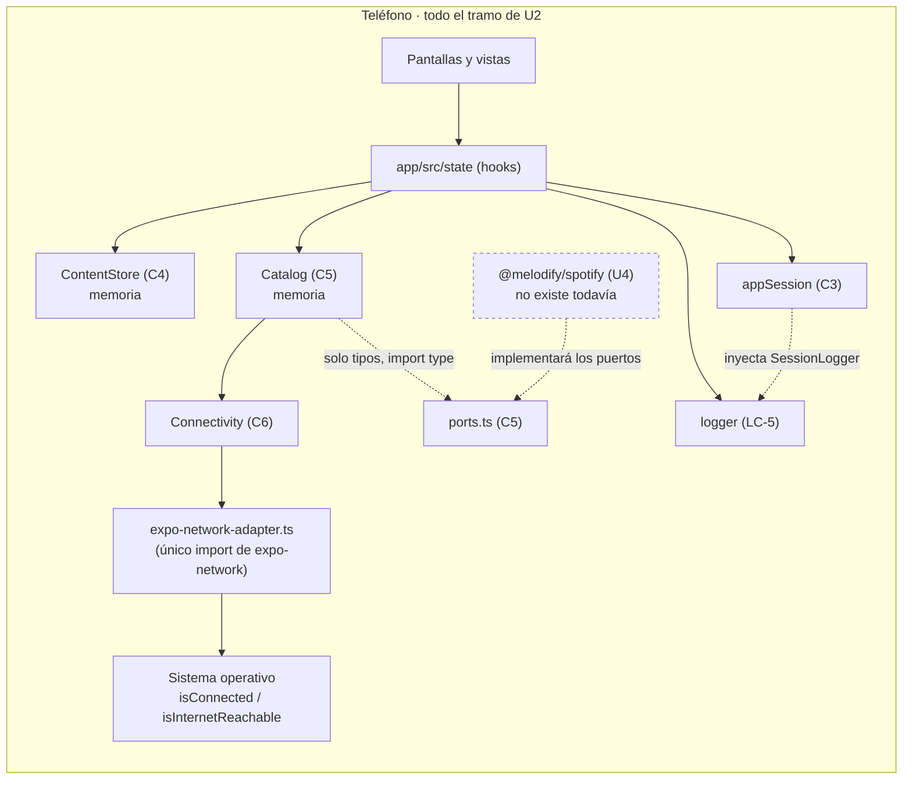

# Diseño de seguridad, privacidad y diagnóstico — U2 `u2-content-core`

> **Provenance**: deriva de `nfr-requirements/security-requirements.md` (NFR3.6–3.11, NFR4.4–4.6, NFR9.4–9.5 y los heredados NFR3.1–3.5, NFR4.1–4.3, NFR9.1–9.3), de `nfr-requirements/tech-stack-decisions.md` (TS-16, TS-17, TS-18, TS-21), de `nfr-requirements/performance-requirements.md` (NFR1.4, NFR2.5), de `functional-design/functional-spec.md` (F7–F12, § Semilla, § Assumptions), de `functional-design/rules.md` (BR4.6, BR4.9, BR5.1–BR5.5, BR6.1–BR6.5, BR7.5, BR8.4), de `inception/contract-design/contract-summary.md` (C2 1.2.0, C3, C4 con `x-identity` y `x-read-errors`, C5 1.1.0, C6 1.0.0, § Revisiones 12 y 13) y de `aidlc/spaces/default/memory/project.md` (§Forbidden, §Mandated).
> Fecha: 2026-11-12. Etapa: NFR Design · Unidad: `u2-content-core` · Agente: aidlc-architect-agent · Profundidad: Standard.

## Fronteras de confianza de esta unidad



**Respaldo en texto**: la interfaz no habla con el sistema operativo: los hooks leen de `ContentStore`, `Catalog`, `appSession` y de la conectividad inyectada en la cáscara. `Connectivity` es el único camino hacia `expo-network`, y lo recorre por un solo adaptador. `Catalog` no conoce a `@melodify/spotify`: solo comparte con él los tipos de los tres puertos, y esa flecha es discontinua porque en U2 no existe el paquete. El logger es la única salida hacia fuera del código y no tiene red.

Hay exactamente **dos** entradas de dato que no escribe la app:

1. **El estado de red del sistema operativo**, reducido a un booleano.
2. **Los textos de ejemplo de la siembra**, que son datos, no instrucciones (NFR3.9), y que en U2 los escribe el código, no una persona. En U3 la tercera entrada será el texto que publique la persona, y esta unidad deja la puerta preparada para que siga siendo texto.

La identidad **no** entra de fuera: se deriva de `appSession` en el punto de llamada (NFR3.7).

## NFR3.6 — Nada nuevo se escribe en el teléfono

### Qué se comprueba y con qué

| Regla | Cómo la sostiene el diseño | Compuerta |
|---|---|---|
| Los tres paquetes nuevos no persisten | `@melodify/content-store`, `@melodify/catalog` y `@melodify/connectivity` no declaran `expo-secure-store`, `AsyncStorage` ni `expo-file-system`; su estado vive en variables del proceso | Revisión de los tres `package.json` y de sus imports, más `no-restricted-imports` para `AsyncStorage` y `expo-secure-store` (NFR3.3 de U1) |
| La única escritura en disco sigue siendo el recuerdo de sesión | U2 no escribe: lee, se suscribe y pinta. «Cerrar sesión» **borra** por `appSession.signOut()` (R-01) | Revisión de `PerfilScreen` y del paquete de contenido |
| El contenido se pierde al recargar, y está dicho | Es una restricción aprobada (RC-03); la app no promete persistencia (`functional-spec.md` § Assumptions) | Recorrido manual: recargar Metro y ver la siembra otra vez |

### La prueba que sí puede fallar

La verificación de NFR3.6 **no** es «no toca el almacenamiento»: el paquete no declara esa dependencia, así que esa prueba pasaría siempre y `team.md` § Testing Posture las prohíbe. La prueba que se escribe es la que distingue estado en memoria de una caché compartida:

```text
// Ilustrativo, no implementación. packages/content-store/src/__tests__/store.test.ts
const a = createContentStore({ now: FIXED_NOW });
const b = createContentStore({ now: FIXED_NOW });
expect(a.listOpinions({ viewerId: "demo" })).toHaveLength(10);
expect(b.listOpinions({ viewerId: "demo" })).toHaveLength(10);
// Publicar en `a` no cambia `b`: no hay estado fuera del proceso ni módulo compartido
```

Si alguien metiera una caché de módulo (o un singleton de paquete, que TS-18 prohíbe), la segunda aserción fallaría. Es una prueba que puede fallar por la razón correcta.

## NFR3.7 — La identidad no la elige el cliente

### Una sola puerta

```text
// Ilustrativo, no implementación. app/src/state/useViewerId.ts
const [viewerId, setViewerId] = useState<string | null>(null);
useEffect(() => {
  // C3 emite la vista vigente al suscribirse si ya la tiene; si no, la publica
  // en cuanto su primera lectura resuelve. No hace falta llamar a getSession().
  return appSession.subscribeSession((session: SessionView) =>
    setViewerId(session.status === "signedIn" ? session.authorId : null),
  );
}, []);
```

- **El `viewerId` sale de `appSession` y de ningún otro sitio.** No hay parámetro de ruta, ni campo de formulario, ni variable de entorno que lo alimente: cambiar una URL de la app o un estado de navegación no cambia quién lee.
- **La suscripción es la única lectura y mantiene el valor al día**: `subscribeSession` entrega la vista vigente en cuanto existe y la publica tras cada cambio; la instancia es la única de la app (`app/src/bootstrap/session.ts`, R-01), así que cerrar sesión desde Perfil deja `viewerId` en `null` y todas las lecturas dejan de llamarse.
- **Sin `viewerId` no se lee.** Los hooks no invocan `listOpinions`, `getOpinion`, `getAuthor`, `listFollowing` ni `subscribeContent` hasta tenerlo: así el `422` de C4 (`x-read-errors`) no llega a la interfaz como error visible, sino como el `loading` que se resuelve solo.
- **Los campos derivados los calcula el almacén.** `isOwn`, `likedByMe`, `followedByMe` y `authorIsFollowed` salen de C4 contra el `viewerId` recibido; ninguna pantalla los recalcula comparando nombres ni handles (BR4.6). Es lo que impide que la opinión propia se pinte como ajena y habilite una segunda opinión sobre la misma obra (AC4.2.3).
- **La frontera es honesta**: C4 no autoriza, acepta la identidad que recibe. En esta versión no hay cuentas reales ni datos de terceros; el día que las haya, la comprobación tendrá que vivir en el almacén o en un servidor, no en el punto de llamada. Queda escrito en `security-requirements.md` § Consideraciones de amenaza y aquí para que nadie lo lea como una autorización.

## NFR3.8 — Los datos de ejemplo no son datos personales reales

| Dato | Origen | Regla |
|---|---|---|
| 5 autores (`demo`, `lucia`, `ana`, `bruno`, `marcos`) | Ficticios, escritos para el ejemplo | Sin nombres de personas reales ni cuentas de Spotify de terceros |
| 10 opiniones y 3 comentarios | Textos de ejemplo (BR4.9) | No se copian de la API ni de reseñas reales |
| 8 obras (id, título, artista, portada) | Metadatos públicos de Spotify | No se guarda audio, letra ni nada de la cuenta de nadie |
| `coverUrl` sembrada | Nula salvo que el catálogo traiga una | Sin sesión no se pide nada a Spotify (BR5.1) |

**Por qué esto es seguridad y no contenido**: la siembra es el único conjunto de datos que la app pinta sin que nadie los haya escrito en el teléfono, y una siembra con datos reales de terceros convertiría una demo en un problema de privacidad. Se revisa la tabla de § Semilla contra esta regla al cerrar el Bolt, y las pruebas de pantalla usan los mismos dobles sin cuenta ni credencial.

## NFR3.9 — Todo se pinta como texto, no como instrucción

- **Nada interpreta marcado.** Los textos de opinión, los títulos y los nombres se pintan con `Text`; no hay `WebView`, ni `eval`, ni `dangerouslySetInnerHTML` (no existe en React Native), ni un parser de marcado. Un texto de ejemplo que contenga `<script>` se lee tal cual y no ejecuta nada.
- **La única URL que llega a `Image` la decide `coverFor`**: una `coverUrl` del catálogo sembrado o, a partir de U4, la que devuelva `SpotifyResolvePort`. Ninguna URL se construye a partir de un texto de la persona; en U2 no hay campo donde escriba una.
- **Un `workId` desconocido no produce ruta ni consulta.** `getWork` responde `404` y la cabecera cae al `workTitle` y `workArtist` de la opinión (BR5.2). No hay interpolación de identificadores en URLs.
- **Para U3**: cuando exista contenido escrito por la persona, seguirá siendo texto en los mismos componentes; ningún camino de esta unidad lo convierte en marcado ni en URL.

## NFR3.10 / NFR3.1 — Sin secretos nuevos y sin credenciales

| Elemento | En U2 | Regla que lo sostiene |
|---|---|---|
| `EXPO_PUBLIC_SPOTIFY_CLIENT_ID` | No se lee en ningún archivo de la app | Lo usa U4; `.env.example` sigue documentándolo sin valor |
| Client secret de Spotify | **No existe** | PKCE no lo necesita; nunca se declara, ni en `.env.example` |
| Los tres puertos de Spotify | `null` en `app/src/bootstrap/ports.ts` | Sin puerto no hay credencial, ni llamada, ni URL |
| Token de Spotify | No existe en U2 | Lo guarda U4 en su propio paquete y su propia clave |
| Cliente HTTP propio | No se instala | La única dependencia nueva es `expo-network` (TS-16) |
| Cabecera de autorización | No se construye | `searchWorks` sin puerto responde `{ status: "offline", works: [] }` |

**Comprobación**: una búsqueda de `EXPO_PUBLIC_` en `app/` y `packages/` no devuelve nada en esta unidad, y `npm run lint` no encuentra ninguna referencia. La revisión de `ports.ts` confirma los tres en `null`.

## NFR3.11 — El catálogo y Spotify solo comparten tipos

```text
// Ilustrativo, no implementación. app/src/bootstrap/ports.ts
import type { SpotifyResolvePort, SpotifySearchPort, SpotifySessionPort } from "@melodify/catalog";
export const spotifyPorts: {
  session: SpotifySessionPort | null;
  search: SpotifySearchPort | null;
  resolve: SpotifyResolvePort | null;
} = { session: null, search: null, resolve: null };
```

- **Los tipos viven donde vive el consumidor**: `@melodify/catalog/src/ports.ts` declara `SpotifySessionPort`, `SpotifySearchPort` y `SpotifyResolvePort`; `app/src/bootstrap/ports.ts` deja de declararlos por su cuenta y los importa con `import type` (TS-21). Dos declaraciones del mismo tipo acabarían discrepando.
- **`import type` lo borra el compilador**, así que no hay arista de ejecución: aunque `@melodify/spotify` estuviera instalado, nada de U2 lo carga.
- **La compuerta es una regla de lint con tipos, no una convención.** `no-restricted-imports` no distingue `import type` de un import de valor; por eso el diseño usa **`@typescript-eslint/no-restricted-imports` con `allowTypeImports: true`**, aplicada a los archivos de `packages/catalog/src/**` y de `packages/spotify/src/**` (cuando U4 lo cree): prohíbe `@melodify/spotify` en el catálogo y `@melodify/catalog` en Spotify **salvo** como tipo. El plugin ya lo aporta `eslint-config-expo`, y la regla entra en el `eslint.config.js` que el CI ejecuta.
- **La mitad ejecutable se prueba**: un catálogo construido sin puertos responde `{ status: "offline", works: [] }`, `retryCovers` no hace nada y `getCoverFailure` es falso.

## NFR4.4 — Inventario de lo que queda escrito en el teléfono

| Dato | Persistido | Dónde | Se borra |
|---|---|---|---|
| `authorId` = `demo` y `startedAt` | Sí (heredado de U1) | Almacenamiento seguro, clave `melodify.session` | Al cerrar sesión |
| Opiniones, autores, me gustos, comentarios y seguimientos | **No** | Memoria del proceso | Al recargar (RC-03) |
| Obras de ejemplo y decisión de portada | **No** | Memoria del proceso | Al recargar |
| Estado de red | **No** | Memoria del proceso | Al recargar |
| Token de Spotify | Todavía no (U4) | Almacenamiento seguro, clave del token | Al desconectar |

**U2 no añade ninguna fila persistida a la tabla de U1.** Si alguien introdujera caché en disco para el catálogo, esta tabla y RC-03 dejarían de ser ciertas: sería una decisión de etapa, no un detalle de implementación.

## NFR4.5 — El estado de red se lee, no se envía

```text
// Ilustrativo, no implementación. packages/connectivity/src/expo-network-adapter.ts
const adapter: NetworkAdapter = {
  getState: async () => {
    const state = await Network.getNetworkStateAsync();
    return { online: state.isConnected === true && state.isInternetReachable !== false };
  },
  addListener: (cb) => {
    const sub = Network.addNetworkStateListener((s) =>
      cb({ online: s.isConnected === true && s.isInternetReachable !== false }),
    );
    return () => sub.remove();
  },
};
```

- **De la respuesta se usa un solo booleano.** No se leen SSID, dirección IP, tipo de red ni operador; nada de eso se registra ni se envía. `Connectivity` no abre sockets propios ni pregunta a Spotify (BR6.5).
- **Un solo archivo importa `expo-network`**, y una regla `no-restricted-imports` lo comprueba: sin ella, cualquier pantalla podría consultarlo por su cuenta y multiplicar lecturas.
- **No se pide ningún permiso nuevo** (RC-01). Expo Go ya declara `ACCESS_NETWORK_STATE`; U2 no edita ningún manifiesto porque no hay proyecto nativo.
- **El adaptador se sustituye por un doble en las pruebas**, así que ninguna prueba toca el sistema operativo ni la red.
- **`measuredAt` no se usa para nada de la interfaz** y no se registra: es parte de la vista de C6, no un dato que la app acumule.

## NFR4.6 — El registro no se lleva el contenido

| Situación | Mensaje que se registra | Lo que **no** lleva |
|---|---|---|
| Suscripción al contenido fallida | «suscripción al contenido fallida» | Textos, `workId`, `viewerId` |
| Lectura fallida | «no se pudo leer el contenido» | La opinión leída, el título de la obra, el identificador |
| Red no disponible | «módulo de red no disponible» | SSID, IP, tipo de red, marcas de tiempo de conexión |

- **La firma cerrada a dos cadenas (`code`, `message`) lo hace difícil de romper**: no hay sobrecarga que acepte un objeto, así que no se puede «pasar el registro por si acaso» y arrastrar un texto.
- **La regla se fija ahora, no en U3.** En U2 el contenido es de ejemplo; en U3 será texto de la persona por los mismos caminos, y sería tarde para cambiarla.
- **Nunca se registra el `viewerId` completo, ni la sesión, ni un histórico de red.** Lo que identifica a la persona no entra en un mensaje de diagnóstico.

## NFR9.4 — El catálogo de eventos de esta unidad

| Código | Nivel | Cuándo | Qué ve la persona |
|---|---|---|---|
| `CONTENT_SUBSCRIBE_FAILED` | `error` | `subscribeContent` lanza al establecerse (defecto interno del almacén; C4 no publica fallo de suscripción) | `ErrorState` + «Reintentar» |
| `CONTENT_READ_FAILED` | `error` | `getWork`, `getOpinion`, `getAuthor`, `listFollowing`, `countOpinions` o `listOpinions` del detalle fallan | `ErrorState` + «Reintentar» |
| `NETWORK_STATE_UNAVAILABLE` | `warn` | El módulo de red falta o la lectura falla (BR6.3) | Nada: se arranca en línea |

**Dónde viven esos códigos.** El logger del proyecto está tipado `SessionLogger`, cuya unión `SessionLogCode` es cerrada y de C3. U2 **no amplía C3**: declara en el mismo archivo de bootstrap el tipo de la app, asignable al de la sesión.

```text
// Ilustrativo, no implementación. app/src/bootstrap/logger.ts
export type AppLogCode =
  | SessionLogCode
  | "CONTENT_SUBSCRIBE_FAILED"
  | "CONTENT_READ_FAILED"
  | "NETWORK_STATE_UNAVAILABLE";

export interface AppLogger {
  warn(code: AppLogCode, message: string): void;
  error(code: AppLogCode, message: string): void;
}

export const logger: AppLogger = { /* implementación actual, sin cambios */ };
```

- **`AppLogger` es asignable a `SessionLogger`**: acepta un superconjunto del código y la misma pareja `(code, message)`, así que `createAppSession({ logger })` y `appSession` siguen recibiendo el mismo objeto y C3 no cambia (C3 § Revisión 13). Una línea de prueba lo fija: `const asSession: SessionLogger = logger;`.
- **El vocabulario crece por unidad, no por paquete ajeno.** U3 y U5 amplían `AppLogCode` en ese archivo cuando necesiten sus códigos; nadie reabre `SessionLogCode`.
- **No se duplica el aviso.** Si la persona lo ve, el logger no lo repite, salvo que sea un fallo del sistema (el `ErrorState` va acompañado de `CONTENT_*` porque es un defecto, no un estado esperado). El banner de portadas no se registra: `getCoverFailure` ya lo expone a la interfaz. Sin conexión no se registra: es un estado, no un fallo. La portada caída a bloque tampoco: es la degradación prevista.

## NFR9.1 / NFR9.5 — Sin superficie nueva ni telemetría

| Regla | Cómo se cumple |
|---|---|
| Un solo logger | `app/src/bootstrap/logger.ts`; `no-console` en `error` con excepción declarada solo para ese archivo |
| Sin servicio de errores ni analítica | Ninguna dependencia nueva salvo `expo-network`; `@melodify/content-store` no exporta métricas |
| Sin SLI, SLO ni alertas | No hay servicio que observar: la app corre en el teléfono |
| Sin envío de datos | Ningún paquete de U2 tiene red (salvo el adaptador de red, que solo lee) |

Queda anotado para U5: si la Actividad necesitara medir algo, se decide allí y con la misma restricción de no enviar nada fuera.

## Cómo se demuestra cada requisito

| Requisito | Prueba o revisión con la que se demuestra |
|---|---|
| NFR3.6 | Revisión de los tres `package.json` e imports; prueba de dos almacenes construidos desde la misma siembra que no comparten estado; recarga manual de Metro |
| NFR3.7 | Prueba de `useViewerId` con sesión y sin ella; prueba de que ningún hook llama a C4 sin `viewerId`; revisión de que `isOwn`/`likedByMe` vienen de C4 y la tarjeta no los recalcula |
| NFR3.8 | Revisión de la tabla de § Semilla contra la lista de autores ficticios y obras públicas; pruebas de pantalla sin credenciales |
| NFR3.9 | Revisión de que no hay `WebView` ni marcado; prueba de render con un texto que contiene `<script>` y se pinta literal; prueba de `404` que cae al título de la opinión |
| NFR3.10 / NFR3.1 | Búsqueda de `EXPO_PUBLIC_` sin resultados; revisión de `ports.ts` con los tres en `null`; `.env.example` sin valor |
| NFR3.11 | Regla `@typescript-eslint/no-restricted-imports` con `allowTypeImports: true` en verde; búsqueda de `from "@melodify/spotify"` que solo devuelve `import type`; prueba de `searchWorks` sin puertos → `offline` |
| NFR4.4 | Revisión del inventario; ninguna dependencia de almacenamiento en los paquetes nuevos |
| NFR4.5 | Prueba del adaptador con `expo-network` doblado por `jest.mock`: traduce solo los dos campos y devuelve un booleano; revisión de que no lee SSID, IP ni tipo |
| NFR4.6 | Tres pruebas de logger, una por código, con un logger espía: el mensaje es el literal y ningún dato de contenido entra |
| NFR9.4 | `const asSession: SessionLogger = logger;` compila; tabla de eventos cubierta por pruebas de fallo de suscripción, de lectura y de red |
| NFR9.5 | Revisión de dependencias: sin SDK de analítica ni de errores; sin SLI/SLO |

## Riesgos asumidos y su porqué

| Riesgo | Por qué se acepta |
|---|---|
| C4 no autoriza: acepta cualquier `viewerId` que reciba | No hay cuentas reales ni datos de terceros; la identidad se deriva en un solo punto y C4 responde `422` sin ella. Se cierra el día que existan cuentas, en el almacén o en un servidor |
| El contenido de ejemplo vive en memoria y se pierde al recargar | Es RC-03, aprobado, y la app no promete lo contrario; persistirlo exigiría una decisión de etapa |
| Un fallo de `expo-network` deja la app «en línea» sin aviso | Es la degradación que BR6.3 elige: un fallo del módulo de red no puede bloquear el recorrido, y queda registrado como `warn` |
| Los identificadores de obra sembrados son plausibles pero no verificados | No se construye ninguna ruta con ellos; si uno no existe, U4 conserva título y artista (BR5.2) |
| El logger registra en la consola del dispositivo | No lleva contenido, ni identidad, ni credenciales (firma cerrada y mensajes literales), y es la única forma de diagnosticar lo que no se muestra |

## Assumptions & Open Questions

- `[assumption]` `expo-network` en Expo Go expone el estado de red sin permiso adicional declarado por la app; si en el teléfono la lectura fallara, BR6.3 arranca en línea y la app sigue usable.
- `[assumption]` `eslint-config-expo` registra el plugin de TypeScript lo bastante como para habilitar `@typescript-eslint/no-restricted-imports` con `allowTypeImports`; si hubiera que declararlo, se añade como dependencia de desarrollo y la regla no cambia.
- `[assumption]` El contenedor de Expo Go ya declara `ACCESS_NETWORK_STATE`; U2 no edita ningún manifiesto porque no hay proyecto nativo (RC-01).
- **Open question para U4**: la `coverUrl` real llegará de Spotify; allí se confirma que solo se aceptan URLs `https` de los dominios de Spotify y que una respuesta inesperada cae al bloque de inicial.
- **Open question para U3**: el texto de la persona pasará a ser contenido no confiable que se pinta y se registra por los caminos de esta unidad; U3 no debe añadir un `console.log` con el texto ni convertirlo en URL.

## Sources

- `security-requirements` — `construction/u2-content-core/nfr-requirements/security-requirements.md` (NFR3.6–3.11, NFR4.4–4.6, NFR9.4–9.5).
- `performance-requirements` — `construction/u2-content-core/nfr-requirements/performance-requirements.md` (NFR1.4, NFR2.5, para los estados y avisos que se registran).
- `tech-stack-decisions` — `construction/u2-content-core/nfr-requirements/tech-stack-decisions.md` (TS-16, TS-17, TS-18, TS-21).
- `functional-spec` — `construction/u2-content-core/functional-design/functional-spec.md` (F7–F12, § Semilla, § Assumptions).
- `rules` — `construction/u2-content-core/functional-design/rules.md` (BR4.6, BR4.9, BR5.1–BR5.5, BR6.1–BR6.5, BR7.5, BR8.4).
- `contract-summary` — `inception/contract-design/contract-summary.md` (C2 1.2.0, C3 § Revisión 13, C4 con `x-identity` y `x-read-errors`, C5 1.1.0, C6 1.0.0 con `x-construction`).
- `project.md` — `aidlc/spaces/default/memory/project.md` (§Forbidden y §Mandated sobre el client secret, el backend y el contenido local).
