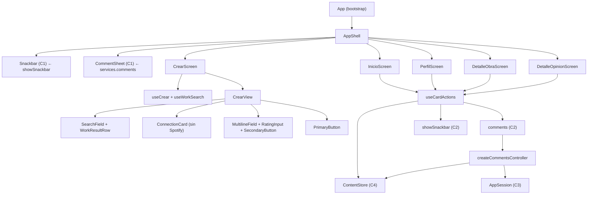

# Componentes de interfaz — U3 `u3-create-react`

> **Provenance**: deriva de `inception/contract-design/contract-summary.md` (C1 1.3.0, C2 1.3.0, C3, C4 1.2.0, C5), `inception/domain-design/components.md` (ContentStore, Catalog, AppShell, DesignSystem), `inception/refined-mockups/mockups.md` (Crear, hoja de comentarios, snackbar, matriz de estados), `inception/refined-mockups/design-system-mapping.md`, `inception/refined-mockups/interaction-spec.md` y las respuestas de `functional-design-questions.md` (Q1 = B, Q2 = A, Q3 = A).
> Fecha: 2026-11-14. Etapa: Functional Design · Unidad: `u3-create-react`.

Este documento fija la forma de la interfaz de U3: qué piezas se añaden al sistema de diseño, quién posee el estado del formulario, cómo se separan contenedor y vista, dónde vive el controlador de la hoja y qué se cablea en cada pantalla existente. Es diseño, no código.

## Jerarquía

**Respaldo en texto**: `App` construye una sola vez el almacén, el catálogo y el controlador de comentarios, y los entrega a la cáscara y a las pantallas. La cáscara pinta dos cosas nuevas —el snackbar y la hoja— a partir de lo que ya recibe en `services`. Las cuatro pantallas de U2 no cambian de forma: reciben un paquete de acciones de tarjeta desde un hook compartido. Crear se parte en contenedor (`useCrear` + `useWorkSearch`) y vista pura (`CrearView`), y su vista solo usa piezas de C1.

## Paquetes y responsabilidad

| Paquete | Dueño | Qué aporta a la interfaz de U3 |
|---|---|---|
| `@melodify/design-system` (C1) | U1, publicado por U3 a la **1.3.0** | Ocho piezas nuevas y tres adiciones opcionales a piezas existentes. |
| `@melodify/app-shell` (C2) | U1, publicado por U3 a la **1.3.0** | `formKey`, `failed`, el cierre de Crear que conserva la pila, el atrás que cancela y el montaje real del snackbar y de la hoja. |
| `@melodify/app-session` (C3) | U1 | El `authorId` de las escrituras y el `viewerId` que ya usa U2. |
| `@melodify/content-store` (C4) | U2, publicado por U3 a la **1.2.0** | Las escrituras que U3 cablea y los dos topes de longitud. |
| `@melodify/catalog` (C5) | U2 | Obras de ejemplo, búsqueda, recuento y portada. No cambia. |
| `@melodify/app` | U3 en sus carpetas | Crear, la hoja, el hook de acciones, el controlador de comentarios y el cableado de las cuatro pantallas. |

## `@melodify/design-system` — lo que añade la 1.3.0

| Pieza | Props | Estados que cubre U3 |
|---|---|---|
| `SearchField` | `value`, `onChangeText`, `placeholder?`, `autoFocus?`, `disabled?`, `loading?`, `onClear?` | Inactivo, escribiendo, esperando, buscando (indicador) y deshabilitado. No temporiza: el disparo es del contenedor. |
| `RatingInput` | `value` (0–5), `onChange`, `disabled?` | Sin valorar, seleccionado («n de 5»), deshabilitado. Repetir el toque no borra. |
| `MultilineField` | `label`, `value`, `onChangeText`, `placeholder?`, `error?`, `maxLength?`, `counterFrom?`, `editable?`, `minHeight?`, `testID?` | Normal, con foco, con error, deshabilitado y con contador. Altura mínima 120 y máxima 240 con scroll. |
| `SecondaryButton` | `label`, `onPress`, `disabled?` | La jerarquía secundaria, con borde y sin fondo. |
| `ConnectionCard` | `title`, `body`, `actionLabel`, `onAction` | La invitación a conectar de Crear sin sesión. |
| `WorkResultRow` | `work: WorkSummary`, `opinionCount`, `onPress` | Con opiniones («N opiniones»), sin opiniones («Sé el primero en opinar»), pulsado y esqueleto. |
| `CommentSheet` | `opinionId`, `comments`, `status`, `failed?`, `maxLength?`, `snackbar?`, `onSubmit`, `onRetry`, `onClose` | Cargando, vacía, con lista, error de carga, error de envío y cerrada. Guarda su borrador y pinta dentro del modal el aviso que le llega en `snackbar`. |
| `Snackbar` | `message`, `visible`, `onDismiss` | Oculto, visible y saliendo; 4 s; sin acciones. |

**Adiciones a piezas existentes y a la hoja**

| Pieza | Cambio | Efecto visible |
|---|---|---|
| `SocialActionBar` | `showLike?: boolean` (por defecto `true`). Con `false`, glifo y contador se pintan como texto sin `Pressable` ni rol. | La opinión propia conserva el número de me gusta pero no se lo puede dar. |
| `OpinionCard` | Pasa `showLike={!isOwn}` a la barra; la etiqueta de seguir es «Seguir autor» / «Siguiendo» según `opinion.followedByMe`; sigue ocultándose en la propia. | AC7.3.1 y AC7.3.2 tienen un texto que cambia y un `accessibilityLabel` coherente («Seguir a {autor}» / «Dejar de seguir a {autor}»). |
| `CommentSheet` | Admite `failed?` (envío anterior fallido sin borrar la lista) y `snackbar?` (el aviso de la cáscara, que se pinta dentro del modal). | AC7.2.5 conserva el texto y la lista; «Comentario publicado» se ve con la hoja abierta (BR14.6). |

**Reglas de uso**: ninguna pantalla pinta una opinión, una fila de obra ni un campo de texto por su cuenta; todas usan las piezas. `CrearView` no construye estilos de formulario fuera de `MultilineField` y `RatingInput`, y la hoja no se pinta desde una pantalla.

## `app/src/comments/` — el controlador de la hoja

| Archivo | Responsabilidad |
|---|---|
| `createCommentsController.ts` | `createCommentsController({ content, session })`: dueño del estado de la hoja y de las cuatro acciones de `ShellServices.comments`. `submit(text)` devuelve si la escritura salió bien; la cáscara usa ese resultado para pedir el snackbar, y el controlador no conoce ni el aviso ni la navegación. |
| `toCommentModel.ts` | `toCommentModel(view: CommentView): CommentModel` — el único mapeo de C4 a C1; toma `author.displayName` y `author.handle`. |
| `index.ts` | Superficie del módulo. |

**Forma del estado** (la de C2 1.3.0 más un campo):

| Campo | Contenido |
|---|---|
| `opinionId` | La opinión abierta, o `null` cuando la hoja está cerrada. |
| `comments` | Los `CommentModel` ya mapeados, del más antiguo al más reciente. |
| `status` | `loading`, `ready`, `empty` o `error` (este último, para la lectura). |
| `failed` | Verdadero si el último envío falló; la lista no se borra. |

**Reglas del controlador**

- `subscribe(listener)` emite el estado vigente al establecerse y en cada cambio; devuelve la baja. La cáscara lo lee con `useSyncExternalStore` y el objeto de estado solo cambia cuando cambia algo.
- `open(opinionId)` fija la opinión, pone `status: loading` y lee `content.listComments({ opinionId })`. Si responde error, `status: error`; si la lista está vacía, `empty`; si no, `ready`.
- `close()` vuelve al estado cerrado (`opinionId: null`, lista vacía, `failed: false`) y descarta el borrador de la hoja, que vive en la pieza.
- `retry()` repite la lectura de la opinión abierta; si la hoja está cerrada, no hace nada. Es el reintento de la **lista**, distinto del de un envío fallido.
- `submit(text)` recorta; si queda vacío no hace nada y devuelve `false`. Llama a `content.addComment({ opinionId, authorId, text })` con el `authorId` de `session.getSession()`. Con `201`, añade el comentario mapeado al final, limpia `failed`, deja `status: ready` y devuelve `true`, y la cáscara pide «Comentario publicado». Con error, pone `failed: true`, no toca la lista y devuelve `false`.
- **Dos reintentos distintos**: con `failed`, la hoja reenvía con `submit(texto)` y conserva el texto; con `status: error`, la hoja relee con `retry()`. La hoja elige cuál ofrecer según su estado.
- **Sin estado «enviando»**: el almacén es síncrono; la hoja no muestra un indicador que duraría un fotograma.
- El controlador no importa `@melodify/design-system` salvo por el tipo `CommentModel`, y no conoce la navegación ni la pestaña activa.

## `app/src/state/` — dos hooks nuevos

| Archivo | Responsabilidad |
|---|---|
| `useCardActions.ts` | Devuelve `actionsFor(opinion: OpinionView)`: `{ onLike?, onComment?, onFollow?, onEdit? }`. Cablea `toggleLike` y `toggleFollow` contra C4 con el `viewerId`, abre la hoja con `comments.open`, pide «Editar» con `openEdit` y muestra los snackbars de confirmación y de fallo. En una opinión propia devuelve solo `onComment` y `onEdit`. Sin `viewerId`, devuelve objetos vacíos y los controles quedan sin efecto. |
| `useWorkSearch.ts` | `useWorkSearch(catalog, enabled)` → `{ query, status, results, setQuery, clear, retry }`. Aplica los 2 caracteres y los 400 ms, cancela el temporizador anterior, descarta respuestas tardías y traduce `SearchResult` a `idle`, `short`, `searching`, `results`, `empty` o `error`. `offline` y `error` de C5 caen los dos en `error` con el texto y el «Reintentar» de BR13.2: un fallo de red no puede parecer una lista vacía. Con `enabled` falso no monta temporizadores ni llamadas. |

`useCardActions` es lo que evita cuatro copias del mismo cableado: Inicio, los dos detalles y Perfil solo deciden qué variante de tarjeta pintan y le pasan el paquete. La confirmación se pide con `showSnackbar` y el texto exacto de `functional-spec.md` § Textos exactos.

## `app/src/screens/crear/` — Crear y Editar

| Archivo | Responsabilidad |
|---|---|
| `CrearScreen.tsx` | Contenedor: lee `useCreateEntry()`, `useGlobalServices()`, `useShellServices()`, `useViewerId`, `useNetwork` y las dependencias de composición; monta `useCrear` y `useWorkSearch`; cablea navegación y snackbar. Reacciona a `entry.formKey`: al cambiar, descarta el borrador y recarga el modo. |
| `CrearView.tsx` | Vista pura con la cabecera, las dos ramas (buscador o selector de ejemplo), el formulario, el estado de carga, el de error de carga y el bloque de error de envío. |
| `CrearHeader.tsx` | `AppHeader` con el título del modo y «Cancelar» en la ranura derecha (`TextButton`). |
| `useCrear.ts` | El estado del formulario: obra, texto, valoración, `alreadyOpined`, error de envío, carga de la edición, validación y las dos escrituras (`createOpinion`/`updateOpinion`). Devuelve `{ state, actions }`. |

**Props de `CrearView`**

| Grupo | Campos |
|---|---|
| Modo y estado | `mode`, `screenStatus` (`loading | ready | loadError`), `online`, `spotifyConnected` |
| Formulario | `work`, `text`, `rating`, `canSubmit`, `alreadyOpined` |
| Búsqueda | `searchVisible`, `query`, `searchStatus`, `results`, `onChangeQuery`, `onClearQuery`, `onToggleSearch`, `onChooseWork`, `onSearchRetry` |
| Selector de ejemplo | `sampleWorks` (con su `opinionCount`) y `onChooseWork` |
| Acciones | `onPublish`, `onSave`, `onCancel`, `onEditExisting`, `onClearRating`, `onRate`, `onChangeText`, `onRetryLoad` |
| Error | `submitError` (`"publish" | "save" | null`) |

**Reglas de composición**

- La vista nunca lee C4, C5 ni la sesión: todo llega por props.
- El botón principal dice «Publicar» o «Guardar», y se sustituye por «Editar mi opinión» cuando `alreadyOpined`.
- En modo edición no se pinta `SearchField` ni el selector de ejemplo, y la fila de obra no tiene «Cambiar» (BR12.2).
- El aviso de sin conexión va bajo `CrearHeader` con `OfflineBanner` y el texto propio de cada modo (BR15.4). `OfflineBanner` gana `message?: string` (el texto de U2 sigue siendo el valor por defecto) y `onRetry?`; en Crear se pinta **sin acción**, porque no hay nada que reintentar: el catálogo de ejemplo es local y el formulario funciona.
- El error de envío se pinta **sobre** el botón principal, no en un diálogo ni en la cabecera, y no oculta los campos.
- La pantalla no pinta el snackbar: solo llama a `showSnackbar`.

## Cableado de las cuatro pantallas

| Pantalla | Qué añade U3 |
|---|---|
| Inicio | `useCardActions`; cada tarjeta del feed recibe `onLike`, `onComment` y `onFollow` (y `onEdit` si es propia). No cambia la variante ni el orden. |
| Detalle de obra | `useCardActions`; la tarjeta propia recibe `onEdit` y `onComment`; las ajenas, además, `onLike` y `onFollow`. No cambia la composición de la vista. |
| Detalle de opinión | `useCardActions`; la tarjeta recibe `onLike`/`onFollow` o `onEdit` según sea propia, más `onComment`. |
| Perfil | `useCardActions`; las tarjetas propias reciben `onEdit` (y `onComment`), y ninguna recibe `onLike` ni `onFollow`. |

**Nota sobre el comentario en la opinión propia**: se permite comentar la propia opinión. Ninguna historia lo prohíbe y el contador de la tarjeta existe; lo que se oculta es el me gusta y el seguir (Q3 = A).

## `@melodify/app-shell` — los cinco cambios de comportamiento

| Punto | Cómo queda | Dónde se nota |
|---|---|---|
| `CreateEntry.formKey` | Entero que sube en `openCreate`, `openEdit` y al tocar la pestaña Crear. | Crear reinicia su borrador; una visita nueva no arrastra texto ni obra. |
| `closeCreate` | Vuelve a `returnTo` sin tocar su pila y deja Crear limpio. | «Cancelar» y «Guardar» devuelven al detalle, con su desplazamiento y su estado. |
| `openEdit` desde Crear | Conserva el `returnTo` de la entrada vigente y solo emite un `formKey` nuevo; no fija `returnTo: activeName` como `openCreateTab`. | «Editar mi opinión» desde `YaOpinada` vuelve al detalle al guardar, no a la pestaña Crear (BR12.3, AC6.1.3). |
| Atrás del sistema en Crear | Llama a `closeCreate()` y consume el evento. | El atrás no cierra la app con un borrador a medias. |
| Montajes | La cáscara se suscribe a `services.comments` y pinta `CommentSheet` cuando hay `opinionId`; pinta `Snackbar` con el mensaje vigente y, mientras la hoja está abierta, se lo pasa a `CommentSheet` para que lo pinte dentro del modal; cualquier cambio de pestaña limpia el mensaje. | La hoja y el aviso dejan de ser marcadores vacíos, y «Comentario publicado» se ve con la hoja abierta. |

No cambia ninguna exportación, ni la forma de `GlobalServices`; `ShellServices` gana `CommentSheetState.failed` y amplía el retorno de `submit` de `void` a `boolean` (compatible con quien lo llamaba por su efecto).

## `app/src/bootstrap/` — composición

| Archivo | Cambio de U3 |
|---|---|
| `comments.ts` **(nuevo)** | Construye una sola vez `createCommentsController({ content: contentStore, session: appSession })`. |
| `shell-services.ts` | Sustituye el controlador vacío de comentarios por el de `comments.ts`; Spotify sigue con su valor de U1 hasta U4. |
| `App.tsx` | La pestaña Crear pasa a `CrearRoute` con `session`, `content` y `catalog`; el resto del registro no cambia. |

## Registro y navegación

| Pestaña | Pantalla raíz | Detalles registrados |
|---|---|---|
| Inicio | `InicioScreen` | `work`, `opinion` |
| Explorar | contenedor de U1 | — (U4) |
| Crear | **`CrearScreen`** (U3) | — |
| Actividad | contenedor de U1 | — (U5) |
| Perfil | `PerfilScreen` | `opinion` |

`openCreate`, `openEdit` y `closeCreate` son de C2 y conservan su forma; lo que cambia es su comportamiento de cierre. La pestaña Crear sigue siendo un destino de la barra y no un detalle apilado; la vuelta al detalle se consigue con `returnTo`, no con una entrada nueva en la pila (divergencia registrada en `functional-spec.md` § Assumptions).

## Flujos de interacción de la interfaz

| Acción | Qué hace la vista | Qué hace el contenedor o la cáscara |
|---|---|---|
| Tocar «Publicar» | Llama a `onPublish()` | `useCrear` valida y llama a `createOpinion`; con `201`, `goToTab({name:'inicio'})` y después `showSnackbar({message:'Opinión publicada'})` |
| Tocar «Guardar» con cambios | Llama a `onSave()` | `updateOpinion`; con `200`, `closeCreate()` y después `showSnackbar` (el cambio de pestaña no borra el aviso) |
| Tocar «Guardar» sin cambios | Llama a `onSave()` | No escribe, no confirma y `closeCreate()` |
| Tocar «Editar mi opinión» | Llama a `onEditExisting()` | `openEdit({ opinionId })` conservando el `returnTo` de la entrada vigente |
| Tocar «Cancelar» | Llama a `onCancel()` | `closeCreate()` |
| Atrás del sistema en Crear | — | `closeCreate()` y consume el evento |
| Escribir en el buscador | `onChangeQuery(text)` | `useWorkSearch` aplica 2 caracteres y 400 ms |
| Tocar una fila de resultado o de ejemplo | `onChooseWork(work)` | Fija la obra, pliega la lista y comprueba la opinión propia |
| Tocar «Cambiar» | `onToggleSearch()` | Vuelve a mostrar el buscador con el texto vacío |
| Tocar una estrella | `onRate(n)` | Fija la valoración aunque repita |
| Tocar «Quitar valoración» | `onClearRating()` | Valoración a 0 y «Publicar» deshabilitado |
| Tocar «♡» | `onLike` de la tarjeta | `toggleLike`; si falla, snackbar y nada cambia |
| Tocar «💬» | `onComment` de la tarjeta | `comments.open(opinionId)` |
| Tocar «Seguir autor» / «Siguiendo» | `onFollow` de la tarjeta | `toggleFollow` y snackbar con el handle |
| Tocar «Editar» de la propia | `onEdit` de la tarjeta | `openEdit({ opinionId })` |
| Enviar un comentario | `onSubmit` de la hoja | `comments.submit(text)`; si devuelve `true`, `showSnackbar('Comentario publicado')`, que se pinta dentro de la hoja |
| «Reintentar» en la hoja | `onRetry` | Con `failed`, reenvía con `submit(texto)`; con la lista en `error`, relee con `retry()` |
| Cerrar la hoja | `onClose` | `comments.close()` |

## Puntos de integración de la interfaz

| Punto | Quién lo consume | Qué deja U3 listo |
|---|---|---|
| C1 1.3.0 | U4, U5 | Ocho piezas que U4 y U5 habrían tenido que entregar si el orden hubiera sido el planificado; `SpotifyCard` sigue libre para U4. |
| C2 1.3.0 | U4, U5 | `formKey` y el cierre que conserva la pila; cualquier pantalla que abra Crear se beneficia. |
| `useCardActions` | U4, U5 | Las cuatro acciones de tarjeta resueltas; Explorar y Actividad solo piden el paquete. |
| `createCommentsController` | U6 | La hoja completa y su controlador, ya inyectados en la cáscara. |
| `CrearScreen` con buscador | U4 | La sesión y el puerto son lo único que falta; la pantalla ya busca, pliega y elige. |
| `openCreate({ workId })` | U4 | Explorar abre Crear con la obra elegida. |
| `openEdit({ opinionId })` | U5, U6 | Cualquier tarjeta propia edita desde la pantalla en la que esté. |
| `Snackbar` montado | U5 | Actividad confirma con el mismo aviso y el mismo texto. |
| «Seguir autor»/«Siguiendo» | U5 | La Actividad puede mostrar el autor con la misma etiqueta que la tarjeta. |

## Assumptions & Open Questions

- `[assumption]` `CrearView` es pura: recibe datos y callbacks. Eso permite probar el estado vacío, el de carga, el error de envío y la rama sin Spotify sin montar el almacén ni la sesión.
- `[assumption]` El paquete de acciones se construye con un hook y no se reparte por pantalla: cuatro copias del mismo cableado se desincronizarían en cuanto una unidad siguiente añadiera una acción.
- `[assumption]` La hoja se pinta desde la cáscara porque C2 lo congeló así (R-34); la pantalla solo la abre. Si una pantalla la pintara, habría dos hojas y dos borradores.
- `[assumption]` `useWorkSearch` recibe el catálogo y no lo importa: la instancia única sigue siendo la del punto de composición, y en las pruebas se le pasa un catálogo con puerto doble.
- `[assumption]` `CommentSheet` usa el `Modal` de React Native y no una librería de hojas: Expo Go lo soporta sin módulos nativos y el comportamiento que piden los mockups (velo, cierre por velo, alto del 70 %) se consigue con props del propio `Modal`.
- `[assumption]` El snackbar se monta en la cáscara y no en cada pantalla; su estado se limpia al cambiar de pestaña para que no viaje de una a otra.
- **Open question para U4**: al montar el buscador con sesión, el puerto debe respetar el disparo del contenedor. Si U4 necesita paginar resultados, es un cambio de C5 y de esta especificación, no de la vista.
- **Open question para U5**: la Actividad no pinta el me gusta propio porque la interfaz ya no permite darlo (Q3 = A).
