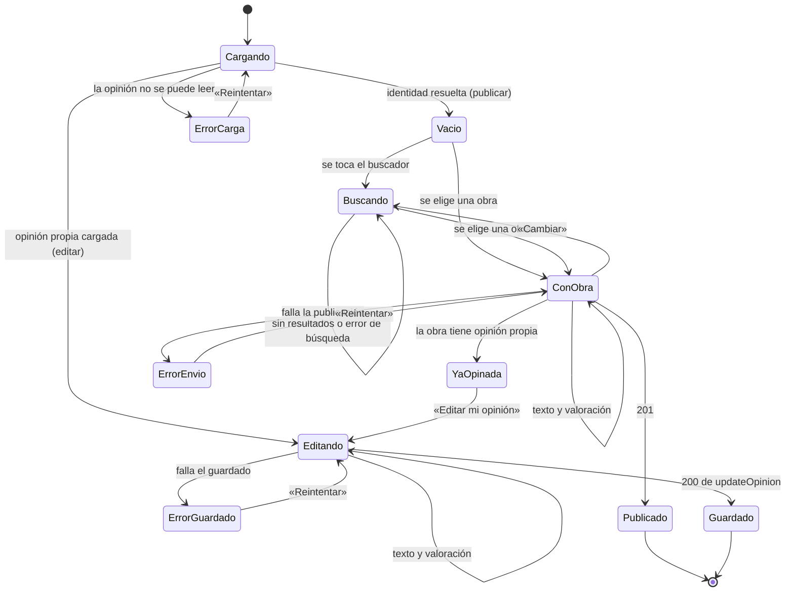

# Especificación funcional — U3 `u3-create-react`

> **Provenance**: deriva de `inception/units-generation/unit-of-work.md` (U3), `inception/units-generation/unit-of-work-story-map.md` (US5.1–US5.3, US6.1, US7.1–US7.3), `inception/user-stories/stories.md` (AC5.1.1–AC5.3.4, AC6.1.1–AC6.1.5, AC7.1.1–AC7.3.4), `inception/requirements-analysis/requirements.md` (FR5, FR6, FR7, FR11, A1, OQ1), `inception/domain-design/components.md` (ContentStore, Catalog, AppShell, DesignSystem), `inception/contract-design/contract-summary.md` (C1 1.3.0, C2 1.3.0, C3, C4 1.2.0, C5), `inception/refined-mockups/mockups.md` (Crear, hoja de comentarios, snackbar, matriz de estados), `inception/refined-mockups/interaction-spec.md` y las respuestas de `functional-design-questions.md` (Q1 = B, Q2 = A, Q3 = A).
> Fecha: 2026-11-14. Etapa: Functional Design · Unidad: `u3-create-react` · Agente: aidlc-architect-agent · Profundidad: Standard.

## Alcance de esta especificación

U3 es la unidad de escritura. Entrega la pantalla **Crear** con búsqueda de obra, el formulario con sus reglas y sus dos modos, la **edición** de la propia opinión, la **hoja de comentarios**, el **me gusta**, **seguir y dejar de seguir**, y el **snackbar** de confirmación, cableados en las cuatro pantallas que ya existen (Inicio, Detalle de obra, Detalle de opinión y Perfil).

Lo que **no** entra: Spotify (conexión, token, búsqueda real, portadas reales) y Actividad. La sesión de Spotify y el `SpotifySearchPort` son de U4: en esta unidad el catálogo responde `offline` y Crear se pinta por la rama «sin Spotify» (FR5.6), que es la única alcanzable en el teléfono hasta U4. El buscador se entrega completo y se prueba con un catálogo de puerto doble; sus dos criterios que dependen de la sesión quedan `Deferred` en la traza, como AC2.2.1 en U2.

Las cuatro pantallas de U2 cambian solo en el cableado de las acciones de la tarjeta. No se rehace ninguna: la tarjeta sigue siendo la única que pinta una opinión, y el detalle de opinión sigue siendo el de U2.

## Vocabulario y actores

| Término | Significado en esta unidad |
|---|---|
| **Persona / quien mira** | Quien usa la app; en esta versión la cuenta demo (`authorId` `demo`). Cada lectura recibe `viewerId` y cada escritura su `authorId`. |
| **Formulario** | La pantalla Crear en cualquiera de sus dos modos: publicar (obra elegible) y editar (obra fija). |
| **Borrador** | Lo que la persona lleva escrito en el formulario: obra, texto y valoración. Vive en el contenedor y no en C4 hasta que se envía. |
| **Entrada de Crear** | `CreateEntry` de C2: modo, obra preseleccionada, opinión que se edita, pestaña de origen y `formKey`. |
| **Hoja** | La hoja inferior de comentarios, modal sobre la pantalla actual. La pinta una sola vez la cáscara. |
| **Reacción** | Me gusta, comentario o seguimiento. Las tres escriben en C4 y ninguna sale del dispositivo. |
| **Confirmación** | El snackbar de una línea que la cáscara muestra 4 s. |
| **Obra de ejemplo** | Una de las 8 obras de `listSampleWorks()`; se puede opinar sobre ellas sin sesión de Spotify. |

## Lo que U3 reutiliza y lo que cambia

| Pieza de U2 | Qué hace U3 con ella |
|---|---|
| `OpinionCard` (estado `own`, fechas, «Editar» pintado) | Se le pasan `onLike`, `onComment`, `onFollow` y `onEdit`; no se reimplementa. |
| `DetalleOpinionScreen` y `DetalleObraScreen` | Ya existen y están registrados; U3 solo cablea «Editar» y las acciones de tarjeta. |
| `useContent`, `useViewerId`, `useNetwork`, `useCatalog`, `opinionCardModel` | Se reutilizan tal cual; se añade un hook de acciones y otro de búsqueda. |
| `OfflineBanner` | Se reutiliza en Crear y Editar con el texto que fija la matriz de estados. |
| `Material de la siembra` | No cambia: 10 opiniones, 5 autores, 8 obras, 2 seguidos, 4 me gusta y 3 comentarios. |
| Cáscara con pila que conserva la raíz | Se conserva; cambia el cierre de Crear (abajo) para volver al detalle de origen. |
| Puntos de montaje `snackbar-mount` y `comment-sheet-mount` | Dejan de ser marcadores vacíos: la cáscara pinta `Snackbar` y `CommentSheet`. |

## La entrada de Crear (C2 1.3.0)

`CreateEntry` ya existe y no cambia de forma salvo un campo: **`formKey`**. Es un entero que sube en cada apertura y es lo que permite que una visita nueva descarte el borrador sin duplicar estado en la cáscara.

| Campo | Quién lo escribe | Qué significa |
|---|---|---|
| `mode` | `openCreate` → `create`; `openEdit` → `edit` | El formulario publica o edita. |
| `preselectedWorkId` | `openCreate({ workId })` | Obra con la que se abre, si se vino del detalle. |
| `editingOpinionId` | `openEdit({ opinionId })` | Opinión que se carga y se actualiza. |
| `returnTo` | La cáscara, con la pestaña activa | A dónde vuelve «Cancelar» y a dónde vuelve «Guardar». |
| `formKey` | La cáscara, incrementándolo | Cambia en cada apertura; el contenedor reinicia el borrador cuando cambia. |

**Cómo se entra y cómo se sale**

| Acción | Efecto en la cáscara | Efecto en la pantalla |
|---|---|---|
| Tocar la pestaña Crear | `mode: create`, sin obra ni opinión, `returnTo` = pestaña anterior, `formKey` nuevo | Formulario limpio. |
| `openCreate({ workId })` desde el detalle | `mode: create` con la obra, `returnTo` = pestaña del detalle | Formulario con obra y buscador plegado. |
| `openEdit({ opinionId })` desde «Editar» | `mode: edit` con la opinión, `returnTo` = pestaña del detalle | Formulario cargado con obra fija. |
| «Cancelar» o atrás del sistema | `closeCreate()`: vuelve a `returnTo` **conservando su pila** y deja Crear limpio | No escribe nada. |
| «Publicar» | `goToTab({ name: 'inicio' })` y después `showSnackbar` | La opinión queda arriba del feed. |
| «Guardar» con cambios | `closeCreate()` y `showSnackbar` | Vuelve al detalle, que ya lee la versión nueva. |
| «Guardar» sin cambios | `closeCreate()`, sin snackbar | Vuelve al detalle sin escribir. |
| «Editar mi opinión» (obra ya opinada) | `openEdit({ opinionId })` | Pasa al modo edición de esa opinión. |

**Divergencia registrada con los mockups**: `mockups.md` § Navegación describe Crear y Editar como un **tercer nivel apilado** sobre el detalle; la cáscara de U1 los resolvió como una **pestaña** sembrada por `CreateEntry`. U3 conserva la pestaña —es lo que C2 congeló y lo que U1 ya probó— y arregla la consecuencia: `closeCreate` deja de reiniciar la pila de la pestaña de origen, de modo que volver devuelve al detalle con su estado y su desplazamiento, como pide el mockup. Se registra en § Assumptions y en `contract-summary.md` § Revisión 15.

## Máquina de estados del formulario

**Respaldo en texto**:

| Estado | Cómo se llega | Qué ve la persona | Salidas |
|---|---|---|---|
| `Cargando` | La pantalla monta y aún no hay `viewerId` o, en edición, no se ha leído la opinión. | Esqueletos con la forma del formulario; la cabecera ya está. | A `Vacio`/`Editando` con los datos; a `ErrorCarga` si la opinión falla. |
| `Vacio` | Modo publicar sin obra elegida. | Buscador abierto (o tarjeta de conexión y selector sin Spotify), texto vacío, valoración a 0, «Publicar» deshabilitado. | A `ConObra` al elegir; a `Buscando` al escribir. |
| `Buscando` | Hay consulta y la lista está en curso, vacía o con error. | Ayuda, esqueletos, resultados, «No encontramos esa obra…» o error con «Reintentar». | A `ConObra` al elegir; sigue en `Buscando` al cambiar el texto. |
| `ConObra` | Hay obra seleccionada y no hay opinión propia sobre ella. | Fila de obra, texto, valoración y «Publicar» (habilitado o no). | A `YaOpinada`, a `Publicado`, a `ErrorEnvio`, a `Buscando` con «Cambiar». |
| `YaOpinada` | La obra elegida ya tiene opinión propia. | «Ya opinaste sobre esta obra.» y «Editar mi opinión» en lugar de «Publicar». | A `Editando` con esa opinión. |
| `Editando` | Modo edición con la opinión cargada. | Obra fija, texto y valoración rellenos, «Guardar». | A `Guardado`, a `ErrorGuardado`; «Cancelar» sale sin escribir. |
| `ErrorCarga` | `getOpinion` falla, la opinión no es propia o no existe. | «No pudimos cargar tu opinión.» con «Reintentar». | A `Cargando` al reintentar. |
| `ErrorEnvio` | `createOpinion` responde algo distinto de `201` y de `409`. | «No pudimos publicar tu opinión.» sobre el botón, con todo conservado. | A `ConObra` al reintentar o editar. |
| `ErrorGuardado` | `updateOpinion` responde algo distinto de `200`. | «No pudimos guardar los cambios.» con todo conservado. | A `Editando` al reintentar. |
| `Publicado` / `Guardado` | La escritura terminó bien. | Navegación y snackbar. | Fin. |

**Invariante**: la pantalla nunca se queda en `Cargando` después de resolver la identidad y, en edición, la opinión. Ningún fallo de red la lleva a `ErrorEnvio`: la publicación es local y el aviso de sin conexión es informativo.

## Flujo F13 — Publicar sin sesión desde el catálogo de ejemplo

1. La persona toca la pestaña Crear. La cáscara escribe una `CreateEntry` nueva con `formKey` distinto y la pestaña anterior en `returnTo`.
2. `CrearScreen` lee el `viewerId` de la sesión. Mientras no llega, pinta la cabecera y esqueletos del formulario.
3. Lee `spotify.status` de `useShellServices()`: es `disconnected` (no hay conexión con Spotify). Pinta la `ConnectionCard` y, debajo, las 8 obras de `listSampleWorks()` en `WorkResultRow`, con el recuento de `countOpinions(workId)`.
4. La persona elige una obra: se guarda `workId`, título y artista; la lista se pliega y aparece la fila de obra. Se consulta `listOpinions({ workId, viewerId })` para saber si ya hay opinión propia.
5. Escribe el texto (hasta 500; contador desde 400) y toca una estrella (1–5; «n de 5» y «Quitar valoración»).
6. Con obra, texto no vacío y valoración, «Publicar» se habilita.
7. Toca «Publicar»: `createOpinion({ authorId: viewerId, workId, workTitle, workArtist, text: text.trim(), rating })`.
8. `201`: la cáscara va a Inicio y muestra «Opinión publicada». El feed se repinta por la suscripción y la opinión nueva queda la primera (BR4.5).
9. La portada de esa opinión es el bloque con la inicial, en Inicio y en el detalle de la obra (AC5.2.2, AC5.2.4), porque sin sesión de Spotify no hay URL real (BR5.3).

**Casos límite**

| Caso | Comportamiento |
|---|---|
| La obra elegida ya tiene opinión propia | Estado `YaOpinada`: aviso y «Editar mi opinión» (BR11.6, AC5.1.6). |
| Sin conexión a internet | Aviso «Sin conexión. Puedes opinar sobre las obras de ejemplo.» bajo la cabecera; se elige, se escribe y se publica igual (BR11.11, AC5.2.3). |
| `createOpinion` responde `422` | «No pudimos publicar tu opinión.» con «Reintentar»; se conserva todo (BR11.7). Aunque el texto pase el filtro de la pantalla, la respuesta se trata como error genérico y no se muestra el código. |
| `createOpinion` responde `409` | Se pasa a `YaOpinada` con la opinión que ya existe; no se muestra error de envío. |
| La obra no está en el catálogo | Se conservan título y artista que trajo la navegación; el formulario no se bloquea. |
| El texto queda en solo espacios | «Publicar» sigue deshabilitado: el recorte precede a la comprobación. |

## Flujo F14 — Buscar y elegir una obra con sesión de Spotify

Este flujo **no es alcanzable en el teléfono hasta U4**, porque no hay sesión de Spotify ni `SpotifySearchPort`; se entrega completo y se verifica con un catálogo de puerto doble. En cuanto U4 conecte la sesión, la misma pantalla lo recorre sin cambios.

1. Con `spotify.status === 'connected'`, Crear pinta el `SearchField` en lugar de la tarjeta de conexión.
2. Al escribir un carácter: «Escribe al menos 2 caracteres.» y ninguna petición.
3. A partir de 2 caracteres: se cancela el temporizador anterior, se esperan 400 ms y se llama a `catalog.searchWorks(query)`.
4. Mientras responde: 3 esqueletos de fila. Con resultados: hasta 5 `WorkResultRow` visibles con scroll interno. Sin resultados: «No encontramos esa obra. Prueba con otro nombre.». Error: «No pudimos buscar en Spotify.» con «Reintentar», que repite la última consulta escrita.
5. Elegir una fila la selecciona, pliega el buscador y muestra la fila de obra con «Cambiar» (AC5.1.1).
6. «Cambiar» vuelve a desplegar el buscador con el texto vacío; elegir otra obra sustituye la anterior.
7. La ✕ limpia el campo y vuelve al estado inicial sin petición; una respuesta que llega tarde para una consulta vieja se descarta.

## Flujo F15 — Crear desde el detalle con la obra preseleccionada

1. En el detalle de una obra sin opinión propia, la persona toca «Opinar sobre esta obra».
2. La pantalla llama a `openCreate({ workId })`: la cáscara escribe `mode: create`, `preselectedWorkId`, `returnTo` = la pestaña de origen y un `formKey` nuevo.
3. Crear resuelve la obra con `catalog.getWork(workId)` y la pinta en la fila, con el buscador **plegado** (AC5.3.1).
4. «Cambiar» despliega el buscador y permite elegir otra (AC5.3.2); elegirla sustituye la preseleccionada.
5. «Cancelar» llama a `closeCreate()` y devuelve al detalle de la obra, que sigue en su sitio (AC5.3.3).
6. Publicar sigue el flujo F13 desde el paso 5, y al terminar va a Inicio (no al detalle).

## Flujo F16 — La obra ya tiene mi opinión

1. Al elegir una obra, Crear comprueba `listOpinions({ workId, viewerId })` y encuentra una opinión propia.
2. Bajo la fila de obra aparece «Ya opinaste sobre esta obra.» y el botón deja de ser «Publicar»: es «Editar mi opinión» (AC5.1.6).
3. Tocar «Editar mi opinión» llama a `openEdit({ opinionId })` con la opinión encontrada; la pantalla pasa a modo edición con el texto y la valoración de esa opinión.
4. Si la comprobación no vio la opinión pero C4 responde `409` al publicar, se cae en este mismo estado; no se muestra el error de envío.

## Flujo F17 — Editar mi opinión

1. En el detalle de obra, en el detalle de opinión o en Perfil, la tarjeta propia muestra «Editar». Tocar llama a `openEdit({ opinionId })`.
2. La cáscara escribe `mode: edit`, `editingOpinionId`, `returnTo` = la pestaña del detalle y un `formKey` nuevo.
3. Crear pinta la cabecera «Editar opinión» y, mientras lee, esqueletos. Lee la opinión con `getOpinion({ opinionId, viewerId })` y rellena obra, texto y valoración; la obra queda **fija** (AC6.1.1, AC6.1.2).
4. La persona cambia el texto o la valoración. «Guardar» se habilita con las mismas reglas que «Publicar».
5. «Guardar» con cambios: `updateOpinion({ opinionId, authorId: viewerId, viewerId, text: text.trim(), rating })`. Con `200`, la cáscara muestra «Opinión actualizada» y llama a `closeCreate()`, que devuelve al detalle de origen; allí la tarjeta ya muestra el texto nuevo y «Editada el …» con la fecha de modificación (AC6.1.3, AC6.1.4). No se crea ninguna opinión.
6. «Guardar» sin cambios (mismo texto recortado y misma valoración): no se llama a C4, no se mueve `updatedAt`, no hay snackbar y se vuelve al detalle (AC6.1.5).
7. «Cancelar» o atrás: `closeCreate()` sin escribir; el detalle sigue mostrando la versión anterior (AC5.3.3, BR12.6).
8. Si `getOpinion` falla, no es propia o no existe: «No pudimos cargar tu opinión.» con «Reintentar».
9. Si `updateOpinion` falla con `403` o `404`: se pasa al error de carga. Con cualquier otro código: «No pudimos guardar los cambios.» con «Reintentar» y todo lo escrito conservado.

## Flujo F18 — Comentar una opinión

1. La persona toca «💬» en cualquier tarjeta (propia o ajena). La pantalla llama a `comments.open(opinionId)`.
2. La cáscara monta la hoja sobre la pestaña activa, sin cambiarla ni desmontar lo de debajo, y el controlador lee `listComments({ opinionId })`.
3. Con comentarios: la lista los muestra del más antiguo al más reciente, con avatar, handle, tiempo relativo y texto. Sin comentarios: «Sé el primero en comentar» (AC7.2.2, AC7.2.3).
4. La persona escribe en «Escribe un comentario…». El botón de enviar se habilita con texto no vacío; el campo admite hasta 300 caracteres y muestra «N/300» desde 250.
5. Al enviar, el controlador llama a `addComment({ opinionId, authorId: viewerId, text: text.trim() })`.
6. Con `201`: el comentario aparece al final de la lista, el campo se limpia, la tarjeta sube su contador porque C4 emitió y la cáscara muestra «Comentario publicado». La hoja sigue abierta (AC7.2.4).
7. Con error: «No pudimos enviar tu comentario.» con «Reintentar», el texto sigue escrito y el contador no cambia (AC7.2.5).
8. La hoja se cierra con ✕, con arrastre o tocando el velo; al cerrarse descarta el borrador del campo y no cambia de pestaña.
9. Sin conexión, el comentario se guarda igual porque C4 es local y no hace ninguna petición (AC7.2.6).

## Flujo F19 — Dar y quitar me gusta

1. La persona toca «♡ n» en una tarjeta que no es suya.
2. La pantalla llama a `toggleLike({ opinionId, authorId: viewerId })`.
3. Con `200`, C4 emite y la tarjeta se repinta: «♥ n+1» en color de error. Volver a tocar devuelve «♡ n» (AC7.1.1, AC7.1.2).
4. Si la escritura no es correcta, el estado no cambia y aparece «No pudimos guardar tu me gusta».
5. Dar me gusta no genera ningún evento de Actividad (AC7.1.3, ADR-006).
6. En la opinión propia el corazón se pinta como contador de solo lectura y no responde (Q3 = A).
7. El me gusta se pierde al cerrar la app, porque vive en memoria; ningún texto promete lo contrario (AC7.1.4).

## Flujo F20 — Seguir y dejar de seguir a un autor

1. La persona toca «Seguir autor» en una tarjeta que no es suya.
2. La pantalla llama a `toggleFollow({ authorId, followerId: viewerId })`.
3. Con `200`, el botón pasa a «Siguiendo» y el contador «N siguiendo» de Perfil sube; la cáscara muestra «Ahora sigues a @handle» (AC7.3.1).
4. Volver a tocar «Siguiendo» lo devuelve a «Seguir autor», baja el contador y muestra «Ya no sigues a @handle» (AC7.3.2).
5. Si la escritura falla, no cambia nada y aparece «No pudimos guardar tu seguimiento».
6. En la opinión propia el botón no se pinta; el `409` de seguirse a uno mismo no puede ocurrir desde la interfaz.
7. El seguimiento funciona sin conexión y se pierde al cerrar la app (AC7.3.4).

## La hoja de comentarios

| Estado | Cómo se llega | Qué se ve | Salidas |
|---|---|---|---|
| Cerrada | Estado inicial (`opinionId: null`). | No se monta. | A cargando al abrir. |
| Cargando | `open(opinionId)`. | Hoja con la lista vacía y esqueletos de fila. | A lista, vacía o error. |
| Vacía | `listComments` devuelve 0. | «Sé el primero en comentar» y el campo. | A lista al enviar el primero. |
| Con comentarios | La lectura trae al menos uno. | Filas con autor, handle, tiempo y texto; campo al pie. | A lista al enviar; a error de envío si falla. |
| Error de carga | `listComments` falla o la opinión no existe. | «No pudimos cargar los comentarios.» con «Reintentar». | A cargando al reintentar. |
| Error de envío | `addComment` falla. | «No pudimos enviar tu comentario.» con «Reintentar», texto conservado. | A lista al reintentar con éxito. |

**Comportamiento**: alto máximo 70 % de la pantalla con scroll interno en la lista; el campo queda siempre visible por encima del teclado; el foco entra en el campo al abrir y vuelve al «💬» al cerrar; el envío es síncrono, así que no hay un estado «enviando» visible (BR14.5, § Assumptions).

**Qué guarda el controlador**: `opinionId`, los `CommentModel` ya mapeados, el estado de la lista y si el último envío falló. No guarda el texto del campo: lo posee la hoja, y por eso sobrevive al error. `close()` vuelve al estado cerrado y descarta el borrador.

## Textos exactos de la interfaz

| Dónde | Texto | Notas |
|---|---|---|
| Crear, cabecera | «Crear» / «Editar opinión» | Según el modo. |
| Crear, acción | «Cancelar» | `TextButton` en la cabecera; vuelve sin escribir. |
| Crear, sección | «Obra» · «Tu opinión» · «Valoración» | Encabezados de sección. |
| Crear, buscador | «Busca en Spotify…» | Ayuda dentro del campo. |
| Crear, consulta corta | «Escribe al menos 2 caracteres.» | Sin petición. |
| Crear, sin resultados | «No encontramos esa obra. Prueba con otro nombre.» | Bajo el buscador. |
| Crear, error de búsqueda | «No pudimos buscar en Spotify.» | Con «Reintentar». |
| Crear, obra elegida | «Cambiar» | Acción de la fila; solo en modo publicar. |
| Crear, sin Spotify | «Conecta Spotify para buscar en el catálogo completo.» + «Conectar con Spotify» | `ConnectionCard`; la acción no responde hasta U4. |
| Crear, texto | «Escribe lo que piensas…» | Placeholder del campo. |
| Crear, contador | «420/500» | Solo desde 400 caracteres. |
| Crear, estrellas | «Sin valorar» / «4 de 5» | Debajo de las estrellas. |
| Crear, quitar | «Quitar valoración» | Acción de texto, solo con valoración. |
| Crear, botón | «Publicar» / «Guardar» | Según el modo. |
| Obra ya opinada | «Ya opinaste sobre esta obra.» + «Editar mi opinión» | Sustituye a «Publicar». |
| Error al publicar | «No pudimos publicar tu opinión.» | Con «Reintentar». |
| Error al guardar | «No pudimos guardar los cambios.» | Con «Reintentar». |
| Error al cargar la edición | «No pudimos cargar tu opinión.» | Con «Reintentar». |
| Sin conexión en Crear | «Sin conexión. Puedes opinar sobre las obras de ejemplo.» | `OfflineBanner` bajo la cabecera. |
| Sin conexión en Editar | «Sin conexión. Estás viendo lo último que cargamos.» | El aviso único de U2. |
| Hoja, título | «Comentarios» | `type.title2`, con ✕. |
| Hoja, vacía | «Sé el primero en comentar» | Cuerpo de la lista. |
| Hoja, campo | «Escribe un comentario…» | Placeholder. |
| Hoja, enviar | «Enviar» | Etiqueta accesible del botón de 44×44. |
| Hoja, contador | «260/300» | Solo desde 250. |
| Hoja, error de carga | «No pudimos cargar los comentarios.» | Con «Reintentar»; texto añadido por esta unidad. |
| Hoja, error de envío | «No pudimos enviar tu comentario.» | Con «Reintentar». |
| Tarjeta, seguir | «Seguir autor» / «Siguiendo» | Según `followedByMe`. |
| Tarjeta, editar | «Editar» | Solo en la opinión propia. |
| Fila de obra | «3 opiniones» / «Sé el primero en opinar» | Singular «1 opinión». |
| Confirmaciones | «Opinión publicada» · «Opinión actualizada» · «Comentario publicado» · «Ahora sigues a @ana» · «Ya no sigues a @ana» | Snackbar de 4 s. |
| Fallo de reacción | «No pudimos guardar tu me gusta» · «No pudimos guardar tu seguimiento» | Snackbar; el estado no cambia. |
| Botón de reintento | «Reintentar» | Único texto de acción de los errores. |

Ningún texto visible se escribe en inglés ni muestra códigos técnicos. Los textos de error que no vienen de `interaction-spec.md` § Copy (carga de la edición, carga de comentarios, fallo de reacción) se añaden aquí porque FR11.2 exige que todo error tenga mensaje y acción; se registran en § Assumptions.

## Reglas derivadas

Esta tabla es la vista de lectura de `rules.md`; la fuente de verdad es ese archivo.

| Regla | Enunciado corto | Origen |
|---|---|---|
| BR11.1–BR11.11 | Crear: modos, habilitación, tope de 500, valoración, publicar, obra ya opinada, error, cancelar, sin Spotify, preselección y sin red. | FR5, FR6.1, OQ1, A1 |
| BR12.1–BR12.7 | Editar: carga, obra fija, guardar con y sin cambios, errores, cancelar y reglas compartidas. | FR6.2–FR6.4 |
| BR13.1–BR13.5 | Búsqueda de obra: disparo, estados, selección, cancelación y ausencia de puerto. | FR5.1, FR5.5, FR5.7 |
| BR14.1–BR14.10 | Me gusta, comentar y seguir: alternancia, opinión propia, hoja, validación, errores, localidad y sin red. | FR7, AC7.x, ADR-006 |
| BR15.1–BR15.4 | Snackbar único, textos de confirmación, errores en llano y aviso de sin conexión. | FR11 |

## Contratos que U3 posee y consume

| Contrato | Papel de U3 | Qué se entrega |
|---|---|---|
| **C1** `@melodify/design-system` | Consumidor y publicador de la **1.3.0** | Ocho piezas nuevas y cuatro adiciones opcionales (abajo). |
| **C2** `@melodify/app-shell` | Consumidor y publicador de la **1.3.0** | `CreateEntry.formKey`, `CommentSheetState.failed`, el cierre de Crear que conserva la pila, el atrás que cancela y el montaje real de `Snackbar` y `CommentSheet`. |
| **C3** `@melodify/app-session` | Consumidor | El `authorId` de cada escritura y el `viewerId` que ya usa U2. |
| **C4** `@melodify/content-store` | Consumidor; **U2 lo publica en 1.2.0** | Los dos topes de longitud (500 y 300) que hoy no aplica. |
| **C5** `@melodify/catalog` | Consumidor | `listSampleWorks`, `getWork`, `countOpinions`, `coverFor` y `searchWorks`; no cambia. |
| **C7, C8** | Consumidor futuro | No se importan en U3. |

### Por qué C1 sube a 1.3.0 y no a 1.4.0

`contract-summary.md` § Enmienda de la revisión 9 planificó la 1.3.0 para U4 y la 1.4.0 para U3, dando por hecho que U4 se construiría antes. La secuencia real la fija `unit-of-work.md` § U3 y § U4 en orden **unit-major**, así que U3 se construye primero y necesita ya cuatro piezas que la tabla asignaba a U4: `SearchField`, `ConnectionCard` y `WorkResultRow` —las usa su buscador y su selector de ejemplo— además de las cinco suyas. Se resuelve así:

| Versión | Unidad | Piezas |
|---|---|---|
| 1.3.0 | U3 | `SearchField`, `ConnectionCard`, `WorkResultRow`, `RatingInput`, `MultilineField`, `SecondaryButton`, `CommentSheet` y `Snackbar` |
| 1.4.0 | U4 | `SpotifyCard` |
| 1.5.0 | U5 | `ActivityRow`, `DayHeader` |

Es la misma entrega total, repartida por quien llega primero; ningún consumidor cambia por ello. Se registra en `contract-summary.md` § Revisión 15.

### Contenido de C1 1.3.0

| Pieza | Props | Estados y reglas que sostiene |
|---|---|---|
| `SearchField` | `value`, `onChangeText`, `placeholder?`, `autoFocus?`, `disabled?`, `loading?`, `onClear?` | Lupa, ✕ con texto, indicador con `loading`. No temporiza: los 400 ms y los 2 caracteres son del contenedor (BR13.1). |
| `ConnectionCard` | `title`, `body`, `actionLabel`, `onAction` | La invitación a conectar de Crear sin sesión (BR11.9). |
| `WorkResultRow` | `work: WorkSummary`, `opinionCount`, `onPress` | Fila de resultado y de ejemplo, con «N opiniones» o «Sé el primero en opinar». |
| `RatingInput` | `value` 0–5, `onChange`, `disabled?` | Cinco objetivos de 44×44, «n de 5» o «Sin valorar», `radiogroup` lógico. Repetir el toque no borra (BR11.4). |
| `MultilineField` | `label`, `value`, `onChangeText`, `placeholder?`, `error?`, `maxLength?`, `counterFrom?`, `editable?`, `minHeight?`, `testID?` | Altura mínima 120 y máxima 240 con scroll, borde de error y contador «N/max» desde `counterFrom` (BR11.3). |
| `SecondaryButton` | `label`, `onPress`, `disabled?` | La jerarquía de acción secundaria, que hoy no existe. |
| `CommentSheet` | `opinionId`, `comments`, `status`, `failed?`, `maxLength?`, `onSubmit`, `onRetry`, `onClose` | Hoja modal con lista, vacío, error, campo y botón de enviar. Guarda su propio borrador (BR14.4–BR14.7). |
| `Snackbar` | `message`, `visible`, `onDismiss` | Franja sobre la barra, 4 s, sin acciones (BR15.1). |

**Adiciones a piezas existentes**:

| Pieza | Adición | Por qué |
|---|---|---|
| `SocialActionBar` | `showLike?: boolean` (por defecto `true`). Con `false`, el glifo y el contador se pintan como texto, sin `Pressable` ni rol. | Q3 = A pide ocultar el me gusta en la opinión propia y conservar el contador como texto no pulsable. |
| `OpinionCard` | La etiqueta de seguir pasa de «Seguir» a **«Seguir autor»** y alterna con **«Siguiendo»** según `opinion.followedByMe`. Sigue ocultándose en la opinión propia. | FR7.4 y AC7.3.1 nombran «Seguir autor» y «Siguiendo», y el modelo ya lleva `followedByMe`; es la «open question para U3» que dejó U2 (§ Assumptions). |
| `CommentSheet` | `failed?: boolean` en lugar de un estado `error` que borraría la lista ya cargada. | Un error de envío no debe ocultar los comentarios que sí se leyeron. |

### Enmienda a C2 1.3.0 — el ciclo de Crear y los dos montajes

C2 sube a **1.3.0** por comportamiento, con dos campos aditivos. No cambia ninguna exportación ni la forma de `GlobalServices` más allá de lo que ya declaraba.

| Punto | Cómo queda | Por qué |
|---|---|---|
| `CreateEntry.formKey` | Entero nuevo, requerido, que sube en cada `openCreate`, `openEdit` y visita a la pestaña. | El borrador vive en la pantalla y la cáscara ya reinicia la pila; sin una marca, React conserva el estado de la raíz de Crear y una visita nueva arrastraría el texto anterior. |
| `closeCreate` | Vuelve a `returnTo` **sin reiniciar su pila** y deja la pestaña Crear con el formulario limpio. | Hoy reinicia la pila de origen y con eso el detalle desaparece; AC6.1.3 pide volver al detalle y AC5.3.3 a la pantalla anterior. |
| Atrás del sistema en Crear | Se comporta como «Cancelar»: llama a `closeCreate()` y consume el evento. | Es la única pantalla con un borrador que se pierde; el resto de pestañas conserva el comportamiento del esqueleto. |
| Snackbar | La cáscara pinta `Snackbar` (C1 1.3.0) con el mensaje de `showSnackbar` y lo limpia con `onDismiss`; cualquier cambio de pestaña limpia el mensaje pendiente. | U1 dejó solo `testID="snackbar-mount"`; sin montaje real, publicar no confirma nada (AC5.1.4, BR15.1). |
| Hoja de comentarios | La cáscara se suscribe a `services.comments`, pinta `CommentSheet` cuando `state.opinionId` no es nulo y le pasa `state` y las cuatro acciones. | Igual que el snackbar: el punto de montaje existía sin contenido (BR14.3). |
| `CommentSheetState` | Añade `failed: boolean` (el envío anterior falló). | Separa «no se pudieron cargar los comentarios» de «no se pudo enviar el último», sin borrar la lista. |

**Orden de la confirmación al publicar**: la pantalla llama primero a `goToTab({ name: 'inicio' })` —que limpia el snackbar— y después a `showSnackbar({ message: 'Opinión publicada' })`. Si se hiciera al revés, el propio cambio de pestaña borraría el aviso.

### Enmienda a C4 1.2.0 — los dos topes

C4 sube a **1.2.0** porque las dos reglas que esta etapa cierra (Q1 = B, Q2 = A) tienen que valer también fuera de la pantalla:

| Operación | Regla que se añade | Por qué |
|---|---|---|
| `createOpinion` y `updateOpinion` | `text` recortado no vacío y de **hasta 500 caracteres**; por encima, `422`. | Una prueba puede llamar directamente a C4; si el tope viviera solo en el campo, el contrato aceptaría lo que el formulario prohíbe. |
| `addComment` | `text` recortado no vacío y de **hasta 300 caracteres**; por encima, `422`. | El contrato ya declaraba «fuera de límite» sin número; Q2 = A le pone el número y una prueba que lo sostiene. |

No cambia ninguna vista ni operación: solo dos validaciones que ya estaban anunciadas como `422`. El tope de 500 que U2 retiró a propósito (revisión 14) vuelve aquí con su decisión tomada y su prueba.

## Puntos de integración con las unidades siguientes

| Punto | Quién lo consume | Qué deja U3 listo |
|---|---|---|
| C1 1.3.0 | U4, U5, U6 | Ocho piezas nuevas; `SearchField`, `ConnectionCard` y `WorkResultRow` ya en la versión que U4 esperaba. |
| C2 1.3.0 | U4, U5, U6 | `CreateEntry.formKey`, el cierre que conserva la pila de origen, el atrás que cancela y los dos montajes reales. |
| `createCommentsController` en `app/src/comments/` | U6 | La hoja completa con su controlador, inyectado en `shell-services`: U4–U5 no lo tocan. |
| `useCardActions` en `app/src/state/` | U4, U5 | Las cuatro acciones de la tarjeta (me gusta, comentar, seguir, editar) resueltas en un solo sitio; Explorar y Actividad las heredan. |
| Crear en modo publicar | U4 | La sesión de Spotify y el puerto de búsqueda son lo único que falta; la pantalla ya sabe buscar, plegar y elegir. |
| `openCreate({ workId })` cableado | U4 | Explorar puede abrir Crear con la obra elegida sin tocar la pantalla. |
| `openEdit({ opinionId })` cableado en las tres pantallas | U5, U6 | Cualquier tarjeta propia edita desde donde esté. |
| «Editar» y las fechas de la opinión propia | U6 | El recorrido de las seis pantallas ya puede mostrar creación y modificación. |
| Snackbar montado | U5 | La Actividad confirma con el mismo aviso. |
| Contenido en memoria | U6 | Me gusta, comentarios y seguimientos se pierden al cerrar, como el resto del contenido. |

## Historias implementadas

| Historia | Título | Criterios cubiertos |
|---|---|---|
| US5.1 | Publicar desde Crear con una obra de Spotify | AC5.1.1 (`Deferred`: la sesión de Spotify y el puerto de búsqueda son de U4; el buscador se entrega y se prueba con un doble), AC5.1.2, AC5.1.3, AC5.1.4, AC5.1.5 (`Deferred`: igual que AC5.1.1), AC5.1.6 |
| US5.2 | Publicar sin sesión desde el catálogo de ejemplo | AC5.2.1, AC5.2.2, AC5.2.3, AC5.2.4 |
| US5.3 | Publicar desde el detalle sin perder lo escrito | AC5.3.1, AC5.3.2, AC5.3.3, AC5.3.4 |
| US6.1 | Editar mi opinión y ver la fecha | AC6.1.1, AC6.1.2, AC6.1.3, AC6.1.4, AC6.1.5 |
| US7.1 | Dar y quitar me gusta | AC7.1.1, AC7.1.2, AC7.1.3, AC7.1.4 |
| US7.2 | Comentar una opinión | AC7.2.1, AC7.2.2, AC7.2.3, AC7.2.4, AC7.2.5, AC7.2.6 |
| US7.3 | Seguir a un autor | AC7.3.1, AC7.3.2, AC7.3.3 (ya se cumple con la siembra de U2 y esta unidad no la cambia), AC7.3.4 |

## Recorrido en el teléfono (Expo Go, Android)

Lo que no se puede demostrar con Jest y hay que ver en el dispositivo físico antes de dar la unidad por terminada:

| Paso | Qué se demuestra |
|---|---|
| Abrir Crear sin sesión de Spotify | **AC5.2.1**: tarjeta de conexión y las 8 obras de ejemplo en lugar del buscador. |
| Elegir una obra, escribir hasta pasar de 400 caracteres y seguir hasta 500 | **BR11.3**: el contador aparece en 400 y el campo no acepta el carácter 501. |
| Tocar la misma estrella dos veces y luego «Quitar valoración» | **BR11.4**: repetir no borra; la acción de texto sí, y «Publicar» se deshabilita con valoración 0. |
| Publicar y volver a Inicio | **AC5.1.4, AC5.2.2**: snackbar «Opinión publicada» y la opinión arriba del feed, con portada de bloque. |
| Volver a Crear y elegir la misma obra | **AC5.1.6**: «Ya opinaste sobre esta obra.» y «Editar mi opinión». |
| Desde el detalle de una obra sin opinión propia, tocar «Opinar sobre esta obra», desplegar «Cambiar» y cancelar | **AC5.3.1, AC5.3.2, AC5.3.3**: obra preseleccionada, buscador desplegable y vuelta al detalle sin publicar. |
| Desde el detalle de una opinión propia, «Editar», guardar sin cambios y después con un cambio | **AC6.1.1–AC6.1.5**: obra fija, campos rellenos, sin marca de edición la primera vez y «Editada el …» la segunda. Que el detalle conserve su desplazamiento al volver solo se ve aquí. |
| Tocar «💬» en una tarjeta, comentar y cerrar la hoja | **AC7.2.1–AC7.2.4**: la hoja se abre sobre la pantalla, el comentario aparece al final, el contador sube y la pestaña no cambia. |
| Dar me gusta, quitarlo y seguir a un autor; abrir Perfil | **AC7.1.1, AC7.1.2, AC7.3.1, AC7.3.2**: glifo y contador alternan, los snackbars aparecen y «N siguiendo» cambia. |
| Activar el modo avión y comentar y seguir | **AC7.2.6, AC7.3.4**: las dos acciones funcionan igual, sin ningún aviso de error. |
| Cerrar la app por completo y volver a entrar | **AC7.1.4, FR7.6**: el me gusta, el comentario y el seguimiento se han perdido; la opinión publicada también. |

## Assumptions & Open Questions

- `[assumption]` **El contenido vive en memoria** (CT-02, CT-03): ninguna escritura de esta unidad sobrevive al cierre. Es lo que AC7.1.4 y FR7.6 esperan.
- `[assumption]` **AC5.1.1 y AC5.1.5 quedan `Deferred`**: exigen una sesión de Spotify que no existe hasta U4, y C5 devuelve `offline` sin puerto. La pantalla se entrega completa y se prueba con un catálogo construido con un `search` doble; U4 los cierra en el teléfono. Es el mismo trato que AC2.2.1 recibió en U2.
- `[assumption]` **Crear y Editar son una pestaña, no un tercer nivel apilado** (divergencia con `mockups.md` § Navegación). Es lo que C2 congeló en U1 y lo que U1 ya probó; U3 arregla la consecuencia con `closeCreate` conservando la pila de origen y el atrás que cancela, de modo que el resultado observable —volver al detalle en su sitio— es el del mockup. Se registra en `contract-summary.md` § Revisión 15.
- `[assumption]` **El formulario no muestra un estado «enviando»**: C4 es síncrono y local, así que la escritura termina en el mismo gesto y un «Publicando…» sería un fotograma que nadie ve. Los textos «Publicando…» del mockup no se implementan; el botón solo se deshabilita con el formulario incompleto. Se aparta de `mockups.md` § Estados y se registra aquí.
- `[assumption]` **El me gusta se oculta en la opinión propia** (Q3 = A), con el contador como texto no pulsable; `interaction-spec.md` § SocialActionBar lo pintaba en todas las tarjetas y solo ocultaba «Seguir autor». La razón es que un me gusta propio aparecería en Actividad como «me gusta recibido» (FR8.1, AC8.1.2).
- `[assumption]` **La etiqueta de seguir cambia a «Seguir autor»/«Siguiendo»**: C1 pintaba «Seguir» y los requisitos y las historias nombran «Seguir autor» y «Siguiendo». Se resuelve en la tarjeta —que es la única que pinta la acción— con el `followedByMe` que el modelo ya llevaba; cierra la open question que dejó U2.
- `[assumption]` **`422` no se distingue de un fallo genérico** al publicar o guardar: el formulario ya impide los casos que C4 rechaza, así que si llega un `422` es una discrepancia entre capas y se muestra «No pudimos publicar tu opinión.» o «No pudimos guardar los cambios.» con «Reintentar». `409` sí se distingue: significa «obra ya opinada».
- `[assumption]` **El error al cargar la edición y el de cargar comentarios son rutas defensivas**: el almacén es local, pero `getOpinion` puede responder `403`/`404` y `listComments` puede fallar con un doble. FR11.1 exige que los estados existan y sus textos se fijan aquí porque `interaction-spec.md` § Copy no los traía.
- `[assumption]` **El borrador de la hoja de comentarios vive en la hoja** y no en el controlador: es lo que hace que el texto sobreviva a un error de envío (AC7.2.5) sin que la cáscara guarde estado de un campo.
- `[assumption]` **`closeCreate` conserva la pila de la pestaña de origen**: es un cambio de comportamiento de C2, no de props. Sin él, volver desde Editar aterrizaba en la raíz de la pestaña y AC6.1.3 no se podía cumplir.
- `[assumption]` **`CommentSheetState.failed`** separa el fallo de envío del fallo de lectura; el estado `error` de la lista se reserva para «no se pudieron cargar los comentarios».
- **Open question para U4**: al conectar la sesión de Spotify, `spotify.status` pasa a `connected` y Crear monta el buscador. El puerto de búsqueda debe respetar los 2 caracteres y los 400 ms que ya impone el contenedor; si U4 quisiera otro disparo, es un cambio de esta especificación, no de la pantalla.
- **Open question para U5**: Actividad no debe pintar el me gusta propio porque la interfaz ya no permite darlo; si algún día se permitiera, esta decisión (Q3 = A) es la que hay que revisar.

## Sources

- `unit-of-work` — `inception/units-generation/unit-of-work.md` (§ U3).
- `unit-of-work-story-map` — `inception/units-generation/unit-of-work-story-map.md` (US5.1–US5.3, US6.1, US7.1–US7.3).
- `stories` — `inception/user-stories/stories.md` (US5.x, US6.1, US7.x).
- `requirements` — `inception/requirements-analysis/requirements.md` (FR5, FR6, FR7, FR11, A1, OQ1).
- `components` — `inception/domain-design/components.md` (ContentStore, Catalog, AppShell, DesignSystem).
- `contract-summary` — `inception/contract-design/contract-summary.md` (C1, C2, C3, C4, C5; revisión 15).
- `mockups` — `inception/refined-mockups/mockups.md` (Pantalla 4, hojas y avisos, matriz de estados, navegación).
- `interaction-spec` — `inception/refined-mockups/interaction-spec.md` (§ RatingInput, SocialActionBar, ConnectionCard, SearchField, MultilineField, Snackbar, CommentSheet, Buttons, WorkResultRow, flujos y copy).
- `design-system-mapping` — `inception/refined-mockups/design-system-mapping.md` (inventario y tokens).
- `rules` — `construction/u3-create-react/functional-design/rules.md` (BR11–BR15).
- `functional-design-questions` — `construction/u3-create-react/functional-design/functional-design-questions.md` (Q1 = B, Q2 = A, Q3 = A).
