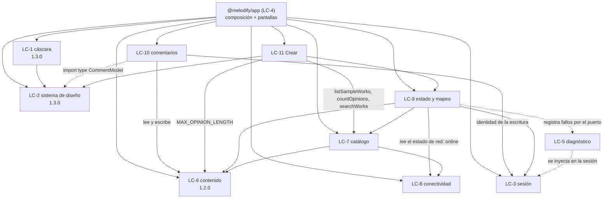

# Componentes lógicos — U3 `u3-create-react`

> **Provenance**: deriva de `inception/domain-design/components.md` (ContentStore, Catalog, Connectivity, AppShell, DesignSystem), de `inception/contract-design/contract-summary.md` (§ Estructura del monorepo, C1 1.3.0, C2 1.3.0, C3, C4 1.2.0, C5, C6, § Revisiones 15 y 16), de `nfr-requirements/tech-stack-decisions.md` (TS-23 a TS-30, más los heredados TS-14 a TS-22), de `nfr-requirements/performance-requirements.md` (NFR1.9–1.11, NFR2.7–2.9, NFR8.8–8.11), de `nfr-requirements/security-requirements.md` (NFR3.12–3.16, NFR4.7–4.8, NFR9.6), de `functional-design/frontend-components.md` (§ Jerarquía, § Paquetes, § `app/src/comments/`, § `app/src/state/`, § `app/src/screens/crear/`, § `app/src/bootstrap/`), de `construction/u2-content-core/nfr-design/logical-components.md` (LC-1 a LC-9, inventario heredado) y de `performance-design.md` / `security-design.md` de esta misma etapa.
> Fecha: 2026-11-15. Etapa: NFR Design · Unidad: `u3-create-react` · Agente: aidlc-architect-agent · Profundidad: Standard.

## Qué describe este archivo

`logical-components.md` pide un inventario de componentes, dominios de fallo y radio de impacto. U3 sigue sin servidor: no hay servicios que aislar ni réplicas que repartir. Lo que sí añade son **dos áreas nuevas con fallo propio** —la hoja de comentarios y el formulario de Crear— y **tres paquetes que cambian de versión**. El inventario continúa la numeración de U1 y U2 para que las tres unidades se puedan leer juntas.

## Alcance: qué se diseña y qué no

- **Escalabilidad** (`scalability-design`): no se diseña. `requirements.md` no fija ningún objetivo y U3 no introduce ninguno: el contenido vive en memoria, no hay servidor y la app la usa una persona (RC-02, RC-03). Su ausencia es una decisión, no un olvido.
- **Fiabilidad** (`reliability-design`): filtrada por `produces_kinds`; se diseña en `performance-design.md` § NFR1 (los estados de Crear y de la hoja, el borrador que sobrevive al fallo, el cierre que devuelve el detalle intacto) y en § NFR2.6/NFR2.5/NFR1.4 para lo heredado.
- **Observabilidad** (`observability-design`): filtrada igual; se diseña en `security-design.md` § NFR9 (un solo logger, `SEARCH_PORT_UNAVAILABLE`, sin telemetría).
- **Rendimiento y usabilidad**: `performance-design.md`; **seguridad, privacidad y diagnóstico**: `security-design.md`.

## Inventario

| ID | Componente lógico | Dónde vive | Responsabilidad | Dueño |
|---|---|---|---|---|
| **LC-1** | Cáscara y navegación | `packages/app-shell/` (`@melodify/app-shell` 1.3.0) | `AppShell`, barra de cinco pestañas, pila de cada pestaña, `ShellServices`; **U3 publica** `CreateEntry.formKey`, `CommentSheetState.failed`/`maxLength`/`counterFrom`, `closeCreate` que conserva la pila, el atrás que cancela, `submit` que devuelve `boolean` y los montajes reales de `Snackbar` y `CommentSheet` | U1; U3 publica la 1.3.0 |
| **LC-2** | Sistema de diseño | `packages/design-system/` (`@melodify/design-system` 1.3.0) | Tokens, temas, `ThemeProvider`, `useTheme` y las ocho piezas nuevas (`SearchField`, `ConnectionCard`, `WorkResultRow`, `RatingInput`, `MultilineField`, `SecondaryButton`, `CommentSheet`, `Snackbar`) más `SocialActionBar.showLike`, la etiqueta de seguir de `OpinionCard` y `CommentSheet.counterFrom` | U1; U3 publica la 1.3.0 |
| **LC-3** | Sesión de la app | `packages/app-session/` (`@melodify/app-session` 1.1.0, sin cambios) | `getSession`, `signIn`, `signOut`, `subscribeSession`, la guarda del registro y el adaptador de `expo-secure-store`; declara `SessionLogger` y `SessionLogCode` | U1 |
| **LC-4** | Arranque y composición | `app/src/bootstrap/` | `session.ts` (la única sesión), `instances.ts` (contenido, catálogo y conectividad), **`comments.ts`** (la única instancia del controlador de comentarios), `shell-services.ts`, `ports.ts` con los tres en `null`, `logger.ts`, `App.tsx` con `CrearRoute` | U1 y U2; U3 añade `comments.ts` y la ruta |
| **LC-5** | Diagnóstico | `app/src/bootstrap/logger.ts` | El logger del proyecto: implementa `SessionLogger` y declara `AppLogger`/`AppLogCode`; único sitio que llama a `console` | U1; U2 y U3 amplían el vocabulario |
| **LC-6** | Contenido | `packages/content-store/` (`@melodify/content-store` 1.2.0) | Estado de opiniones, autores, me gusta, comentarios y seguimientos; **las cinco escrituras que U3 cablea**; `MAX_OPINION_LENGTH` y `MAX_COMMENT_LENGTH` con su `422`; `subscribeContent` que emite al establecerse | U2; U3 publica la 1.2.0 |
| **LC-7** | Catálogo | `packages/catalog/` (`@melodify/catalog` 1.1.0, sin cambios) | Obras de ejemplo, `listSampleWorks`, `getWork`, `countOpinions`, `searchWorks`, decisión de portada, aviso de portadas; tipos de los tres puertos | U2 |
| **LC-8** | Conectividad | `packages/connectivity/` (`@melodify/connectivity` 1.0.0, sin cambios) | `createConnectivity({ network })`, estado «en línea / sin conexión», `subscribeNetwork`; el único adaptador de `expo-network` | U2 |
| **LC-9** | Estado y mapeo de la interfaz | `app/src/state/` | Lo de U2 (`useViewerId`, `useContent`, `useCatalog`, `useNetwork`, `useDetalleObra`, `useDetalleOpinion`, `usePerfil`, `toOpinionCardModel`) más **`useCardActions`** y **`useWorkSearch`**: la identidad de las escrituras, las cuatro acciones de tarjeta y el disparo de la búsqueda con sus 400 ms | U2; U3 añade dos hooks |
| **LC-10** | Comentarios: el controlador de la hoja | `app/src/comments/` | `createCommentsController({ content, session })`: estado de la hoja (`opinionId`, `comments`, `status`, `failed`, `maxLength`, `counterFrom`), `subscribe`/`open`/`close`/`retry`/`submit`, el mapeo `toCommentModel` y la lectura y escritura de C4; la identidad de la escritura la guarda **una sola suscripción a `subscribeSession`**, no una espera a `getSession()` (NFR3.12) | **U3** |
| **LC-11** | Crear y su estado | `app/src/screens/crear/` | `CrearScreen` (contenedor), `CrearView` (vista pura), `CrearHeader`, `useCrear` (borrador, validación, publicar y guardar), `validateOpinionDraft` y la reacción a `formKey` | **U3** |

**Lo que no es un componente propio**: la barra de pestañas, las vistas y las piezas de C1 no tienen estado que sobreviva a su montaje ni un fallo que aísle a las demás. Las cuatro pantallas de U2 siguen sin ser componentes aquí: U3 les añade un paquete de acciones, no un estado propio.

**`OpinionCard` no cambia su condición de «Editar».** La variante `detail` ya pinta la acción en la fila de la opinión propia (`OpinionCard.tsx:94-114`) y la variante `feed` en la fila de acciones (`:208-220`); la segunda excluye `isOwnDetail` justo para no repetirla. Lo que U3 aporta es el **cableado**: las dos vistas de detalle pasan `onEdit` en la opinión propia y el `useCardActions` deja de devolverlo en la ajena (NFR3.13, TS-26). Por eso C1 1.3.0 no necesita ninguna revisión del contrato por esta acción.

## Dependencias entre componentes

**Respaldo en texto**: la app conoce a todos y es el único punto que los conecta. La cáscara depende del sistema de diseño y **no del almacén**: recibe el controlador de comentarios y las dos cifras de la hoja dentro de `CommentSheetState`. El controlador de comentarios depende de C4 (lee y escribe) y de C3 (de quién es la escritura), y de C1 solo por el tipo `CommentModel`. Crear depende de la capa de estado, de las piezas de C1, de las constantes de C4 y de las lecturas de C5. **Ninguna flecha va de un paquete a la app**, y **ninguna va de C1 o C2 hacia C4**: esa es la regla que hace que el tope de la hoja llegue como prop y no como importación (TS-28).

### Por qué el controlador depende del almacén y la hoja no

`CommentSheet` es una pieza de C1 y no puede saber qué es un comentario de Melodify más allá de su forma: recibe una lista ya mapeada, un estado y dos números. Quien conoce C4 es `createCommentsController`, que vive en la app y se construye una sola vez en LC-4. Si la dependencia se invirtiera —la hoja leyendo el almacén—, C1 tendría que declarar C4 en su `package.json`, el sistema de diseño dejaría de ser reutilizable y el tope de 300 viviría en dos sitios.

## Reglas de importación y su compuerta

| Regla | Qué la hace cumplir | Por qué |
|---|---|---|
| `packages/*` no importa `@melodify/app` ni `app/` | **ESLint** (`no-restricted-imports`, patrón `**/app/**`) y type-check | El type-check no ve un import relativo si la ruta existe; la regla sí |
| **`packages/design-system/src/**` no importa `@melodify/content-store`** | **`@typescript-eslint/no-restricted-imports`** (regla nueva de U3) | El tope de la opinión y el del comentario llegan como props (`maxLength`, `counterFrom`); sin esta regla, C1 acabaría importando el almacén para leer 500 y 300, que es justo lo que TS-28 descarta |
| **`packages/app-shell/src/**` no importa `@melodify/content-store`** | La misma regla, con la misma lista | La cáscara recibe el controlador y `CommentSheetState` con sus dos cifras; si importara C4, la cáscara tendría dos formas de leer lo mismo y dejaría de poder probarse sin la app |
| C1 no importa C2 (ni C2 hacia atrás) | Type-check de las referencias de proyecto y revisión del PR | Una arista C1 → C2 sería un ciclo entre paquetes que el contrato no declara |
| Nadie importa `expo-secure-store` salvo el adaptador de LC-3, y nadie importa `AsyncStorage` ni `expo-file-system` | **ESLint** (`no-restricted-imports`), heredado de U1 y U2 | Es lo que sostiene NFR3.16: U3 no añade persistencia |
| En U3, `app/src/**` y los tres paquetes que toca no importan `@melodify/spotify` | Type-check (el paquete no existe) y revisión de imports | NFR3.15: la sesión de Spotify es de U4; la `ConnectionCard` no la necesita |
| Solo `app/src/bootstrap/` construye instancias | Revisión del PR y el propio diseño | Una segunda instancia del almacén o del controlador daría dos verdades (TS-18, TS-27) |
| `app/src/state/` no usa `createContext` | Revisión del PR | Un contexto de contenido o de borrador sería una segunda fuente (ADR-005 se refería al estado propio de la interfaz) |

**Cada regla tiene una compuerta real, y las dos nuevas son de lint a propósito.** El type-check cierra las aristas entre paquetes internos que las referencias de proyecto ven; no impide que C1 importe C4, porque la referencia compilaría. Lo que hace comprobable la decisión de TS-28 es una regla que el CI ya ejecutaba antes de esta unidad (`npm run lint`) y que no depende de que alguien se acuerde en la revisión.

## Superficie, cobertura y compatibilidad

`tech-stack-decisions.md` declara requisitos que nacen de sus decisiones y no de `requirements.md`. Los tres que son propiedades de la estructura se diseñan aquí; los demás se reparten entre `performance-design.md` (NFR2.7, NFR2.9, NFR1.10, NFR8.9), `security-design.md` (NFR3.12, NFR3.14, NFR4.7) y la sección de C1 de más abajo (NFR6.7, NFR6.8).

| Requisito | Qué exige | Cómo lo cumple el diseño | Compuerta que lo demuestra |
|---|---|---|---|
| **NFR5.8** | Cobertura por árbol: 80 % de líneas en `app/src/**` **y** en cada `packages/*/src/**` | U3 toca cuatro entradas de `coverageThreshold`: `./app/src/**`, `./packages/design-system/src/**`, `./packages/app-shell/src/**` y `./packages/content-store/src/**`. Las cuatro siguen a 80 y ninguna se baja ni se compensa con el total del monorepo | `npm test -- --coverage`: Jest falla si cualquiera de los cuatro árboles baja del umbral |
| **NFR5.9** | Cada pieza y cada hook nuevos llegan con su prueba en esta misma unidad | Las ocho piezas de LC-2 traen prueba de render; `useCardActions`, `useWorkSearch` y `useCrear` traen la suya en `app/src/**`; LC-10 trae las de sus seis estados; LC-6 trae las dos del `422`. `team.md` § Testing Posture prohíbe las aserciones que siempre pasan: cada prueba afirma el estado que describe | Revisión del árbol de pruebas junto a cada pieza y `npm test` sin `--passWithNoTests` en ninguna ruta nueva |
| **NFR7.6** | Todo corre en Expo Go, sin módulo nativo ni `prebuild` | U3 **no añade ninguna dependencia**: la hoja es `Modal` + `KeyboardAvoidingView` (+ `PanResponder` si el arrastre se implementa), los temporizadores son `setTimeout` y las piezas son React Native con los tokens de C1 (TS-23, TS-29) | `npm run typecheck`, `npm run lint`, `npm test` y el recorrido en el teléfono: abrir Crear, escribir, tocar estrellas, abrir la hoja y enviar un comentario |

**Por qué estos tres viven aquí y no en `performance-design.md`**: describen la forma del monorepo —superficie, umbral de cobertura y compatibilidad—, y su compuerta natural es el CI y el recorrido en el teléfono, no una pantalla concreta.

## Dominios de fallo y radio de impacto

| ID | Qué falla | Qué se degrada | Qué sigue funcionando | Radio |
|---|---|---|---|---|
| **LC-10** | La lectura de la lista falla (`listComments` devuelve error) | La hoja queda en `error` con «Reintentar»; la opinión y su contador no cambian | El resto de la app y la propia hoja, que se puede cerrar | La hoja |
| **LC-10** | El envío de un comentario falla | `failed: true`; el texto se conserva y la lista ya leída no se borra | La lista, la tarjeta y el resto de la pantalla | La hoja |
| **LC-10** | Se construye **dos veces** el controlador | Dos estados de hoja: una tarjeta abre una lista y otra, otra | — | **Toda la app** (dos verdades) |
| **LC-11** | `useCrear` no reacciona a `formKey` | El borrador de una visita anterior sobrevive en la siguiente y se puede publicar sobre la obra equivocada | La pantalla se pinta; el error es de dato | Una pantalla, con dato equivocado |
| **LC-11** | `validateOpinionDraft` y el envío discrepan | «Publicar» habilitado con un formulario incompleto, o deshabilitado con uno completo | — | Una pantalla (dos verdades sobre cuándo se puede enviar) |
| **LC-11** | La identidad no resuelve | Crear se queda en `Cargando` sin escribir; el resto de pestañas funciona | Inicio, Perfil y los detalles | Una pestaña, sin salida hasta que la sesión resuelva |
| **LC-1** | El snackbar no se limpia al cambiar de pestaña | Un aviso viaja de una pestaña a otra y tapa la barra | Las acciones siguen funcionando | El aviso |
| **LC-2** | Una pieza nueva falla al pintar | La pantalla se pinta sin esa pieza; el resto sigue | Las demás pantallas | Una pantalla |

**La regla que se lee de esta tabla**: casi todo degrada a la hoja, a la pantalla de Crear o a un aviso. Los dos fallos que no degradan son los de «dos verdades» —el controlador construido dos veces y el borrador que sobrevive—, y son los que se prueban primero.

### Los dos fallos que la unidad trata como intolerables

- **LC-10 con dos instancias**: si cada tarjeta construyera su controlador, la hoja abierta desde Inicio y la abierta desde Perfil serían dos listas distintas y un comentario publicado en una no aparecería en la otra. Se evita con **una sola construcción** en `app/src/bootstrap/comments.ts` (TS-27, TS-18) y se comprueba con una prueba que monta dos tarjetas, abre la hoja desde cada una y verifica que ambas leen el mismo estado y que un `addComment` se ve en las dos.
- **LC-11 con el borrador pegado**: publicar el texto de una visita anterior sobre otra obra es un error **silencioso**: la app dice «Opinión publicada» y el contenido está donde no debía. Se evita con `formKey` (TS-25) y se comprueba con la prueba de `security-design.md` § NFR3.16, que **monta el árbol una sola vez** y cambia la clave sin desmontarlo —pulsando la pestaña Crear estando ya en Crear—: con la clave nueva se afirma que el campo está vacío **y** que no hay obra seleccionada. Si la prueba desmontara la pantalla, pasaría aunque `useCrear` no mirara `formKey`.

## Recursos compartidos y quién los posee

| Recurso | Cuántas instancias | Quién lo crea | Regla |
|---|---|---|---|
| `contentStore` | **Una** | `app/src/bootstrap/instances.ts` | Es la fuente única del contenido; dos instancias serían dos verdades (TS-18) |
| `commentsController` | **Una** | `app/src/bootstrap/comments.ts` (**nuevo en U3**) | La hoja es una sola; dos controladores serían dos listas (TS-27) |
| Mensaje del snackbar | Uno (un mensaje pendiente) | LC-1, por `showSnackbar` | Sustituye, no encola; se limpia al cambiar de pestaña; con la hoja abierta viaja **dentro** del modal (BR15.1, BR14.6) |
| Borrador del formulario | Uno por `CrearScreen` montada | LC-11 (`useCrear`) | Muere al desmontar o al cambiar `formKey`; la cáscara no guarda texto (TS-25) |
| Borrador del comentario | Uno por hoja abierta | LC-2 (`CommentSheet`) | Muere al cerrar; es un descarte por decisión, no una pérdida (BR14.3) |
| `MAX_OPINION_LENGTH` / `MAX_COMMENT_LENGTH` | Una definición, en LC-6 | `@melodify/content-store` 1.2.0 | C1 los recibe como props y C2 los lleva en `CommentSheetState`; nadie más escribe esos números (TS-28) |
| `appSession` | **Una** | `app/src/bootstrap/session.ts` (R-01) | Cerrar sesión desde Perfil devuelve la app a Login y deja las escrituras sin identidad |
| `logger` | Un módulo | Importado donde haga falta | Sin estado, sin red; único sitio que llama a `console` |
| Puerto de búsqueda | Sigue en `null` | `app/src/bootstrap/ports.ts` | Sin puerto el buscador ni se monta; el hook sabe responder a un puerto ausente, pero ese estado no se alcanza en el teléfono (BR13.5) |

## Sistema de diseño: dónde se cumplen NFR6.7 y NFR6.8

| Requisito | Cómo lo cumple LC-2 | Quién lo comprueba |
|---|---|---|
| **NFR6.7 — área táctil y estado con palabras** | Las cinco estrellas de `RatingInput`, la ✕ de la hoja, «Enviar» y la ✕ que limpia la búsqueda son de **44×44**; debajo de las estrellas se lee «Sin valorar» o «n de 5», y el seguimiento dice «Seguir autor» o «Siguiendo» (NFR2.9). Las etiquetas accesibles nuevas quedan **fuera de esta versión** (NFR6 aprobado): se conservan las que U1 y U2 ya declararon en la tarjeta y no se añade ninguna | Prueba de `RatingInput` (área táctil declarada y texto de valoración); revisión de contraste con los pares de tokens de TS-14; recorrido en el teléfono |
| **NFR6.8 — el foco entra y vuelve** | Al abrir la hoja el foco entra en el campo (`autoFocus`, TS-23); al cerrarla por ✕, velo o atrás vuelve al «💬» que la abrió, que sigue en pantalla. El orden de lectura de `CrearView` es el del flujo —búsqueda, obra, texto, valoración, «Publicar»— y el aviso de error se anuncia donde está el botón | Prueba de `CommentSheet` que comprueba el foco al montarse; recorrido con el teclado abierto que comprueba que no tapa el campo ni el botón |

**Por qué las ocho piezas viven en LC-2 y no en la app**: las usan Crear, la hoja y las cuatro pantallas, y U4 y U5 volverán a usarlas. Si vivieran en `app/src/components/`, la siguiente unidad las copiaría y el sistema de diseño dejaría de ser el sitio donde se resuelve el contraste. Lo que sí vive en la app es lo que solo usa esta unidad: `OfflineBanner` (su texto y su acción son de esta versión), `CrearView` y el controlador de comentarios.

## Frontera con las unidades siguientes

| Punto que U3 deja listo | Quién lo usa | Qué contrato lo fija |
|---|---|---|
| C1 1.3.0 con las ocho piezas | U4, U5, U6 | C1 1.3.0; `SpotifyCard` queda libre para la 1.4.0 de U4 |
| C2 1.3.0 con `formKey`, `failed`, `maxLength`/`counterFrom` y el cierre que conserva la pila | U4, U5 | C2 1.3.0 |
| C4 1.2.0 con los dos topes y su `422` | U4, U5, U6 | C4 1.2.0, TS-28 |
| `useCardActions` con las cuatro acciones | U4, U5 | TS-26 |
| `createCommentsController` y la hoja montados en la cáscara | U6 | TS-27, C2 1.3.0 |
| `CrearScreen` con buscador, selección y edición | U4 (solo faltan la sesión y el puerto) | BR13.5, C5 |
| `openCreate({ workId })` y `openEdit({ opinionId })` cableados | U4, U5, U6 | C2 1.3.0 |
| `Snackbar` montado y con un solo mensaje | U5 | BR15.1 |
| `AppLogCode` con `SEARCH_PORT_UNAVAILABLE` | U4 | NFR9.6 |

**Lo que este archivo no decide**: la topología de despliegue (no aplica: no hay despliegue, `team.md` § Deployment) ni el reparto de unidades (fijado en `unit-of-work.md`). Describe dónde vive cada cosa y qué se rompe si falla.

## Assumptions & Open Questions

- `[assumption]` LC-10 y LC-11 son las dos únicas áreas nuevas con fallo propio; si U4 introdujera el paquete de Spotify, lo declara en su propio `logical-components.md` y actualiza esta frontera.
- `[assumption]` La construcción de LC-10 en `comments.ts` es síncrona y **sin E/S nueva**: se hace una vez, junto al resto de instancias, y su suscripción a C3 no dispara ninguna lectura que el arranque no fuera a hacer de todos modos —si la sesión todavía no tiene vista vigente, `subscribeSession` inicia la misma primera lectura del almacén seguro (`packages/app-session/src/app-session.ts:174-180`)—. Si en U4 esa suscripción tuviera que leer algo más, la construcción pasa a ser perezosa al abrir la hoja (NFR8.1).
- `[assumption]` El controlador no se suscribe a C4: relee al abrir y al reintentar. Si U5 necesitara ver un comentario ajeno en directo con la hoja abierta, sería una decisión de esa etapa y no un cambio de forma de C2.
- **Open question para U4**: el buscador real solo tiene que respetar el disparo del contenedor (2 caracteres y 400 ms) y no enviar texto de opiniones ni de comentarios al puerto.
- **Open question para U5**: la Actividad pide `useCardActions` y el mismo `Snackbar`; no debe cablear `toggleLike` por su cuenta.

## Sources

- `components` — `inception/domain-design/components.md` (ContentStore, Catalog, Connectivity, AppShell, DesignSystem).
- `contract-summary` — `inception/contract-design/contract-summary.md` (§ Estructura del monorepo, C1 1.3.0, C2 1.3.0, C3, C4 1.2.0, C5, C6, § Revisiones 15 y 16).
- `tech-stack-decisions` — `construction/u3-create-react/nfr-requirements/tech-stack-decisions.md` (TS-23 a TS-30 y los heredados TS-14 a TS-22).
- `performance-requirements` — `construction/u3-create-react/nfr-requirements/performance-requirements.md` (NFR1.9–1.11, NFR2.7–2.9, NFR8.8–8.11).
- `security-requirements` — `construction/u3-create-react/nfr-requirements/security-requirements.md` (NFR3.12–3.16, NFR4.7–4.8, NFR9.6).
- `functional-spec` — `construction/u3-create-react/functional-design/functional-spec.md` (§ Máquina de estados, § La hoja de comentarios).
- `frontend-components` — `construction/u3-create-react/functional-design/frontend-components.md` (§ Jerarquía, § Paquetes, § `app/src/comments/`, § `app/src/state/`, § `app/src/screens/crear/`, § `app/src/bootstrap/`).
- `rules` — `construction/u3-create-react/functional-design/rules.md` (BR11–BR15).
- `logical-components (U1, U2)` — `construction/u1-app-skeleton/nfr-design/logical-components.md` (LC-1 a LC-5) y `construction/u2-content-core/nfr-design/logical-components.md` (LC-6 a LC-9, recursos compartidos y reglas de importación heredadas).
- `performance-design` / `security-design` — esta misma etapa.
