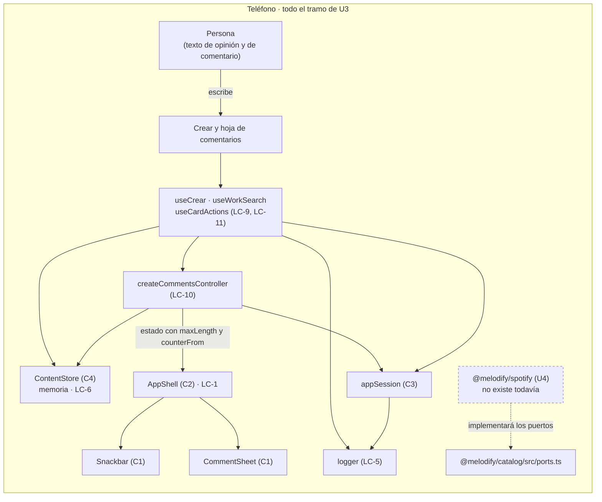

# Diseño de seguridad, privacidad y diagnóstico — U3 `u3-create-react`

> **Provenance**: deriva de `nfr-requirements/security-requirements.md` (NFR3.12–3.16, NFR4.7–4.8, NFR9.6 y los heredados NFR3.7, NFR3.9, NFR3.10, NFR3.1, NFR3.2, NFR4.6, NFR9.1, NFR9.5), de `nfr-requirements/performance-requirements.md` (NFR1.10, NFR2.8, para lo que se pinta y lo que se conserva ante un fallo), de `nfr-requirements/tech-stack-decisions.md` (TS-23 a TS-30), de `functional-design/functional-spec.md` (F13–F20, § Textos exactos, § Assumptions), de `functional-design/rules.md` (BR11.2–BR11.11, BR12.1–BR12.7, BR14.1–BR14.10, BR15.1–BR15.4), de `functional-design/frontend-components.md` (§ `app/src/comments/`, § `app/src/state/`, § `app/src/screens/crear/`) y de `inception/contract-design/contract-summary.md` (C1 1.3.0, C2 1.3.0, C3, C4 1.2.0, C5, § Revisiones 15 y 16).
> Fecha: 2026-11-15. Etapa: NFR Design · Unidad: `u3-create-react` · Agente: aidlc-architect-agent · Profundidad: Standard.

## Fronteras de confianza de esta unidad



**Respaldo en texto**: la única entrada nueva es **texto que escribe una persona**. Ese texto no se interpreta, no se convierte en URL y no sale del proceso. La interfaz no conoce el almacén: las pantallas pasan por los hooks y la cáscara, y el controlador de comentarios es el único módulo que habla con C4 en nombre de la hoja. La identidad **no** entra de fuera: se toma de `appSession` en el punto de llamada —los hooks la leen con `useViewerId` y el controlador la guarda desde `subscribeSession`—, nunca de una prop ni de la ruta. El logger no está en el camino de los datos —solo de los fallos—, y `@melodify/spotify` sigue siendo una flecha discontinua que en esta unidad no existe; el buscador no se monta (BR13.5), así que ni siquiera se alcanza C5 con una consulta.

## NFR3.12 — El autor de toda escritura sale de la sesión, no del formulario

### Una sola lectura por escritura

```text
// Ilustrativo, no implementación. app/src/state/useCardActions.ts
const viewerId = useViewerId(appSession);           // la sesión llega inyectada al hook
const toggleLike = (opinion: OpinionView): void => {
  if (viewerId === null) return;                    // sin identidad no se escribe
  const result = content.toggleLike({ opinionId: opinion.id, authorId: viewerId });
  if (!result.ok) shell.showSnackbar({ message: "No pudimos guardar tu me gusta" });
};
```

- **El `authorId` es la variable `viewerId`, no un campo.** Los cinco caminos leen la misma identidad de dos fuentes, las dos **síncronas en el punto de la escritura**: los hooks de pantalla, que reciben la sesión inyectada y ya tienen el valor resuelto en su estado (`useViewerId(appSession)`), y el controlador de comentarios, que guarda la vista vigente desde `subscribeSession` (abajo). No hay campo de formulario, ni parámetro de ruta, ni prop de `CrearView` que lo transporte: si lo hubiera, sería una puerta para escribir «como otra persona».
- **La identidad del controlador de comentarios llega por `subscribeSession`, no por `getSession()`.** `getSession()` devuelve `Promise<GetSessionResult>` (`packages/app-session/src/app-session.ts:56`); esperarla desde `submit` rompería el `submit(text): boolean` síncrono de C2 1.3.0 y con él NFR8.8. `createCommentsController` se **suscribe una vez, al construirse**, y guarda la vista emitida: `subscribeSession` entrega la vista en el acto si ya existe y, si no, la primera lectura se la publica a quien se suscribió antes (`app-session.ts:171-180`), así que la identidad está disponible sin promesa en el momento de la escritura.

```text
// Ilustrativo, no implementación. app/src/comments/comments-controller.ts
let viewerId: string | null = null;                 // la última vista emitida por C3
const unsubscribe = session.subscribeSession((view) => {
  viewerId = view.status === "signedIn" ? view.authorId : null;
});

const submit = (text: string): boolean => {         // síncrono: no espera a C3 ni a C4
  if (viewerId === null) return false;              // sin identidad no se escribe; la hoja queda en `failed`
  const result = content.addComment({ opinionId, authorId: viewerId, text: text.trim() });
  return result.ok;
};
```

- **Una sola suscripción, la de la app.** El controlador se construye una vez en `app/src/bootstrap/comments.ts` (LC-4, TS-27), así que no hay una suscripción por hoja ni por tarjeta; el `unsubscribe` que devuelve C3 lo usa la prueba de montaje y desmontaje, no el camino normal de la app.
- **El cierre de sesión deja la hoja sin identidad sin código extra**: `signOut()` publica la vista `signedOut` y la suscripción la guarda; el siguiente `submit` devuelve `false` sin tocar C4, igual que el caso de sesión sin resolver.
- **`updateOpinion` recibe dos veces el mismo valor y lo lee una sola vez.** `{ authorId: viewerId, viewerId }` sale de la misma variable, así que C4 no puede recibir un `authorId` de un sitio y un `viewerId` de otro (los campos derivados y la autorización se calculan contra el mismo sujeto).
- **Los nombres son los del contrato**: `createOpinion({ authorId })`, `updateOpinion({ authorId, viewerId })`, `addComment({ authorId })`, `toggleLike({ authorId })` y `toggleFollow({ authorId, followerId })`. En el seguimiento el que sigue es `followerId`, porque la ruta es `/authors/{authorId}/follow` y el sujeto de la ruta es el autor seguido; los dos valores salen de la misma lectura.
- **Sin identidad no hay escritura.** `useViewerId` devuelve `null` mientras la sesión no resuelve; `useCardActions` devuelve acciones vacías y `CrearScreen` sigue en `Cargando` (BR11.5, NFR1.9). Si aun así llegara una llamada sin autor, C4 responde `422` —`«Falta quién publica la opinión.»`, `«Falta quién comenta.»`, `«Falta quién da el me gusta.»`, `«Falta quién sigue.»`—, que no es un estado de la interfaz sino la red de seguridad del contrato.
- **La frontera es honesta**: C4 acepta la identidad que recibe y no hay cuentas reales en esta versión. Lo que la unidad garantiza es que **la interfaz no puede elegir** con qué identidad escribe; el día que haya servidor, la comprobación tendrá que vivir allí (riesgo asumido, más abajo).

**Cómo se verifica**: prueba de `useCardActions` con sesión y sin ella (con `null`, `toggleLike` no se llama); prueba de `CrearScreen` en modo publicación que comprueba que el `authorId` enviado es el de la sesión aunque el formulario tenga otro valor a mano; prueba de `createCommentsController` con una sesión doble que **emite `demo` al suscribirse** y comprueba que `submit` devuelve `true` **sin avanzar temporizadores ni esperar promesas** y que `addComment` recibió `demo`; y la misma prueba con una vista `signedOut` que comprueba que `submit` devuelve `false` y C4 no recibe ninguna llamada. El doble **no miente sobre la firma**: implementa `subscribeSession` como C3, y `getSession` como C3 (una promesa), porque el controlador no lo usa.

## NFR3.13 — Editar está autorizado en dos capas: la vista no lo ofrece y C4 lo rechaza

| Capa | Qué comprueba | Dónde se materializa | Compuerta |
|---|---|---|---|
| Vista | «Editar» solo existe en la opinión propia | `OpinionCard` recibe `isOwn` y solo con él pinta la acción: en variante `feed` en la fila de acciones inferior (`OpinionCard.tsx:208-220`) y en variante `detail` en la fila de la opinión propia (`OpinionCard.tsx:94-114`). `useCardActions` no devuelve `onEdit` para una opinión ajena (BR12.1, BR14.2, TS-26) | Prueba de `OpinionCard` con `isOwn: false`: la acción no está en el árbol. **Prueba positiva**: tarjeta propia en `detail` con `onEdit`, «Editar» visible y su pulsación llamando al manejador. Prueba de `useCardActions`: `actionsFor(ajena).onEdit` es `undefined` |
| Contrato | `updateOpinion` responde `403` si el `authorId` no es el autor | `packages/content-store/src/store.ts:605-607` —`failure(403, 'Solo se puede editar la opinión propia.')`, declarado en C4 1.2.0— | Prueba de `content-store`: `updateOpinion` con un `authorId` distinto devuelve `403` **y** el texto de la opinión no cambia |

- **«Editar» en el detalle no exige cambiar C1.** La condición `!isOwnDetail && isOwn && onEdit !== undefined` de la línea 208 es la del **pie**: evita repetir el botón cuando la variante es `detail` y ya lo pinta la fila de la opinión propia (`isOwnDetail`, líneas 94-114), que es la que se ve en las dos pantallas de detalle. El resultado es **un solo «Editar» por tarjeta** y el mismo `testID` (`opinion-edit`) en las dos variantes. Lo que sí es obligatorio en esta unidad es el cableado: `DetalleObraView` y `DetalleOpinionView` pasan `onEdit` en la opinión propia (F17 paso 1, `frontend-components.md` § Flujos); si no lo pasan, la fila propia pinta «Editar» deshabilitado —`disabled={onEdit === undefined}`— y la prueba positiva lo detecta.
- **Dos capas, y la positiva no es opcional.** La compuerta de la vista se prueba en los dos sentidos: la ajena sin acción y la propia **con** acción accionable en el detalle. Solo la negativa dejaría pasar un cableado roto sin que ninguna prueba se queje.

- **Las dos capas existen y se prueban; ninguna es la única puerta.** Que la vista oculte la acción no autoriza nada: una llamada directa al almacén sigue pasando por el `403`. Que el almacén responda `403` no sustituye a la vista: ofrecer una acción que siempre falla es un defecto de interfaz.
- **El `403` no es un estado de la pantalla.** El flujo funcional no lo alcanza (F17 paso 9 solo distingue `404` y «cualquier otro código»), así que se trata como el error genérico de guardado —«No pudimos guardar los cambios.» con «Reintentar»— y no se le inventa un texto que sugeriría que la persona hizo algo mal. Si apareciera en el teléfono sería un defecto de la vista, y la prueba de `OpinionCard` es lo que lo impide.
- **El formulario de edición trabaja sobre la entrada vigente.** `openEdit({ opinionId })` fija el `opinionId`; el hook guarda ese identificador y no uno derivado del texto ni de la obra. Editar desde `YaOpinada` reutiliza el mismo `returnTo` (BR11.6, C2 1.3.0).
- **Apoyo del contrato en el seguimiento**: `toggleFollow` responde `409`—«No puedes seguirte a ti mismo.»— si el `authorId` es el `followerId`, y `useCardActions` no ofrece `onFollow` en la opinión propia. Es la misma forma de defensa en profundidad, aplicada a la acción que Q3 = A oculta.

**Cómo se verifica**: las cuatro pruebas de la tabla —las dos del almacén y las dos de la vista, negativa y positiva—, más la de `CrearScreen` en modo edición que comprueba que el `opinionId` enviado es el de `openEdit` y no el de una obra elegida por la persona.

## NFR3.14 — El texto de la persona se pinta como texto y no se convierte en nada ejecutable

- **Nada interpreta marcado.** El texto de la opinión y el del comentario se pintan con `Text` dentro de `OpinionCard` y de `CommentSheet`; no hay `WebView`, ni `eval`, ni parser de marcado. Un texto con `<script>` se lee literal, igual que U2 fijó para la siembra (NFR3.9), ahora con texto que no escribió el equipo.
- **Ninguna URL sale de un texto.** La portada de la opinión propia se decide con `coverFor(workId)` y, sin sesión, cae al bloque con la inicial (BR5.3). El texto escrito no participa en ninguna URL, ni en una consulta, ni en una clave de caché.
- **El tope se valida en las dos capas y con la misma fuente.** `MultilineField` recibe `maxLength={MAX_OPINION_LENGTH}` (500) o `MAX_COMMENT_LENGTH` (300) y no acepta el carácter 501 ni el 301; C4 valida con esas mismas constantes y responde `422` a una llamada directa que los supere (TS-28, C4 1.2.0). El número se escribe una sola vez; el campo protege a la persona y el almacén protege al contrato.
- **El recorte precede a la comprobación.** `validateOpinionDraft` y `submit` recortan antes de decidir: un texto de solo espacios no se envía y «Publicar» sigue deshabilitado (BR11.2, BR12.7, TS-30).
- **El contador no es una validación.** Que «400/500» se pinte no habilita nada: el envío depende del tope real, no de lo que se ve (BR11.3).

**Cómo se verifica**: prueba de `MultilineField` que comprueba que no admite el carácter 501; prueba de `content-store` con 501 caracteres en `createOpinion` y 301 en `addComment` que comprueba `422` y que nada se guardó; prueba de render con un texto que contiene `<script>` que comprueba que se lee literal.

## NFR3.15 / NFR3.10 / NFR3.1 — Sin secretos nuevos y sin sesión de Spotify

| Elemento | En U3 | Regla que lo sostiene |
|---|---|---|
| `EXPO_PUBLIC_SPOTIFY_CLIENT_ID` | No se lee en ningún archivo de la app | Lo usa U4; `.env.example` sigue documentándolo sin valor |
| Client secret de Spotify | **No existe** | PKCE no lo necesita; nunca se declara (NFR3 de U1, `project.md` § Forbidden) |
| Token de Spotify (NFR3.2 heredado) | **No existe en U3**: no se lee, no se escribe, no se borra | Lo guarda U4 en su propio paquete y con su clave; U3 no importa `@melodify/spotify` |
| Los tres puertos de Spotify | Siguen en `null` | Sin puerto no hay credencial, ni llamada, ni URL; el buscador **ni se monta** (BR13.5) |
| Cliente HTTP propio y cabecera de autorización | No se construyen | Las cinco escrituras son locales y a C4 |
| `.env` | No se lee ni se commitea | `.gitignore` de U1 y `project.md` § Forbidden |

- **La `ConnectionCard` de Crear no pide nada.** Pinta «Conectar con Spotify» y su acción no cambia ningún estado observable hasta U4 (BR11.9): no abre autorización, ni pide token, ni guarda nada. Es una invitación, no un flujo a medias.
- **Los tres paquetes que U3 toca no ganan una arista hacia Spotify.** `@melodify/design-system`, `@melodify/app-shell` y `@melodify/content-store` no importan `@melodify/spotify`; la única relación entre el catálogo y Spotify siguen siendo los tipos de `@melodify/catalog/src/ports.ts` (TS-21), que U3 no toca.

**Cómo se verifica**: búsqueda de `EXPO_PUBLIC_` en `app/` y `packages/` sin resultados; revisión de `app/src/bootstrap/ports.ts` con los tres en `null`; búsqueda de `@melodify/spotify` en los tres paquetes sin resultados; prueba de `ConnectionCard` que comprueba que su acción no modifica el estado que recibe.

## NFR3.16 — Nada nuevo se escribe en el teléfono

| Regla | Cómo la sostiene el diseño | Compuerta |
|---|---|---|
| No se añade ningún mecanismo de persistencia | `@melodify/design-system`, `@melodify/app-shell` y `@melodify/content-store` no declaran ni importan `expo-secure-store`, `AsyncStorage` ni `expo-file-system` (RC-03) | Revisión de los `package.json` y de los imports, más `no-restricted-imports` sobre las tres rutas y sobre `app/src/**` |
| El borrador vive en memoria y muere con la pantalla | Lo posee `useCrear` (LC-11); `formKey` lo descarta al cambiar de entrada (TS-25). La hoja guarda el suyo y `close()` lo tira (BR11.1, BR14.3) | Prueba de `formKey`: el árbol se monta **una vez** y se le cambia la clave sin desmontarlo; texto **y** obra seleccionada quedan descartados. Cerrar y reabrir la hoja deja el campo de comentario vacío |
| El texto publicado vive en memoria | C4 lo guarda en el proceso y se pierde al recargar (RC-03, NFR4.7) | Recorrido manual: recargar Metro y ver la siembra otra vez |
| La única escritura en disco de la app sigue siendo el recuerdo de sesión de C3 | U3 no escribe: envía a C4 y pinta. «Cerrar sesión» **borra** por `appSession.signOut()` | Revisión de `PerfilScreen` y del paquete de contenido, sin cambios respecto a U2 |

### La prueba que sí puede fallar

«No toca el almacenamiento» no es una prueba: el paquete no declara esa dependencia, así que pasaría siempre y `team.md` § Testing Posture las prohíbe. La prueba que se escribe es la que distingue un borrador de pantalla de una caché compartida, y tiene que **ejercer `formKey` sin desmontar el árbol**: montar, escribir, desmontar y volver a montar con otra clave pasa aunque `useCrear` ignore `formKey` por completo, porque React ya perdió el estado al desmontar.

```text
// Ilustrativo, no implementación. app/src/screens/crear/__tests__/CrearScreen.test.tsx
const app = render(<AppShell services={services} />);        // el árbol se monta UNA vez
fireEvent.press(app.getByTestId("tab-crear"));               // entrada 1: formKey = 1
fireEvent.changeText(app.getByTestId("create-opinion-text"), "Texto a medias");
fireEvent.press(app.getByTestId("create-work-result-7tFiyTwD0nx5a1eklYtX2J"));  // Bohemian Rhapsody, del catálogo de ejemplo
expect(app.getByTestId("create-opinion-text").props.value).toBe("Texto a medias");

fireEvent.press(app.getByTestId("tab-crear"));               // entrada 2: formKey = 2, sin salir de Crear
expect(app.getByTestId("create-opinion-text").props.value).toBe("");  // el texto se descartó
expect(app.queryByTestId("create-selected-work")).toBeNull();         // y la obra también
```

**Los selectores son parte de la compuerta.** La pestaña se pulsa por `testID` (`tab-crear`, que `BottomTabBar` ya expone como `tab-${item.name}`, `BottomTabBar.tsx:59`) y no por texto: «Crear» también es el título de la cabecera de la pantalla (`functional-spec.md` § Textos exactos), así que `getByText("Crear")` sería ambiguo. La obra se elige por un `workId` **real** del catálogo de ejemplo —`7tFiyTwD0nx5a1eklYtX2J` es «Bohemian Rhapsody» en `packages/catalog/src/sample.ts:19-21`; el identificador anterior, `4u7EnebtmKWzUH433Rbtpz`, no existe en Spotify y se corrigió el 2026-11-24—; los identificadores son los de Spotify, no índices inventados, y la prueba los toma de `listSampleWorks()` para no quedar atada a la siembra. Y el campo de Crear lleva un `testID` propio —`create-opinion-text`— porque `opinion-text` ya es el del texto de la tarjeta (`OpinionCard.tsx:144`) y las cinco raíces de pestaña siguen montadas aunque estén ocultas (`AppShell.tsx:361-395`), de modo que un `testID` repetido encontraría dos nodos. Los `testID` los fija esta prueba, no la librería.

**Por qué esta prueba sí falla si el mecanismo falta**: pulsar la pestaña Crear **estando ya en Crear** pasa por `handleSelect`, que escribe una entrada nueva con `formKey` incrementado y deja `activeName` en `crear` (`packages/app-shell/src/AppShell.tsx:290-310`), así que la pantalla no se desmonta y su estado de React sobrevive. Si `useCrear` no reaccionara a `formKey`, el texto y la obra seguirían ahí y las dos aserciones fallarían —que es exactamente el fallo intolerable de LC-11: publicar sobre otra obra el texto de una visita anterior—. **La prueba no se escribe con `unmount()` ni con un segundo `render`**, y esa es la diferencia entre probar el mecanismo y probar el desmontaje. La segunda mitad de la prueba es la obra: sin la aserción de la obra seleccionada, un reset que solo borrase el texto pasaría.

**El caso de disco lo cierra la revisión de dependencias, no la prueba**: una lectura asíncrona de `AsyncStorage` no la vería una prueba síncrona, y por eso la compuerta declarada arriba es el lint y la revisión del PR.

## NFR3.7 — La lectura sigue sin elegir identidad (heredado)

- **`useViewerId` sigue siendo la única puerta de lectura** y U3 no añade una segunda: `useCardActions`, `useCrear` y el controlador de comentarios consumen esa identidad, no una que venga de la tarjeta ni de la ruta.
- **Los campos derivados siguen viniendo de C4.** `isOwn`, `likedByMe` y `followedByMe` se leen de la vista que emite el almacén; `OpinionCard` no compara handles ni identificadores para decidir si una opinión es propia, y por eso la acción «Editar» no puede aparecer por un cálculo local (BR4.6, NFR3.13).
- **Sin `viewerId` no se lee ni se escribe.** La pantalla está en `Cargando`; no hay un `isOwn: false` por defecto que pinte la opinión propia como ajena (AC4.2.3).

**Cómo se verifica**: las pruebas de U2 de `useViewerId` siguen verdes; se añade la de `useCardActions` sin identidad (acciones vacías) y la de `OpinionCard` que comprueba que `isOwn` llega por prop y no se recalcula.

## NFR3.9 — Todo se pinta como texto (heredado)

U3 no añade una regla nueva: la extiende al texto que escribe la persona y la deja escrita en NFR3.14. Lo que sí conviene fijar aquí es que **la regla vale también para los textos de confirmación**: los siete avisos de `functional-spec.md` § Textos exactos se pintan como cadenas construidas solo con datos de la interfaz. Cinco son literales —«Opinión publicada», «Opinión actualizada», «Comentario publicado», «No pudimos guardar tu me gusta», «No pudimos guardar tu seguimiento»— y **los dos de seguimiento interpolan únicamente el `handle` del autor**: «Ahora sigues a @ana» y «Ya no sigues a @ana», con el `handle` de la tarjeta en lugar de `ana` (F20 pasos 3 y 4, AC7.3.1 y AC7.3.2). Lo que **nunca** se interpola es el texto de la opinión, el del comentario ni el nombre completo del autor; y ningún aviso muestra un código técnico ni una palabra en inglés (NFR2.9).

## NFR4.7 — Inventario actualizado de lo que queda escrito en el teléfono

| Dato | Persistido | Dónde | Se borra |
|---|---|---|---|
| `authorId` = `demo` y `startedAt` | Sí (heredado de U1) | Almacenamiento seguro, clave `melodify.session` | Al cerrar sesión (F3) |
| Opiniones, autores, me gusta, comentarios y seguimientos de la siembra | **No** | Memoria del proceso | Al recargar (RC-03) |
| **Texto de la opinión que escribe la persona** | **No** | Memoria del proceso (C4) | Al recargar |
| **Texto del comentario** | **No** | Memoria del proceso (C4) | Al recargar |
| **Borrador del formulario y de la hoja** | **No** | Memoria del proceso; la hoja lo descarta al cerrarse | Al cerrar la hoja, al cambiar de entrada o al recargar |
| Obras de ejemplo y decisión de portada | **No** | Memoria del proceso | Al recargar |
| Estado de red | **No** | Memoria del proceso | Al recargar |
| Token de Spotify | Todavía no (U4) | Almacenamiento seguro, clave del token | Al desconectar |

**U3 no añade ninguna fila persistida.** Añade tres filas en memoria y las tres desaparecen al recargar. La tabla es la misma que revisa el recorrido del teléfono: cerrar la app por completo y volver a entrar tiene que dejar la siembra otra vez (AC7.1.4, FR7.6). Si alguien introdujera un borrador en disco «para no perder lo escrito», esta tabla y RC-03 dejarían de ser ciertas y la decisión tendría que tomarla una etapa.

## NFR4.8 — Nada de lo que escribe la persona sale del dispositivo

- **Las cinco escrituras van a C4, que vive en el proceso**: no hay petición, ni socket, ni cola, ni fichero.
- **El texto no viaja a Spotify, ni siquiera en U4.** La búsqueda envía la **consulta de obra** y nada más; el puerto de búsqueda no recibe la opinión ni el comentario, y U3 no lo amplía (BR13.5, `functional-spec.md` § Alcance). Queda como pregunta abierta para U4 para que no se añada el campo «por comodidad».
- **El registro de diagnóstico no se lleva el texto** (NFR9.6 y NFR4.6, abajo).
- **La app no promete lo contrario en ningún texto**: ninguna cadena de U3 dice «guardado», «sincronizado» ni «en tu cuenta»; las confirmaciones dicen lo que pasó, no dónde se guardó.

**Cómo se verifica**: revisión de que ningún paquete de U3 tiene red (los tres ya existentes siguen sin ella); revisión de las cadenas de § Textos exactos; y el recorrido del teléfono con modo avión, donde publicar y comentar funcionan igual.

## NFR4.6 — El registro no se lleva el contenido (heredado, ahora con texto de la persona)

| Situación | Mensaje que se registra | Lo que **no** lleva |
|---|---|---|
| El puerto de búsqueda falta o la consulta falla por un defecto interno | «puerto de búsqueda de Spotify no disponible» | La consulta escrita, el `workId`, el título de la obra |
| Fallo interno del almacén al escribir | Se deja pasar el resultado de C4; no se registra | El texto de la opinión, el del comentario, el borrador, el `authorId` completo |

- **La firma cerrada a dos cadenas (`code`, `message`) sigue siendo la garantía.** No hay sobrecarga que acepte un objeto, así que no se puede «pasar el registro por si acaso» y arrastrar el texto (NFR9.4 de U2).
- **En U3 el dato es de la persona, no de ejemplo**: es la primera unidad en la que un descuido del logger publicaría algo que alguien escribió. La regla no cambia; lo que cambia es la consecuencia.
- **Nunca se registra el `viewerId` completo, ni la sesión, ni el identificador de obra de cada tarjeta.** El logger registra el fallo y su origen.

## NFR9.6 — El catálogo de eventos de esta unidad

| Situación | Se muestra a la persona | Se registra |
|---|---|---|
| Error al publicar (F13, paso 7) | Sí, «No pudimos publicar tu opinión.» con «Reintentar» | No: C4 devuelve un resultado esperado |
| Error al guardar (F17, paso 9) | Sí, «No pudimos guardar los cambios.» con «Reintentar» | No, misma razón |
| Error al cargar la edición (F17, paso 8) | Sí, «No pudimos cargar tu opinión.» con «Reintentar» | No: el `404` es un estado previsto del contrato |
| Búsqueda fallida (F14) | Sí, «No pudimos buscar en Spotify.» con «Reintentar» | Sí, con `warn` y `SEARCH_PORT_UNAVAILABLE`, **solo** si el puerto falta o la consulta falla por un defecto interno; un `offline` previsto no se registra |
| Seguimiento correcto (F20, pasos 3 y 4) | Sí, «Ahora sigues a @ana» o «Ya no sigues a @ana», con el `handle` del autor | No: es un resultado esperado y el handle ya está a la vista en la tarjeta |
| Error al cargar o enviar un comentario (F18) | Sí, «No pudimos cargar los comentarios.» / «No pudimos enviar tu comentario.» con «Reintentar» | No: son resultados esperados del contrato |
| Fallo de me gusta o de seguimiento (F19, F20) | Sí, snackbar sin acción (desviación registrada) | No |
| Sin conexión en Crear (F13) | Sí, aviso informativo, sin acción | No: es un estado, no un fallo |

### El único código que añade U3

```text
// Ilustrativo, no implementación. app/src/bootstrap/logger.ts
export type AppLogCode =
  | SessionLogCode
  | "CONTENT_SUBSCRIBE_FAILED"
  | "CONTENT_READ_FAILED"
  | "NETWORK_STATE_UNAVAILABLE"
  | "SEARCH_PORT_UNAVAILABLE";
```

- **`SessionLogCode` no se reabre**: los cuatro códigos de sesión siguen siendo de C3, y `AppLogger` sigue siendo asignable a `SessionLogger` (la línea `const asSession: SessionLogger = logger;` de U2 sigue valiendo).
- **La condición de `SEARCH_PORT_UNAVAILABLE` es acotada.** En U3 el buscador ni se monta (BR13.5), así que el código se dispara en la prueba de unidad del hook con un puerto que falta o que lanza; en el teléfono no se ve hasta U4. Un `offline` previsto **no** se registra: es un estado del contrato, no un defecto, y la interfaz ya lo pinta con su «Reintentar» (BR13.2).
- **No se duplica el aviso.** Todo lo que la persona ve por un resultado esperado de C4 no se repite en el registro; solo los defectos internos llegan al logger.

## NFR9.1 / NFR9.5 — Sin superficie nueva ni telemetría (heredado)

| Regla | Cómo se cumple en U3 |
|---|---|
| Un solo logger | `app/src/bootstrap/logger.ts`; `no-console` en `error` con excepción declarada solo para ese archivo. U3 no añade otro |
| Sin servicio de errores ni analítica | Ninguna dependencia nueva (TS-23 a TS-29): las ocho piezas y los tres hooks son React Native y tokens |
| Sin SLI, SLO ni alertas | No hay servicio que observar: la app corre en el teléfono |
| Sin envío de datos | Ningún paquete de U3 tiene red; las cinco escrituras son locales |

## Amenazas de la unidad y qué las cierra

Traducida a decisiones de este diseño, la tabla de amenazas de `security-requirements.md` queda así:

| Amenaza | Qué la cierra en el diseño | Dónde se comprueba |
|---|---|---|
| Escribir como otra persona | Una sola lectura de identidad por escritura, desde `appSession` (NFR3.12); C4 responde `422` si falta el autor | Pruebas de `useCardActions` y del controlador de comentarios |
| Editar la opinión ajena desde una llamada directa al almacén | `403` de `updateOpinion` (`store.ts:605-607`) **y** la vista sin «Editar» (NFR3.13) | Prueba del almacén y prueba de `OpinionCard` con `isOwn: false`; prueba positiva con la tarjeta propia en `detail` |
| Editar sin camino desde el detalle | La fila de la opinión propia de `OpinionCard` en `detail` pinta «Editar» y las dos vistas de detalle pasan `onEdit` (NFR3.13) | Prueba positiva de `OpinionCard` y prueba de `DetalleObraView` / `DetalleOpinionView` que comprueba que la acción llega |
| Seguirse a uno mismo o darse me gusta en la propia | `useCardActions` solo devuelve `onComment` y `onEdit` en la propia; `showLike={!isOwn}`; C4 responde `409` al seguirse | Prueba de `useCardActions` y de `SocialActionBar` con `showLike: false` |
| Colar contenido ejecutable por el campo de texto | Todo se pinta como `Text`, ninguna URL sale de un texto y el tope se valida en el campo y en C4 (NFR3.14) | Prueba de render con `<script>` y prueba del `422` |
| Dejar el texto de la persona en disco sin decisión | Ningún paquete de U3 declara almacenamiento y el borrador es del hook (NFR3.16) | Revisión de `package.json` e imports; regla de lint |
| Filtrar el texto por el registro de diagnóstico | Firma cerrada a dos cadenas y mensajes literales (NFR4.6, NFR9.6) | Pruebas de logger con espía |
| Publicar dos veces la misma obra | `YaOpinada` cambia «Publicar» por «Editar mi opinión» y C4 responde `409` (BR11.6) | Prueba de `CrearScreen` en `YaOpinada` y prueba del `409` |
| Que una escritura fallida borre lo escrito | El borrador vive en el hook y ningún camino de fallo lo toca (NFR1.10) | Pruebas de `errorEnvio`, `errorGuardado` y `failed` |
| Que un aviso quede detrás del velo | Con la hoja abierta el snackbar viaja dentro del modal (NFR8.10) | Prueba de la hoja con `snackbar` visible |

## Cómo se demuestra cada requisito

| Requisito | Prueba o revisión con la que se demuestra |
|---|---|
| NFR3.12 | Prueba de `useCardActions` sin identidad (no escribe) y con ella (escribe con `demo`); prueba de `CrearScreen` que comprueba el `authorId` enviado; prueba del controlador de comentarios con una sesión doble que emite `demo` al suscribirse (y otra que emite `signedOut`) |
| NFR3.13 | Prueba de `content-store` con `authorId` ajeno → `403` y texto intacto; prueba de `OpinionCard` con `isOwn: false` sin «Editar»; **prueba positiva de la tarjeta propia en `detail` con «Editar» accionable**; prueba de `useCardActions` sin `onEdit` en la ajena; revisión de `store.ts:605-607` |
| NFR3.14 | Prueba de `MultilineField` (501 rechazado); pruebas de `422` en `createOpinion` y `addComment`; prueba de render con `<script>` literal |
| NFR3.15 / NFR3.10 / NFR3.1 / NFR3.9 | Búsqueda de `EXPO_PUBLIC_` y de `@melodify/spotify` sin resultados en los tres paquetes; `ports.ts` con los tres en `null`; prueba de `ConnectionCard` inerte; prueba de `useCardActions` que comprueba los dos textos de seguimiento con el `handle` interpolado («Ahora sigues a @ana» / «Ya no sigues a @ana») y que ninguno lleva texto de opinión ni de comentario |
| NFR3.16 | Revisión de los `package.json` y de los imports; regla `no-restricted-imports`; prueba de `formKey` con el árbol montado una sola vez (texto **y** obra descartados); recarga manual de Metro |
| NFR4.7 | Revisión del inventario; recorrido del teléfono: cerrar la app por completo y volver a entrar |
| NFR4.8 | Revisión de dependencias y de las cadenas de § Textos exactos; recorrido con modo avión |
| NFR4.6 / NFR9.6 | Pruebas de logger con espía: el mensaje es el literal y no lleva texto, `workId` ni `viewerId`; prueba de que un `offline` no registra nada y un puerto ausente sí |
| NFR9.1 / NFR9.5 | `const asSession: SessionLogger = logger;` compila; revisión de dependencias (sin SDK de analítica ni de errores) |

## Riesgos asumidos y su porqué

| Riesgo | Por qué se acepta |
|---|---|
| C4 acepta el `authorId` que recibe; no hay cuentas reales | La identidad se deriva en un solo punto y la interfaz no puede elegirla; el día que haya servidor, la comprobación vive allí (declarado en U2 y repetido aquí) |
| El `403` de `updateOpinion` se pinta como error genérico de guardado | El flujo no lo alcanza; inventarle un texto sugeriría un fallo de la persona. La prueba de la vista es lo que impide llegar |
| El texto vive en memoria y se pierde al recargar | Es RC-03, aprobado, y los textos de la app no prometen persistencia; AC7.1.4 lo verifica en el teléfono |
| El logger escribe en la consola del dispositivo | No lleva contenido, ni identidad, ni credenciales; es la única forma de diagnosticar lo que no se muestra |
| Un `422` al publicar se muestra como error genérico | El formulario impide los casos que C4 rechaza; un `422` sería una discrepancia entre capas y no se le enseña un código a la persona (`functional-spec.md` § Assumptions) |

## Assumptions & Open Questions

- `[assumption]` `subscribeSession` entrega la vista vigente en el acto cuando existe y publica la primera lectura a quien se suscribió antes (`packages/app-session/src/app-session.ts:171-180`). Sobre esa garantía se apoya la identidad **síncrona** del controlador de comentarios: `getSession()` devuelve una promesa y no se usa en la ruta de escritura. Si C3 cambiara la entrega a asíncrona, `submit` tendría que esperar y NFR8.8 dejaría de cumplirse: sería una decisión de esa etapa, no un ajuste de esta.
- `[assumption]` El `403` de `updateOpinion` está en C4 1.2.0 y no cambia en esta unidad; la prueba del almacén lo fija para que una revisión futura no lo retire por parecer redundante con la vista.
- `[assumption]` La regla de lint que impide a C1 y a C2 importar C4 se escribe con `@typescript-eslint/no-restricted-imports` en `eslint.config.js` (la misma familia que la regla de TS-21), y el CI ya la ejecuta con `npm run lint`.
- **Open question para U4**: el buscador real enviará la consulta de obra a Spotify; **nunca** el texto de una opinión ni de un comentario. Si U4 necesitara enviar algo más, es un cambio de contrato y de esta regla, no un detalle de implementación.
- **Open question para U5**: la Actividad confirmará con el mismo snackbar y no pinta el me gusta propio, porque la interfaz ya no permite darlo (Q3 = A). Si eso cambiara, esta unidad tendría que revisar la regla de acciones de la opinión propia (TS-26).

## Sources

- `security-requirements` — `construction/u3-create-react/nfr-requirements/security-requirements.md` (NFR3.12–3.16, NFR4.7–4.8, NFR9.6).
- `performance-requirements` — `construction/u3-create-react/nfr-requirements/performance-requirements.md` (NFR1.10, NFR2.8).
- `tech-stack-decisions` — `construction/u3-create-react/nfr-requirements/tech-stack-decisions.md` (TS-23 a TS-30).
- `functional-spec` — `construction/u3-create-react/functional-design/functional-spec.md` (F13–F20, § Máquina de estados, § Textos exactos, § Assumptions).
- `rules` — `construction/u3-create-react/functional-design/rules.md` (BR11–BR15).
- `frontend-components` — `construction/u3-create-react/functional-design/frontend-components.md` (§ `app/src/comments/`, § `app/src/state/`, § `app/src/screens/crear/`).
- `contract-summary` — `inception/contract-design/contract-summary.md` (C1 1.3.0, C2 1.3.0, C3, C4 1.2.0, C5, § Revisiones 15 y 16).
- `project.md` / `team.md` — `aidlc/spaces/default/memory/` (§ Forbidden y § Mandated; § Testing Posture y § Code Style).
- `security-design (U2)` — `construction/u2-content-core/nfr-design/security-design.md` (NFR3.6–3.11, NFR4.4–4.6, NFR9.4–9.5 heredados).
