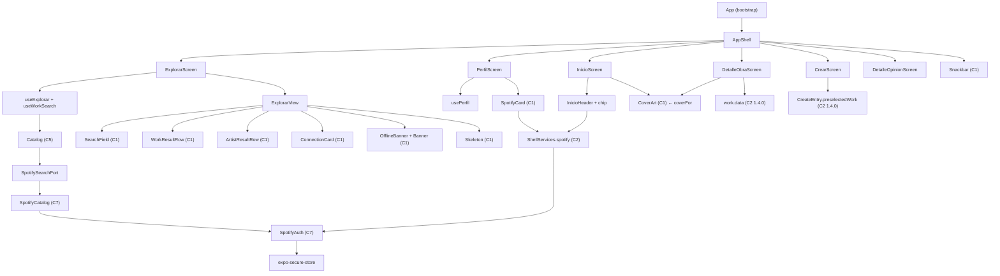

# Componentes de interfaz — U4 `u4-spotify-explore`

> **Provenance**: deriva de `inception/contract-design/contract-summary.md` (C1 1.4.0, C2 1.4.0, C5 1.2.0, C7 1.0.0, C9, C10), `inception/domain-design/components.md` (SpotifyAuth, SpotifyCatalog, Catalog, AppShell, DesignSystem), `inception/refined-mockups/mockups.md` (Explorar, Perfil, Inicio, matriz de estados), `inception/refined-mockups/design-system-mapping.md`, `inception/refined-mockups/interaction-spec.md`, `construction/u4-spotify-explore/functional-design/rules.md` (BR16–BR20) y `functional-spec.md`, y las respuestas de `functional-design-questions.md` (Q1 = B, Q2 = A, Q3 = B, Q4 = A, Q5 = A).
> Fecha: 2026-11-17. Etapa: Functional Design · Unidad: `u4-spotify-explore`.

Este documento fija la forma de la interfaz de U4: qué piezas estrena el sistema de diseño, quién posee el estado de la conexión, cómo se parte Explorar en contenedor y vista, qué viaja por la ruta hasta el detalle y Crear, y qué se cablea en Inicio, Perfil y la composición. Es diseño, no código.

## Jerarquía

**Respaldo en texto**: `App` construye una sola vez `SpotifyAuth`, `SpotifyCatalog`, el catálogo y la cáscara, y los entrega a la cáscara y a las pantallas. La cáscara publica el estado de la conexión en `services.spotify` y lo consume quien lo necesita: la tarjeta de Perfil, el chip de Inicio y la tarjeta de Explorar. Explorar se parte en contenedor (`useExplorar` + `useWorkSearch`) y vista pura (`ExplorarView`), que solo usa piezas de C1. El detalle y Crear no cambian de forma: reciben la `WorkView` por la ruta y la resuelven con la precedencia de BR20.2. `SpotifyAuth` es la única pieza que toca el token.

## Paquetes y responsabilidad

| Paquete | Dueño | Qué aporta a la interfaz de U4 |
|---|---|---|
| `@melodify/design-system` (C1) | U1, publicado por U4 a la **1.4.0** | `SpotifyCard`, `ArtistResultRow`, `WorkResultRow.kind?`, el fallback de `CoverArt` y dos modelos nuevos. |
| `@melodify/app-shell` (C2) | U1, publicado por U4 a la **1.4.0** | La `WorkView` por la ruta del detalle y por `CreateEntry`; `openWorkDetail` y `openCreate` ganan `data?`. |
| `@melodify/catalog` (C5) | U2, publicado por U4 a la **1.2.0** | `WorkView.workKind?`, `ArtistHit`, `artists` en el resultado; `searchWorks` los propaga y los cachea. |
| `@melodify/spotify` (C7) | **U4 (nuevo)** | `@melodify/spotify/auth` y `@melodify/spotify/catalog`: PKCE, token, búsqueda y resolución. |
| `@melodify/app-session` (C3) | U1 | La identidad simulada; no cambia (BR16.11). |
| `@melodify/content-store` (C4) | U2 | Las opiniones por `workId`; no cambia. |
| `@melodify/connectivity` (C6) | U1 | `online` entra en la decisión de portada y en el aviso de Explorar; no cambia. |
| `@melodify/app` | U4 en sus carpetas | Explorar, la tarjeta de Perfil, el chip de Inicio, la precedencia de la ruta en detalle y Crear, y la composición de Spotify. |

## `@melodify/design-system` — lo que añade la 1.4.0

| Pieza | Props | Estados que cubre U4 |
|---|---|---|
| `SpotifyCard` | `status: SpotifyConnectionStatus`, `onConnect`, `onDisconnect`, `onRetry?` | Los seis estados de BR16.7 con su texto y su acción: `disconnected`, `connecting` (indicador y botón deshabilitado), `connected` («Desconectar» en tono de error), `connectionError`, `invalidToken` y `notConfigured`. |
| `ArtistResultRow` | `artist: ArtistSummary`, `onPress` | Fila de artista: bloque circular de 56 con la inicial, nombre y «Artista». Toda la fila es el objetivo táctil; no pinta portada de obra ni recuento. |
| `WorkResultRow` | `work`, `opinionCount`, `onPress`, **`kind?: 'track' \| 'album'`** | Sin `kind`, idéntica a la 1.3.0 (obras de ejemplo). Con `kind`, una etiqueta «Canción»/«Álbum» en `type.caption` sin cambiar la altura de la fila. |

**Adiciones a piezas existentes**

| Pieza | Cambio | Efecto visible |
|---|---|---|
| `CoverArt` | Acepta el fallo de carga de la imagen: si `onError` dispara, sustituye la imagen por el mismo bloque con la inicial, sin cambiar de tamaño ni desmontar la fila. | BR18.3 y AC2.2.3: una portada que no carga deja el bloque, nunca un hueco roto ni un icono de imagen. |
| `ConnectionCard` | Sin cambios de props. U4 la usa tal cual en Explorar sin sesión y le pasa el estado de la conexión a través de las props de texto y acción que ya tiene. | BR19.1 y BR19.2: la tarjeta no sabe qué es Spotify; la pantalla decide el texto y el estado. |

**Adiciones al modelo de C1**

| Tipo | Campos | Quién lo consume |
|---|---|---|
| `SpotifyConnectionStatus` | `'disconnected' \| 'connecting' \| 'connected' \| 'connectionError' \| 'invalidToken' \| 'notConfigured'` | `SpotifyCard`. |
| `ArtistSummary` | `{ artistId: string; name: string }` | `ArtistResultRow`. |

`C2` conserva `SpotifyStatus` como alias de `SpotifyConnectionStatus`; las pantallas siguen importándolo de `@melodify/app-shell` y no cambian de importación. `WorkSummary` **no** gana `workKind`: la etiqueta de clase es una prop de la fila, no un dato del modelo de presentación, y así ninguna pieza existente cambia de forma.

**Reglas de uso**: ninguna pantalla pinta una fila de resultado, una tarjeta de conexión ni un bloque de portada por su cuenta; todas usan las piezas. `ExplorarView` no construye estilos de fila fuera de `WorkResultRow` y `ArtistResultRow`, y la portada de una fila la decide C5, no la vista.

## `@melodify/spotify` — la forma del paquete

| Archivo | Responsabilidad |
|---|---|
| `src/auth/` | `createSpotifyAuth({ clientId, redirectUri, secureStore, browser, crypto, fetch, clock })`: PKCE S256, apertura del navegador, intercambio del código, guardado, lectura, renovación, borrado y los seis estados. Es el único módulo que conoce `expo-secure-store`. Expone `getState`, `subscribe`, `connect`, `disconnect`, `retry`, `getAccessToken` y `markInvalid`. Implementa `SpotifySessionPort`. |
| `src/catalog/` | `createSpotifyCatalog({ auth, fetch, clock })`: `search` y `resolve`. Pide el token a `auth` y nunca lo lee del almacén. Implementa `SpotifySearchPort` y `SpotifyResolvePort`. |
| `src/index.ts` | Superficie del paquete: solo tipos compartidos (`SpotifyConnectionStatus` reexportado para C1) y las dos fábricas. Las pantallas no importan de aquí. |

**Regla de frontera**: `@melodify/spotify/auth` no importa nada de `@melodify/design-system`, `@melodify/app-shell` ni de las pantallas; `@melodify/spotify/catalog` no importa `expo-secure-store`. La instancia se construye una sola vez en `app/src/bootstrap/ports.ts` (BR16.12, NFR3.11).

## `app/src/bootstrap/` — composición

| Archivo | Cambio de U4 |
|---|---|
| `ports.ts` | Deja de exportar los tres puertos en `null`: construye `spotifyAuth = createSpotifyAuth({ clientId: process.env.EXPO_PUBLIC_SPOTIFY_CLIENT_ID ?? null, redirectUri: process.env.EXPO_PUBLIC_SPOTIFY_REDIRECT_URI })` y `spotifyCatalog = createSpotifyCatalog({ auth: spotifyAuth })`, y exporta `catalogPorts` con los tres puertos reales. Registra `SPOTIFY_REDIRECT_RESOLVED` una sola vez con el valor exacto, sin token. |
| `instances.ts` | Sin cambios de forma: sigue construyendo `Catalog` con `catalogPorts`. El catálogo ya recibe puertos reales. |
| `shell-services.ts` | Sustituye los cinco campos de `spotify` por los de `spotifyAuth`: `status` como lector de `getState().status`, `subscribe`, `connect`, `disconnect` y `retry`. Deja de ser un valor por defecto inerte. |
| `App.tsx` | La pestaña Explorar pasa a `ExplorarRoute` con `session`, `content` y `catalog`; el detalle de obra se registra también bajo Explorar; `DetalleObraRoute` acepta `work: { workId, data? }`. |

**Orden de construcción**: `ports.ts` construye `spotifyAuth` antes que `spotifyCatalog` (el catálogo pide el token a auth), y ambos antes de `instances.ts` los importe. El ciclo `auth → catalog → catalog(C5) → instances` es de importación, no de ejecución: `ports.ts` no importa `instances.ts` (NFR3.11).

## `app/src/state/` — `useWorkSearch` con artistas

| Punto | Cómo queda |
|---|---|
| Firma | `useWorkSearch(catalog, enabled, log?, options?: { includeArtists?: boolean })`. Por defecto `includeArtists: false`, que es el modo de Crear. |
| Estado | `{ query, status, results, artists, setQuery, clear, retry }`. `artists` es `ArtistSummary[]` y solo tiene contenido en `results`. |
| Estados | Los mismos seis de U3 (`idle`, `short`, `searching`, `results`, `empty`, `error`) más la lectura de `offline` de C5. En modo `includeArtists`, `empty` exige que no haya ni obras ni artistas. En modo Crear, la presencia de artistas no convierte el estado en `results`: solo las obras cuentan, porque elegir un artista como obra no tiene sentido. |
| Cancelación | Igual que U3: cada cambio invalida el número de petición y una respuesta tardía se descarta (BR17.8). |
| Debounce | 400 ms y 2 caracteres, sin cambios (BR17.1). |
| Caché | La pone C5; el hook solo consume su respuesta (BR17.2). |
| Uso | `ExplorarScreen` lo monta con `includeArtists: true`; `CrearScreen` lo mantiene sin la opción y sigue igual que en U3. |

**Por qué una opción y no dos hooks**: el disparo, la cancelación, el debounce y la traducción de estados son idénticos; duplicarlos para separar la lista de artistas haría dos copias que se desincronizarían con el primer cambio de disparo. La diferencia real es una sola: qué clases de resultado se pintan.

## `app/src/screens/explorar/` — la pantalla

| Archivo | Responsabilidad |
|---|---|
| `ExplorarScreen.tsx` | Contenedor: lee `useViewerId`, `useShellServices` (estado de Spotify y red), `useGlobalServices`, `useCatalog` y las dependencias; monta `useExplorar` y `useWorkSearch`; cablea conexión, apertura de detalle, apertura de Crear, reintentos y el relleno del campo al tocar un artista. |
| `ExplorarView.tsx` | Vista pura: cabecera, aviso de sin conexión, tarjeta de conexión o buscador, aviso de token caído, y las ramas de estado (`idle`, `short`, `searching`, `results`, `empty`, `error`, `offline`). No lee C5, C7 ni la sesión. |
| `useExplorar.ts` | El estado que no es de búsqueda: si hay sesión de Spotify, la lista de sugerencias del catálogo de ejemplo con su recuento, el aviso de token caído con resultados y la acción que lo resuelve. Devuelve `{ sinSesion, sugerencias, tokenCaido, connect, retryConnection, volverAConectar, openWork, openCreate }`. |
| `__tests__/` | `explorar-view.test.tsx` (render por estado) y `explorar-screen.test.tsx` (cableado con catálogo y servicios dobles). |

**Props de `ExplorarView`**

| Grupo | Campos |
|---|---|
| Sesión | `spotifyStatus`, `sinSesion`, `tokenCaido` |
| Red | `online` |
| Conexión | `onConnect`, `onRetryConnection`, `onVolverAConectar` |
| Búsqueda | `query`, `searchStatus`, `results`, `artists`, `onChangeQuery`, `onClearQuery`, `onSearchRetry` |
| Resultados | `onOpenWork(work)`, `onOpenArtist(artist)` |
| Sugerencias | `sugerencias` (obra + recuento) y `onOpenWork` |

**Reglas de composición**

- Sin sesión (`disconnected`, `connectionError`, `notConfigured`, `invalidToken` sin resultados) no se pinta `SearchField`: solo `ConnectionCard` y «Sugerencias para empezar» (BR19.1).
- Con `connecting`, la `ConnectionCard` se pinta en modo compacto con el botón deshabilitado y «Conectando…» (BR19.2).
- Con `invalidToken` y resultados en pantalla, la lista **no** se sustituye: sobre ella se pinta el aviso de BR18.6 con «Volver a conectar» (Q4 = A).
- Con `results`, las obras van primero y los artistas después; cada clase usa su pieza y su encabezado solo si tiene elementos (BR17.3).
- La vista nunca decide la portada: recibe `coverUrl` ya resuelto por C5 al construir cada fila.
- El banner de sin conexión usa `OfflineBanner` con el texto de Explorar y «Reintentar» (BR17.10); sin sesión y sin red, el banner de BR19.3.
- La vista no pinta el snackbar ni navega: llama a los callbacks del contenedor.

## `app/src/screens/perfil/` — la tarjeta de Spotify

| Punto | Cómo queda |
|---|---|
| `PerfilScreen.tsx` | Lee `useShellServices().spotify` y pasa a la vista `spotifyStatus`, `onConnect`, `onDisconnect`, `onRetrySpotify`. |
| `PerfilView.tsx` | Añade `SpotifyCard` bajo la identidad y antes de «Mis opiniones», con los seis estados. No cambia el resto de la vista. |
| `usePerfil.ts` | Sin cambios: la conexión de Spotify no es contenido y no se lee de C4. |
| Desconexión | `onDisconnect` llama a `services.spotify.disconnect()` y después a `showSnackbar({ message: 'Spotify desconectado' })` (BR16.9). |

**Posición en la pantalla**: tras los contadores y antes del título «Mis opiniones». La tarjeta es una acción de cuenta, no una opinión; ponerla al final la haría invisible en un perfil con muchas opiniones.

## `app/src/screens/inicio/` — el chip con acción

| Punto | Cómo queda |
|---|---|
| `InicioHeader.tsx` | Gana `onPress: () => void`; el chip deja de tener `onPress={() => undefined}`. Sigue leyendo solo `spotifyStatus` para decidir texto y punto verde (BR19.4). |
| `InicioView.tsx` | Recibe `onPressSpotify` y lo pasa a la cabecera. |
| `InicioScreen.tsx` | Decide la acción: con `connected`, `global.goToTab({ name: 'perfil' })`; en cualquier otro estado, `spotify.connect()` (BR19.4). |
| Portadas | Sin cambios de forma: `coverFor` ya devuelve `url` o `initialBlock` según sesión y red (BR18.1, BR18.4). El aviso de `metadataError` ya existe desde U2 (BR18.5). |

## `app/src/screens/detalle-obra/` — la obra por la ruta

| Punto | Cómo queda |
|---|---|
| Props de la pantalla | `work: { workId: string; data?: WorkView }`; el resto de dependencias no cambia. |
| `useDetalleObra.ts` | Resuelve la obra con la precedencia de BR20.2: si `catalog.getWork(workId)` responde `ok`, usa el catálogo; si no y hay `data`, usa `data`; si no hay ninguna de las dos, `work: null` y el estado de error de BR20.7. Lee las opiniones de C4 por `workId` en los tres casos. |
| `DetalleObraWork` | Gana `workKind?: 'track' \| 'album'` y `coverUrl` lo sigue resolviendo C5 con `coverFor`, para que desconectar devuelva el bloque. |
| «Opinar sobre esta obra» | Pasa a `openCreate({ workId, data })` conservando la vista que se usó para pintar, para que Crear no tenga que volver a resolverla (BR20.4). |
| Vista | Sin cambios de estructura: la cabecera ya pinta portada, título, artista y recuento; el estado vacío ya ofrece «Opinar sobre esta obra» (BR20.3). |

## `app/src/screens/crear/` — la obra preseleccionada completa

| Punto | Cómo queda |
|---|---|
| `useCrear.ts` | Si `entry.preselectedWork !== null`, la usa como obra seleccionada y comprueba la opinión propia con su `workId`; si es `null`, cae a `preselectedWorkId` + `catalog.getWork` como en U3 (BR20.2). El orden de precedencia es el mismo que en el detalle. |
| `CrearScreen.tsx` | Recibe `entry` de C2 1.4.0 sin cambios de forma; `useWorkSearch` se sigue montando sin `includeArtists` (la búsqueda de Crear solo elige obras). |
| `CrearView.tsx` | Sin cambios: la fila fija ya existe y ya muestra título, artista y portada. |
| Nombre del archivo de la obra | La fila fija pinta la etiqueta de clase solo si `workKind` está presente; sin él se comporta como U3 (BR20.9). |

**Por qué Crear ignora a los artistas**: elegir un artista como obra pintaría una fila sin título ni portada y permitiría publicar una opinión sobre algo que no es una obra (BR20.6). El hook devuelve artistas, pero la pantalla de Crear filtra por obras y su estado `results` exige al menos una.

## `@melodify/app-shell` — los cuatro cambios de comportamiento

| Punto | Cómo queda | Dónde se nota |
|---|---|---|
| `WorkDetailScreen.component` | `ComponentType<{ work: { workId: string; data?: WorkView } }>` | El detalle de una obra que el catálogo local no conoce se pinta con los datos de la ruta. |
| `GlobalServices.openWorkDetail` | `(input: { workId: string; data?: WorkView }) => void` | Explorar pasa la `WorkView` del resultado (BR20.1). |
| `GlobalServices.openCreate` | `(input?: { workId?: string; data?: WorkView }) => void` | El detalle pasa la obra completa a Crear (BR20.4). |
| `CreateEntry.preselectedWork` | `WorkView \| null` (nuevo, requerido) y `DEFAULT_CREATE_ENTRY` lo inicializa a `null` | Crear pinta la fila fija sin volver a resolver la obra. |
| Pila de la cáscara | La entrada de detalle de obra guarda `data?` y la pasa al componente | La ruta es el único sitio donde vive la obra entre pantallas. |

`WorkView` se importa con `import type` desde `@melodify/catalog`: es un tipo y no crea arista de ejecución hacia C5 ni hacia Spotify (TS-21, NFR3.11). Los llamadores actuales de `openWorkDetail({ workId })` y `openCreate({ workId })` siguen compilando.

## `@melodify/catalog` — lo que cambia en la superficie que consume la interfaz

| Punto | Cómo queda | Efecto en la pantalla |
|---|---|---|
| `WorkView.workKind?` | `'track' \| 'album'` opcional | `WorkResultRow.kind` se rellena desde aquí; sin el campo, la fila no pinta etiqueta (BR20.9). |
| `ArtistHit` | `{ artistId, name }` | `ExplorarScreen` lo mapea a `ArtistSummary` para `ArtistResultRow`. |
| `SearchResult.artists?` | Opcional; C5 lo devuelve vacío si no hay | `useWorkSearch` lo expone como `artists` y la vista pinta las filas de artista. |
| `searchWorks` | Propaga `artists` y los cachea junto con las obras; sigue registrando solo obras | Repetir una búsqueda no vuelve a pedir y el detalle de una obra buscada ya la encuentra (BR17.2, BR20.8). |
| `getWork`, `countOpinions`, `coverFor` | Sin cambios | Un álbum se resuelve con las mismas operaciones que una canción. |

## Registro y navegación

| Pestaña | Pantalla raíz | Detalles registrados |
|---|---|---|
| Inicio | `InicioScreen` | `work`, `opinion` |
| Explorar | **`ExplorarScreen`** (U4) | **`work`** (nuevo) |
| Crear | `CrearScreen` | — |
| Actividad | contenedor de U1 | — (U5) |
| Perfil | `PerfilScreen` | `opinion` |

**Por qué el detalle vive bajo Explorar**: al abrir una obra desde un resultado, el detalle se apila en la pestaña activa; volver devuelve a la lista con su texto y sus resultados intactos (BR20.1). Registrar el detalle también bajo Inicio y Perfil no cambia: es el mismo componente con la misma ruta.

## Flujos de interacción de la interfaz

| Acción | Qué hace la vista | Qué hace el contenedor o la cáscara |
|---|---|---|
| Tocar «Conectar con Spotify» en Explorar | Llama a `onConnect()` | `services.spotify.connect()`; el estado pasa a `connecting` y la tarjeta se repinta |
| Tocar «Reintentar» de la tarjeta | Llama a `onRetryConnection()` | `services.spotify.retry()` |
| Escribir en el buscador | `onChangeQuery(text)` | `useWorkSearch` aplica 2 caracteres, 400 ms y descarte de respuestas tardías |
| Tocar la ✕ del campo | `onClearQuery()` | Vuelve a `idle` con las sugerencias y no pide nada |
| Tocar una fila de obra | `onOpenWork(work)` | `global.openWorkDetail({ workId, data })` |
| Tocar una fila de artista | `onOpenArtist(artist)` | Rellena el campo con el nombre y relanza la búsqueda; no navega (BR17.6) |
| Tocar una sugerencia | `onOpenWork(work)` | Igual que una fila de obra, con la obra de ejemplo |
| «Reintentar» de un error de búsqueda | `onSearchRetry()` | Repite la consulta vigente con el mismo disparo |
| «Volver a conectar» del aviso de token caído | `onVolverAConectar()` | `services.spotify.connect()`; la lista y la consulta no se tocan (BR18.6) |
| Tocar «Desconectar» en Perfil | `onDisconnect()` | `services.spotify.disconnect()` y después `showSnackbar('Spotify desconectado')` |
| Tocar el chip de Inicio con sesión | `onPress()` | `global.goToTab({ name: 'perfil' })` |
| Tocar el chip de Inicio sin sesión | `onPress()` | `services.spotify.connect()` |
| Tocar «Opinar sobre esta obra» | `onCreateOpinion()` | `global.openCreate({ workId, data })` |
| Tocar «Publicar» en Crear | `onPublish()` | Como en U3; la obra preseleccionada llega por `CreateEntry` |

## Puntos de integración de la interfaz

| Punto | Quién lo consume | Qué deja U4 listo |
|---|---|---|
| `@melodify/spotify` 1.0.0 | U6 | PKCE, token seguro, búsqueda y resolución; solo falta el redirect del panel (Q1 = B). |
| C1 1.4.0 | U5, U6 | `SpotifyCard`, `ArtistResultRow`, `WorkResultRow.kind?` y el fallback de portada. |
| C2 1.4.0 | U5, U6 | La `WorkView` por la ruta y por `CreateEntry`; cualquier pantalla abre una obra que no esté en el catálogo local. |
| C5 1.2.0 | U5, U6 | `workKind`, `ArtistHit` y `artists` en el resultado. |
| `spotifyAuth` en `bootstrap/ports.ts` | U6 | La conexión se prueba en el teléfono sin tocar la composición. |
| `useWorkSearch` con `includeArtists` | U6 | Explorar y Crear comparten disparo, caché y descarte de respuestas tardías. |
| `SpotifyCard` montada en Perfil | U6 | El recorrido con sesión (US11.2) tiene su punto de conexión y desconexión. |
| Aviso de token caído en Explorar | U6 | El recorrido de recuperación (US10.2) tiene su texto y su acción. |
| Chip de Inicio con acción | U6 | El recorrido puede conectar desde Inicio, no solo desde Perfil. |

## Assumptions & Open Questions

- `[assumption]` `ExplorarView` es pura: recibe datos y callbacks. Eso permite probar los siete estados de búsqueda, la rama sin sesión y la de token caído sin montar C7 ni el almacén seguro.
- `[assumption]` `SpotifyCard` no conoce C7: recibe un estado y tres callbacks. El paquete de Spotify queda fuera del sistema de diseño, como `ConnectionCard`, y la pieza se puede probar con los seis estados sin dobles de red.
- `[assumption]` La etiqueta de clase es una prop de `WorkResultRow` y no un campo de `WorkSummary`: así el modelo de presentación no crece con un dato que solo la búsqueda necesita y ninguna pieza existente cambia de forma.
- `[assumption]` `useWorkSearch` gana una opción y no un hook nuevo: el disparo, la cancelación y la caché son idénticos; separar los artistas en otro hook duplicaría cuatro reglas.
- `[assumption]` El aviso de token caído se pinta dentro de `ExplorarView` y no en la cáscara: es la pantalla la que conserva resultados y consulta (Q4 = A). La cáscara solo publica el estado.
- `[assumption]` La tarjeta de Spotify va antes de «Mis opiniones»: es una acción de cuenta y no debe quedar al final de una lista larga.
- `[assumption]` El chip de Inicio decide entre dos acciones y no entre seis estados: el mockup lo fija así y Perfil es donde se ve el estado completo (BR19.4).
- **Open question para U5**: Actividad no depende de Spotify; si muestra portadas reales, debe pasar por C5 y no por C7.
- **Open question para U6**: el registro del redirect en el panel de Spotify sigue siendo el único paso manual. Si el panel lo rechaza, la pantalla queda igual y el recorrido se demuestra sin sesión (FR12.2).
