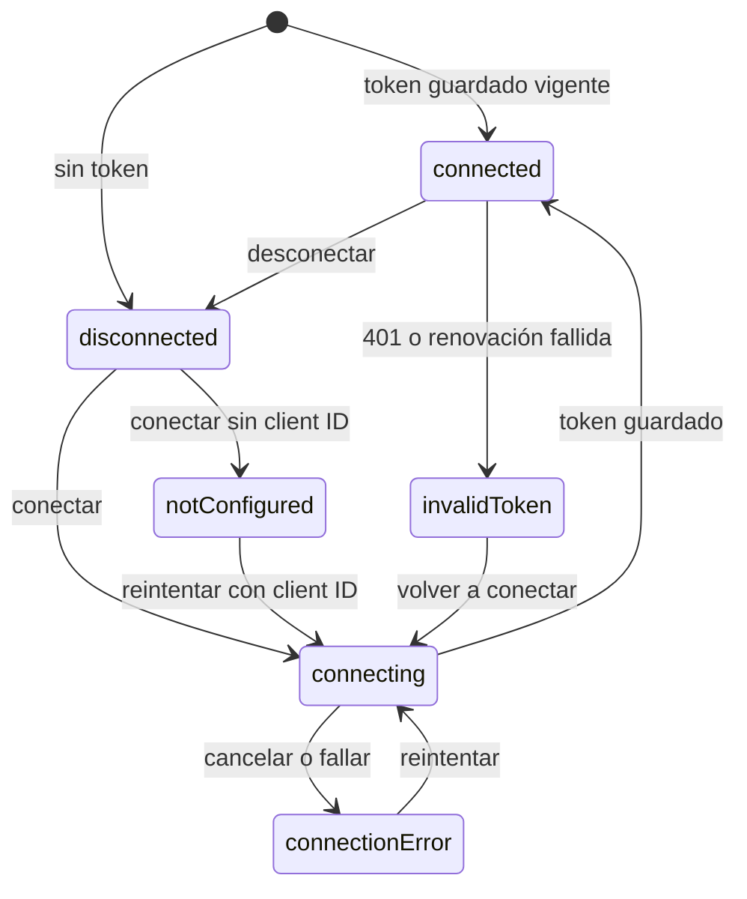
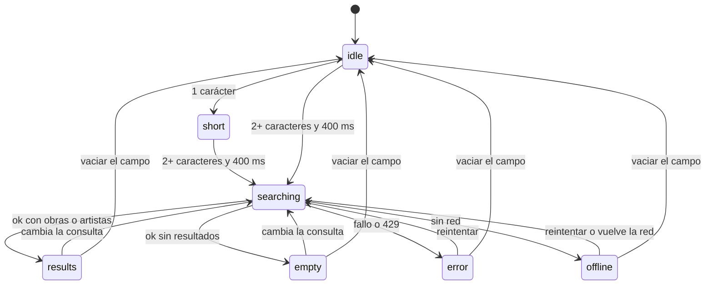

# Especificación funcional — U4 `u4-spotify-explore`

> **Provenance**: deriva de `inception/units-generation/unit-of-work.md` (U4), `inception/units-generation/unit-of-work-story-map.md` (US2.2, US3.1, US3.2, US10.1, US10.2), `inception/user-stories/stories.md` (AC2.2.1–AC2.2.4, AC3.1.1–AC3.1.8, AC3.2.1–AC3.2.4, AC10.1.1–AC10.1.6, AC10.2.1–AC10.2.5), `inception/requirements-analysis/requirements.md` (FR3.3–FR3.5, FR4.1–FR4.6, FR9.2, FR10.1–FR10.8, FR11.2–FR11.4, FR12.2, RC-05, RC-08, RC-09, A6, OQ2), `inception/domain-design/components.md` (SpotifyAuth, SpotifyCatalog, Catalog, AppShell, DesignSystem), `inception/contract-design/contract-summary.md` (C1, C2, C5, C7, C9, C10), `inception/refined-mockups/mockups.md` (Explorar, Perfil, Inicio, matriz de estados), `inception/refined-mockups/interaction-spec.md` y las respuestas de `functional-design-questions.md` (Q1 = B, Q2 = A, Q3 = B, Q4 = A, Q5 = A).
> Fecha: 2026-11-17. Etapa: Functional Design · Unidad: `u4-spotify-explore` · Agente: aidlc-architect-agent · Profundidad: Standard.

## Alcance de esta especificación

U4 es la unidad de la integración externa. Entrega **`@melodify/spotify`** con PKCE S256, client ID por entorno, token en `expo-secure-store`, renovación y sus seis estados; la **búsqueda real** de canciones, álbumes y artistas; la pantalla **Explorar** completa con y sin sesión; la **tarjeta de Spotify** de Perfil con conexión y desconexión; y las **portadas reales** en Inicio, detalle y resultados, con su degradación a bloque con la inicial.

Lo que **no** entra: publicar desde Crear ya existe en U3 y aquí solo cambia de dónde salen las obras; Actividad sigue siendo U5; el registro del redirect en el panel de Spotify es una dependencia externa que se intenta y, si falla, se documenta (Q1 = B, FR12.2). No hay pantalla de artista, ni reproducción de audio, ni backend.

La unidad se construye en este orden (de `unit-of-work-story-map.md`): `SpotifyAuth` con PKCE y token seguro → `SpotifyCatalog` → Explorar con sesión → Explorar sin sesión → conexión y desconexión en Perfil → portadas reales en Inicio y detalle → pruebas con dobles.

## Vocabulario y actores

| Término | Significado |
|---|---|
| **Sesión de Spotify** | La autorización PKCE vigente, independiente de la sesión de la app (C3). Su estado es uno de los seis de C7. |
| **Token** | El par `accessToken` / `refreshToken` con su `expiresAt`, guardado solo en `expo-secure-store`. Nunca cruza la frontera de `@melodify/spotify/auth`. |
| **Obra** | Una canción o un álbum de Spotify identificado por su `workId`, con título, artista y portada. Es lo que se puede opinar. |
| **Artista** | Un resultado de búsqueda que no es obra: no tiene título, portada ni recuento de opiniones. Es un atajo de búsqueda. |
| **Resultado** | Una fila de la lista de Explorar: una obra (canción o álbum) o un artista. |
| **Puerto** | La interfaz que C5 declara y C7 implementa: `SpotifySessionPort`, `SpotifySearchPort` y `SpotifyResolvePort`. |
| **Redirect URI** | La URL a la que Spotify devuelve el código de autorización. Se resuelve por entorno o con `makeRedirectUri()` (BR16.2). |
| **Bloque con la inicial** | La portada de respaldo: un cuadrado `surfaceSunken` con la primera letra del título. Nunca es un hueco. |

## Lo que U4 reutiliza y lo que cambia

| Pieza | Estado en U3 | Qué hace U4 |
|---|---|---|
| `@melodify/design-system` (C1) | 1.3.0 con `SearchField`, `ConnectionCard`, `WorkResultRow` | Publica **1.4.0**: `SpotifyCard`, `ArtistResultRow` y `WorkResultRow.kind?`. |
| `@melodify/app-shell` (C2) | 1.3.0 con pila, `openWorkDetail({ workId })` y `openCreate({ workId })` | Publica **1.4.0**: la `WorkView` viaja por la ruta y por `CreateEntry`. |
| `@melodify/catalog` (C5) | 1.1.0 con los tres puertos en `null` y `searchWorks` de canciones | Publica **1.2.0**: `workKind`, `ArtistHit`, `artists` en el resultado. |
| `@melodify/spotify` (C7) | No existe | Se crea en **1.0.0**: `auth` y `catalog`, con PKCE, token, búsqueda y resolución. |
| `@melodify/app-session` (C3) | 1.0.0 | Sin cambios: sigue siendo la identidad simulada. |
| `@melodify/content-store` (C4) | 1.2.0 | Sin cambios: las opiniones se leen y escriben por `workId` como hasta ahora. |
| `@melodify/connectivity` (C6) | 1.0.0 | Sin cambios: su estado entra en la decisión de portada y en el aviso de Explorar. |
| `app/src/state/useWorkSearch.ts` | 2 caracteres, 400 ms, obras | Devuelve también artistas y admite el modo de Explorar. |
| `app/src/screens/placeholders/ExplorarScreen.tsx` | Contenedor con título | Se sustituye por la pantalla completa en `app/src/screens/explorar/`. |
| `app/src/screens/perfil/PerfilView.tsx` | Sin tarjeta de Spotify | Añade `SpotifyCard` y su estado. |
| `app/src/screens/inicio/InicioHeader.tsx` | Chip «Conectar» sin acción | El chip conecta o lleva a Perfil según el estado (BR19.4). |
| `app/src/screens/detalle-obra/` | Resuelve la obra con `catalog.getWork` | Acepta la `WorkView` de la ruta y aplica la precedencia (BR20.2). |
| `app/src/screens/crear/` | Preselección por `workId` | Acepta `preselectedWork` con la vista completa. |
| `app/src/bootstrap/ports.ts` | Tres puertos en `null` | Construye y registra `SpotifyAuth` y `SpotifyCatalog`. |
| `app/src/bootstrap/shell-services.ts` | Spotify con valores por defecto | Sustituye los cinco campos por los de la instancia real. |

## Modelo de obra y de resultado

### `WorkView` (C5 1.2.0)

| Campo | Tipo | Obligatorio | Qué es |
|---|---|---|---|
| `workId` | `string` | Sí | Identificador de Spotify de la canción o del álbum. |
| `title` | `string` | Sí | Nombre de la canción o del álbum. |
| `artist` | `string` | Sí | Artista principal; para un álbum, su artista de álbum. |
| `coverUrl` | `string \| null` | Sí | La imagen que resolvió Spotify, o `null`. |
| `origin` | `'sample' \| 'spotify'` | Sí | De dónde entró la obra. |
| `workKind` | `'track' \| 'album'` | No | La clase de obra. Ausente equivale a `track` (BR20.9). |

### `ArtistHit` (C5 1.2.0)

| Campo | Tipo | Obligatorio | Qué es |
|---|---|---|---|
| `artistId` | `string` | Sí | Identificador de Spotify del artista. |
| `name` | `string` | Sí | Nombre visible del artista. |

### `SearchResult` / `SearchPortResult` (C5 1.2.0)

| Tipo | Campos | Cambio |
|---|---|---|
| `SearchPortResult` | `kind`, `works?`, `artists?`, `failure?` | Añade `artists?: ArtistHit[]`. |
| `SearchResult` | `status`, `works`, `artists?` | Añade `artists?: ArtistHit[]`; en la práctica C5 siempre lo devuelve, vacío si no hay. |

**Invariantes del modelo**

1. Un `ArtistHit` nunca se convierte en `WorkView`: no tiene título ni portada, y el detalle no lo acepta.
2. Un álbum y una canción son la misma clase de dato (`WorkView`); solo `workKind` los distingue.
3. Una obra que se pinta en Inicio, detalle o Crear siempre tiene `workId`, `title` y `artist`; `coverUrl` puede ser `null` y entonces se pinta el bloque.
4. El recuento de opiniones no vive en `WorkView`: se pregunta a C5 (`countOpinions`) en el instante de pintar.

## Máquina de estados de la conexión



**Respaldo en texto**: al arrancar, un token guardado y vigente lleva directo a `connected`; sin token se arranca en `disconnected`; si falta el client ID se arranca en `notConfigured`. Conectar abre el navegador (`connecting`) y termina en `connected` si el token se guarda o en `connectionError` si la persona abandona o el intercambio falla. Desconectar vuelve a `disconnected`. Un `401` de C10 o una renovación fallida llevan a `invalidToken`, que solo sale con «Volver a conectar».

| Estado | Dispara a | Qué ve la persona | Acción disponible |
|---|---|---|---|
| `disconnected` | `connecting` | «Sin conectar» / «Conecta para ver portadas y buscar en el catálogo completo.» | «Conectar con Spotify» |
| `connecting` | `connected`, `connectionError` | «Conectando…» + indicador | Ninguna (botón deshabilitado) |
| `connected` | `disconnected`, `invalidToken` | «Conectado» / «Conectado con tu cuenta.» | «Desconectar» |
| `connectionError` | `connecting` | «No pudimos conectar con Spotify.» | «Reintentar» |
| `invalidToken` | `connecting` | «Tu sesión de Spotify caducó. Vuelve a conectar.» | «Conectar con Spotify» |
| `notConfigured` | `connecting` (si aparece el client ID) | «La conexión con Spotify no está configurada en esta instalación.» | «Reintentar» |

**Invariantes de la máquina**

1. Solo hay una instancia de `SpotifyAuth` y un estado vigente; dos pantallas nunca ven estados distintos.
2. `connected` es el único estado en el que C5 devuelve portadas `url` y en el que Explorar pide a Spotify.
3. `connecting` no se pinta nunca al arrancar: renovar es silencioso (BR16.6).
4. El token nunca se expone fuera de `@melodify/spotify/auth` (BR16.12).

## Máquina de estados de Explorar



**Respaldo en texto**: el campo vacío deja el estado inicial con sugerencias; un carácter pide ayuda sin lanzar nada; dos o más esperan 400 ms y pintan cinco esqueletos mientras piden. La respuesta lleva a resultados (obras y artistas), vacío o error; la falta de red lleva a `offline` sin pedir. Cambiar el texto vuelve a `searching`; vaciar vuelve a `idle`; reintentar repite la consulta vigente.

**Estados y textos**

| Estado | Qué se ve | Texto exacto |
|---|---|---|
| `idle` (con sesión) | Título, explicación y sugerencias | «Encuentra tu próxima opinión» / «Busca en el catálogo completo de Spotify o empieza por una de estas.» / «Sugerencias para empezar» |
| `short` | Ayuda bajo el campo | «Escribe al menos 2 caracteres.» |
| `searching` | 5 filas de esqueleto | — |
| `results` | Obras y artistas | — |
| `empty` | Bloque centrado con la consulta | «Sin resultados para «…»» / «Prueba con otra grafía o con el nombre del artista.» |
| `error` | Bloque de error con el texto conservado | «No pudimos buscar en Spotify.» / «Reintentar» |
| `offline` | Banner y, si hay, resultados en caché; si no, error | «Sin conexión. No podemos buscar en Spotify ahora mismo.» / «Reintentar» |
| `sin sesión` | Tarjeta de conexión y sugerencias, sin campo | «Busca en todo Spotify» / «Conecta tu cuenta para buscar en el catálogo completo. Mientras tanto, estas obras del catálogo de ejemplo también se pueden opinar.» / «Conectar con Spotify» |
| `token caído con resultados` | Lista conservada con bloques y aviso sobre ella | «Tu sesión de Spotify caducó. Vuelve a conectar para buscar en el catálogo completo.» / «Volver a conectar» |

**Invariantes de la pantalla**

1. Sin sesión no se pinta el campo de búsqueda (BR19.1); con sesión, el campo tiene el foco al entrar.
2. El estado `token caído` no es un estado de búsqueda: es una capa sobre `results` que conserva lista y consulta (BR18.6).
3. La lista nunca mezcla obras y artistas sin distinguirlos: las obras usan `WorkResultRow` y los artistas `ArtistResultRow`.
4. Un cambio de consulta invalida la petición anterior antes de que el efecto vuelva a correr (BR17.8).

## Flujo F21 — Conectar Spotify desde Explorar o desde Inicio

1. La persona abre Explorar sin sesión. Ve la tarjeta «Busca en todo Spotify» y las sugerencias del catálogo de ejemplo.
2. Toca «Conectar con Spotify». `SpotifyAuth` comprueba el client ID:
   - si falta o no es válido → `notConfigured`; la tarjeta muestra «La conexión con Spotify no está configurada en esta instalación.» y «Reintentar»; nada más cambia.
   - si existe → construye la URL de C9 con PKCE S256 y `state`, y abre el navegador del sistema. El estado pasa a `connecting` y el botón queda deshabilitado con «Conectando…».
3. La persona autoriza en Spotify. El navegador vuelve al `redirect_uri`; la app recibe `code` y `state`.
4. `SpotifyAuth` comprueba el `state`, intercambia el código en `/api/token` con el `code_verifier`, guarda el token en `expo-secure-store` y emite `connected`.
5. La tarjeta de Explorar desaparece y en su lugar aparece el campo de búsqueda con las sugerencias. El chip de Inicio pasa a «Conectado» y Perfil muestra «Conectado» + «Desconectar». Las portadas de Inicio y detalle se resuelven en la siguiente lectura.
6. Si la persona abandona el navegador o el intercambio falla, el estado pasa a `connectionError` con «No pudimos conectar con Spotify.» y «Reintentar»; las sugerencias siguen visibles y operativas.

**Si el panel de Spotify rechaza el redirect**: el paso 2 abre la página de autorización, pero Spotify no devuelve el código a la app; el flujo termina en `connectionError`. Se anota el valor exacto que devolvió `makeRedirectUri()` y el motivo del rechazo en `external-dependency-map.md`; la unidad se cierra con el recorrido sin sesión (FR12.2). El código de los pasos 2–4 queda cubierto por pruebas con dobles de navegador, criptografía y almacén seguro.

## Flujo F22 — Buscar en Spotify con sesión

1. La persona entra en Explorar con sesión. El campo dice «Busca canciones, álbumes o artistas…» y tiene el foco.
2. Escribe un carácter: aparece «Escribe al menos 2 caracteres.» y no se lanza ninguna petición.
3. Escribe el segundo: se cancela el temporizador anterior y, tras 400 ms de pausa, se pintan 5 esqueletos y se llama a C5 → C7 → C10 con `type=track,album,artist`.
4. La respuesta se normaliza: las canciones y los álbumes se registran como obras; los artistas se listan después. Cada fila de obra muestra portada (o bloque), título, artista, etiqueta «Canción»/«Álbum» y «N opiniones» o «Sé el primero en opinar». Cada fila de artista muestra su inicial circular, su nombre y «Artista».
5. Si la consulta ya estaba en caché, los resultados aparecen sin esqueletos y sin petición.
6. Si no hay resultados: «Sin resultados para «…»» y «Prueba con otra grafía o con el nombre del artista.».
7. Si falla: «No pudimos buscar en Spotify.» y «Reintentar», conservando el texto. Al tocar «Reintentar» se repite la misma consulta.
8. Si se cae la red: banner de sin conexión; si la consulta vigente estaba en caché, sus resultados siguen visibles con bloques; si no, el bloque de error de red.

## Flujo F23 — Abrir una obra de Spotify y opinar sobre ella

1. La persona toca una fila de canción o de álbum. La app llama a `openWorkDetail({ workId, data })` con la `WorkView` completa.
2. La cáscara apila el detalle de obra dentro de la pestaña Explorar y le pasa `work: { workId, data }`. La lista y la consulta quedan debajo, intactas.
3. `useDetalleObra` resuelve la obra: si el catálogo local la conoce (la búsqueda la registró en BR20.8), usa sus datos; si no, usa `data`. Lee las opiniones de C4 por `workId`.
4. Sin opiniones, el detalle muestra la identidad de la obra (portada real o bloque, título, artista, «0 opiniones») y el botón «Opinar sobre esta obra».
5. «Opinar sobre esta obra» llama a `openCreate({ workId, data })`. Crear abre en modo publicar con la obra fija, el buscador plegado y «Cambiar» disponible.
6. La persona escribe y valora; «Publicar» guarda la opinión en C4 con el título y el artista de la obra y vuelve a Inicio con «Opinión publicada», como en U3.
7. Volver atrás desde el detalle devuelve a Explorar con el texto y los resultados que había.

## Flujo F24 — Tocar un artista

1. En una lista de resultados, la persona toca una fila de artista.
2. El campo de búsqueda pasa a contener el nombre del artista; el foco se mantiene en el campo.
3. Se dispara la misma búsqueda que si se hubiera escrito: 400 ms, caché y estados. La lista se sustituye por los resultados de esa nueva consulta, que incluirán sus canciones y álbumes.
4. No se abre ninguna pantalla, no se crea ninguna obra y no se pide recuento de opiniones para el artista (BR20.6).

## Flujo F25 — La sesión se cae con resultados en pantalla

1. La persona tiene resultados de una búsqueda en pantalla y la sesión está conectada.
2. Una nueva búsqueda recibe `401`, o la renovación de 60 s falla. `SpotifyAuth` borra el token y emite `invalidToken`.
3. El chip de Inicio vuelve a «Conectar»; la tarjeta de Perfil muestra «Tu sesión de Spotify caducó. Vuelve a conectar.» + «Conectar con Spotify».
4. Explorar **no** borra la lista ni la consulta: las portadas pasan a bloque y sobre la lista aparece el aviso «Tu sesión de Spotify caducó. Vuelve a conectar para buscar en el catálogo completo.» con «Volver a conectar» (Q4 = A).
5. «Volver a conectar» relanza el flujo F21. Al volver a `connected`, la tarjeta y el aviso desaparecen; una nueva búsqueda vuelve a pedir a Spotify. Los resultados anteriores no se revalidan solos.

## Flujo F26 — Desconectar y recuperarse de un fallo

1. En Perfil, con sesión conectada, la persona toca «Desconectar».
2. `SpotifyAuth` borra el token de `expo-secure-store`, emite `disconnected` y la cáscara muestra «Spotify desconectado». Perfil pasa a «Sin conectar» + «Conectar con Spotify»; el chip de Inicio pasa a «Conectar»; las portadas de Inicio, detalle y resultados pasan a bloque en la siguiente lectura. El contenido local no se toca.
3. Si la persona vuelve a conectar y abandona el navegador, Perfil muestra «No pudimos conectar con Spotify.» + «Reintentar». «Reintentar» vuelve a abrir la autorización.
4. Si la instalación no tiene client ID, Perfil muestra «La conexión con Spotify no está configurada en esta instalación.» + «Reintentar»; el resto de la app sigue funcionando.
5. Si la persona cierra sesión en Melodify, el token de Spotify no se toca (BR16.11).

## Flujo F27 — Portadas reales en Inicio y en el detalle

1. Con sesión conectada y red, Inicio y el detalle piden `coverFor(workId)` a C5. Si la obra tiene `coverUrl`, se pinta la imagen real; si no, C5 intenta resolverla con `SpotifyResolvePort`.
2. Si la resolución falla, `getCoverFailure()` pasa a verdadero: Inicio muestra «No pudimos actualizar las portadas.» + «Reintentar» bajo la cabecera, y la lista sigue visible con bloques. «Reintentar» llama a `retryCovers()`.
3. Si una imagen concreta no carga, su tarjeta se queda con el bloque con la inicial, sin aviso adicional.
4. Si se desconecta Spotify o se pierde la red, las portadas pasan a bloque en la siguiente lectura; al reconectar o volver la red, vuelven las imágenes reales sin remontar la pantalla.
5. Si la persona está desconectada, Inicio y el detalle no piden nada a Spotify: C5 devuelve `initialBlock` directamente.

## Textos exactos de la interfaz

| Dónde | Texto | Notas |
|---|---|---|
| Explorar, campo | «Busca canciones, álbumes o artistas…» | Placeholder; corrige «Busca artistas, álbumes…» del mockup (Q3 = B). |
| Explorar, inicial | «Encuentra tu próxima opinión» | `type.title2`. |
| Explorar, inicial | «Busca en el catálogo completo de Spotify o empieza por una de estas.» | `type.body`. |
| Explorar, sugerencias | «Sugerencias para empezar» | `type.label`. |
| Explorar, consulta corta | «Escribe al menos 2 caracteres.» | Sin petición. |
| Explorar, vacío | «Sin resultados para «…»» | Con el texto buscado entre comillas angulares. |
| Explorar, vacío | «Prueba con otra grafía o con el nombre del artista.» | Segunda línea. |
| Explorar, error | «No pudimos buscar en Spotify.» | Con «Reintentar». |
| Explorar, sin red | «Sin conexión. No podemos buscar en Spotify ahora mismo.» | Con «Reintentar». |
| Explorar, sin sesión | «Busca en todo Spotify» | Título de la tarjeta. |
| Explorar, sin sesión | «Conecta tu cuenta para buscar en el catálogo completo. Mientras tanto, estas obras del catálogo de ejemplo también se pueden opinar.» | Cuerpo de la tarjeta. |
| Explorar, sin sesión | «Conectar con Spotify» | Acción. |
| Explorar, token caído | «Tu sesión de Spotify caducó. Vuelve a conectar para buscar en el catálogo completo.» | Aviso sobre la lista conservada. |
| Explorar, token caído | «Volver a conectar» | Acción del aviso. |
| Fila de artista | «Artista» | Texto de apoyo bajo el nombre. |
| Fila de obra | «Canción» / «Álbum» | Etiqueta de clase en `type.caption`; ausente en obras de ejemplo. |
| Perfil, tarjeta | «Spotify» | Título fijo de la tarjeta. |
| Perfil, desconectado | «Sin conectar» / «Conecta para ver portadas y buscar en el catálogo completo.» | Acción «Conectar con Spotify». |
| Perfil, conectando | «Conectando…» | Con indicador; botón deshabilitado. |
| Perfil, conectado | «Conectado» / «Conectado con tu cuenta.» | Acción «Desconectar» en tono de error. |
| Perfil, error | «No pudimos conectar con Spotify.» | Acción «Reintentar». |
| Perfil, token inválido | «Tu sesión de Spotify caducó. Vuelve a conectar.» | Acción «Conectar con Spotify». |
| Perfil, sin configurar | «La conexión con Spotify no está configurada en esta instalación.» | Acción «Reintentar». |
| Inicio, chip | «Conectado» / «Conectar» | Solo dos lecturas (BR19.4). |
| Inicio, portadas | «No pudimos actualizar las portadas.» | Con «Reintentar»; la lista sigue. |
| Inicio, sin red | «Sin conexión. Estás viendo lo último que cargamos.» | Banner de C6/U2. |
| Snackbar | «Spotify desconectado» | Confirmación de F26. |
| Detalle, obra desconocida | «No pudimos cargar esta obra.» | Con «Reintentar» (BR20.7). |

**Textos que no cambian**: los de Crear y Editar son los de U3; el botón «Publicar», «Cambiar», «Opinar sobre esta obra» y los avisos de publicación se conservan tal cual.

## Reglas derivadas

Las reglas completas, con su lógica y su violación, están en `rules.md` (BR16–BR20). En corto:

- **BR16** — La conexión: PKCE S256 sin secret (16.1), redirect resuelto y probado (16.2), `connecting` con salida (16.3), token seguro y borrado (16.4), persistencia (16.5), renovación silenciosa (16.6), seis estados (16.7), instalación sin configurar (16.8), desconexión (16.9), fallos visibles (16.10), independencia de sesiones (16.11) y token confinado a `auth` (16.12).
- **BR17** — La búsqueda: disparo y caché (17.1–17.2), tres clases de resultado y su orden (17.3), petición a C10 (17.4), fila de obra (17.5), artista como atajo (17.6), siete estados (17.7), descarte de respuestas tardías (17.8), error con reintento (17.9), sin red (17.10) y vaciado del campo (17.11).
- **BR18** — Las portadas: cuándo es real (18.1), bloque con la inicial (18.2), fallo de carga (18.3), recálculo al cambiar sesión o red (18.4), fallo de metadatos (18.5) y token caído con resultados (18.6).
- **BR19** — Sin sesión y sin red: tarjeta y sugerencias (19.1), estados de la tarjeta (19.2), sin sesión y sin red (19.3), chip de Inicio (19.4) y ausencia de peticiones (19.5).
- **BR20** — La obra: apertura por ruta (20.1), precedencia catálogo/ruta (20.2), obra sin opiniones (20.3), Crear preseleccionado (20.4), álbum como obra (20.5), artista que no es obra (20.6), obra desconocida (20.7), registro en C5 (20.8) y `workKind` opcional (20.9).

## Contratos que U4 posee y consume

| Contrato | Papel de U4 | Qué se entrega |
|---|---|---|
| **C1** `@melodify/design-system` | Consumidor y publicador de la **1.4.0** | `SpotifyCard`, `ArtistResultRow` y `WorkResultRow.kind?`; el tipo `SpotifyConnectionStatus` y el modelo `ArtistSummary`. |
| **C2** `@melodify/app-shell` | Consumidor y publicador de la **1.4.0** | La `WorkView` viaja por la ruta del detalle y por `CreateEntry`; `openWorkDetail` y `openCreate` ganan `data?`. |
| **C5** `@melodify/catalog` | Consumidor y publicador de la **1.2.0** | `WorkView.workKind?`, `ArtistHit`, `SearchResult.artists?` y `SearchPortResult.artists?`; `searchWorks` los propaga. |
| **C7** `@melodify/spotify` | **Dueño y publicador de la 1.0.0** | El paquete completo con `auth` y `catalog`. |
| **C9** Spotify Accounts API | Consumidor | Sin cambios de esquema: se usa `authorize` y `/api/token` como están declarados. |
| **C10** Spotify Web API | Consumidor | Cambia la búsqueda a `type=track,album,artist` y la respuesta gana `albums` y `artists`; la resolución acepta `/albums/{id}`. |
| **C3, C4, C6, C8** | Consumidor | Sin cambios. |

### C1 1.4.0 — lo que añade

| Pieza | Props | Estados y reglas que sostiene |
|---|---|---|
| `SpotifyCard` | `status: SpotifyConnectionStatus`, `onConnect`, `onDisconnect` | Los seis estados de BR16.7 con su texto y su acción; «Desconectar» en tono de error; «Conectando…» con indicador y botón deshabilitado. |
| `ArtistResultRow` | `artist: ArtistSummary`, `onPress` | Inicial circular de 56, nombre y «Artista»; toda la fila es el objetivo táctil; no pinta recuento ni portada de obra. |
| `WorkResultRow` | `work`, `opinionCount`, `onPress`, `kind?: 'track' \| 'album'` | Sin `kind`, igual que 1.3.0; con `kind`, una etiqueta «Canción»/«Álbum» en `type.caption` sin cambiar la altura. |

**Adiciones al modelo de C1**

| Tipo | Campos |
|---|---|
| `SpotifyConnectionStatus` | `'disconnected' \| 'connecting' \| 'connected' \| 'connectionError' \| 'invalidToken' \| 'notConfigured'` |
| `ArtistSummary` | `{ artistId: string; name: string }` |

`C2` conserva `SpotifyStatus` como alias de `SpotifyConnectionStatus`; las pantallas siguen importándolo de `@melodify/app-shell` y no cambian.

### C2 1.4.0 — la obra por la ruta

| Punto | Cómo queda | Por qué |
|---|---|---|
| `WorkDetailScreen.component` | `ComponentType<{ work: { workId: string; data?: WorkView } }>` | El detalle necesita los metadatos de una obra que el catálogo local no conoce (Q2 = A). |
| `GlobalServices.openWorkDetail` | `(input: { workId: string; data?: WorkView }) => void` | La lista de Explorar pasa la `WorkView` que ya tiene. |
| `GlobalServices.openCreate` | `(input?: { workId?: string; data?: WorkView }) => void` | Crear recibe la obra completa para pintar la fila fija sin volver a resolverla. |
| `CreateEntry.preselectedWork` | `WorkView \| null` (nuevo, requerido) | La vista completa de la obra preseleccionada; `preselectedWorkId` se conserva para las entradas que solo llevan id. |
| `DEFAULT_CREATE_ENTRY` | Añade `preselectedWork: null` | Toda entrada nace sin obra. |
| Pila de la cáscara | La entrada `work` guarda `data?: WorkView` y la pasa al componente | La ruta es el único sitio donde vive la obra entre pantallas. |
| Importación de `WorkView` | `import type { WorkView } from '@melodify/catalog'` | Es un tipo: no crea arista de ejecución hacia C5 ni hacia Spotify (TS-21, NFR3.11). |

**Compatibilidad**: los llamadores actuales de `openWorkDetail({ workId })` y `openCreate({ workId })` siguen compilando; solo cambia el tipo del componente registrado, que la app actualiza en el mismo PR.

### C5 1.2.0 — obras con clase y artistas en el resultado

| Punto | Cómo queda | Por qué |
|---|---|---|
| `WorkView.workKind?` | `'track' \| 'album'` opcional; ausente = canción | El álbum es obra opinable y C7 necesita saber cómo resolverlo (BR20.5, BR20.9). |
| `ArtistHit` | `{ artistId: string; name: string }` | El artista no es obra y no debe fingir serlo (BR20.6). |
| `SearchPortResult.artists?` | `ArtistHit[]` opcional | El puerto de C7 devuelve las tres clases en una sola respuesta. |
| `SearchResult.artists?` | `ArtistHit[]` opcional; C5 lo devuelve vacío si no hay | La pantalla de Explorar pinta las filas de artista. |
| `searchWorks` | Propaga `artists` y los cachea con las obras; `registerSearchedWork` sigue registrando solo obras | La caché y el registro no cambian de regla (BR17.2, BR20.8). |
| `getWork`, `countOpinions`, `coverFor`, `listSampleWorks` | Sin cambios | Una obra de álbum se resuelve con las mismas operaciones. |

**Compatibilidad**: todo es aditivo y opcional; los consumidores de U2 y U3 compilan sin cambios. `SearchResult` construido a mano en pruebas sigue valiendo sin `artists`.

### C7 1.0.0 — el paquete de Spotify

```yaml
openapi: 3.1.0
info: { title: Spotify, version: 1.0.0, x-owner: U4, x-transport: in-process }
x-modules:
  rule: >
    Dos módulos de superficie pública separada, como fija ADR-004. `@melodify/spotify/auth`
    es el único que toca el token y `expo-secure-store`; `@melodify/spotify/catalog` pide el
    token a `auth` y nunca lo lee ni lo guarda. El punto de composición usa `auth` para los
    tres puertos de sesión y `catalog` para búsqueda y resolución.
  auth:
    entry: '@melodify/spotify/auth'
    exports:
      createSpotifyAuth:
        input:
          clientId: 'string | null'
          redirectUri: 'string | undefined'
          secureStore: 'SecureStoreAdapter | undefined'
          browser: 'AuthBrowser | undefined'
          crypto: 'CryptoAdapter | undefined'
          fetch: 'typeof fetch | undefined'
          clock: '(() => number) | undefined'
        returns: SpotifyAuth
      SpotifyAuth:
        getState: '() => AuthorizationStateView'
        subscribe: '(listener: (state: AuthorizationStateView) => void) => () => void'
        connect: '() => Promise<void>'
        disconnect: '() => Promise<void>'
        retry: '() => Promise<void>'
        getAccessToken: '() => Promise<string | null>'
        markInvalid: '() => void'
        implements: [SpotifySessionPort]
  catalog:
    entry: '@melodify/spotify/catalog'
    exports:
      createSpotifyCatalog:
        input: { auth: SpotifyAuth, fetch: 'typeof fetch | undefined', clock: '(() => number) | undefined' }
        returns: { search: 'SpotifySearchPort["search"]', resolve: 'SpotifyResolvePort["resolve"]' }
        implements: [SpotifySearchPort, SpotifyResolvePort]
redirect:
  env: EXPO_PUBLIC_SPOTIFY_REDIRECT_URI
  fallback: "makeRedirectUri({ path: 'spotify-callback' })"
  expo_go_value: "exp://<ip>:8081/--/spotify-callback"
  decision: 'Q1 = B: se intenta registrar el valor exacto; si el panel lo rechaza, se anota y se demuestra sin sesión (FR12.2)'
token:
  storage: expo-secure-store
  key: melodify.spotify.token
  shape: { accessToken: string, refreshToken: string, expiresAt: number }
  cleared_on: disconnect
  plaintext_reads: none
pkce:
  method: S256
  verifier: '32 bytes aleatorios en base64url (43–128 caracteres de [A-Za-z0-9-._~])'
  challenge: 'base64url(SHA-256(verifier))'
  state: '32 bytes aleatorios en base64url; se compara al volver'
  scopes: 'ninguno: solo catálogo público (search, tracks, albums)'
refresh:
  before_seconds: 60
  single_flight: true
  on_success: 'token nuevo guardado; el estado sigue connected'
  on_failure: 'token borrado; estado invalidToken'
search:
  request: 'GET https://api.spotify.com/v1/search?q=<consulta>&type=track,album,artist&limit=20'
  mapping:
    track: 'WorkView { workId: id, title: name, artist: artists[0].name, coverUrl: album.images[0].url ?? null, origin: spotify, workKind: track }'
    album: 'WorkView { workId: id, title: name, artist: artists[0].name, coverUrl: images[0].url ?? null, origin: spotify, workKind: album }'
    artist: 'ArtistHit { artistId: id, name }'
  discard: 'elementos sin id o sin name'
  order: 'canciones, álbumes, artistas'
  failures:
    401: 'auth.markInvalid(); SearchPortResult.failure = unauthorized'
    429: 'rateLimited'
    abort: 'timeout (10 s)'
    network: 'network'
    other: 'error'
resolve:
  request: 'GET /tracks/{id}; si 404, GET /albums/{id}'
  success: 'WorkView con workKind track o album'
  404_both: 'notFound'
  failures: 'mismo mapeo que search'
x-timeouts:
  request: 10s
  retry: 'nunca automático; reintenta la persona'
```

**Decisiones del paquete**

1. **PKCE se implementa en `auth`**, no en las pantallas: genera verificador, desafío S256 y `state`; abre la autorización con `WebBrowser.openAuthSessionAsync`; comprueba el `state`; intercambia el código en `/api/token` con `application/x-www-form-urlencoded` y sin `Authorization: Basic` (cliente público); guarda el token.
2. **El redirect se resuelve una vez al construir `auth`**: `EXPO_PUBLIC_SPOTIFY_REDIRECT_URI` si existe; si no, `makeRedirectUri({ path: 'spotify-callback' })`. El valor se expone en un log de diagnóstico (`SPOTIFY_REDIRECT_RESOLVED`) para poder pegarlo en el panel, sin incluir el token.
3. **`getAccessToken()` es la única puerta al token** y solo la usa `catalog`: renueva si faltan menos de 60 s, comparte la promesa de renovación y devuelve `null` si no hay sesión. `markInvalid()` es la señal de un `401` de C10.
4. **`search` y `resolve` comparten un cliente HTTP** con tiempo límite de 10 s y sin reintento automático (OQ2). Un `fetch` que lanza por red se mapea a `network`; un aborto por tiempo, a `timeout`.
5. **La resolución es consciente de la clase**: primero `/tracks/{id}` y, si responde `404`, `/albums/{id}`. Así una obra de ejemplo (que es una canción) se resuelve como antes y un álbum encontrado por búsqueda también.
6. **La instancia se crea una sola vez** en `app/src/bootstrap/ports.ts`: `spotifyAuth` y `spotifyCatalogPorts`. `instances.ts` construye `Catalog` con esos puertos y `shell-services.ts` mapea `spotifyAuth` a los cinco campos de `ShellServices.spotify`.

### C10 — la búsqueda de tres clases y la resolución de álbumes

| Punto | Antes | Ahora |
|---|---|---|
| `GET /search.type` | `const: track` | `enum: [track, album, artist]` |
| `GET /search` respuesta | `tracks.items[]` | `tracks.items[]`, `albums.items[]`, `artists.items[]` |
| `GET /tracks/{id}` | Resuelve una canción | Igual; si `404`, el consumidor prueba `/albums/{id}` |
| `GET /albums/{id}` | No declarado | Metadatos y portada de un álbum (mismo esquema que un track, sin `album` anidado) |
| Límite | `default: 20` | `20` por clase |
| Tiempo y reintento | 10 s, sin reintento | Igual |

**Compatibilidad**: C10 es una API externa, no un paquete versionado; el cambio se registra en `contract-summary.md` § Revisión 17 y en la tabla de C10.

## Puntos de integración con las unidades siguientes

| Punto | Quién lo consume | Qué deja U4 listo |
|---|---|---|
| `@melodify/spotify` 1.0.0 | U6 | PKCE, token seguro, búsqueda y resolución listos; solo falta el redirect del panel. |
| C1 1.4.0 | U5, U6 | `SpotifyCard`, `ArtistResultRow` y `WorkResultRow.kind?`. |
| C2 1.4.0 | U5, U6 | La `WorkView` por la ruta y por `CreateEntry`; cualquier pantalla puede abrir una obra que no esté en el catálogo. |
| C5 1.2.0 | U5, U6 | Obras con `workKind` y resultados con artistas. |
| `spotifyAuth` en `bootstrap/ports.ts` | U6 | La conexión se prueba en el teléfono sin tocar la composición. |
| `useWorkSearch` con artistas | U6 | Explorar y Crear comparten disparo, caché y descarte de respuestas tardías. |
| Portadas reales en Inicio y detalle | U6 | El recorrido con sesión (US11.2) ya puede enseñar imágenes. |
| Snackbar «Spotify desconectado» | U6 | La desconexión confirma con el mismo aviso de la cáscara. |
| Aviso de token caído en Explorar | U6 | El recorrido de recuperación (US10.2) tiene su texto y su acción. |

## Historias implementadas

| Historia | Título | Criterios cubiertos |
|---|---|---|
| US2.2 | Ver portadas y metadatos según la sesión de Spotify | AC2.2.1, AC2.2.2, AC2.2.3, AC2.2.4 |
| US3.1 | Buscar obras en el catálogo de Spotify | AC3.1.1, AC3.1.2, AC3.1.3, AC3.1.4, AC3.1.5, AC3.1.6, AC3.1.7, AC3.1.8 |
| US3.2 | Explorar sin sesión de Spotify | AC3.2.1, AC3.2.2, AC3.2.3, AC3.2.4 |
| US10.1 | Conectar Spotify y mantener la conexión | AC10.1.1, AC10.1.2 (`Deferred` si el panel rechaza el redirect), AC10.1.3 (`Deferred` por lo mismo), AC10.1.4, AC10.1.5, AC10.1.6 |
| US10.2 | Desconectar y recuperarme de un fallo | AC10.2.1 (`Deferred` sin sesión real en el teléfono), AC10.2.2 (`Deferred`), AC10.2.3 (`Deferred`), AC10.2.4, AC10.2.5 |

**Por qué hay `Deferred`**: Q1 = B deja la conexión real a expensas de que el panel de Spotify acepte `exp://<ip>:8081/--/spotify-callback`. El código de los criterios aplazados se entrega completo y se prueba con dobles; lo que no se puede enseñar en el teléfono es el retorno real. Si el panel acepta el valor, los cinco criterios se cierran en la verificación de U6 sin cambiar código. Es el mismo trato que U3 dio a AC5.1.1 y AC5.1.5.

## Recorrido en el teléfono (Expo Go, Android)

Lo que no se puede demostrar con Jest y hay que ver en el dispositivo físico antes de dar la unidad por terminada:

| Paso | Qué se demuestra |
|---|---|
| Arrancar sin `EXPO_PUBLIC_SPOTIFY_CLIENT_ID` y abrir Explorar | **AC10.1.5, AC3.2.1, AC3.2.2**: tarjeta de conexión, sugerencias y, al tocar conectar, «La conexión con Spotify no está configurada en esta instalación.» con «Reintentar», sin romper el resto. |
| Con client ID, tocar «Conectar con Spotify» en Explorar y autorizar | **AC10.1.1, AC10.1.2**: la página de Spotify se abre con PKCE y, si el panel aceptó el redirect, la app vuelve con «Conectado» y portadas reales. Si no, se anota el rechazo y se sigue con el recorrido sin sesión. |
| Con sesión, escribir 1 y 2 caracteres en Explorar | **AC3.1.1**: no hay petición al primer carácter; a los 400 ms aparecen esqueletos y resultados. |
| Buscar un artista, tocar su fila y mirar el campo | **BR17.6, Q5 = A**: el campo se rellena con su nombre y la lista se relanza; no se abre ninguna pantalla. |
| Buscar un álbum y abrirlo, y después una canción | **AC3.1.8, BR20.5**: los dos abren el detalle dentro de Explorar, con su etiqueta de clase en la lista. |
| Desde el detalle de una obra sin opiniones, tocar «Opinar sobre esta obra» | **AC3.1.8, BR20.4, AC5.3.1**: Crear abre con la obra fija y el buscador plegado; publicar vuelve a Inicio con la opinión arriba. |
| Repetir una búsqueda ya hecha | **AC3.1.6**: los resultados salen sin esqueletos y sin una nueva petición. |
| Buscar algo sin resultados y algo que falle (modo avión) | **AC3.1.4, AC3.1.5, AC3.1.7, AC3.2.4**: vacío con la consulta, error con «Reintentar», esqueletos y banner de sin conexión. |
| Con sesión, abrir Perfil y tocar «Desconectar» | **AC10.2.1, AC10.2.2**: «Spotify desconectado», chip «Conectar», portadas a bloque y, al reabrir la app, sigue desconectado. |
| Con sesión, cerrar la app por completo y volver a entrar | **AC10.1.3, AC10.1.4**: sigue conectado sin volver a autorizar; el token no aparece en texto plano en ninguna lectura. |
| Abrir Inicio con sesión y con el modo avión | **AC2.2.1, AC2.2.2, AC2.2.4, AC2.2.3**: portadas reales, bloques sin sesión, lo cargado se conserva con banner y una portada rota cae a bloque. |
| En Perfil, tocar «Conectar», abandonar el navegador y volver | **AC10.2.4, AC10.2.5**: «No pudimos conectar con Spotify.» con «Reintentar»; durante la espera, «Conectando…». |
| Con resultados en pantalla, forzar un token inválido y buscar | **AC10.2.3, Q4 = A**: la lista y la consulta se conservan con bloques, el aviso ofrece «Volver a conectar» y Perfil muestra el token inválido. |

**Prerrequisito del recorrido con sesión**: el redirect exacto que devuelve `makeRedirectUri()` en el teléfono debe estar cargado en el panel de Spotify. Si no lo está o el panel lo rechaza, se recorre sin sesión y se deja constancia (FR12.2, RC-09, Q1 = B).

## Assumptions & Open Questions

- `[assumption]` **La conexión real puede quedar pendiente.** Q1 = B intenta el redirect de Expo Go; las reglas del panel apuntan a que lo rechazará. En ese caso se entrega PKCE completo y probado con dobles, y el recorrido con sesión se aplaza a U6 o a una entrega con build propio. No se improvisa `expo-dev-client` porque CT-05 y `team.md` § Deployment lo prohíben.
- `[assumption]` **Explorar sin sesión no pinta el buscador.** El mockup lo dibuja siempre, pero FR4.5 y AC3.2.1 describen la pantalla sin sesión como tarjeta + sugerencias. Un campo que no puede buscar sería una promesa falsa; se aparta del dibujo y se registra en `contract-summary.md` § Revisión 17.
- `[assumption]` **La etiqueta «Canción»/«Álbum» es una adición de esta etapa**, no está en el mockup. Dos obras pueden compartir título y la lista debe distinguirlas; se pinta en `type.caption` y no cambia la altura de la fila.
- `[assumption]` **El artista no tiene imagen ni pantalla propia.** La fila usa el bloque circular con la inicial; una pantalla de artista exigiría una petición más (`artists/{id}/top-tracks` o una búsqueda por `artist:`) y sus estados, que Q5 = A descartó.
- `[assumption]` **La renovación del token no se ve.** Ocurre dentro de la llamada en curso; solo su fallo se muestra, como `invalidToken`.
- `[assumption]` **El redirect se resuelve al construir `auth`**, no en cada conexión: el panel exige un valor estable y cambiarlo entre intentos haría imposible registrar uno. Se lee de entorno para poder fijarlo sin tocar código.
- `[assumption]` **La búsqueda de Crear ignora a los artistas.** `useWorkSearch` devuelve las dos clases, pero `CrearScreen` solo pinta obras: elegir un artista como obra no tiene sentido. El hook recibe `includeArtists: true` solo en Explorar; en Crear el estado `results` exige al menos una obra.
- `[assumption]` **La caché no se invalida al caer la sesión** (Q4 = A): son datos ya leídos que la persona está mirando. Al reconectar, una nueva búsqueda pide y actualiza.
- `[assumption]` **`createSpotifyAuth` recibe sus adaptadores** (almacén seguro, navegador, criptografía, `fetch` y reloj) para que las pruebas no toquen red, navegador ni dispositivo. Los valores por defecto son `expo-secure-store`, `expo-web-browser`, `expo-crypto`, `fetch` y `Date.now`.
- **Open question para U5**: Actividad no depende de Spotify; si algún día muestra portadas reales, debe pasar por C5 y no por C7.
- **Open question para U6**: el registro del redirect en el panel de Spotify es el único paso manual que queda. Si se acepta, el recorrido con sesión se demuestra sin cambios de código; si no, se documenta y se recorre sin sesión.

## Sources

- `unit-of-work` — `inception/units-generation/unit-of-work.md` (§ U4).
- `unit-of-work-story-map` — `inception/units-generation/unit-of-work-story-map.md` (US2.2, US3.1, US3.2, US10.1, US10.2 y el orden de U4).
- `stories` — `inception/user-stories/stories.md` (US2.2, US3.1, US3.2, US10.1, US10.2).
- `requirements` — `inception/requirements-analysis/requirements.md` (FR3.3–FR3.5, FR4.1–FR4.6, FR9.2, FR10.1–FR10.8, FR11.2–FR11.4, FR12.2, RC-05, RC-08, RC-09, A6, OQ2).
- `components` — `inception/domain-design/components.md` (SpotifyAuth, SpotifyCatalog, Catalog, AppShell, DesignSystem).
- `decisions` — `inception/domain-design/decisions.md` (ADR-004: separación de auth y catálogo; ADR-010: estados).
- `contract-summary` — `inception/contract-design/contract-summary.md` (C1, C2, C5, C7, C9, C10; revisión 17).
- `mockups` — `inception/refined-mockups/mockups.md` (Pantalla 2 Inicio, Pantalla 3 Explorar, Pantalla 6 Perfil, matriz de estados, navegación).
- `interaction-spec` — `inception/refined-mockups/interaction-spec.md` (§ SpotifyStatusChip, CoverArt, ConnectionCard, SpotifyCard, SearchField, WorkResultRow, flujos de búsqueda y conexión, copy).
- `design-system-mapping` — `inception/refined-mockups/design-system-mapping.md` (inventario y tokens).
- `external-dependency-map` — `inception/delivery-planning/external-dependency-map.md` (Spotify Developer App, client ID y redirect URI).
- `rules` — `construction/u4-spotify-explore/functional-design/rules.md` (BR16–BR20).
- `functional-design-questions` — `construction/u4-spotify-explore/functional-design/functional-design-questions.md` (Q1 = B, Q2 = A, Q3 = B, Q4 = A, Q5 = A).
