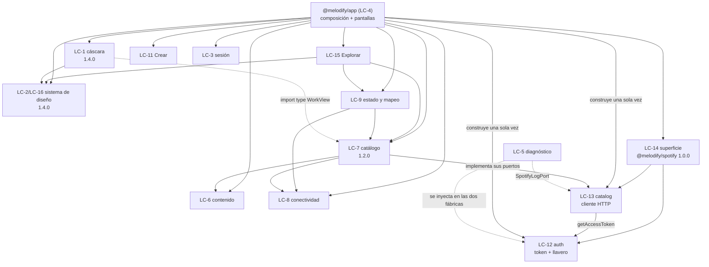

# Componentes lógicos — U4 `u4-spotify-explore`

> **Provenance**: deriva de `inception/domain-design/components.md` (SpotifyAuth, SpotifyCatalog, Catalog, Connectivity, AppShell, DesignSystem), de `inception/contract-design/contract-summary.md` (§ Estructura del monorepo, C1 1.4.0, C2 1.4.0, C5 1.2.0, C7 1.0.0, C9, C10, § Revisiones 17), de `nfr-requirements/tech-stack-decisions.md` (TS-31 a TS-38 y los heredados TS-01, TS-05, TS-13, TS-17, TS-18, TS-21, TS-29), de `nfr-requirements/performance-requirements.md` (NFR8.12–8.15, NFR1.12–1.15), de `nfr-requirements/security-requirements.md` (NFR3.17–3.20, NFR4.9–4.10, NFR9.7), de `functional-design/frontend-components.md` (§ Jerarquía, § Paquetes, § `@melodify/spotify`, § `app/src/bootstrap/`, § `app/src/state/`, § `app/src/screens/explorar/`), de `construction/u3-create-react/nfr-design/logical-components.md` (LC-1 a LC-11, inventario heredado) y de `performance-design.md` / `security-design.md` de esta misma etapa.
> Fecha: 2026-11-17. Etapa: NFR Design · Unidad: `u4-spotify-explore` · Agente: aidlc-architect-agent · Profundidad: Standard.

## Qué describe este archivo

`logical-components.md` pide un inventario de componentes, dominios de fallo y radio de impacto. U4 sigue sin servidor: no hay servicios que aislar ni réplicas que repartir. Lo que sí añade es **el primer paquete con dos superficies públicas** y **la primera credencial de terceros**, más **un área de pantalla con fallo propio** (Explorar) y **cinco piezas de interfaz nuevas**. El inventario continúa la numeración de U1, U2 y U3 para que las cuatro unidades se puedan leer juntas.

## Alcance: qué se diseña y qué no

- **Escalabilidad** (`scalability-design`): no se diseña. `requirements.md` no fija ningún objetivo y U4 no introduce ninguno: el contenido vive en memoria, no hay servidor y la app la usa una persona (RC-02, RC-03). Su ausencia es una decisión, no un olvido.
- **Fiabilidad** (`reliability-design`): filtrada por `produces_kinds`; se diseña en `performance-design.md` § NFR1 (los seis estados de la conexión, la capa de token caído, las cinco fronteras asíncronas y el recorrido sin client ID, sin sesión y sin red).
- **Observabilidad** (`observability-design`): filtrada igual; se diseña en `security-design.md` § NFR9 (un solo logger, seis códigos nuevos, `SpotifyLogPort`, sin telemetría).
- **Rendimiento y usabilidad**: `performance-design.md`; **seguridad, privacidad y diagnóstico**: `security-design.md`.

## Inventario

| ID | Componente lógico | Dónde vive | Responsabilidad | Dueño |
|---|---|---|---|---|
| **LC-1** | Cáscara y navegación | `packages/app-shell/` (`@melodify/app-shell` **1.4.0**) | `AppShell`, barra de cinco pestañas, pila de cada pestaña, `ShellServices`; **U4 publica** la `WorkView` por la ruta del detalle (`work: { workId, data? }`), `openWorkDetail`/`openCreate` con `data?`, `CreateEntry.preselectedWork` y el detalle registrado también bajo Explorar | U1; U4 publica la 1.4.0 |
| **LC-2** | Sistema de diseño | `packages/design-system/` (`@melodify/design-system` **1.4.0**) | Tokens, temas, `ThemeProvider`, `useTheme` y las piezas de U1–U3 más las **cinco adiciones de U4**: `SpotifyCard`, `ArtistResultRow`, `WorkResultRow.kind?`, el fallback de `CoverArt` y los modelos `SpotifyConnectionStatus` y `ArtistSummary` | U1; U4 publica la 1.4.0 |
| **LC-3** | Sesión de la app | `packages/app-session/` (`@melodify/app-session` 1.1.0, sin cambios) | `getSession`, `signIn`, `signOut`, `subscribeSession`, la guarda del registro y el adaptador de `expo-secure-store`; declara `SessionLogger` y `SessionLogCode` | U1 |
| **LC-4** | Arranque y composición | `app/src/bootstrap/` | `session.ts`, `instances.ts`, `comments.ts`, `logger.ts`, `App.tsx`; **U4 cambia `ports.ts`** (deja de publicar los tres puertos en `null` y construye `spotifyAuth` y `spotifyCatalog`), **`shell-services.ts`** (los cinco campos reales) y **`App.tsx`** (`ExplorarRoute`, el detalle bajo Explorar, `DetalleObraRoute` con `work`) | U1–U3; U4 cablea Spotify |
| **LC-5** | Diagnóstico | `app/src/bootstrap/logger.ts` | El logger del proyecto: implementa `SessionLogger` y declara `AppLogger`/`AppLogCode`; único sitio que llama a `console`. **U4 añade seis códigos** | U1; U2, U3 y U4 amplían el vocabulario |
| **LC-6** | Contenido | `packages/content-store/` (`@melodify/content-store` 1.2.0, sin cambios) | Opiniones, autores, me gusta, comentarios y seguimientos; las escrituras de U3; los topes con su `422` | U2 |
| **LC-7** | Catálogo | `packages/catalog/` (`@melodify/catalog` **1.2.0**) | Obras de ejemplo, `listSampleWorks`, `getWork`, `countOpinions`, `searchWorks`, `coverFor`, aviso de portadas y los tipos de los tres puertos; **U4 publica** `WorkView.workKind?`, `ArtistHit`, `artists` en el resultado y su caché | U2; U4 publica la 1.2.0 |
| **LC-8** | Conectividad | `packages/connectivity/` (`@melodify/connectivity` 1.0.0, sin cambios) | «En línea / sin conexión», `subscribeNetwork`; el único adaptador de `expo-network` | U2 |
| **LC-9** | Estado y mapeo de la interfaz | `app/src/state/` | Los hooks de U2 y U3; **U4 amplía `useWorkSearch`** con `includeArtists`, `artists` en el resultado y la lectura de `offline` de C5, y **añade `useSpotifyConnection`**, que expone `status: SpotifyStatus \| null` y traduce `null` (sin primera emisión: hidratando) a la presentación neutra de la conexión | U2/U3; U4 amplía el hook |
| **LC-10** | Comentarios: el controlador de la hoja | `app/src/comments/` | Estado de la hoja, `subscribe`/`open`/`close`/`retry`/`submit`, `toCommentModel` y la lectura y escritura de C4 | U3 |
| **LC-11** | Crear y su estado | `app/src/screens/crear/` | `CrearScreen`, `CrearView`, `useCrear`, `validateOpinionDraft`; **U4 hace que `useCrear` lea `entry.preselectedWork`** con la precedencia de BR20.2 | U3; U4 amplía la precedencia |
| **LC-12** | Autenticación con Spotify | `packages/spotify/src/auth/` (`@melodify/spotify/auth`) | `createSpotifyAuth`: PKCE S256, apertura del navegador, comprobación del `state`, intercambio, guardado, hidratación del arranque (lee, renueva si caducó y publica ya resuelto), renovación a 60 s, borrado y los seis estados. **Único módulo que toca el token y el almacén seguro.** Implementa `SpotifySessionPort` con `isConnected` y `onConnectionChange` | **U4** |
| **LC-13** | Catálogo de Spotify | `packages/spotify/src/catalog/` (`@melodify/spotify/catalog`) | `createSpotifyCatalog`: `search` y `resolve` sobre un único `requestJson` con 10 s, sin reintento; pide el token a `auth` y nunca lo lee del almacén. Implementa `SpotifySearchPort` y `SpotifyResolvePort` | **U4** |
| **LC-14** | Superficie y tipos del paquete | `packages/spotify/src/index.ts` y `src/types.ts` | `exports` con `.`, `./auth` y `./catalog`; `SpotifyToken`, `SpotifyLogCode`, `SpotifyLogPort` y el `import type` de `SpotifyConnectionStatus` que toman las dos entradas. **No declara ni reexporta la unión de estados** | **U4** |
| **LC-15** | Explorar y su estado | `app/src/screens/explorar/` | `ExplorarScreen` (contenedor), `ExplorarView` (vista pura), `useExplorar` (sugerencias, `sinSesion`, capa `tokenCaido` y sus acciones) y las pruebas de render por estado | **U4** |
| **LC-16** | Piezas de Spotify en el sistema de diseño | `packages/design-system/src/` | `SpotifyCard` (seis estados, 44×44, «Conectando…»), `ArtistResultRow` (fila entera tocable, bloque de 56) y `WorkResultRow.kind?` con su etiqueta de clase, más el `onError` de `CoverArt` | **U4** (dentro de LC-2) |

**Lo que no es un componente propio**: la tarjeta de Perfil y el chip de Inicio no tienen estado propio —leen `ShellServices.spotify` y llaman a sus cinco miembros—, y el detalle y Crear no cambian de forma: reciben un dato más por la ruta. `@melodify/spotify` no es dos paquetes: es uno con dos entradas, y esa decisión se explica abajo porque es la que sostiene la frontera del token.

## Dependencias entre componentes

**Respaldo en texto**: la app conoce a todos y es el único punto que los conecta. La superficie del paquete (LC-14) es la única puerta: `./auth` da acceso al token y al almacén, `./catalog` no. `catalog` depende de `auth` por una sola función —`getAccessToken()`— y no al revés, así que no hay ciclo de ejecución; la app construye `auth` antes que `catalog`, y `Catalog` (C5) recibe los dos puertos ya construidos. **Ninguna flecha va de un paquete a la app**, y **ninguna va de `catalog` hacia `content-store`**: el paquete no registra obras, eso lo hace C5 (TS-36). La cáscara solo nombra `WorkView` como tipo para la ruta, y ese import se borra al compilar.

### Por qué un paquete con dos entradas y no dos paquetes

El mapa `exports` de LC-14 es lo que hace comprobable la frontera del token: quien importa `@melodify/spotify/catalog` **no puede alcanzar** `expo-secure-store` ni siquiera por accidente, porque el mapa no le da esa ruta. Dos paquetes (`@melodify/spotify-auth` y `@melodify/spotify-catalog`) impondrían la misma frontera a costa de dos `package.json`, dos referencias de TypeScript, dos entradas de cobertura y dos versiones que subir por separado para dos módulos que comparten un contrato (C7). Un solo paquete con una sola entrada dejaría el import del almacén a un `import` de distancia de la pantalla. La decisión se justifica sola y se registra aquí para que una revisión futura no la lea como descuido (TS-31).

## Reglas de importación y su compuerta

| Regla | Qué la hace cumplir | Por qué |
|---|---|---|
| `packages/*` no importa `@melodify/app` ni `app/` | **ESLint** (`no-restricted-imports`, patrón `**/app/**`) y type-check | Un import relativo existente pasaría el type-check y no el lint |
| **`packages/spotify/src/catalog/**` no importa `auth/device.ts` ni ningún módulo de Expo** | Revisión de imports y prueba que lo comprueba archivo a archivo | Es la frontera del token: `catalog` pide el token, no lo lee (NFR3.18) |
| **`expo-secure-store`, `expo-web-browser` y `expo-crypto` solo se importan en `packages/spotify/src/auth/device.ts`** | `no-restricted-imports` con un bloque gemelo del de `app-session`, y la lista de módulos restringidos en el bloque de `packages/spotify/src/**` (TS-31) | Sin esa regla, el primer archivo de `auth` pone `npm run lint` en rojo; con ella, la frontera es del linter y no una convención |
| `expo-secure-store` sigue autorizado, y solo, en `packages/app-session/src/secure-store-adapter.ts` | La excepción que ya existía desde U1 | Dos claves, dos dueños, dos adaptadores (BR16.11) |
| `@melodify/spotify` no importa C1 salvo un `import type` en `src/types.ts` | Type-check y revisión: el tipo se borra al compilar y no hay arista de ejecución | La unión de seis estados tiene un solo dueño; redeclararla daría dos verdades (NFR3.11) |
| C1 y C2 no importan C5 ni C4 | `@typescript-eslint/no-restricted-imports` (regla de U3) | La cáscara recibe la `WorkView` como tipo; el sistema de diseño no conoce el catálogo |
| Nadie importa `AsyncStorage` ni `expo-file-system` | **ESLint** (`no-restricted-imports`), heredado de U1 y U2 | Es lo que sostiene NFR3.18: la única persistencia nueva es el llavero |
| Solo `app/src/bootstrap/` construye instancias de Spotify | Revisión del PR y el propio diseño | Dos instancias de `auth` serían dos estados de sesión y dos verdades (TS-18, TS-35) |
| `app/src/state/` y `app/src/screens/**` no importan `@melodify/spotify` | Revisión de imports y type-check | Las pantallas hablan con C2 y C5; el paquete es de la composición |

**Cada regla tiene una compuerta real, y las dos nuevas son de lint a propósito.** El type-check cierra las aristas entre paquetes internos que las referencias de proyecto ven; no impide que `catalog` importe `device.ts`, porque la referencia compila. Lo que hace comprobable la decisión es una regla que el CI ya ejecutaba antes de esta unidad (`npm run lint`) y que no depende de que alguien se acuerde en la revisión.

## Superficie, cobertura y compatibilidad

`tech-stack-decisions.md` declara requisitos que nacen de sus decisiones y no de `requirements.md`. Los cuatro que son propiedades de la estructura se diseñan aquí; los demás se reparten entre `performance-design.md` (NFR8.12–8.15, NFR2.10–2.12, NFR1.12–1.15) y `security-design.md` (NFR3.17–3.20, NFR4.9–4.10, NFR9.7).

| Requisito | Qué exige | Cómo lo cumple el diseño | Compuerta que lo demuestra |
|---|---|---|---|
| **NFR5.10** | Cobertura por árbol: 80 % de líneas en `app/src/**` **y** en cada `packages/*/src/**` | U4 escribe la entrada que faltaba, `"./packages/spotify/src/**": { lines: 80 }`, ahora que el árbol existe. `"./packages/activity/src/**"` sigue esperando a U5: un umbral sobre un árbol inexistente hace fallar la medición sin cubrir nada | `npm test -- --coverage`: la entrada nueva aparece con su propio porcentaje, no agregada a `app/src` |
| **NFR5.11** | Ninguna prueba sale a la red, abre el navegador ni toca el almacén del teléfono | Los cinco adaptadores de LC-12 y los cuatro de LC-13 se inyectan (TS-35, TS-37). **No hay mock global de `fetch`**: el doble se pasa por parámetro, para que una llamada real futura se delate en vez de quedar tapada | `npm test` en verde con la máquina sin salida; prueba del flujo completo con navegador, criptografía, almacén, `fetch`, reloj y logger dobles |
| **NFR7.7** | Todo corre en Expo Go, sin módulo nativo ni `prebuild` | Las tres dependencias nuevas —`expo-crypto`, `expo-web-browser`, `expo-auth-session`— son módulos del SDK 57 y viajan en el cliente de Expo Go; `expo-secure-store` ya estaba. Nada de `react-native-app-auth` ni `AsyncStorage` | `npx expo start` sin aviso de módulo ausente; el recorrido abre la autorización en el navegador del sistema y vuelve |
| **NFR6.9** | Las piezas nuevas de interfaz, 44×44 y el estado con palabras | `SpotifyCard` tiene dos botones como mucho y los dos son de 44×44; `ArtistResultRow` es una fila entera tocable sobre un bloque de 56; el estado se lee en texto («Conectando…», «Conectado», «Sin conectar»), no en el color de un punto | Pruebas de `SpotifyCard` por estado (texto y área táctil declarada); revisión de contraste con los pares de tokens de TS-14 |

**Por qué estos cuatro viven aquí y no en `performance-design.md`**: describen la forma del monorepo —superficie, umbral de cobertura, dependencias y accesibilidad de las piezas—, y su compuerta natural es el CI y el recorrido en el teléfono, no una pantalla concreta.

## Dominios de fallo y radio de impacto

| ID | Qué falla | Qué se degrada | Qué sigue funcionando | Radio |
|---|---|---|---|---|
| **LC-12** | La lectura del token falla al arrancar | `disconnected`; se registra `SPOTIFY_TOKEN_READ_FAILED`; la credencial **no** se borra | Toda la app; Explorar con sugerencias y el resto de pantallas | Arranque de la sesión de Spotify |
| **LC-12** | El intercambio o el guardado falla | `connectionError` con «Reintentar» | Las sugerencias y el resto de la pantalla; el contenido local | La tarjeta de conexión |
| **LC-12** | La renovación falla | `invalidToken`; token borrado | Inicio, Explorar con la lista conservada, Crear, Actividad y Perfil | La sesión de Spotify |
| **LC-12** | Se construye **dos veces** `auth` | Dos estados de sesión: una pantalla dice «Conectado» y otra «Conectar»; dos tokens | — | **Toda la app** (dos verdades) |
| **LC-13** | Spotify responde `429`, `5xx`, red o tiempo agotado | El estado `error` con «Reintentar»; el texto y el foco se conservan | El resto de la app y la caché ya leída | Una búsqueda |
| **LC-13** | La respuesta trae elementos incompletos | Se descartan esos elementos; el resto de la lista se pinta | La lista y la navegación | Una fila |
| **LC-13** | El `workId` de la ruta es inválido | Se rechaza antes de la petición; `notFound` | La lista y el detalle con sus datos de ruta | Una resolución |
| **LC-14** | El mapa `exports` no resuelve en Metro | El arranque no compila: la app no levanta | — | **Toda la app** (bloqueante, y por eso se prueba primero) |
| **LC-15** | La vista pinta un estado sin texto ni salida | Una zona vacía en Explorar | El resto de la app | Una pantalla |
| **LC-15** | `tokenCaido` se modela como estado y sustituye la lista | La persona pierde lo que estaba leyendo y no sabe si la búsqueda falló | — | Una pantalla, con dato perdido |
| **LC-16** | Una pieza falla al pintar | La pantalla se pinta sin esa pieza; el resto sigue | Las demás pantallas | Una pantalla |

**La regla que se lee de esta tabla**: casi todo degrada a una búsqueda, a una tarjeta o a una fila. Los tres fallos que no degradan son los de «dos verdades» —`auth` construida dos veces, el token cruzando la frontera y `tokenCaido` sustituyendo la lista—, y son los que se prueban primero.

### Los tres fallos que la unidad trata como intolerables

- **LC-12 con dos instancias**: si cada pantalla construyera su `auth`, el chip de Inicio y la tarjeta de Perfil podrían decir cosas distintas y un `disconnect()` en uno no borraría el token del otro. Se evita con **una sola construcción** en `app/src/bootstrap/ports.ts` (TS-35, TS-18) y se comprueba con una prueba de `ports.ts` que verifica una única construcción y que `ShellServices.spotify` sale de ella.
- **El token cruzando la frontera**: si el token llegara a una prop, a un contexto o a un mensaje, dejaría de ser una credencial para ser un dato más de la interfaz. Se evita con el mapa `exports` (LC-14), con la regla de lint (arriba) y con la forma de `ShellServices.spotify`, que no tiene ningún campo de token; se comprueba con la prueba de tipos y con la revisión de imports.
- **`tokenCaido` sustituyendo la lista**: si el `401` entrara como `error`, la persona perdería la lista y el texto, y el mensaje le diría que la búsqueda falló cuando lo que pasó es que hay que reconectar. Se evita modelándolo como **capa** (`tokenCaido: boolean` junto a `searchStatus`) y se comprueba con una prueba que provoca un `401` con resultados en pantalla y afirma que la lista y la consulta siguen en el árbol.

## Recursos compartidos y quién los posee

| Recurso | Cuántas instancias | Quién lo crea | Regla |
|---|---|---|---|
| `contentStore` | **Una** | `app/src/bootstrap/instances.ts` | Fuente única del contenido (TS-18) |
| `commentsController` | **Una** | `app/src/bootstrap/comments.ts` | La hoja es una sola (TS-27) |
| `spotifyAuth` | **Una** | `app/src/bootstrap/ports.ts` (**nuevo en U4**) | Dos instancias serían dos estados de sesión y dos tokens (TS-35) |
| `spotifyCatalog` (puertos) | **Uno** | `app/src/bootstrap/ports.ts` (**nuevo en U4**) | Se construye después de `auth`, que es su única dependencia |
| `Catalog` (C5) | **Uno** | `app/src/bootstrap/instances.ts` | Recibe los puertos reales; sigue siendo el dueño de la caché y del registro (TS-36) |
| Token de Spotify | **Uno** | `auth` | Una clave, un registro, un dueño; no se copia a memoria de módulo (NFR3.18) |
| Caché de búsquedas y registro de obras | **Uno** | C5 | El paquete de Spotify no cachea ni registra (TS-36) |
| Redirect resuelto | **Uno** | `auth`, al construirse | Se registra una vez con `warn` y se usa en los dos pasos del flujo (NFR9.7) |
| `logger` | Un módulo | Importado donde haga falta | Sin estado, sin red; el paquete lo recibe por `SpotifyLogPort` |
| Mensaje del snackbar | Uno | LC-1 | «Spotify desconectado» usa el mismo aviso de U3 |

## Frontera con las unidades siguientes

| Punto que U4 deja listo | Quién lo usa | Qué contrato lo fija |
|---|---|---|
| `@melodify/spotify` 1.0.0 con `auth` y `catalog` | U6 | C7 1.0.0 |
| C1 1.4.0 con `SpotifyCard`, `ArtistResultRow` y `WorkResultRow.kind?` | U5, U6 | C1 1.4.0 |
| C2 1.4.0 con la `WorkView` por la ruta y por `CreateEntry` | U5, U6 | C2 1.4.0 |
| C5 1.2.0 con `workKind`, `ArtistHit` y `artists` | U5, U6 | C5 1.2.0 |
| `spotifyAuth` en `bootstrap/ports.ts` y el chip de Inicio con acción | U6 | TS-35, BR19.4 |
| `useWorkSearch` con `includeArtists` | U6 | TS-31 de U3, ampliado |
| Aviso de token caído en Explorar y snackbar «Spotify desconectado» | U6 | BR18.6, BR16.9 |
| `AppLogCode` con los seis códigos de Spotify | U5, U6 | NFR9.7 |

**Lo que este archivo no decide**: la topología de despliegue (no aplica: no hay despliegue, `team.md` § Deployment) ni el reparto de unidades (fijado en `unit-of-work.md`). Describe dónde vive cada cosa y qué se rompe si falla.

## Assumptions & Open Questions

- `[assumption]` LC-12, LC-13, LC-14, LC-15 y LC-16 son las cinco áreas nuevas con fallo propio; el resto son ampliaciones de LC-1, LC-2, LC-4, LC-7, LC-9 y LC-11, y se dice en su fila para que el inventario no crezca con componentes que no lo son.
- `[assumption]` Metro de Expo SDK 57 resuelve el mapa `exports` del paquete sin `metro.config.js`. Si no lo hiciera, se añade la configuración que active `unstable_enablePackageExports`; **no** se parte el paquete en dos.
- `[assumption]` La construcción de `auth` es síncrona y la lectura del token es asíncrona y no bloqueante: `ports.ts` no espera ninguna promesa, y el arranque de 2 s se mantiene (NFR8.1, NFR8.13).
- `[assumption]` Las tres piezas nuevas de interfaz viven en C1 y no en un `@melodify/spotify-ui`: se evita una frontera más y la tarjeta de conexión queda disponible para Perfil y Explorar sin que ninguna pantalla la reimplemente.
- **Open question para U5**: Actividad no depende de Spotify; si muestra portadas reales, pasa por C5 y no por C7, y su paquete añade su propia entrada de cobertura.
- **Open question para U6**: el registro del redirect en el panel de Spotify sigue siendo el único paso manual. Si el panel lo rechaza, el recorrido se demuestra sin sesión y esta frontera no cambia.

## Sources

- `components` — `inception/domain-design/components.md` (SpotifyAuth, SpotifyCatalog, Catalog, Connectivity, AppShell, DesignSystem).
- `contract-summary` — `inception/contract-design/contract-summary.md` (§ Estructura del monorepo, C1 1.4.0, C2 1.4.0, C5 1.2.0, C7 1.0.0, C9, C10, § Revisión 17).
- `tech-stack-decisions` — `construction/u4-spotify-explore/nfr-requirements/tech-stack-decisions.md` (TS-31 a TS-38 y los heredados).
- `performance-requirements` — `construction/u4-spotify-explore/nfr-requirements/performance-requirements.md` (NFR8.12–8.15, NFR1.12–1.15).
- `security-requirements` — `construction/u4-spotify-explore/nfr-requirements/security-requirements.md` (NFR3.17–3.20, NFR4.9–4.10, NFR9.7).
- `functional-spec` — `construction/u4-spotify-explore/functional-design/functional-spec.md` (§ Contratos que U4 posee, § Máquinas de estado).
- `frontend-components` — `construction/u4-spotify-explore/functional-design/frontend-components.md` (§ Jerarquía, § Paquetes, § `@melodify/spotify`, § `app/src/bootstrap/`, § `app/src/state/`, § `app/src/screens/explorar/`).
- `rules` — `construction/u4-spotify-explore/functional-design/rules.md` (BR16–BR20).
- `logical-components (U1–U3)` — `construction/u1-app-skeleton/nfr-design/logical-components.md` (LC-1 a LC-5), `construction/u2-content-core/nfr-design/logical-components.md` (LC-6 a LC-9) y `construction/u3-create-react/nfr-design/logical-components.md` (LC-10, LC-11 y las reglas de importación heredadas).
- `performance-design` / `security-design` — esta misma etapa.
