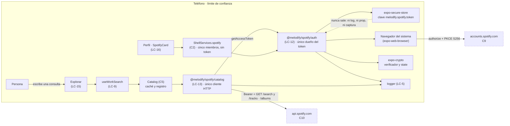

# Diseño de seguridad, privacidad y diagnóstico — U4 `u4-spotify-explore`

> **Provenance**: deriva de `nfr-requirements/security-requirements.md` (NFR3.17–3.20, NFR4.9–4.10, NFR9.7 y los heredados NFR4.8, NFR4.6, NFR9.4, NFR9.6, NFR9.1), de `nfr-requirements/performance-requirements.md` (NFR1.13, NFR1.14, NFR2.12, para lo que se conserva y lo que se registra ante un fallo), de `nfr-requirements/tech-stack-decisions.md` (TS-31 a TS-38), de `functional-design/functional-spec.md` (F21–F27, § C7 1.0.0, § Textos exactos, § Assumptions), de `functional-design/rules.md` (BR16.1–BR16.12, BR17.4, BR18.6, BR19.5, BR20.6, BR20.8), de `functional-design/frontend-components.md` (§ `@melodify/spotify` — la forma del paquete, § `app/src/bootstrap/`, § `app/src/screens/explorar/`) y de `inception/contract-design/contract-summary.md` (C1 1.4.0, C5 1.2.0, C7 1.0.0 con `x-pkce`, `x-token-storage` y `x-token-lifecycle`, C9, C10, § Fallos, tiempos y reintentos).
> Fecha: 2026-11-17. Etapa: NFR Design · Unidad: `u4-spotify-explore` · Agente: aidlc-architect-agent · Profundidad: Standard.

## Fronteras de confianza de esta unidad



**Respaldo en texto**: todo el tramo de U4 vive en el teléfono salvo dos destinos, y los dos son de Spotify: la autorización (C9) y el catálogo (C10). La credencial no cruza ninguna frontera: nace del intercambio, se guarda en el llavero del sistema y solo la lee `auth`. `catalog` no la toca —la pide prestada por `getAccessToken()` en el instante de la petición— y la cáscara solo publica el **estado**, nunca el token. El logger está en el camino de los fallos y no en el de los datos. **La app no habla con ningún servidor propio**: no hay backend, ni proxy, ni intermediario (RC-02, `project.md` § Forbidden).

**La frontera que esta unidad cruza, dicha sin rodeos**: hasta U3 el peor fallo posible era pintar mal una tarjeta. U4 es la primera unidad que guarda una **credencial** y la primera que envía algo a un servidor ajeno. Todo lo de abajo existe para que esa conexión sea la mínima posible: una credencial, dos verbos y nada más.

## NFR3.17 — PKCE S256 sin secreto, con el `state` comprobado antes de canjear el código

### El flujo, paso a paso

| Paso | Qué se genera o se envía | Dónde vive | Qué se descarta |
|---|---|---|---|
| 1. Verificador | 32 bytes aleatorios de `expo-crypto`, codificados en base64url (43 caracteres de `[A-Za-z0-9-._~]`) | Memoria de la llamada a `connect()` | Al terminar el intercambio |
| 2. Desafío | `base64url(SHA-256(verificador))` | Viaja en la URL de autorización | — (es público) |
| 3. `state` | Otros 32 bytes aleatorios en base64url | Memoria de la llamada a `connect()` | Al comparar, coincida o no |
| 4. Autorización | `response_type=code`, `client_id`, `redirect_uri`, `code_challenge`, `code_challenge_method=S256`, `state`, **sin `scope`** | Navegador del sistema → C9 | — |
| 5. Comprobación | Comparación **exacta** del `state` devuelto con el generado | `auth`, antes de tocar `/api/token` | Si no coincide: el código y el verificador |
| 6. Intercambio | `grant_type=authorization_code`, `client_id`, `code`, `redirect_uri`, `code_verifier` en `application/x-www-form-urlencoded`, **sin `Authorization: Basic`** | `auth` → C9 | El verificador y el código |
| 7. Guardado | `SpotifyToken` completo en el llavero | `auth` → almacén seguro | Nada más que la referencia |

### La codificación es una función pura del paquete

```text
// Ilustrativo, no implementación. packages/spotify/src/auth/pkce.ts
export function toBase64Url(bytes: Uint8Array): string {
  return base64(bytes)
    .replace(/\+/g, "-").replace(/\//g, "_").replace(/=+$/, "");
}
```

- **`expo-crypto` devuelve hexadecimal**, así que el recorte del relleno y la sustitución `+`→`-`, `/`→`_` son obligatorios y son una fuente clásica de desafíos inválidos. Sacarlos a una función pura permite probarlos con el vector de RFC 7636 Apéndice B —verificador `dBjftJeZ4CVP-mB92K27uhbUJU1p1r_wW1gFWFOEjXk` → desafío `E9Melhoa2OwvFrEMTJguCHaoeK1t8URWbuGJSstw-cM`— sin navegador ni criptografía real.
- **El verificador y el `state` no viven en el módulo.** Son variables de la llamada a `connect()`: dos conexiones seguidas no comparten verificador, y un `connect()` abandonado no deja el verificador del intento anterior disponible para el siguiente.
- **El `state` se compara antes del intercambio, no después.** Si no coincide —o si llega vacío, que es un no-coincidente— **no se llama a `/api/token`**: se descarta el código, se descarta el verificador y el estado pasa a `connectionError` con «No pudimos conectar con Spotify.» + «Reintentar» (BR16.3). Cambiar el código primero y comprobar después permitiría que un `state` ajeno canjeara un código.
- **El alcance va vacío.** Solo se usa el catálogo público —búsqueda, metadatos y portadas—, así que no se piden `user-read-*` ni ningún permiso que convierta una app sin cuenta en una app que exige una (FR10.6, NFR4.10).
- **El cliente es público y no hay secreto en ninguna parte**: ni en el código, ni en una variable `EXPO_PUBLIC_*`, ni en `.env.example`, ni en una prueba. `project.md` § Forbidden lo prohíbe en términos absolutos y CT-04 lo cerró en la ideación.
- **El redirect se resuelve una sola vez al construir `auth`** —`EXPO_PUBLIC_SPOTIFY_REDIRECT_URI` o `makeRedirectUri({ path: 'spotify-callback' })`— y se usa **el mismo valor** en la autorización y en el intercambio. Resolverlo dos veces haría que un cambio de IP de la red local entre ambos pasos rompiera el intercambio, y el panel exige registrar un valor estable (BR16.2).

**Cómo se verifica**: prueba de `toBase64Url` y del desafío con el vector de RFC 7636; prueba con criptografía doble que comprueba que la URL lleva `code_challenge_method=S256`, `response_type=code` y un `state` no vacío; prueba con un navegador doble que devuelve un `state` distinto y comprueba que **no** se llamó a `/api/token` y que el estado es `connectionError`; prueba que recorre el cuerpo del intercambio y comprueba que no hay `Authorization` ni `client_secret`; prueba de longitud (43–128) y alfabeto del verificador.

## NFR3.18 — El token vive solo en `@melodify/spotify/auth` y solo en el almacenamiento seguro

| Regla | Cómo se cumple en el diseño | Compuerta que lo demuestra |
|---|---|---|
| Un solo dueño | `expo-secure-store` se nombra en `packages/spotify/src/auth/device.ts` y, desde U1, en `packages/app-session/src/secure-store-adapter.ts`. **Ningún otro archivo** | `no-restricted-imports` con dos excepciones de archivo, una por adaptador (TS-31) |
| Una sola puerta de lectura | `getAccessToken()` es la única función que devuelve el token, y solo la llama `catalog` | Revisión de imports y prueba que comprueba que `catalog` pide el token y no toca el almacén doble |
| Nada fuera del paquete | `ShellServices.spotify` expone `status`, `subscribe`, `connect`, `disconnect` y `retry`; **no** expone el token (BR16.12) | Prueba de tipos: ningún campo de `ShellServices.spotify` tiene un tipo de token |
| Nada en claro | Sin `AsyncStorage`, sin archivo, sin `console` y sin una variable de módulo que guarde el token más allá de la llamada en curso | Revisión de imports y `no-console` |
| Un solo registro | Un único `setItemAsync` bajo `melodify.spotify.token` con los cuatro campos de `SpotifyToken`: `accessToken`, `refreshToken`, `expiresAt` y `obtainedAt` | Prueba que comprueba que tras `connect()` el almacén doble recibió **un** registro con los cuatro campos |
| Borrado al desconectar | `disconnect()` borra la clave entera y deja el estado en `disconnected` **aunque el borrado falle** (BR16.4) | Prueba del borrado y prueba del borrado que rechaza |
| Un `refreshToken` huérfano no reconecta | Se borra la clave entera, no solo el `accessToken` | Prueba que comprueba que tras `disconnect()` una lectura devuelve `null` |
| Las dos sesiones no se tocan | Cerrar sesión en Melodify **no** borra el token de Spotify, y desconectar Spotify **no** cierra la sesión de la app (BR16.11) | Prueba cruzada: `signOut()` deja el token; `disconnect()` deja la sesión |

### Cuándo se borra, y cuándo no

La clave se borra en **tres** caminos y en ninguno más: al desconectar (BR16.4), cuando la renovación falla —también la del arranque, con un `refreshToken` que ya no vale— y cuando Spotify responde `401` (BR18.6). Eso es exactamente `x-token-storage.cleared_on: disconnect` más los dos caminos que el contrato ya declara.

**Un fallo de lectura no borra nada.** Si el llavero falla al arrancar, se registra `SPOTIFY_TOKEN_READ_FAILED` y la app publica `disconnected` (`performance-design.md` § NFR8.13 y § NFR1.14); la credencial sigue guardada y el siguiente arranque la vuelve a intentar. Borrarla por un fallo transitorio del almacén destruiría una sesión válida y obligaría a autorizar de nuevo sin que nada lo justifique.

### Por qué los cuatro campos y no tres

`components.md` declara `SpotifyToken` con `obtainedAt`, y `expiresAt` es una marca absoluta. Guardar tres de los cuatro dejaría el modelo de dominio y la prueba diciendo cosas distintas por ahorrar un campo que la serialización ya lleva, y `obtainedAt` es lo que permite distinguir «caducado hace un minuto» de «caducado de una sesión anterior» al diagnosticar. **La forma que se escribe es la forma que se lee**, y la prueba lo fija.

### La frontera que el mock global de Jest no puede probar

`jest.setup.js` declara un doble de `expo-secure-store` desde U1 para que la app arranque entera en Jest. Precisamente por eso **no puede delatar un import indebido**: lo taparía. Lo que impide que `catalog` —o una pantalla— alcance el almacén es:

1. el mapa `exports` del paquete, que no da a `./catalog` ninguna ruta hacia `auth/device.ts`;
2. la regla de `eslint.config.js` que solo autoriza los tres módulos de dispositivo en `packages/spotify/src/auth/device.ts`;
3. la prueba que revisa que ningún archivo de `packages/spotify/src/catalog/` importa `device.ts` ni un módulo de Expo.

**La compuerta declarada es la que distingue**, y es lint y revisión de imports, no una prueba que pasaría siempre.

## NFR3.19 — El token, el verificador y el código no aparecen en un log, en una prueba ni en una captura

| Superficie | Qué puede aparecer | Qué no puede aparecer nunca |
|---|---|---|
| Logger del proyecto | `SPOTIFY_REDIRECT_RESOLVED` con el redirect resuelto; los cinco códigos de fallo con su mensaje literal | token, `refreshToken`, verificador, desafío, `state`, `code`, URL de retorno con su cadena de consulta |
| Mensajes de la interfaz | Los textos de `functional-spec.md` § Textos exactos | Cualquier credencial, cualquier código HTTP |
| Pruebas y fixtures | `token-de-prueba`, `refresh-de-prueba` | Una credencial real; ninguna prueba lee `.env` |
| Capturas para el PR | Estado, textos y portadas | El token: **ninguna pantalla lo pinta**, así que no hay nada que capturar |
| Diagnóstico de Metro | Nada de la unidad | El token, el código o el verificador |

- **El redirect es el único valor que se registra a propósito**: es un dato público, no lleva credencial y es el único que hay que pegar a mano en el panel de Spotify. Va por `warn`, que en un binario de release no se emite (TS-35): en producción no queda ni ese rastro.
- **La firma del logger no acepta un objeto.** `warn(code, message)` y `error(code, message)`: no hay sobrecarga por la que «pasar el contexto por si acaso» y arrastrar el token (NFR9.4, heredado).
- **Ningún mensaje interpola el valor del fallo.** Un intercambio que responde `400` se registra como «no se pudo guardar el token de Spotify», no con el cuerpo de la respuesta: el cuerpo de un `/api/token` fallido puede llevar el `code` o el `code_verifier` reflejados por el servidor.

**Cómo se verifica**: prueba con un `SpotifyLogPort` doble inyectado en las dos fábricas que recorre una conexión completa, una renovación fallida y una búsqueda fallida, y comprueba que **ningún** mensaje contiene el token, el `refreshToken`, el verificador, el `state` ni el `code`; revisión del código que confirma que el único sitio que llama al logger del proyecto con el redirect es `app/src/bootstrap/ports.ts`, con `warn` y sin token; revisión de `.env.example` (solo nombres de variable, sin valores).

## NFR3.20 — Una sola puerta HTTP, con sus URLs armadas, su autorización acotada y su respuesta desconfiada

| Aspecto | Regla del diseño | Dónde se materializa |
|---|---|---|
| Una sola puerta | Toda petición sale por `requestJson`, sobre `fetch` con `AbortController` de 10 s (TS-34) | `packages/spotify/src/catalog/http.ts` |
| Autorización acotada | `Authorization: Bearer` solo en las peticiones a `api.spotify.com`; `/api/token` va sin ella | `catalog` la añade al llamar; `auth` llama sin cabecera |
| Hosts fijos | Las bases son constantes del paquete: `https://api.spotify.com/v1` y `https://accounts.spotify.com/api/token` | `http.ts`; ninguna URL se compone desde un texto de la app |
| URLs armadas | La consulta entra con `encodeURIComponent`; el `workId` entra en la ruta **después** de validarlo contra `^[A-Za-z0-9]+$` | `catalog` |
| Sin texto libre en la URL | Lo único que viaja en la consulta es la consulta de búsqueda normalizada (`trim`, espacios colapsados, comparación en minúsculas) y esa misma forma es la clave de la caché de C5 (BR17.4, BR17.2) | `useWorkSearch` + C5 |
| Respuesta desconfiada | El JSON se lee campo a campo; un elemento sin `id` o sin `name` **se descarta** (BR17.4, `x-search-mapping`). Sin `eval`, sin `JSON.parse` de contenido ejecutable, sin interpretar marcado | `catalog` |
| La portada es un dato, no una orden | La `coverUrl` que devuelve Spotify se pasa a `Image` como fuente y **no** se usa para construir otra petición, un enlace ni una ruta. Vacía es `null` y se pinta el bloque | C5 + `CoverArt` |
| Errores mapeados, no propagados | Un `401` marca el token inválido; `429`, `5xx`, red y tiempo agotado se convierten en el `failure` del contrato. Nunca se pinta un código ni se relanza (BR16.10, BR17.9) | `http.ts` |
| Sin cookies ni `WebView` | No hay sesión de navegador ni contenido remoto ejecutado: la autorización abre el navegador del sistema y vuelve por el redirect | — |

**Cómo se verifica**: prueba del cliente con un `fetch` doble que registra las llamadas y comprueba la URL exacta, la cabecera y la ausencia de `Authorization` en el intercambio; prueba con una respuesta con un elemento sin `id` que comprueba que no llega a la lista; prueba de `resolve` que comprueba que el `workId` viaja codificado y que un identificador con `/` o `?` no entra en la ruta; prueba que comprueba que un `500` se convierte en `failure: 'error'` y no en una excepción.

## NFR4.9 — Inventario de lo que cruza la frontera y de lo que se queda

**Lo que sale del dispositivo, y solo eso:**

| Dato | Destino | Cuándo | Por qué es necesario |
|---|---|---|---|
| Consulta de búsqueda | `api.spotify.com/v1/search` | Al buscar con sesión | Es la búsqueda; sin ella no hay resultado |
| `workId` de una obra | `api.spotify.com/v1/tracks|albums/{id}` | Al resolver una portada o abrir una obra que no llegó por búsqueda | Es el identificador que Spotify emitió |
| `accessToken` | `api.spotify.com` (cabecera) | En cada petición | Autoriza la lectura del catálogo público |
| `code`, `code_verifier`, `client_id`, `redirect_uri` | `accounts.spotify.com/api/token` | Una vez, al conectar | Es el intercambio PKCE |
| IP del dispositivo y agente de Expo Go | Los servidores de Spotify y su CDN de imágenes | En cada petición y al cargar una portada | Es inherente a una petición HTTP |

**Lo que no sale nunca:** el texto de una opinión y el de un comentario (NFR4.8, abajo); el `viewerId`, el `authorId` y cualquier identificador de la persona en Melodify; los me gusta, los seguimientos y el contenido local; métricas, analítica o telemetría de cualquier tipo.

**Lo que se guarda en el dispositivo:**

| Dato | Persistido | Dónde | Se borra |
|---|---|---|---|
| `authorId` = `demo` y `startedAt` (U1) | Sí | Almacenamiento seguro, clave de sesión | Al cerrar sesión |
| **Token de Spotify** | **Sí (nuevo)** | Almacenamiento seguro, clave `melodify.spotify.token` | Al desconectar, al fallar la renovación (incluida la del arranque) y ante un `401` |
| Opiniones, comentarios, me gusta, seguimientos | No | Memoria del proceso | Al recargar (RC-03) |
| Caché de búsquedas y de resultados | No | Memoria del proceso (C5) | Al recargar |
| Estado de la conexión y de la red | No | Memoria del proceso | Al recargar |

**U4 añade exactamente una fila persistida**: el token. Es la primera credencial que la app guarda, está donde `project.md` § Mandated manda y se borra en tres caminos distintos. Si alguien propusiera guardar también la caché de búsquedas «para no repetir peticiones», esta tabla y RC-03 dejarían de ser ciertas: la decisión tendría que tomarla una etapa, no un detalle de implementación.

## NFR4.10 — Nada se envía a un servidor propio, y la app no promete más de lo que hace

- **No hay backend** (RC-02, `project.md` § Forbidden): ni propio, ni función serverless, ni proxy. La única salida es Spotify, y solo para lo de la tabla de arriba.
- **El contenido que la persona crea no viaja a Spotify**: publicar una opinión sobre una obra de Spotify es una escritura **local** en C4 (BR20.4). Que la obra venga de Spotify no convierte la opinión en un dato de Spotify.
- **La app no pide cuenta de Spotify para funcionar**: sin sesión, el recorrido completo existe (BR19.5, FR12.2), y eso es también una decisión de privacidad: nadie tiene que entregar una credencial para usar Melodify.
- **El token pertenece a la cuenta de Spotify de la propia persona** y no se comparte, ni se envía a Melodify, ni se usa para nada que no sea leer el catálogo público (FR10.6).
- **Desconectar es un borrado real, no una pausa**: el token se borra del almacén y no queda una copia en memoria (NFR3.18).
- **Ningún texto promete lo que la app no hace**: no se lee «sincronizado», «en tu cuenta» ni «guardado en Spotify». El estado dice «Conectado con tu cuenta.» porque describe la autorización, no una copia de datos.

## NFR9.7 — Qué se registra y qué no en esta unidad

| Situación | Se muestra a la persona | Se registra | Emisor |
|---|---|---|---|
| Arranque: redirect resuelto | No | Sí, `warn`, valor exacto: `SPOTIFY_REDIRECT_RESOLVED` | `app/src/bootstrap/ports.ts` |
| Lectura del token fallida | No: se arranca sin sesión, como C3 con su `503` | Sí, `error`: `SPOTIFY_TOKEN_READ_FAILED` | `auth` |
| Guardado del token fallido | «No pudimos conectar con Spotify.» + «Reintentar» | Sí, `error`: `SPOTIFY_TOKEN_SAVE_FAILED` | `auth` |
| Borrado del token fallido | «Spotify desconectado» (el estado pasa a `disconnected` igualmente) | Sí, `error`: `SPOTIFY_TOKEN_DELETE_FAILED` | `auth` |
| Renovación fallida | «Tu sesión de Spotify caducó. Vuelve a conectar.» | Sí, `warn`: `SPOTIFY_REFRESH_FAILED` | `auth` |
| El puerto de búsqueda lanza en vez de devolver un `failure` | El estado `error` de BR17.7 | Sí, `error`: `SPOTIFY_SEARCH_FAILED` | `catalog` |
| `401` de C10 | Capa `token caído` con «Volver a conectar» | No: es un estado previsto | — |
| `429`, tiempo agotado, `network`, `5xx` | El estado `error` de BR17.7 | No: son resultados previstos del contrato | — |
| Búsqueda sin resultados | `empty` con la consulta | No | — |
| Resolución de portada fallida | Banner con «Reintentar» | No se duplica: C5 ya lo expone con `getCoverFailure` (NFR9.4 de U2) | — |
| Una portada concreta que no carga | El bloque con la inicial, sin aviso | No: es una degradación prevista | — |
| Sin sesión, sin red o sin client ID | Tarjeta o banner | No | — |

### El vocabulario que crece

```ts
export type AppLogCode =
  | SessionLogCode
  | "CONTENT_SUBSCRIBE_FAILED"
  | "CONTENT_READ_FAILED"
  | "NETWORK_STATE_UNAVAILABLE"
  | "SEARCH_PORT_UNAVAILABLE"
  | "SPOTIFY_REDIRECT_RESOLVED"
  | "SPOTIFY_TOKEN_READ_FAILED"
  | "SPOTIFY_TOKEN_SAVE_FAILED"
  | "SPOTIFY_TOKEN_DELETE_FAILED"
  | "SPOTIFY_REFRESH_FAILED"
  | "SPOTIFY_SEARCH_FAILED";
```

- **`SessionLogCode` no se reabre**: los cuatro códigos de sesión siguen siendo de C3, y `AppLogger` sigue siendo asignable a `SessionLogger` (la línea `const asSession: SessionLogger = logger;` de U2 sigue valiendo).
- **El diagnóstico entra en el paquete por un puerto, no por un import.** `SpotifyLogPort` vive en `packages/spotify/src/types.ts` y declara `warn(code, message)` y `error(code, message)`. Sin él no habría por dónde emitir los cinco códigos del paquete: un fallo de guardado o de borrado **no cambia el estado visible**, así que desde la app no se puede observar (TS-38).
- **Es obligatorio, no opcional.** Un `log` opcional con un no-op por defecto dejaría cinco códigos sin emitir en silencio y convertiría la prueba de NFR3.19 en una prueba de algo que nunca se llama. La app siempre tiene `logger`; la prueba siempre tiene su doble.
- **Quién emite cada uno**: `auth` emite los cuatro de token; `catalog` emite `SPOTIFY_SEARCH_FAILED`; `SPOTIFY_REDIRECT_RESOLVED` lo emite `bootstrap/ports.ts`, porque allí se resuelve el redirect y es el único sitio que tiene el valor.

## NFR4.8 y NFR4.6 — Lo que U3 fijó sobre el texto de la persona, ahora con una credencial en juego

- **NFR4.8 — el texto de la persona no sale del dispositivo.** U4 no amplía ningún puerto con ese dato: `SpotifySearchPort.search(query)` recibe **la consulta de obra y nada más**. Ni la opinión, ni el comentario, ni el `handle` del autor, ni el `viewerId` participan en la URL, en la cabecera ni en el cuerpo de ninguna petición. Publicar sigue siendo una escritura local a C4.
- **NFR4.6 — el registro no se lleva el contenido.** La firma cerrada a `(code, message)` sigue siendo la garantía de que no se puede «pasar el contexto por si acaso». En U4 el dato sensible ya no es solo lo que alguien escribió: es también una credencial. La regla no cambia; lo que cambia es la consecuencia de un descuido.
- **Nunca se registra la consulta de búsqueda.** Es lo que la persona buscó y U4 es la primera unidad que la tiene: el logger registra **el fallo y su origen**, no el texto.

**Cómo se verifica**: prueba con un `fetch` doble que recorre una búsqueda y comprueba que la URL solo contiene la consulta y ningún otro texto; prueba del logger con espía que comprueba que el mensaje de `SPOTIFY_SEARCH_FAILED` no contiene la consulta; revisión de las firmas de los puertos en C5 1.2.0.

## NFR9.4, NFR9.6 y NFR9.1 — Lo heredado sigue valiendo

| Requisito | Qué fijó | Qué hace U4 |
|---|---|---|
| **NFR9.4** (U2) | La firma del logger son dos cadenas y un código de una unión; no hay sobrecarga con objeto | La respeta en `AppLogger` y en `SpotifyLogPort`, que es la misma forma |
| **NFR9.6** (U3) | El catálogo de eventos de Crear y de la hoja; solo los defectos internos llegan al logger | Añade el catálogo de NFR9.7 y no toca el de U3 |
| **NFR9.1** (U2) | Un solo logger en `app/src/bootstrap/logger.ts`, sin SDK de errores ni analítica | U4 no añade ninguna superficie: ni panel, ni telemetría, ni servicio de errores. Los seis códigos nuevos son vocabulario de la app y el paquete los recibe inyectados |

## Amenazas de la unidad y qué las cierra

| Amenaza | Qué la cierra en el diseño | Dónde se comprueba |
|---|---|---|
| Robo del token desde el dispositivo | Almacenamiento seguro del sistema, un único registro, borrado al desconectar (NFR3.18) | Prueba del almacén doble y revisión de imports |
| Interceptación del código de autorización | PKCE S256: sin el verificador no se canjea, y el verificador nunca sale del dispositivo (NFR3.17) | Prueba del desafío con el vector de RFC 7636 |
| Suplantación: volver a la app con un `state` ajeno | El `state` se genera en el dispositivo y se compara **antes** del intercambio; un `state` vacío es un no-coincidente (NFR3.17) | Prueba que comprueba cero llamadas a `/api/token` |
| Fuga de un client secret | No existe: cliente público, sin secreto en código, entorno ni pruebas (NFR3.17) | Revisión de `.env.example` y búsqueda de `client_secret` |
| Fuga del token por el registro de diagnóstico | El logger nunca recibe la credencial; el único dato registrado es el redirect (NFR3.19, NFR9.7) | Prueba con `SpotifyLogPort` doble |
| Fuga del token por una prop, un contexto o una captura | `ShellServices.spotify` no tiene ningún campo de token; ninguna pantalla lo pinta (BR16.12) | Prueba de tipos y revisión de `shell-services.ts` |
| Un `refreshToken` huérfano reconecta sin pedirlo | Se borra la clave entera al desconectar (TS-33) | Prueba del borrado |
| Enviar contenido de la persona a un tercero | Solo salen la consulta y el `workId`; nunca una opinión, un comentario ni una identidad (NFR4.9, NFR4.8) | Prueba del `fetch` doble con la URL exacta |
| Que una respuesta manipulada pinte una obra falsa o ejecute algo | Los elementos incompletos se descartan, todo se pinta como texto y la `coverUrl` solo se usa como fuente de imagen (NFR3.20) | Prueba con un elemento sin `id`; revisión de `CoverArt` |
| Que un `workId` manipulado inyecte una ruta | Se valida contra `^[A-Za-z0-9]+$` antes de entrar en la URL (NFR3.20) | Prueba con `../` y con `?` en el identificador |
| Dos verdades sobre la sesión | Una sola instancia de `SpotifyAuth` en `bootstrap/ports.ts`, un solo estado y una sola emisión (BR16.12, TS-35) | Prueba de `ports.ts` que comprueba una sola construcción |
| Que un `401` se disfrace de fallo de búsqueda y oculte que hay que reconectar | El `401` levanta la capa `token caído`, no el estado `error` (BR18.6, NFR1.13) | Prueba de `ExplorarScreen` con un `401` |
| Que se pueda publicar una opinión sobre algo que no es una obra | Un artista no se convierte en `WorkView` y no abre detalle ni Crear (BR20.6) | Prueba de `ArtistResultRow` y de la fila de artista |

## Cómo se demuestra cada requisito

| Requisito | Prueba o revisión con la que se demuestra |
|---|---|
| NFR3.17 | Vector de RFC 7636 para `toBase64Url` y el desafío; URL de autorización con `S256` y `state`; `state` distinto → sin `/api/token` y `connectionError`; cuerpo del intercambio sin `Authorization` ni `client_secret`; longitud y alfabeto del verificador |
| NFR3.18 | Revisión de imports (`expo-secure-store`, `AsyncStorage`, `expo-file-system`) con exactamente dos archivos autorizados; un registro con los cuatro campos tras `connect()`; borrado tras `disconnect()`; `catalog` no toca el almacén; tipos de `ShellServices.spotify` sin token |
| NFR3.19 | `SpotifyLogPort` doble que recorre conexión, renovación fallida y búsqueda fallida sin token, verificador, `state` ni `code`; revisión del único emisor del redirect; `.env.example` sin valores; fixtures ficticios |
| NFR3.20 | URL exacta y cabecera con un `fetch` doble; ausencia de `Authorization` en el intercambio; elemento sin `id` descartado; `workId` inválido rechazado; `500` → `failure: 'error'` |
| NFR4.9 | Revisión del inventario; prueba de lectura fallida que comprueba `disconnected` **sin** borrado y prueba de renovación fallida que comprueba `invalidToken` **con** borrado; recorrido del teléfono cerrando la app por completo y comprobando que el token persiste y que nada más lo hace |
| NFR4.10 | Revisión de dependencias (sin backend ni analítica); revisión de las cadenas de § Textos exactos; recorrido con modo avión |
| NFR4.8 / NFR4.6 | URL del `fetch` doble sin texto de opinión ni de comentario; logger con espía sin la consulta; revisión de las firmas de los puertos |
| NFR9.7 | Una prueba por código que comprueba que se emite en su situación y **no** en las previstas; prueba que comprueba que un `429` no registra nada y que un `listener` que lanza no impide la emisión |
| NFR9.4 / NFR9.6 / NFR9.1 | `const asSession: SessionLogger = logger;` compila; `AppLogger` asignable a `SpotifyLogPort`; revisión de dependencias sin SDK de analítica ni de errores |

## Riesgos asumidos y su porqué

| Riesgo | Por qué se acepta |
|---|---|
| El almacenamiento seguro es el límite de confianza | Si el teléfono está comprometido, ninguna app puede proteger un token de portador. Lo que sí se garantiza es que no queda en claro, no se registra y se borra al desconectar |
| La IP del dispositivo llega a Spotify y a su CDN | Es inherente a una petición HTTP. No se añade un proxy propio para ocultarlo porque RC-02 prohíbe un backend |
| El panel de Spotify puede rechazar el redirect de Expo Go | Q1 = B lo asume: el código de PKCE se entrega y se prueba con dobles, y el recorrido se demuestra sin sesión (FR12.2) |
| Una petición en vuelo por consulta al cambiar de texto | Abortar el socket exigiría ampliar `SpotifySearchPort` con una señal; el tiempo límite de 10 s acota el coste y el contrato no declara la señal |
| El `log` obligatorio complica la construcción | Es lo que impide que una fábrica se construya sin diagnóstico y que NFR9.7 sea letra muerta; la app siempre tiene `logger` y la prueba siempre tiene su doble |
| El redirect se registra en `warn` | Es el único dato que hay que pegar en el panel y `warn` solo existe en desarrollo: en release no queda rastro |

## Assumptions & Open Questions

- `[assumption]` El almacenamiento seguro del dispositivo es el límite de confianza. Lo que se garantiza es que el token no queda en claro, no se registra y se borra al desconectar.
- `[assumption]` Spotify exige el mismo `redirect_uri` en la autorización y en el intercambio. El valor se resuelve una sola vez al construir `auth` y se usa en los dos pasos.
- `[assumption]` El alcance vacío es suficiente: búsqueda, metadatos y portadas del catálogo público no requieren permisos de usuario (FR10.6). Leer la biblioteca de la persona sería una historia nueva con su propio consentimiento.
- `[assumption]` Los seis códigos de diagnóstico nuevos son de la app y no de C7: el paquete recibe `SpotifyLogPort` inyectado, igual que C3 y C6.
- `[assumption]` El doble global de `expo-secure-store` de `jest.setup.js` no prueba la frontera del token; la prueban el mapa `exports`, la regla de lint y la revisión de imports (TS-37).
- **Open question para U5**: Actividad no habla con Spotify. Si mostrara portadas reales, tendría que pasar por C5 y no por C7, y este inventario no cambiaría.
- **Open question para U6**: la prueba en el teléfono puede revelar que el almacenamiento seguro tarda en frío más de lo esperado. Si es así, se documenta y se mantiene la lectura asíncrona: nunca se convierte en bloqueante.

## Sources

- `security-requirements` — `construction/u4-spotify-explore/nfr-requirements/security-requirements.md` (NFR3.17–3.20, NFR4.9–4.10, NFR9.7 y los heredados).
- `performance-requirements` — `construction/u4-spotify-explore/nfr-requirements/performance-requirements.md` (NFR1.13, NFR1.14, NFR2.12).
- `tech-stack-decisions` — `construction/u4-spotify-explore/nfr-requirements/tech-stack-decisions.md` (TS-31 a TS-38).
- `functional-spec` — `construction/u4-spotify-explore/functional-design/functional-spec.md` (F21–F27, § C7 1.0.0, § Textos exactos, § Assumptions).
- `rules` — `construction/u4-spotify-explore/functional-design/rules.md` (BR16–BR20).
- `frontend-components` — `construction/u4-spotify-explore/functional-design/frontend-components.md` (§ `@melodify/spotify`, § `app/src/bootstrap/`, § `app/src/screens/explorar/`).
- `contract-summary` — `inception/contract-design/contract-summary.md` (C1 1.4.0, C5 1.2.0, C7 1.0.0, C9, C10, § Fallos, tiempos y reintentos).
- `project.md` / `team.md` — `aidlc/spaces/default/memory/` (§ Forbidden y § Mandated; § Testing Posture y § Code Style).
- `security-design (U2, U3)` — `construction/u2-content-core/nfr-design/security-design.md` (NFR9.4–9.5) y `construction/u3-create-react/nfr-design/security-design.md` (NFR4.6, NFR4.8, NFR9.6 heredados).
