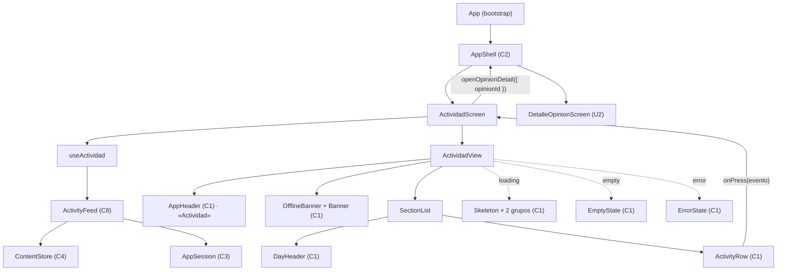

# Componentes de interfaz — U5 `u5-activity`

> **Provenance**: deriva de `inception/contract-design/contract-summary.md` (C1 1.5.0, C2 1.4.0, C3 1.1.0, C4 1.2.0, C8 1.1.0), `inception/domain-design/components.md` (ActivityFeed, AppShell, DesignSystem), `inception/refined-mockups/mockups.md` (Pantalla 5 — Actividad, matriz de estados, navegación), `inception/refined-mockups/interaction-spec.md` (§ ActivityRow, § DayHeader, § flujos), `construction/u5-activity/functional-design/rules.md` (BR21–BR24) y `functional-spec.md`.
> Fecha: 2026-11-19. Etapa: Functional Design · Unidad: `u5-activity`.

Este documento fija la forma de la interfaz de U5: qué piezas estrena el sistema de diseño, cómo se parte Actividad en contenedor y vista, de dónde sale el estado que pinta, qué recorre la lista y qué se cablea en la composición. Es diseño, no código.

## Jerarquía

**Respaldo en texto**: `App` construye una sola vez `ActivityFeed` junto al contenido y la sesión. `AppShell` monta `ActividadScreen` bajo la pestaña Actividad; el contenedor se suscribe con `useActividad` a `ActivityFeed` y entrega a `ActividadView` el estado ya resuelto y las secciones ya mapeadas. La vista pinta la cabecera, el aviso de sin conexión y una `SectionList` con `DayHeader` por grupo y `ActivityRow` por evento; en carga pinta esqueletos, en vacío un `EmptyState` con acción y en error un `ErrorState` con «Reintentar». La vista no lee C8, C3 ni C4: al tocar una fila llama al callback del contenedor, que pide a la cáscara el detalle de opinión de U2.

## Paquetes y responsabilidad

| Paquete | Dueño | Qué aporta a la interfaz de U5 |
|---|---|---|
| `@melodify/design-system` (C1) | U1, publicado por U5 a la **1.5.0** | `ActivityRow`, `DayHeader`, el modelo `ActivityEventSummary` y los tres estados que ya existen (`Skeleton`, `EmptyState`, `ErrorState`, `Banner`). |
| `@melodify/activity` (C8) | **U5 (nuevo)** | `createActivity({ content, session })`, `getActivity`, `retryActivity` y `subscribeActivity` (1.1.0). Deriva los eventos; no pinta. |
| `@melodify/content-store` (C4) | U2 | Las opiniones, los me gusta y los comentarios; no cambia (BR21.5). |
| `@melodify/app-session` (C3) | U1 | La identidad de la cuenta; no cambia. |
| `@melodify/app-shell` (C2) | U1 | `openOpinionDetail({ opinionId })`, `goToTab({ name: 'crear' })` y la pila de la pestaña; no cambia. |
| `@melodify/connectivity` (C6) | U1 | El aviso de sin conexión, a través de `useNetwork` y la cáscara; no cambia. |
| `@melodify/app` | U5 en sus carpetas | La pantalla, su modelo de presentación y el cableado de la composición. |

`@melodify/catalog` (C5) y `@melodify/spotify` (C7) **no aparecen**: la Actividad no pide portadas ni red, y sus filas no llevan imagen (BR21.6, BR24.2). La pregunta abierta que U4 dejó para U5 queda contestada así: la fila de actividad es de icono, texto y tiempo, como fija `interaction-spec.md`; no hay portada que resolver.

## `@melodify/design-system` — lo que añade la 1.5.0

| Pieza | Props | Estados y forma |
|---|---|---|
| `ActivityRow` | `{ event: ActivityEventSummary, onPress: () => void }` | Tres variantes por `event.kind` (`ownOpinion` → `★`, `likeReceived` → `♡`, `commentReceived` → `💬`) con los textos literales de BR24.2, `formatRelativeTime(event.createdAt)` como pista secundaria y chevron. Estado pulsado con `surfaceSunken`. Toda la fila es el objetivo táctil y su etiqueta accesible es el texto completo; el icono es decorativo. |
| `DayHeader` | `{ label: string }` | La etiqueta del grupo con `type.label` y `color.textSecondary`, sobre `color.bg`, alto 32. Es la cabecera de sección de la lista, no un elemento tocable. |

**Adiciones al modelo de C1**

| Tipo | Campos | Quién lo consume |
|---|---|---|
| `ActivityEventSummary` | `{ eventId: string; kind: 'ownOpinion' \| 'likeReceived' \| 'commentReceived'; opinionId: string; workTitle: string; createdAt: string; actorHandle?: string }` | `ActivityRow`. |

La 1.5.0 es **aditiva**: suma dos exportaciones y un modelo, no cambia ninguna pieza ni prop existente. `ActivityEventSummary` ya estaba declarado en C1 y se implementa aquí; el sistema de diseño **no importa C8** —recibe el modelo ya mapeado— y la pantalla es quien traduce (ver § Mapeo de presentación).

**Piezas existentes que se reutilizan sin cambios**

| Pieza | Uso en Actividad |
|---|---|
| `AppHeader` | La pestaña raíz pinta su propia cabecera: `<AppHeader title="Actividad" />`, igual que Inicio y Perfil. La cáscara solo pinta cabecera para detalles apilados. |
| `Skeleton` | La carga: `shape="header"` para los encabezados de grupo y `shape="card"` para las filas (BR23.1). |
| `EmptyState` | El vacío: `title`, `actionLabel` y `onAction`; sin `body`, porque el mockup no trae una segunda frase. |
| `ErrorState` | El error: `message`, `retryLabel` y `onRetry`. |
| `Banner` / `OfflineBanner` | El aviso de sin conexión de la app, bajo la cabecera y sobre la lista (BR23.4). |

**Reglas de uso**: ninguna pantalla pinta una fila de actividad ni un encabezado de día por su cuenta; todas usan `ActivityRow` y `DayHeader`. La vista no construye estilos de fila fuera de esas dos piezas ni decide el texto: el texto lo fija la pieza a partir de `kind` y `workTitle`. El ancho máximo de 720 del `interaction-spec.md` lo aplica la vista al contenedor de la lista, no cada fila.

## `@melodify/activity` — la forma del paquete (C8 1.1.0)

| Archivo | Responsabilidad |
|---|---|
| `src/index.ts` | Superficie del paquete: `createActivity` y los tipos `ActivityFeed`, `ActivityView`, `ActivityGroupView`, `ActivityEventView`, `ActivityStatus`, `ActivityEventKind`. No exporta React ni importa C1. |
| `src/activity.ts` | La fábrica y su máquina: resuelve la identidad con C3, se suscribe a `subscribeSession` y `subscribeContent({ viewerId })`, guarda la vista vigente, emite por `subscribeActivity` y atiende `getActivity` / `retryActivity`. Es el único archivo que conoce las suscripciones. |
| `src/derive.ts` | La derivación pura: recibe `viewerId` y las lecturas de C4 y devuelve los eventos (BR21.2–21.4). No conoce la sesión ni las suscripciones, así que se prueba sin dobles de C3. |
| `src/grouping.ts` | Orden (BR22.1), `eventId` (BR22.3) y agrupación por día UTC (BR22.2). Funciones puras con reloj explícito. |
| `src/__tests__/` | Derivación, orden, agrupación con reloj fijo, estados y recálculo, y un doble de C4 que falla (BR23.3, ADR-012). |

**Superficie**

| Operación | Firma | Qué hace |
|---|---|---|
| Construcción | `createActivity({ content, session })` | Recibe C4 y C3; no lee nada hasta que se le pregunta. |
| `getActivity` | `(): ActivityView` | Devuelve la derivación vigente (o la inicia si aún no existe). |
| `retryActivity` | `(): ActivityView` | Vuelve a `loading` y repite la derivación. |
| `subscribeActivity` | `(listener: (view: ActivityView) => void) => () => void` | Emite la vista vigente al suscribirse y la nueva tras cada recálculo. |

**Regla de frontera**: el paquete importa los tipos de C4 y C3 con `import type` y recibe las implementaciones por constructor (C8 § `rule`), así que no crea arista de ejecución hacia ellos. No importa `@melodify/catalog`, `@melodify/spotify`, `@melodify/design-system` ni React; no escribe en C4 y no hace peticiones de red (BR21.6). Los fallos no se lanzan: se representan en `status: 'error'` (ADR-012).

## `app/src/bootstrap/` — composición

| Archivo | Cambio de U5 |
|---|---|
| `instances.ts` | Construye y exporta `activityFeed = createActivity({ content: contentStore, session: appSession })` **una sola vez**, junto a `contentStore`, `connectivity` y `catalog`. Importa `appSession` de `./session`; no hay ciclo: `session.ts` solo depende del logger. |
| `dependencies.ts` | Añade `activity?: ActivityFeed` a `ScreenDependencies`, con el mismo criterio que las demás: opcional mientras la composición no exista, para que la pantalla se quede en carga en vez de construir una segunda instancia. |
| `App.tsx` | Sustituye el `ActividadScreen` de `screens/placeholders/` por el de `screens/actividad/`; añade `ActividadRoute` con `activity={activityFeed}` y registra `details: [{ kind: 'opinion', component: DetalleOpinionRoute }]` en la pestaña `actividad`. |
| `ports.ts`, `shell-services.ts`, `session.ts` | Sin cambios. La Actividad no usa Spotify, ni puertos, ni servicios de la cáscara más allá de los que ya existen. |

**Orden de construcción**: `activityFeed` se construye después de `contentStore` y después de importar `appSession`; no necesita que `catalog` exista. El grafo de importación queda `App.tsx → instances.ts → activity → (types de C4 y C3)`, sin aristas de ejecución hacia C5 ni C7 (NFR3.11).

## `app/src/state/` — `useActividad`

| Punto | Cómo queda |
|---|---|
| Firma | `useActividad(activity: ActivityFeed): { status, groups, retry }`. |
| Estado inicial | `status: 'loading'` y `groups: []`, el estado honesto mientras no hay primera emisión. |
| Suscripción | En un efecto: `activity.subscribeActivity(listener)` y baja al desmontar. La primera emisión llega en el acto porque C8 emite la vista vigente al suscribirse (F13). |
| Reintento | `retry()` llama a `activity.retryActivity()`; la emisión resultante actualiza el estado y la vista vuelve a `loading` antes de resolverse. |
| Por qué un hook propio | La vista no debe saber que existe una suscripción. `useContent` resuelve el contenido de C4 y `useViewerId` la identidad; el estado de C8 es otro store con otra forma, y envolverlo aquí deja `ActividadView` como una función pura de props, recorrible en pruebas sin sesión ni almacén (BR24.3). |

El hook **no** deriva, no ordena y no agrupa: todo eso vive en C8. Tampoco lee C3 ni C4.

## `app/src/screens/actividad/` — la pantalla

| Archivo | Responsabilidad |
|---|---|
| `ActividadScreen.tsx` | Contenedor: recibe `session`, `content`, `activity` y `log` por `ScreenDependencies`; si falta la actividad se queda en carga; monta `useActividad`, `useNetwork` y `useGlobalServices`; mapea los grupos de C8 a secciones de presentación, y cablea el reintento, el detalle y la acción del vacío. |
| `ActividadView.tsx` | Vista pura: cabecera, aviso de sin conexión, esqueletos, vacío, error o `SectionList` con `DayHeader` y `ActivityRow`. No lee C8, C3 ni C4; solo recibe props y llama callbacks. |
| `activityModel.ts` | `toActividadSections(groups)`: convierte `ActivityGroupView[]` de C8 en `ActividadSection[]` con `ActivityEventSummary` ya mapeado. Vive en la pantalla, no en C1 ni en C8 (C1 § view-models). |
| `__tests__/` | `actividad-view.test.tsx` (los cuatro estados, el aviso de sin conexión, el orden de las secciones y el toque de una fila) y `actividad-screen.test.tsx` (cableado con una actividad doble: carga, lista, vacío, error y reintento). |

**Props de `ActividadView`**

| Grupo | Campos |
|---|---|
| Estado | `status: 'loading' \| 'ready' \| 'empty' \| 'error'` |
| Contenido | `sections: readonly ActividadSection[]` (`{ day, label, events: ActivityEventSummary[] }`) |
| Red | `online: boolean` |
| Acciones | `onRetry: () => void`, `onOpenOpinion: (opinionId: string) => void`, `onCreate: () => void` |

**Reglas de composición**

- La cabecera es `<AppHeader title="Actividad" />` y no se desplaza con la lista; la pestaña raíz la pinta por su cuenta, como en Inicio y Perfil.
- Bajo la cabecera y fuera de la lista, `OfflineBanner` con el texto de la app y «Reintentar» cuando `online` es `false`; el reintento del aviso vuelve a derivar (BR23.4).
- `loading` pinta dos grupos de esqueleto: `Skeleton shape="header" count={1}` y `Skeleton shape="card" count={3}` por grupo, con el mismo hueco que la lista real (BR23.1). No hay temporizador ni espera artificial.
- `empty` pinta `EmptyState` con «Todavía no hay actividad.» y «Crear opinión»; el callback llama a `goToTab({ name: 'crear' })` en el contenedor (BR23.2).
- `error` pinta `ErrorState` con «No pudimos cargar tu actividad.» y «Reintentar» (BR23.3).
- `ready` pinta una `SectionList` con `stickySectionHeadersEnabled`, `sections` ya agrupadas, `renderSectionHeader` con `DayHeader` y `renderItem` con `ActivityRow`; la clave es `event.eventId`, nunca el índice (BR22.3, BR22.4).
- La columna de la lista se limita a 720 y se centra en pantallas anchas; en compacto ocupa el ancho completo.
- La vista no pinta la barra inferior, no navega y no muestra ningún mensaje técnico.

## Mapeo de presentación

| Origen (C8 `ActivityEventView`) | Destino (C1 `ActivityEventSummary`) | Nota |
|---|---|---|
| `eventId` | `eventId` | Se conserva tal cual: es la clave de la lista. |
| `kind` | `kind` | Misma unión de tres cadenas. |
| `opinionId` | `opinionId` | Lo usa el callback de apertura. |
| `workTitle` | `workTitle` | Viaja ya resuelto desde `OpinionView.workTitle`; no se pide a C5. |
| `createdAt` | `createdAt` | `ActivityRow` calcula el tiempo relativo con `formatRelativeTime`. |
| `actorHandle?` | `actorHandle?` | Se copia, no se pinta (ver `memory.md` § Interpretations). |

`toActividadSections` es una función explícita y total: recibe los grupos de C8 y devuelve secciones con el mismo `day` y `label` y los eventos ya mapeados. No reordena, no reagrupa y no inventa textos: el orden y la etiqueta son de C8, y la forma de la fila es de C1.

## Navegación y registro

| Pestaña | Pantalla raíz | Detalles registrados |
|---|---|---|
| Inicio | `InicioScreen` | `work`, `opinion` |
| Explorar | `ExplorarScreen` | `work` |
| Crear | `CrearScreen` | — |
| Actividad | **`ActividadScreen`** (U5) | **`opinion`** (nuevo) |
| Perfil | `PerfilScreen` | `opinion` |

**Por qué el detalle vive bajo Actividad**: al tocar un evento, el detalle se apila en la pestaña activa; «‹ Volver» desapila y la lista reaparece con su contenido y su posición, porque la pestaña no se desmonta (BR24.1, AC8.1.4). Actividad no conoce el componente del detalle ni le pasa datos: la ruta la fija C2.

## Flujos de interacción de la interfaz

| Acción | Qué hace la vista | Qué hace el contenedor o la cáscara |
|---|---|---|
| Tocar la pestaña Actividad | — | La cáscara monta `ActividadScreen`; `useActividad` se suscribe y la vista pinta la carga. |
| La derivación termina con eventos | Pinta la `SectionList` agrupada | `ActivityFeed` emite `ready` por `subscribeActivity`. |
| Desplazar la lista | El `DayHeader` del grupo se queda arriba; el siguiente lo empuja | — |
| Tocar una fila | Llama `onOpenOpinion(event.opinionId)` | `global.openOpinionDetail({ opinionId })`; la cáscara apila el detalle de U2. |
| «‹ Volver» en el detalle | — | La cáscara desapila; la lista conserva su posición. |
| Tocar «Crear opinión» en el vacío | Llama `onCreate()` | `global.goToTab({ name: 'crear' })`. |
| «Reintentar» del error | Llama `onRetry()` | `activity.retryActivity()`; la vista pasa por `loading` y repinta. |
| «Reintentar» del aviso de sin conexión | Llama `onRetry()` | Vuelve a derivar; la lista no se toca. |
| Publicar en Crear y volver | — | C4 emite; `ActivityFeed` recalcula y emite; la lista muestra el evento nuevo sin reiniciar (BR23.5). |

## Puntos de integración de la interfaz

| Punto | Quién lo consume | Qué deja U5 listo |
|---|---|---|
| `@melodify/activity` 1.1.0 | U6 | La derivación completa, los cuatro estados y la suscripción al recálculo. |
| C1 1.5.0 | U6 | `ActivityRow`, `DayHeader` y `ActivityEventSummary` para cualquier lista de actividad futura. |
| `activityFeed` en `bootstrap/instances.ts` | U6 | La pantalla se prueba en el teléfono sin construir nada en el recorrido. |
| Pestaña Actividad con detalle de opinión | U6 | US8.1 se recorre de punta a punta con y sin Spotify conectado. |
| Aviso de sin conexión reutilizado | U6 | FR11.4 se demuestra apagando la red del teléfono. |

## Assumptions & Open Questions

- `[assumption]` `ActividadView` es pura: recibe estado, secciones, red y callbacks. Eso permite probar los cuatro estados y el aviso de sin conexión sin montar C8, C3 ni C4.
- `[assumption]` Las secciones que recibe la vista son un modelo de presentación de la pantalla (`ActividadSection`) y no el tipo de C8: así la vista no importa el paquete que la alimenta y el mapeo queda en un solo archivo comprobado por `tsc`.
- `[assumption]` Las filas de actividad no llevan portada: `interaction-spec.md` fija icono, texto, tiempo y chevron. Eso deja a U5 sin dependencia de C5 y contesta la pregunta abierta de U4.
- `[assumption]` La carga usa `Skeleton` con formas existentes: `header` para los encabezados y `card` para las filas. La forma `card` es algo más alta que una fila real; se acepta antes que añadir una forma a C1 para un solo uso (BR23.1).
- `[assumption]` `actorHandle` viaja en el modelo y no se pinta: los tres textos de `interaction-spec.md` no nombran a quien interactuó y usar el handle obligaría a inventar concordancia de género.
- `[assumption]` La cabecera la pinta la pestaña raíz y no la cáscara: es el patrón de Inicio y Perfil, y la cáscara solo pinta cabecera cuando hay un detalle apilado.
- **Open question para U6**: el recorrido del teléfono es la única verificación que queda; el estado vacío y el de error se demuestran con dobles en las pruebas (FR11.6, ADR-012).
