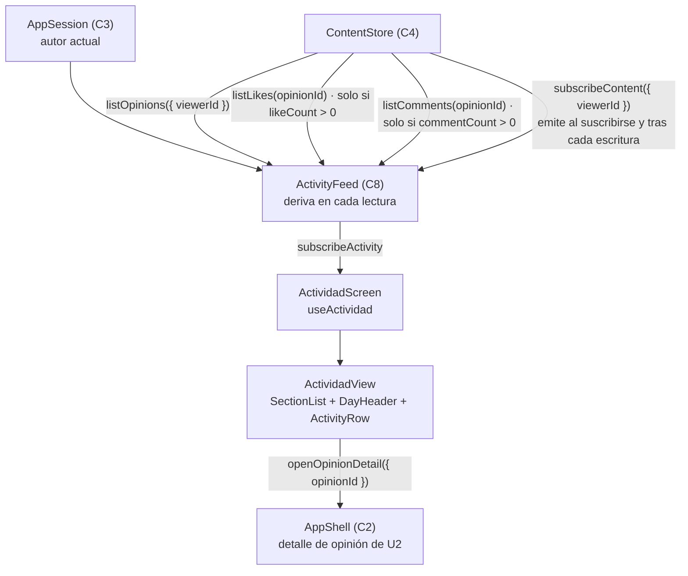
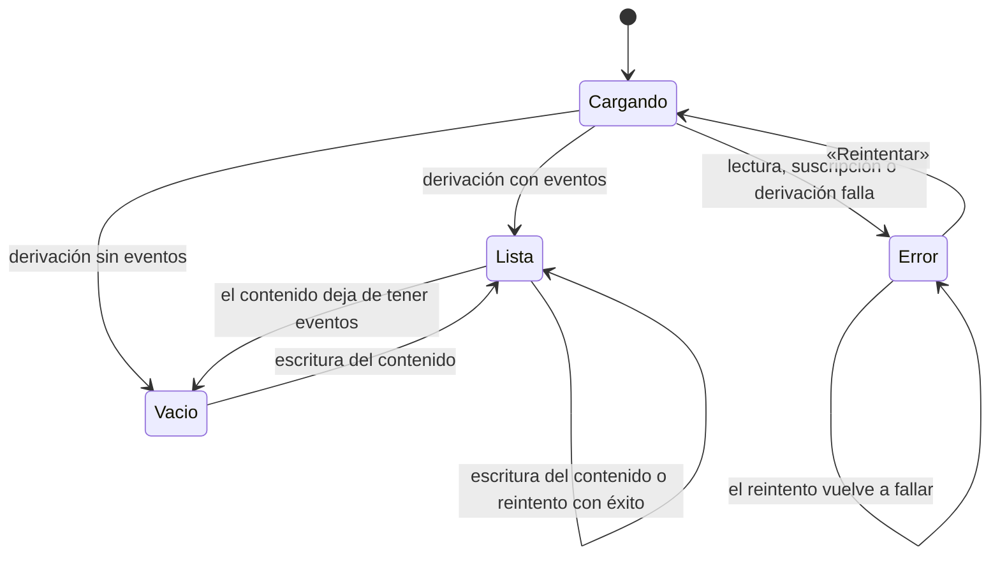

# Especificación funcional — U5 `u5-activity`

> **Provenance**: deriva de `inception/units-generation/unit-of-work.md` (U5), `inception/units-generation/unit-of-work-story-map.md` (US8.1), `inception/user-stories/stories.md` (AC8.1.1–AC8.1.7), `inception/requirements-analysis/requirements.md` (FR8.1–FR8.4, FR11.2, FR11.4, FR11.6, NFR1, NFR5, NFR6), `inception/domain-design/components.md` (ActivityFeed, AppShell, DesignSystem), `inception/domain-design/decisions.md` (ADR-006, ADR-012), `inception/contract-design/contract-summary.md` (C1 1.5.0, C2 1.4.0, C3 1.1.0, C4 1.2.0, C8 1.1.0), `inception/refined-mockups/mockups.md` (Pantalla 5 — Actividad, matriz de estados, navegación), `inception/refined-mockups/interaction-spec.md` (§ ActivityRow, § DayHeader, § flujos) y `construction/u5-activity/functional-design/rules.md` (BR21–BR24).
> Fecha: 2026-11-19. Etapa: Functional Design · Unidad: `u5-activity` · Agente: aidlc-architect-agent · Profundidad: Standard.

## Alcance de esta especificación

U5 entrega la pantalla **Actividad**: la lista de lo que le pasó a la cuenta —sus publicaciones, los me gusta que recibió y los comentarios que le escribieron— agrupada por día, con sus estados de carga, vacío y error, y la apertura de la opinión correspondiente al tocar un evento.

Para hacerlo entrega también `ActivityFeed` (`@melodify/activity`, C8), que **no guarda nada**: deriva la lista del contenido cada vez que se lee y vuelve a derivarla cuando el contenido cambia (ADR-006). Y publica la 1.5.0 de `@melodify/design-system` con las dos piezas que la lista necesita, `ActivityRow` y `DayHeader`.

Lo que **no** entra: escribir (publicar, comentar, dar me gusta o seguir son de U3), el detalle de la opinión (U2 lo construyó y aquí solo se abre), el contenido de ejemplo (la siembra de U2 ya trae los eventos, BR21.5), Spotify y el catálogo (la Actividad no los toca, BR21.6), y el recorrido completo en el teléfono (U6).

Esta unidad **no introduce entidades**: la vista `ActivityEventView` y sus grupos son derivados de C4 y la forma de presentación `ActivityEventSummary` es de C1. Por eso no hay `entities.md` y no hay diagrama entidad-relación; en su lugar, § De dónde sale la actividad describe el recorrido de los datos.

## Vocabulario y actores

| Término | Significado en esta unidad |
|---|---|
| **Cuenta / la persona** | Quien usa la app; en esta versión, la cuenta demo (`authorId` `demo`). La Actividad no asume el identificador: lo pregunta a C3 (BR24.3). |
| **Evento** | Un hecho recibido que se puede contar en una fila: publicación propia, me gusta recibido o comentario recibido (BR21.1). |
| **Evento recibido** | El que produjo otra persona sobre el contenido de la cuenta. El me gusta o el comentario que la cuenta da a otros **no** es un evento. |
| **Derivación** | Calcular la lista entera a partir del contenido en el momento de leerla. No hay registro de eventos que mantener. |
| **Grupo** | Los eventos de un mismo día de calendario, con su etiqueta («Hoy», «Ayer», «16 nov 2026»). |
| **Estado de la pantalla** | Los cuatro de C8: `loading`, `ready`, `empty`, `error`. El vacío es un estado propio —lo declara el contrato— y no una lista de cero filas. |

## De dónde sale la actividad

La derivación recorre cuatro lecturas de C4 y no escribe ninguna (BR21.6). El título de la obra no se pide a C5: viaja en `OpinionView.workTitle` (C8 § `work_title`).

| Evento | Origen | Operación de C4 | Qué se lee de la vista | `actorHandle` |
|---|---|---|---|---|
| `ownOpinion` | Cada opinión de la cuenta | `listOpinions({ viewerId })` filtrado por `author.authorId` | `opinionId`, `workTitle`, `createdAt` | ausente |
| `likeReceived` | Me gusta ajenos sobre una opinión propia | `listLikes({ opinionId })` por opinión propia con `likeCount > 0` | `author.handle`, `createdAt`; se descarta el `authorId` de la cuenta | `like.author.handle` |
| `commentReceived` | Comentarios ajenos en una opinión propia | `listComments({ opinionId })` por opinión propia con `commentCount > 0` | `commentId`, `author.handle`, `createdAt`; se descarta el `authorId` de la cuenta | `comment.author.handle` |

Los contadores `likeCount` y `commentCount` de `OpinionView` **solo deciden si hay algo que leer**: no se convierten en eventos por sí mismos, porque no dan autor ni fecha (BR21.3, BR21.4).

**Respaldo en texto**: la única instancia de `ActivityFeed` se construye en el punto de composición con el contenido (C4) y la sesión (C3). Al leer, pregunta a C3 quién es la cuenta y recorre C4: las opiniones propias dan las publicaciones; de cada opinión propia con me gusta o comentarios lee sus listas y se queda con lo ajeno. Se suscribe a los cambios de C4 para volver a derivar. La pantalla se suscribe a `ActivityFeed`, pinta la lista y, al tocar una fila, pide a la cáscara el detalle de esa opinión.

## Orden y agrupación

1. Se calculan los ocho eventos (o los que haya) con sus fechas.
2. Se ordenan de más reciente a más antiguo; a igual instante, publicación antes que me gusta antes que comentario, y luego por `eventId` (BR22.1).
3. Se agrupan por día de calendario **en UTC**, el mismo criterio que `formatCalendarDate` (BR22.2). El grupo del día actual se llama «Hoy»; el del día anterior, «Ayer»; el resto, con su fecha.
4. Los grupos salen del más reciente al más antiguo y cada uno conserva el orden del paso 2.

### Ejemplo trabajado con la siembra

Con el reloj fijado en `2026-11-19T12:00:00Z` —la siembra de U2 calcula sus edades desde el instante de construcción, así que el ejemplo es reproducible—, la siembra produce exactamente estos ocho eventos:

| Grupo | Evento | Instante | Por qué ahí |
|---|---|---|---|
| **Hoy** | Comentario recibido en `op-004` («El puente es lo mejor.») | `2026-11-19T10:00Z` | 2 h antes |
| **Hoy** | Me gusta recibido en `op-004` (`ana`) | `2026-11-19T09:00Z` | 3 h antes |
| **Ayer** | Publicación de `op-004` | `2026-11-18T12:00Z` | 1 d antes; empata con el comentario y gana por ser publicación |
| **Ayer** | Comentario recibido en `op-001` («Totalmente de acuerdo.») | `2026-11-18T12:00Z` | 1 d antes |
| **17 nov 2026** | Me gusta recibido en `op-001` (`lucia`) | `2026-11-17T12:00Z` | 2 d antes |
| **16 nov 2026** | Publicación de `op-001` | `2026-11-16T12:00Z` | 3 d antes; empata y gana por ser publicación |
| **16 nov 2026** | Comentario recibido en `op-008` («Ese riff no envejece.») | `2026-11-16T12:00Z` | 3 d antes |
| **15 nov 2026** | Publicación de `op-008` | `2026-11-15T12:00Z` | 4 d antes |

Los dos me gusta de `bruno` y `marcos` sobre opiniones ajenas no aparecen (BR21.1). Las fechas con dos eventos en el mismo instante son el caso que el desempate de BR22.1 resuelve, y por eso el ejemplo lo muestra en vez de esconderlo.

## Máquina de estados de la pantalla

**Respaldo en texto**:

| Estado (C8) | Cómo se llega | Qué ve la persona | Salidas |
|---|---|---|---|
| `loading` | Se abre la pestaña; la identidad o la primera derivación aún no están | Cabecera «Actividad» y dos grupos de esqueleto con su encabezado | `ready`, `empty` o `error` |
| `ready` | La derivación produce al menos un evento | La lista agrupada por día, con encabezados pegajosos | Otra escritura del contenido; el vacío; el error |
| `empty` | La derivación no produce ningún evento | «Todavía no hay actividad.» y «Crear opinión» | Una publicación nueva; el error |
| `error` | Una lectura devuelve fallo, la suscripción no se establece o la derivación lanza | «No pudimos cargar tu actividad.» y «Reintentar» | `loading` al reintentar |

El aviso de sin conexión no es un estado de esta máquina: convive con `ready`, `empty` y `error` (BR23.4).

## Flujos

### F13 — Cargar Actividad

1. La persona toca la pestaña **Actividad**. La cáscara monta `ActividadScreen`; la pestaña no se había montado antes.
2. `ActivityFeed` ya existe (se construyó con la app) y está en `loading`: nadie ha preguntado aún quién mira.
3. La pantalla se suscribe con `useActividad`; la suscripción emite el estado vigente y la vista pinta los dos grupos de esqueleto (BR23.1).
4. `ActivityFeed` resuelve la identidad de C3 y se suscribe a `subscribeContent({ viewerId })`, que emite el contenido vigente en el acto.
5. Deriva los eventos (BR21.2–21.4), los ordena (BR22.1), los agrupa (BR22.2) y emite `ready` o `empty`.
6. La vista repinta: la lista sustituye a los esqueletos sin mover la cabecera ni la barra. La pestaña conserva su posición al volver a ella.

### F14 — Publicar y ver el evento sin recargar

1. La persona publica en **Crear** (U3). C4 sube su revisión y emite a todos sus suscriptores.
2. `ActivityFeed` recibe la emisión y vuelve a derivar (BR23.5).
3. La nueva publicación aparece como evento `ownOpinion` en el grupo de hoy, la primera de su grupo. Los eventos que ya estaban conservan su `eventId`, así que la lista no se remonta (BR22.3).
4. Lo mismo ocurre con un me gusta o un comentario que otra persona escriba mientras la pantalla está montada: no hay que cambiar de pestaña ni reiniciar.

### F15 — Abrir una opinión desde Actividad y volver

1. La persona toca una fila. `ActivityRow` llama a `onPress` con el evento que tiene.
2. La pantalla llama a `openOpinionDetail({ opinionId })` (BR24.1). La cáscara apila el detalle de opinión de U2 sobre la pestaña Actividad.
3. El detalle se lee como cualquier otro: la obra, el autor, el texto, las acciones sociales. «Editar» de una opinión propia lleva a Crear en modo edición, como en U2 y U3.
4. «‹ Volver» desapila. La lista reaparece con su contenido y su posición; la pestaña nunca se desmontó.

### F16 — Actividad vacía

1. El contenido no tiene ninguna opinión de la cuenta —o no tiene ninguna interacción recibida— y la derivación devuelve cero eventos.
2. El estado es `empty` (BR23.2): `EmptyState` con «Todavía no hay actividad.» y «Crear opinión».
3. Tocar «Crear opinión» llama a `goToTab({ name: 'crear' })`. La pestaña cambia; la Actividad se queda montada por si se vuelve.
4. Tras publicar, la emisión de C4 devuelve la pantalla a `ready` con el evento nuevo (F14).

### F17 — Fallo de carga y reintento

1. Una lectura de C4 devuelve `ok: false`, la suscripción no se establece o la derivación lanza. La ruta es defensiva —el contenido vive en memoria— pero real (ADR-012).
2. El estado pasa a `error` y el fallo se registra con el logger del proyecto y un código propio, sin el mensaje técnico.
3. La vista pinta «No pudimos cargar tu actividad.» con «Reintentar» (BR23.3).
4. «Reintentar» llama a `retryActivity()`: el estado vuelve a `loading`, se repite la derivación y, si sale bien, la lista aparece; si vuelve a fallar, se queda en `error` con la misma acción.

### F18 — Leer sin conexión

1. La persona abre Actividad sin red. Todo lo que la pantalla lee está en memoria, así que la derivación funciona igual.
2. Bajo la cabecera aparece el aviso de sin conexión de la app, con su «Reintentar» (BR23.4). La lista sigue visible y se puede tocar.
3. Al volver la red, el aviso desaparece. Nada más cambia: la Actividad no depende de la red ni de Spotify.

## Comportamiento de `ActivityFeed` (C8)

### Superficie

`@melodify/activity` publica una sola fábrica y tres operaciones, todas síncronas y en proceso:

| Operación | Firma | Qué hace |
|---|---|---|
| Construcción | `createActivity({ content, session })` | Recibe C4 y C3; no lee nada hasta que se le pregunta. |
| `getActivity` | `(): ActivityView` | Deriva (o devuelve la derivación vigente) y responde con su estado. |
| `retryActivity` | `(): ActivityView` | Vuelve a `loading` y repite la derivación; devuelve la vista resultante. |
| `subscribeActivity` | `(listener: (view: ActivityView) => void) => () => void` | Emite la vista vigente al suscribirse y la nueva tras cada recálculo; devuelve la baja (C8 1.1.0). |

Los fallos **no se lanzan**: se representan en `status: 'error'`, igual que C5 normaliza sus fallos y por la misma razón —quien pinta no tiene que envolver cada llamada en un `try`.

`ActivityView.status` sigue siendo el enum de C8 (`loading | ready | empty | error`) y `groups` es opcional en el esquema: `empty` y `error` viajan con `groups: []`, y `loading` también, porque no hay nada que enseñar todavía.

### Derivación

1. **Identidad.** Si la sesión está `signedOut`, no hay cuenta a la que le haya pasado nada: la vista es `empty` (no un error). Si aún no se sabe, `loading`.
2. **Opiniones propias.** `listOpinions({ viewerId })`; un fallo → `error`. Cada opinión con `author.authorId === viewerId` produce un `ownOpinion` (BR21.2).
3. **Me gusta.** Para cada opinión propia con `likeCount > 0`, `listLikes({ opinionId })`; un fallo → `error`. Cada me gusta con `author.authorId !== viewerId` produce un `likeReceived` (BR21.3).
4. **Comentarios.** Para cada opinión propia con `commentCount > 0`, `listComments({ opinionId })`; un fallo → `error`. Cada comentario con `author.authorId !== viewerId` produce un `commentReceived` (BR21.4).
5. **Orden y grupos.** BR22.1 y BR22.2.
6. **Estado.** Cero eventos → `empty`; uno o más → `ready`. Cualquier excepción no controlada en 2–5 también termina en `error` y se registra.

El coste es una lectura por opinión propia con me gusta o comentarios: tres en la siembra. No se leen las que están a cero y no se lee nada de C5.

### Recalculo y suscripción

`ActivityFeed` se suscribe a `subscribeContent({ viewerId })` cuando conoce la identidad y a `subscribeSession` para enterarse de un cambio de cuenta. Cada emisión de C4 dispara una derivación nueva y una emisión por `subscribeActivity` (BR23.5). Una suscripción que no se puede establecer deja el estado en `error`; `retryActivity()` lo intenta otra vez.

## Textos exactos de la interfaz

| Dónde | Texto |
|---|---|
| Cabecera | «Actividad» |
| Encabezado de día, hoy | «Hoy» |
| Encabezado de día, ayer | «Ayer» |
| Encabezado de día, resto | La fecha del día: «16 nov 2026» |
| Fila, publicación propia | «Publicaste tu opinión de «{título}»» |
| Fila, me gusta recibido | «A alguien le gustó tu opinión de «{título}»» |
| Fila, comentario recibido | «Comentaron tu opinión de «{título}»» |
| Fila, tiempo | «hace 1 h», «hace 2 d» (`formatRelativeTime`) |
| Vacío | «Todavía no hay actividad.» + «Crear opinión» |
| Error | «No pudimos cargar tu actividad.» + «Reintentar» |
| Sin conexión | «Sin conexión. Estás viendo lo último que cargamos.» |

Los títulos de obra se escriben entre comillas angulares «», como en el resto de la interfaz. Ningún texto nuevo se inventa aquí: los tres de la fila y los tres de los estados salen de `interaction-spec.md` y de `mockups.md` § Pantalla 5.

## Reglas derivadas

| Regla | Qué fija |
|---|---|
| **BR21.1** | Solo eventos recibidos (ADR-006). |
| **BR21.2** | Una publicación por opinión propia, con fecha de creación. |
| **BR21.3** | Un me gusta recibido por me gusta ajeno, con autor y fecha. |
| **BR21.4** | Un comentario recibido por comentario ajeno, con autor y fecha. |
| **BR21.5** | La siembra no se toca: 3/2/3 salen de C4. |
| **BR21.6** | Solo lectura: no escribe, no guarda, no pide red. |
| **BR22.1** | Orden descendente con desempate estable. |
| **BR22.2** | Grupos por día UTC con «Hoy», «Ayer» o fecha. |
| **BR22.3** | `eventId` estable y único como clave. |
| **BR22.4** | Encabezado pegajoso por grupo. |
| **BR23.1** | Carga con dos grupos de esqueleto. |
| **BR23.2** | Vacío con acción. |
| **BR23.3** | Error con reintento. |
| **BR23.4** | Sin red: aviso y lista conservada. |
| **BR23.5** | Recálculo tras cada escritura. |
| **BR24.1** | Tocar la fila abre el detalle de la opinión. |
| **BR24.2** | Textos literales por tipo, tiempo y chevron. |
| **BR24.3** | Instancia única y pantalla partida en contenedor y vista. |
| **BR24.4** | C1 1.5.0 con `ActivityRow` y `DayHeader`. |

La fuente de verdad de cada regla —enunciado, disparador, lógica y violación— es `rules.md`; esta tabla es su vista de lectura.

## Contratos que U5 posee y consume

### C8 — `@melodify/activity` sube a 1.1.0 con la suscripción

C8 se publica en la **1.1.0** con una operación que el contrato no declaraba y que AC8.1.3 necesita:

- **`GET /activity/changes` (`subscribeActivity`)** — emite la `ActivityView` vigente nada más suscribirse y la vista completa tras cada recálculo, y devuelve la baja. Es la misma forma que ya tienen `/session/changes` (C3), `/changes` (C4), `/catalog/changes` (C5) y `/network/changes` (C6), y es lo que permite que la pantalla observe el recálculo sin volver a derivar por su cuenta ni mirar C4.

Por qué es aditivo: no cambia ninguna operación, esquema ni campo existente; suma un camino y una exportación. U6, único consumidor de C8, arranca ya sobre la 1.1.0. Sin esta operación, la pantalla tendría que suscribirse a C4 y derivar una segunda vez —dos derivaciones de la misma verdad, y una regla de C8 viviendo fuera del paquete que la posee.

El resto de C8 se entrega tal como está declarado: `ActivityView` con `status`, `groups` (`day`, `label`, `events`), y `ActivityEventView` con `eventId`, `kind`, `opinionId`, `workTitle`, `createdAt` y `actorHandle?`.

### C1 — 1.5.0, las dos piezas de la lista

`@melodify/design-system` sube a la **1.5.0** con `ActivityRow` y `DayHeader`, con las props que C1 ya declara:

| Pieza | Props | Qué pinta |
|---|---|---|
| `ActivityRow` | `{ event: ActivityEventSummary, onPress: () => void }` | Icono de la clase, texto de BR24.2, `formatRelativeTime(event.createdAt)` y chevron; la fila entera es el objetivo táctil. |
| `DayHeader` | `{ label: string }` | La etiqueta del grupo, `type.label` y `color.textSecondary`, alto 32. |

`ActivityEventSummary` es el modelo de presentación de C1 (`eventId`, `kind: "ownOpinion" | "likeReceived" | "commentReceived"`, `opinionId`, `workTitle`, `createdAt`, `actorHandle?`). La pantalla mapea desde `ActivityEventView` con una función explícita `toActivityEventSummary(view: ActivityEventView): ActivityEventSummary`; el sistema de diseño no importa C8.

### C3 y C4 — lo que se consume, sin cambios

De **C3** se usa la identidad: `getSession()` para la primera lectura, `subscribeSession` para un cambio de cuenta, y `SessionView.authorId` como `viewerId`. De **C4** se usan `listOpinions`, `listLikes`, `listComments` y `subscribeContent`, todas con la forma `ContentResult` (`{ ok: true, value }` / `{ ok: false, message, code }`). Ninguno de los dos cambia por esta unidad.

De **C2** solo se usan `openOpinionDetail({ opinionId })` y `goToTab({ name: 'crear' })`, que ya existen; la pestaña declara `details: [{ kind: 'opinion', component: DetalleOpinionRoute }]` y ninguna operación de la cáscara cambia.

## Puntos de integración con las unidades siguientes

| Unidad | Qué recibe de U5 | Qué no cambia |
|---|---|---|
| **U6** (`u6-walkthrough`) | La pantalla de Actividad completa, sus tres estados y la apertura del detalle, para recorrerla con y sin Spotify conectado | No hay ajustes pendientes: la Actividad no depende de Spotify, así que su mitad del recorrido funciona sin sesión |
| **U3** (`u3-create-react`) | Nada nuevo que consumir: publicar ya dispara el recálculo (BR23.5) | U3 no necesita saber que existe la Actividad |
| **U2** (`u2-content-core`) | Nada nuevo: se leen sus vistas y se abre su detalle de opinión | La siembra y las vistas de C4 se quedan como están (BR21.5) |
| **U4** (`u4-spotify-explore`) | Nada | La Actividad no toca el catálogo ni Spotify (BR21.6) |

## Historias implementadas

| Historia | Criterios | Cómo se cumplen |
|---|---|---|
| **US8.1** — Ver actividad y abrir una opinión | AC8.1.1 | BR21.1–21.4, BR22.1, BR22.2: los tres tipos, en orden y por día |
| | AC8.1.2 | BR21.5: la siembra de C4 ya produce 3 publicaciones, 2 me gusta y 3 comentarios recibidos |
| | AC8.1.3 | BR23.5: la suscripción a C4 recalcula y la nueva publicación aparece sin recargar |
| | AC8.1.4 | BR24.1: tocar la fila abre el detalle de esa opinión |
| | AC8.1.5 | BR23.2: «Todavía no hay actividad.» con acción |
| | AC8.1.6 | BR23.3: «No pudimos cargar tu actividad.» con «Reintentar» |
| | AC8.1.7 | BR23.1: dos grupos de esqueleto con su encabezado, ocupando el espacio de la lista |

## Recorrido en el teléfono (Expo Go, Android)

La Actividad se comprueba sin salir de la app y sin red:

1. Arrancar Metro, abrir Expo Go y entrar con `demo` / `demo`.
2. Tocar **Actividad**. Con la siembra, se ven los grupos de hoy y de días anteriores, con ocho filas: tres publicaciones, dos me gusta y tres comentarios recibidos.
3. Desplazar la lista: el encabezado del día se queda arriba y el siguiente lo empuja.
4. Tocar una fila de me gusta: se abre el detalle de esa opinión; «‹ Volver» devuelve a la lista en la misma posición.
5. Ir a **Crear**, publicar una opinión nueva y volver a **Actividad**: el evento de publicación está arriba del grupo de hoy, sin reiniciar la app.
6. Apagar la red del teléfono: aparece el aviso de sin conexión y la lista sigue completa.
7. Todo en español, sin un solo texto técnico.

El estado vacío y el de error no se ven con la siembra: se recorren en las pruebas con un almacén sin contenido y con un doble que falla (FR11.6, ADR-012).

## Assumptions & Open Questions

- `[assumption]` La cuenta de la app es la única que mira en esta versión (C3 la fija en `demo`), pero la derivación no asume el identificador: lo toma de `SessionView.authorId`.
- `[assumption]` Los ocho eventos de la siembra son suficientes para que la pantalla se vea llena y para demostrar los tres tipos (AC8.1.2). U5 no añade contenido de ejemplo.
- `[assumption]` La actividad no tiene sentido sin sesión: la pestaña solo existe con la app dentro. Aun así, un `signedOut` en C3 se trata como `empty`, no como error.
- `[assumption]` El recálculo ocurre en el acto porque C4 emite de forma síncrona; no hay temporizador, ni `setTimeout`, ni espera artificial.
- `[assumption]` `actorHandle` viaja en el modelo porque C1 lo declara, y se queda sin pintar hasta que una historia pida nombrar a quien interactuó (ver `memory.md` § Interpretations).
- `None.`

## Sources

- `unit-of-work` — `inception/units-generation/unit-of-work.md` (U5).
- `unit-of-work-story-map` — `inception/units-generation/unit-of-work-story-map.md` (US8.1).
- `stories` — `inception/user-stories/stories.md` (US8.1, AC8.1.1–AC8.1.7).
- `requirements` — `inception/requirements-analysis/requirements.md` (FR8.1–FR8.4, FR11.2, FR11.4, FR11.6, NFR1, NFR5, NFR6).
- `components` — `inception/domain-design/components.md` (ActivityFeed, AppShell, DesignSystem).
- `decisions` — `inception/domain-design/decisions.md` (ADR-006, ADR-012).
- `contract-summary` — `inception/contract-design/contract-summary.md` (C1 1.5.0, C2 1.4.0, C3 1.1.0, C4 1.2.0, C8 1.1.0).
- `mockups` — `inception/refined-mockups/mockups.md` (Pantalla 5 — Actividad, matriz de estados, navegación).
- `interaction-spec` — `inception/refined-mockups/interaction-spec.md` (§ ActivityRow, § DayHeader, § flujos).
- `rules` — `construction/u5-activity/functional-design/rules.md` (BR21–BR24).
