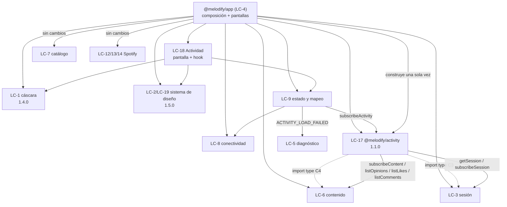

# Componentes lógicos — U5 `u5-activity`

> **Provenance**: deriva de `inception/domain-design/components.md` (ActivityFeed, AppShell, DesignSystem, ContentStore, AppSession, Connectivity), de `inception/contract-design/contract-summary.md` (§ Estructura del monorepo, C1 1.5.0, C2 1.4.0, C3 1.1.0, C4 1.2.0, C8 1.1.0, § Revisiones), de `nfr-requirements/tech-stack-decisions.md` (TS-39 a TS-43 y los heredados TS-01, TS-03, TS-10, TS-17, TS-18, TS-20), de `nfr-requirements/performance-requirements.md` (NFR8.16–8.18, NFR2.13–2.14, NFR1.16–1.18), de `nfr-requirements/security-requirements.md` (NFR3.21–3.23, NFR4.11, NFR9.8), de `functional-design/frontend-components.md` (§ Jerarquía, § Paquetes, § `@melodify/activity`, § `app/src/bootstrap/`, § `app/src/state/`, § `app/src/screens/actividad/`, § Navegación y registro), de `construction/u4-spotify-explore/nfr-design/logical-components.md` (LC-1 a LC-16, inventario heredado) y de `performance-design.md` / `security-design.md` de esta misma etapa.
> Fecha: 2026-11-19. Etapa: NFR Design · Unidad: `u5-activity` · Agente: aidlc-architect-agent · Profundidad: Standard.

## Qué describe este archivo

`logical-components.md` pide un inventario de componentes, dominios de fallo y radio de impacto. U5 sigue sin servidor: no hay servicios que aislar ni réplicas que repartir. Lo que sí añade es **el primer paquete del monorepo sin dependencias de ejecución**, **una pantalla que se deriva de otra fuente** y **dos piezas nuevas en C1**. El inventario continúa la numeración de U1–U4 (que cierra en LC-16) para que las cinco unidades se puedan leer juntas.

## Alcance: qué se diseña y qué no

- **Escalabilidad** (`scalability-design`): no se diseña. `requirements.md` no fija ningún objetivo y U5 no introduce ninguno: el contenido vive en memoria, no hay servidor y la app la usa una persona (RC-02, RC-03). Su ausencia es una decisión, no un olvido.
- **Fiabilidad** (`reliability-design`): filtrada por `produces_kinds`; se diseña en `performance-design.md` § NFR1 (la máquina de cuatro estados con sus salidas, la contención del fallo y el recorrido sin red, sin Spotify y sin contenido).
- **Observabilidad** (`observability-design`): filtrada igual; se diseña en `security-design.md` § NFR9 (un solo código nuevo, sin puerto de diagnóstico en el paquete, sin telemetría).
- **Rendimiento y usabilidad**: `performance-design.md`; **seguridad, privacidad y diagnóstico**: `security-design.md`.

## Inventario

| ID | Componente lógico | Dónde vive | Responsabilidad | Dueño |
|---|---|---|---|---|
| **LC-1** | Cáscara y navegación | `packages/app-shell/` (`@melodify/app-shell` **1.4.0**, sin cambios de versión) | `AppShell`, barra de cinco pestañas, pila de cada pestaña, `ShellServices`, `openOpinionDetail`. **U5 no la modifica**: la pestaña `actividad` ya existe y solo gana el detalle registrado | U1; U4 publicó la 1.4.0 |
| **LC-2** | Sistema de diseño | `packages/design-system/` (`@melodify/design-system` **1.5.0**) | Tokens, temas y las piezas de U1–U4; **U5 añade `ActivityRow`, `DayHeader` y el modelo `ActivityEventSummary`** (TS-42) | U1; U5 publica la 1.5.0 |
| **LC-3** | Sesión de la app | `packages/app-session/` (`@melodify/app-session` 1.1.0, sin cambios) | `getSession`, `signIn`, `signOut`, `subscribeSession`; **U5 solo la lee**, para el `viewerId` y para reaccionar a un cambio de cuenta | U1 |
| **LC-4** | Arranque y composición | `app/src/bootstrap/` | `session.ts`, `instances.ts`, `ports.ts`, `shell-services.ts`, `logger.ts`, `App.tsx`; **U5 añade `activityFeed` a `instances.ts`**, `activity?` a `ScreenDependencies` y la ruta real de Actividad con su detalle en `App.tsx` | U1–U4; U5 cablea la actividad |
| **LC-5** | Diagnóstico | `app/src/bootstrap/logger.ts` | El logger del proyecto y `AppLogCode`; único sitio que llama a `console`. **U5 añade un código: `ACTIVITY_LOAD_FAILED`** (NFR9.8) | U1; U2–U5 amplían el vocabulario |
| **LC-6** | Contenido | `packages/content-store/` (`@melodify/content-store` 1.2.0, sin cambios) | Opiniones, autores, me gusta, comentarios y seguimientos; las lecturas y las escrituras de U3. **U5 solo lee** —cuatro operaciones— y nunca escribe (BR21.6) | U2 |
| **LC-7** | Catálogo | `packages/catalog/` (`@melodify/catalog` 1.2.0, sin cambios) | Obras, búsqueda, portadas y los tipos de los tres puertos. **U5 no lo importa**: el título viaja en `OpinionView.workTitle` | U2; U4 publicó la 1.2.0 |
| **LC-8** | Conectividad | `packages/connectivity/` (`@melodify/connectivity` 1.0.0, sin cambios) | «En línea / sin conexión» y `subscribeNetwork`. **U5 lo consume solo para el banner** (BR23.4) | U2 |
| **LC-9** | Estado y mapeo de la interfaz | `app/src/state/` | Los hooks de U2–U4; **U5 añade `useActividad`**, que traduce `subscribeActivity` al estado de la vista, expone `retry` y emite el único código de diagnóstico de la unidad | U2/U3/U4; U5 añade un hook |
| **LC-10** | Comentarios: el controlador de la hoja | `app/src/comments/` | Estado de la hoja y sus operaciones sobre C4. **Sin cambios**: la Actividad no comenta, solo cuenta que alguien comentó | U3 |
| **LC-11** | Crear y su estado | `app/src/screens/crear/` | `CrearScreen`, `CrearView`, `useCrear`. **Sin cambios**: el vacío de Actividad solo navega a Crear con `goToTab` | U3 |
| **LC-12** | Autenticación con Spotify | `packages/spotify/src/auth/` | PKCE, token y almacén seguro. **U5 no la toca ni la importa** (BR21.6) | U4 |
| **LC-13** | Catálogo de Spotify | `packages/spotify/src/catalog/` | Cliente HTTP, búsqueda y resolución. **U5 no la importa** | U4 |
| **LC-14** | Superficie y tipos del paquete de Spotify | `packages/spotify/src/` | `exports` con tres entradas y los tipos de C7. **U5 solo sube su dependencia de C1 a 1.5.0** en `package.json` (TS-42) | U4 |
| **LC-15** | Explorar y su estado | `app/src/screens/explorar/` | `ExplorarScreen`, `ExplorarView`, `useExplorar`. **Sin cambios** | U4 |
| **LC-16** | Piezas de Spotify en el sistema de diseño | `packages/design-system/src/` | `SpotifyCard`, `ArtistResultRow`, `WorkResultRow.kind?`. **Sin cambios** | U4 |
| **LC-17** | **Actividad (C8)** | `packages/activity/` (`@melodify/activity` **1.1.0**) | `createActivity({ content, session })`: deriva los eventos de la cuenta —publicaciones propias, me gusta y comentarios recibidos—, los ordena, los agrupa por día UTC y los emite por `subscribeActivity`. Cuatro estados con salida y reintento. **Sin dependencias de ejecución**: solo tipos de C4 y C3 | **U5** |
| **LC-18** | **Actividad y su estado** | `app/src/screens/actividad/` y `app/src/state/useActividad.ts` | `ActividadScreen` (contenedor), `ActividadView` (vista pura), `activityModel.ts` (`toActividadSections`) y `useActividad`. La pantalla no deriva: mapea, compone y navega | **U5** |
| **LC-19** | **Piezas de Actividad en el sistema de diseño** | `packages/design-system/src/` | `ActivityRow` (texto por clase, icono decorativo, tiempo relativo, chevron, 56 de alto) y `DayHeader` (etiqueta del día, pegajosa). **U5 publica la C1 1.5.0** | **U5** (dentro de LC-2) |

**Lo que no es un componente propio**: el banner de sin conexión, el estado vacío, el estado de error y los esqueletos son piezas que C1 ya tiene y la pantalla compone; no ganan estado propio ni una carpeta. Tampoco lo es `toActividadSections`: es una función de presentación de LC-18, no un módulo con ciclo de vida.

## Dependencias entre componentes

**Respaldo en texto**: la app conoce a todos y es el único punto que los conecta. `@melodify/activity` (LC-17) es una hoja del grafo: **ningún paquete la importa** y ella no importa ningún paquete de ejecución —solo tipos de C3 y C4, que se borran al compilar (TS-39)—. `useActividad` es el único consumidor de `subscribeActivity` y la pantalla es el único consumidor del hook. **Ninguna flecha va de un paquete a la app**; **ninguna va de la actividad hacia C5, C7 o C1**; y **ninguna sale del proceso**. La ausencia de aristas es la propiedad que hace que la unidad no pueda abrir una puerta que no tiene (NFR3.21).

### Por qué el paquete es una hoja y por qué eso importa

| Alternativa | Qué habría costado |
|---|---|
| Derivar dentro de `ActividadScreen` | La lógica quedaría fuera del suelo de cobertura por árbol y no habría dónde probar la agrupación sin montar React |
| Poner C8 dentro de `@melodify/content-store` | Mezclaría el almacén con una vista derivada y daría a C4 una responsabilidad de presentación |
| Hacer que el paquete dependa de C1 para mapear | Ataría la derivación al sistema de diseño y obligaría a montar React para probarla (TS-42) |
| Declarar un puerto de diagnóstico | Una dependencia para un solo código, cuando el hecho ya cruza el contrato como `status: 'error'` (NFR9.8) |

La decisión se justifica sola: **una unidad que solo lee puede ser una hoja**, y una hoja no puede crear un ciclo ni una puerta.

## Reglas de importación y su compuerta

| Regla | Qué la hace cumplir | Por qué |
|---|---|---|
| `packages/*` no importa `@melodify/app` ni `app/` | **ESLint** (`no-restricted-imports`, patrón `**/app/**`) y type-check | Un import relativo existente pasaría el type-check y no el lint |
| **`packages/activity/src/**` no importa `@melodify/catalog` ni `@melodify/spotify`** | `@typescript-eslint/no-restricted-imports` con `allowTypeImports: false` (TS-39) | Es BR21.6 como regla ejecutable: la Actividad no toca el catálogo ni Spotify |
| **`packages/activity/src/**` no importa `react` ni `react-native`** | El mismo bloque de ESLint (TS-39) | Mantiene la lógica pura y la prueba sin árbol de componentes |
| **`packages/activity/src/**` no usa `fetch`** | `no-restricted-globals` con `fetch` (TS-39) | «No pide red» deja de ser una promesa y pasa a ser una comprobación |
| `packages/activity` solo nombra tipos de C3 y C4 | `import type`, type-check y el constructor | Las implementaciones llegan inyectadas: no hay arista de ejecución (C8 § `rule`) |
| `expo-secure-store`, `expo-network` y `AsyncStorage` siguen prohibidos en todo el repo | Las reglas de U1 y U2, intactas | U5 no añade un tercer adaptador ni una persistencia nueva (NFR4.11) |
| Solo `app/src/bootstrap/` construye la instancia de C8 | Revisión del PR y el propio diseño | Dos instancias serían dos derivaciones y dos suscripciones (BR24.3) |
| C1 no importa C4, C5, C3 ni C8 | `@typescript-eslint/no-restricted-imports` de U3 y U4 | `ActivityRow` recibe `ActivityEventSummary`; el mapeo vive en la pantalla (R-22) |

**La regla que se estrena aquí es la tercera y la cuarta**: hasta U4 las fronteras se defendían con el mapa `exports` y con la inyección; U5 añade dos que el linter puede comprobar por sí solo, porque la frontera no es «qué paquete» sino «qué puede hacer este código».

## Dominios de fallo y radio de impacto

| Qué falla | Qué se degrada | Qué **no** se degrada | Por qué |
|---|---|---|---|
| Una lectura de C4 en la derivación | La pestaña Actividad: estado `error` con «Reintentar» | Inicio, Explorar, Crear y Perfil; el contenido sigue intacto | La Actividad es de solo lectura y no comparte estado con las demás pantallas |
| La suscripción a C4 no se establece | La pestaña Actividad, que ofrece reintentar | El resto de la app; C4 no cambia | C8 no guarda una suscripción a medias (TS-40) |
| Un `listener` de `subscribeActivity` lanza | Nada visible: se aísla y se sigue notificando a los demás | La lista del resto de suscriptores | Notificación por suscriptor (NFR1.17) |
| La red se cae | El banner de la cabecera | **La lista**, que se deriva de memoria | La red no es un requisito de esta pantalla (BR23.4) |
| La sesión cambia o se cierra | La lista se vuelve a derivar con la nueva identidad, o `empty` si no hay cuenta | Nada más: C3 es de U1 | `subscribeSession` avisa y C8 rehace (NFR1.16) |
| C1 1.5.0 cambia de forma | La pestaña Actividad, si el cambio no es aditivo | Las demás piezas de C1 | `ActivityRow` y `DayHeader` son adiciones; cambiar sus props exigiría una versión mayor |
| El paquete crece con una escritura | **Nada en ejecución**: lo detecta el linter y la prueba de la lista blanca | — | Es el fallo que las compuertas existen para atrapar antes del merge |

**El radio de impacto más grande es el de la pestaña, y está acotado a propósito**: ninguna otra pantalla depende de C8, así que un fallo de la Actividad no puede tumbar el recorrido. Es la ventaja de una unidad que solo lee y de una hoja en el grafo.

## Superficie, cobertura y compatibilidad

| Requisito | Cómo se cumple | Dónde |
|---|---|---|
| **NFR5.12** | `coverageThreshold` con `"./packages/activity/src/**": { lines: 80 }`, medido por árbol y sin compensarse con `app/src` | `jest.config.js` (TS-39) |
| **NFR6.10** | `ActivityRow` de 56 de alto con la fila entera tocable, `DayHeader` con tokens del tema, icono decorativo sin etiqueta y los cuatro estados dichos con palabras | `packages/design-system/src/` (TS-42) |
| **NFR7.8** | Ninguna dependencia nueva: `SectionList` es del núcleo de React Native; el paquete no importa un módulo nativo | `packages/activity/package.json`, `app/package.json` |
| **NFR3.21** | Lista blanca de lecturas + linter + prueba de llamadas | `packages/activity/src/`, `eslint.config.js` |
| **NFR8.16–8.18** | Suscripción perezosa, una pasada de derivación, clave estable por evento | `packages/activity/src/` (TS-40, TS-41) |

**Las tres declaraciones de versión que mueve la unidad**: `packages/activity` nace en 1.1.0, `packages/design-system` pasa a 1.5.0, y `app/package.json` añade `@melodify/activity` 1.1.0 y sube C1 a 1.5.0. `packages/spotify/package.json` sube también su dependencia de C1 a 1.5.0 para que el lockfile no quede con dos versiones del mismo paquete interno. Ninguna otra declaración cambia (TS-39, TS-42).

## Assumptions & Open Questions

- `[assumption]` La Actividad no necesita un componente lógico propio en la cáscara: la pestaña existe desde U1 y solo gana el detalle registrado. Si el detalle de opinión necesitara un contexto distinto al de Inicio o Perfil, sería una decisión de C2, no de esta unidad.
- `[assumption]` `@melodify/activity` se queda en una sola entrada. Si alguna vez otra pantalla necesitara la derivación —un contador de actividad en Perfil, por ejemplo—, seguiría siendo una entrada y un consumidor más de `subscribeActivity`, no un segundo paquete.
- `[assumption]` El paquete no publica utilidades de agrupación para que la app las reutilice: `toActividadSections` mapea, no agrupa, y la agrupación por día UTC pertenece a C8 (BR22.2). Exportarla abriría dos formas de agrupar.
- **Open question para U6**: el recorrido confirma el radio de impacto real —que un fallo forzado en Actividad no afecta a las demás pestañas y que volver del detalle conserva la posición—; las pruebas afirman la contención, el teléfono afirma la sensación.

## Sources

- `components` — `inception/domain-design/components.md` (ActivityFeed, AppShell, DesignSystem, ContentStore, AppSession, Connectivity).
- `contract-summary` — `inception/contract-design/contract-summary.md` (§ Estructura del monorepo, C1 1.5.0, C2 1.4.0, C3 1.1.0, C4 1.2.0, C8 1.1.0, R-22, R-31, R-38).
- `tech-stack-decisions` — `construction/u5-activity/nfr-requirements/tech-stack-decisions.md` (TS-39–TS-43).
- `performance-requirements` — `construction/u5-activity/nfr-requirements/performance-requirements.md` (NFR8.16–8.18, NFR2.13–2.14, NFR1.16–1.18).
- `security-requirements` — `construction/u5-activity/nfr-requirements/security-requirements.md` (NFR3.21–3.23, NFR4.11, NFR9.8).
- `frontend-components` — `construction/u5-activity/functional-design/frontend-components.md` (§ Paquetes, § `@melodify/activity`, § `app/src/bootstrap/`, § `app/src/state/`, § `app/src/screens/actividad/`, § Navegación y registro).
- `performance-design` / `security-design` — `construction/u5-activity/nfr-design/`.
