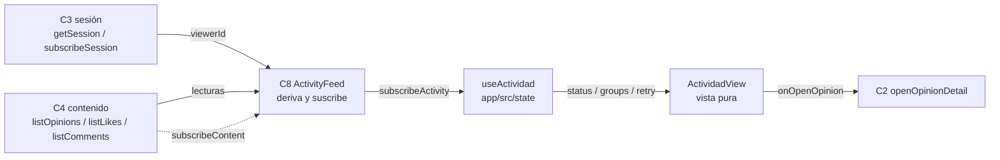
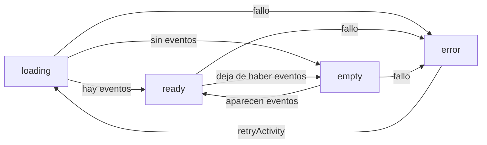

# Diseño de rendimiento, usabilidad y fiabilidad — U5 `u5-activity`

> **Provenance**: deriva de `nfr-requirements/performance-requirements.md` (NFR8.16–8.18, NFR2.13–2.14, NFR1.16–1.18 y los heredados NFR8.14, NFR8.15, NFR2.12, NFR1.15), de `nfr-requirements/security-requirements.md` (NFR9.8, para el único fallo que se registra), de `nfr-requirements/tech-stack-decisions.md` (TS-39 a TS-43, más los heredados TS-01, TS-05, TS-10, TS-17, TS-18, TS-20), de `functional-design/functional-spec.md` (§ Máquina de estados, F13–F18, § Textos exactos, § Assumptions), de `functional-design/rules.md` (BR21.1–BR21.6, BR22.1–BR22.4, BR23.1–BR23.5, BR24.1–BR24.4), de `functional-design/frontend-components.md` (§ `app/src/screens/actividad/`, § `app/src/state/`, § Flujos de interacción) y de `inception/contract-design/contract-summary.md` (C1 1.5.0, C2 1.4.0, C3 1.1.0, C4 1.2.0, C8 1.1.0).
> Fecha: 2026-11-19. Etapa: NFR Design · Unidad: `u5-activity` · Agente: aidlc-architect-agent · Profundidad: Standard.

## Qué resuelve este diseño

Los requisitos dicen **qué** hay que cumplir; este archivo dice **cómo**, con las decisiones que Code Generation no debe tener que tomar por su cuenta:

1. **Que el primer fotograma de Actividad no tenga una espera inventada**: qué pasa exactamente entre el montaje y la primera lista, y por qué no hay temporizador ni tiempo límite (NFR8.16).
2. **Que derivar tenga un coste declarado y no se pague al arrancar**: cuatro lecturas, una pasada de orden, una de agrupación, y cero trabajo hasta que alguien mira (NFR8.17).
3. **Que recalcular no cueste la posición**: la lista se repinta con claves estables y no se remonta (NFR8.18).
4. **Que la pantalla no quede nunca en un estado sin salida** y que ningún fallo se escape ni se disfrace de lista (NFR1.16, NFR1.17).
5. **Que cada acción siga costando dos toques o menos** y que cada estado se diga con palabras y ofrezca su salida (NFR2.13, NFR2.14).
6. **Que la Actividad funcione sin red y sin Spotify**, con la siembra y sin ella (NFR1.18).

**Lo que no se diseña aquí**: la escalabilidad (la unidad es de tipo `ui` y `requirements.md` no fija ningún objetivo: una persona, sin servidor, RC-02), y la fiabilidad y la observabilidad de servicio, filtradas por `produces_kinds`; sus objetivos viven en este archivo (§ NFR1) y en `security-design.md` § NFR9. El detalle de por qué su ausencia es una decisión está en `logical-components.md` § Alcance.

**La forma del conjunto**, antes de entrar en cada requisito:



**Respaldo en texto**: C8 lee de C4 y de C3 por constructor, deriva una `ActivityView` y la emite por `subscribeActivity`. `useActividad` traduce esa emisión al estado que la vista entiende y expone `retry`. `ActividadView` no conoce a C8: recibe `status`, `groups`, `online`, `onRetry` y `onOpenOpinion`. La vista no deriva nada y el paquete no pinta nada.

## NFR8.16 — La espera es de un fotograma, y el fotograma se puede describir

### La secuencia real, del toque al primer píxel de la lista

| Paso | Quién | Qué hace | Es síncrono |
|---|---|---|---|
| 1 | La cáscara | Monta `ActividadScreen` al entrar en la pestaña | Sí |
| 2 | `ActividadScreen` | Pasa `dependencies.activity` a `useActividad` | Sí |
| 3 | `useActividad` | Se suscribe a C8 y arranca en `loading` | Sí |
| 4 | C8 | Resuelve la identidad con `session.getSession()` | Sí: C3 hidrata al construirse |
| 5 | C8 | Deriva con la identidad y emite la primera `ActivityView` | Sí |
| 6 | `useActividad` | Cambia el estado a `ready`, `empty` o `error` | Un render |
| 7 | `ActividadView` | Pinta la lista o su estado | Un render |

- **No hay ninguna promesa que esperar en el camino normal.** C3 resuelve la sesión en su construcción y `getSession()` es una lectura síncrona de su estado; C4 vive en memoria. Por eso la carga dura **el fotograma del montaje** cuando la sesión ya está resuelta, y no un tiempo que alguien haya elegido.
- **Si C3 todavía no ha hidratado**, `getSession()` devuelve una sesión sin autor, C8 deriva `empty` y emite; cuando C3 emita su hidratación, `subscribeSession` vuelve a derivar y la pantalla pasa a `ready` con la lista. **No hay un estado intermedio inventado**: la pantalla nunca afirma «no hay actividad» como definitivo porque la siguiente emisión la corrige, y el esqueleto no se queda colgado esperando una identidad que quizá nunca llegue.
- **La carga no tiene tiempo límite, y eso es deliberado.** Un `setTimeout` de cortesía convertiría una espera local en un plazo, y un plazo exige decidir qué pasa al vencer: pintar `error` sería mentir sobre un fallo que no existe. Si algún día la identidad viniera de la red, el plazo lo fijaría C3, no esta pantalla (NFR8.16).

### Qué se pinta mientras: dos grupos completos, ni uno ni tres

```text
┌──────────────────────────────┐
│ ▬▬▬▬▬▬▬▬  Skeleton header 32 │   grupo 1
│ ▭▭▭▭▭▭▭▭  Skeleton card 96   │
│ ▭▭▭▭▭▭▭▭  Skeleton card 96   │
│ ▭▭▭▭▭▭▭▭  Skeleton card 96   │
├──────────────────────────────┤
│ ▬▬▬▬▬▬▬▬  Skeleton header 32 │   grupo 2
│ ▭▭▭▭▭▭▭▭  Skeleton card 96   │
│ ▭▭▭▭▭▭▭▭  Skeleton card 96   │
│ ▭▭▭▭▭▭▭▭  Skeleton card 96   │
└──────────────────────────────┘
```

- **Dos grupos, tres filas cada uno**: es lo que cabe en la primera pantalla de un teléfono con la cabecera y la barra puestas, y es la forma que fija BR23.1. Un grupo solo se queda corto y deja un hueco; cuatro afirman una lista que no se ha visto.
- **Los encabezados son esqueletos, no «Hoy» ni «Ayer».** El día todavía no se conoce; escribirlo y corregirlo después sería afirmar un dato falso durante un fotograma (BR23.1).
- **La forma `card` (96) es algo más alta que una fila real (56).** Es la única concesión del diseño y está acotada: la lista real puede ser más corta que su esqueleto, nunca más larga, así que el contenido no «salta hacia abajo» al llegar (BR23.1, TS-42).
- **No hay `ActivityIndicator` de pantalla completa.** Un giro infinito no dice cuándo termina y tapa la cabecera, que ya está disponible.

### Lo que no existe en esta pantalla, y se puede comprobar

| Mecanismo | ¿Existe en U5? | Por qué no |
|---|---|---|
| `setTimeout` / `setInterval` | No | La espera es local y termina por emisión, no por reloj |
| `debounce` de la derivación | No | Una emisión de C4 es un hecho, no una pulsación que se repite |
| Reintento automático | No | El reintento es una acción de la persona (BR23.3) |
| Petición HTTP | No | La Actividad no tiene red (BR21.6) |
| Sondeo o refresco periódico | No | C4 ya avisa de cada escritura (BR23.5) |
| Temporizador de «refrescar cada minuto» | No | Sería una segunda fuente de verdad sobre la frescura |

**Cómo se comprueba**: prueba de `useActividad` con temporizadores falsos que afirma que no se programa ninguno; prueba de `ActividadView` en `loading` que cuenta **dos** encabezados de esqueleto y **seis** filas; prueba de montaje con la sesión resuelta que comprueba que la primera emisión llega antes de que se agote un `act()`.

## NFR8.17 — El coste de derivar es proporcional, y no se paga al arrancar

### Las cuatro lecturas de la siembra, contadas

| Lectura | Cuántas | Cuáles | Por qué |
|---|---|---|---|
| `listOpinions({ viewerId })` | **1** | Todas | Es el punto de partida: sin opiniones propias no hay actividad |
| `listLikes({ opinionId })` | **2** | `op-001` (1 me gusta) y `op-004` (1 me gusta) | Solo las que tienen `likeCount > 0`; `op-008` no se lee |
| `listComments({ opinionId })` | **3** | `op-001`, `op-004`, `op-008` | Las tres tienen `commentCount > 0` |
| `listLikes` de `op-008` | **0** | — | Su contador es cero: no hay nada que leer (BR21.3) |

**Total: cuatro llamadas a C4**, no una por evento ni una por opinión. La regla que lo produce es única y vive en un solo sitio: **se lee una lista solo si su contador es mayor que cero**, y el contador no se usa como número de eventos (BR21.3, BR21.4).

### La derivación, en una pasada

```text
// Ilustrativo, no implementación. packages/activity/src/derive.ts
function deriveActivity(content, viewerId) {
  const own = content.listOpinions({ viewerId });
  if (!own.ok) return failure(own);
  const events = [];
  for (const opinion of own.value.opinions.filter(o => o.author.authorId === viewerId)) {
    events.push(ownEvent(opinion));                       // una por opinión propia
    if (opinion.likeCount > 0) events.push(...likeEvents(content, opinion, viewerId));
    if (opinion.commentCount > 0) events.push(...commentEvents(content, opinion, viewerId));
  }
  return ok(events.sort(byRecencyThenClassThenId));        // una sola ordenación
}
```

- **Una pasada por las opiniones propias**, una lectura por lista con contador y **una sola ordenación** al final. Nada de ordenar dentro del bucle ni de buscar en un array por cada evento: el comparador es total (fecha descendente, clase, `eventId`) y el resultado no depende del orden de inserción de ningún `Map` (BR22.1).
- **La agrupación es una segunda pasada, no una tercera**: `toActivityView` recorre los eventos ya ordenados y abre un grupo cuando cambia el día UTC. Como la entrada está ordenada de más reciente a más antiguo, los grupos salen ordenados sin volver a ordenarlos (BR22.2).
- **`viewerId` filtra dos veces y por razones distintas**: las opiniones propias se filtran por autor —`listOpinions({ viewerId })` puede devolver más de lo que el nombre sugiere— y los me gusta y comentarios se filtran para descartar los de la propia cuenta (BR21.3, BR21.4). La segunda es la que evita que la persona se notifique a sí misma.

### El arranque no paga nada: suscripción perezosa

```text
// Ilustrativo, no implementación. packages/activity/src/activity.ts
let listeners = new Set();
let detachContent = null;

function subscribeActivity(listener) {
  listeners.add(listener);
  if (detachContent === null) {
    detachContent = content.subscribeContent({ viewerId }, () => deriveAndEmit());
  }
  listener(currentView());                    // emite la vista vigente al suscribirse
  return () => {
    listeners.delete(listener);
    if (listeners.size === 0 && detachContent !== null) {
      detachContent(); detachContent = null;  // el último observador cierra la puerta
    }
  };
}
```

- **`createActivity` no lee ni se suscribe.** Guarda `{ content, session }` y devuelve la instancia; `getActivity()` deriva una vez y `subscribeActivity` es la que abre la suscripción a C4 (TS-40). El arranque de la app construye la instancia y no paga nada (NFR8.17).
- **La baja del último observador cierra la suscripción a C4.** Una pestaña que nadie mira no debe retener el almacén; y si la persona vuelve, la primera emisión de C4 le devuelve el contenido vigente sin coste añadido.
- **Cada emisión de C4 produce exactamente una derivación y una emisión.** No hay `debounce`, ni una cola, ni «si llega otra emisión en el mismo tick, descarta esta»: la lista es barata y un aplazamiento introduciría un estado que la prueba tendría que esperar. Publicar una opinión y comentar en el mismo gesto produce dos derivaciones y dos repintados, que es lo que corresponde a dos escrituras.
- **Una escritura de C4 que no cambia nada de la actividad** —un me gusta dado a una opinión ajena, un seguimiento— sigue produciendo una derivación. Se acepta: distinguirla exigiría comparar revisiones y el coste de una pasada sobre tres opiniones es menor que el de un `if` que puede equivocarse.

**Cómo se comprueba**: prueba con un doble de C4 que cuenta llamadas y afirma **cero** antes de la primera observación y **cuatro** con la siembra; prueba que afirma una lectura de me gusta para `op-001` y `op-004` y ninguna para `op-008`; prueba de dos emisiones seguidas que afirma **dos** derivaciones y **dos** notificaciones; prueba de la baja del último observador que afirma que se llamó a la función de baja de C4.

## NFR8.18 — Recalcular no remonta la lista ni pierde la posición

### `SectionList` con clave estable, y nada más

| Decisión | Cómo | Qué evita |
|---|---|---|
| Una sola lista virtualizada | `SectionList` con `sections` y `renderItem` | Un `ScrollView` que monta todas las filas y se congela al crecer |
| Clave por evento | `keyExtractor={(item) => item.eventId}` | Una clave por índice, que remonta todo al insertar arriba (BR22.3) |
| Encabezado pegajoso | `stickySectionHeadersEnabled` con `renderSectionHeader` | Dos mecanismos de cabecera o ninguno (BR22.4) |
| Identificadores estables entre derivaciones | `own:<opinionId>`, `like:<opinionId>:<authorId>`, `comment:<commentId>` | Que publicar remonte las filas que no cambiaron |
| La pestaña no se desmonta | La ruta del detalle se apila sobre Actividad (C2) | Recargar la lista al volver del detalle (BR24.1) |
| Sin `extraData` que cambie por render | El array de secciones es la única entrada variable | Repintados completos por un objeto nuevo en cada render |

- **Publicar una opinión nueva añade un grupo y una fila al principio sin tocar las demás.** El `eventId` de cada fila existente no cambia, así que React reconcilia por clave y no por posición: las filas que ya estaban se actualizan en su sitio y el desplazamiento se conserva (BR22.3, AC8.1.3).
- **Los grupos se reconstruyen enteros en cada derivación y eso está bien.** `toActividadSections` crea arrays nuevos, pero las filas conservan su clave; lo que no se hace es crear un objeto nuevo para un evento cuyo contenido no cambió *de forma significativa* —el mapeo copia campos y no añade marcas de tiempo de render— (NFR8.18).
- **La vista no vuelve a derivar.** `ActividadView` recibe `groups` ya agrupados y solo los mapea a la presentación; no ordena, no filtra y no agrupa (BR24.3).
- **No hay `onRefresh` ni `refreshing`.** Un tirar-para-actualizar prometería una recarga que la pantalla no necesita: el contenido ya emite. La lista no se refresca en segundo plano porque no hay nada que refrescar.
- **Volver del detalle no recarga nada.** La pestaña sigue montada, `useActividad` sigue suscrito y la lista conserva su contenido y su posición; el detalle es una pantalla apilada, no un reemplazo (BR24.1).

**Cómo se comprueba**: prueba de `ActivityFeed` que publica sobre un almacén real y afirma que los `eventId` anteriores siguen presentes y que el nuevo está en el primer grupo; prueba de `ActividadView` que comprueba que la clave de la lista es `eventId` y que las secciones llegan ya agrupadas; prueba de la cáscara que abre el detalle y vuelve y afirma que la lista no se volvió a montar.

## NFR2.13 — Las acciones del recorrido, en dos toques o menos

| Acción | Toques desde la pantalla | Camino | Flujo |
|---|---|---|---|
| Abrir Actividad | 1 | Barra inferior, pestaña «Actividad» | F13.1 |
| Abrir la opinión de un evento | 1 | Tocar la fila | F15.1 |
| Volver del detalle, con su posición | 1 | «‹ Volver» o atrás del sistema | F15.4 |
| Crear una opinión desde el vacío | 1 | «Crear opinión» en el estado vacío | F16.3 |
| Reintentar una carga fallida | 1 | «Reintentar» del estado de error | F17.4 |
| Reintentar con el aviso de sin conexión | 1 | «Reintentar» del banner | F18.2 |

Ninguna acción exige leer una explicación previa (NFR2). El desplazamiento por la lista no cuenta como acción: la persona ya está en la pantalla. **La fila entera es el objetivo táctil**, no el chevron: 56 de alto, por encima de los 44 que fija NFR6 (TS-42).

## NFR2.14 — Los cuatro estados se dicen con palabras y cada uno nombra su salida

| Estado | Qué se ve | Acción | Lo que no se usa para distinguirlo |
|---|---|---|---|
| `loading` | Dos grupos de esqueleto con su encabezado | — (no hay nada que hacer todavía) | Un color, un giro, un texto de «Cargando…» |
| `ready` | Lista agrupada por día con encabezados pegajosos | Tocar una fila; el banner si no hay red | Un icono de estado |
| `empty` | «Todavía no hay actividad.» + «Crear opinión» | Abrir Crear | Un icono de bandeja vacía como única señal |
| `error` | «No pudimos cargar tu actividad.» + «Reintentar» | Volver a derivar | El código de error de C4, su `mensaje` o una traza |

- **Cada estado que puede fallar ofrece una acción**; el único sin acción es la lista, porque no hay nada que arreglar (NFR2.14).
- **El aviso de sin conexión es un banner sobre la lista, no un quinto estado.** El estado sigue siendo `ready` y las filas siguen tocables: la red no es un requisito de esta pantalla (BR23.4).
- **Los textos son literales** y están en `functional-spec.md` § Textos exactos; ninguno lleva un código técnico ni una palabra en inglés (FR11.5, `project.md` § Mandated).

**Cómo se comprueba**: prueba de `ActividadView` por estado que afirma el texto visible y la acción; prueba que afirma que `online: false` conserva las filas y añade el banner sin cambiar el estado.

## NFR1.16 — La pantalla no queda nunca en un estado sin salida



**Respaldo en texto**: `loading` sale a `ready`, `empty` o `error`; `ready` puede pasar a `empty` o a `error`; `empty` puede volver a `ready` o caer en `error`; `error` solo sale por `retryActivity()`, que vuelve a `loading`. Un reintento que vuelve a fallar se queda en `error` con la misma acción, no en un estado mudo.

| Regla de salida | Cómo se materializa |
|---|---|
| `error` siempre se puede repetir | `retryActivity()` vuelve a `loading` y deriva sobre la misma instancia; no hace falta reiniciar ni cambiar de pestaña (F17) |
| Una sesión cerrada no es un error | `signedOut` produce `empty`: la cuenta no tiene actividad, no hay un fallo (NFR1.16) |
| Un cambio de cuenta vuelve a derivar | `subscribeSession` mueve la identidad y la derivación se rehace con el nuevo `viewerId`; la vista no conserva nada de la anterior |
| El reintento no cambia de identidad | Repite la derivación con el `viewerId` vigente; no hay un camino que reutilice otra sesión |
| `ready` con cero grupos se trata como `empty` | Una derivación incompleta no deja un hueco en blanco (BR23.2) |

**Cómo se comprueba**: prueba de `ActivityFeed` que recorre cada transición del diagrama, incluida `error → error`; prueba con sesión `signedOut` que afirma `empty`; prueba con dos identidades que afirma que la segunda emisión no contiene eventos de la primera.

## NFR1.17 — Ningún fallo se escapa y ninguna lista parcial se lee como completa

| Origen del fallo | Qué hace C8 | Qué ve la persona |
|---|---|---|
| `listOpinions` devuelve `ok: false` | Estado `error` | «No pudimos cargar tu actividad.» + «Reintentar» |
| `listLikes` de una opinión devuelve `ok: false` | Estado `error`, sin pintar la publicación huérfana | El mismo mensaje |
| `listComments` de una opinión devuelve `ok: false` | Estado `error`, sin pintar la publicación huérfana | El mismo mensaje |
| `subscribeContent` devuelve `ok: false` o lanza | Estado `error` | El mismo mensaje |
| La derivación lanza | Estado `error` | El mismo mensaje |
| Un `listener` de `subscribeActivity` lanza | Se aísla y se sigue notificando a los demás | Nada: es un defecto del consumidor |

- **Una lista parcial se leería como una lista completa**, y ese es el fallo que la contención evita: si se pintaran las publicaciones y se omitieran los me gusta que no se pudieron leer, la pantalla afirmaría que nadie dio me gusta (ADR-012).
- **`ActivityFeed` no lanza**: la contención vive en el contrato, no en la pantalla. `useActividad` no envuelve cada llamada en un `try`; recibe un `status` y lo traduce.
- **Una suscripción que no se establece no deja la instancia inservible**: no se guarda una suscripción a medias y el siguiente `retryActivity()` lo vuelve a intentar (TS-40).
- **El fallo se registra una vez por intento**, con `ACTIVITY_LOAD_FAILED` desde `useActividad`, y el mensaje del registro es una frase fija sin datos del contenido (NFR9.8).

**Cómo se comprueba**: cuatro pruebas con un doble de C4 que falla en cada una de las cuatro operaciones y afirma `error`; prueba con un `listener` que lanza y un segundo que recibe la emisión; prueba que afirma que la vista `error` no contiene ningún `eventId` de la derivación anterior.

## NFR1.18 — La Actividad funciona sin red, sin Spotify y con la siembra

| Escenario | Qué se ve | Qué no cambia |
|---|---|---|
| Sin red | La lista completa y el banner «Sin conexión. Estás viendo lo último que cargamos.» con «Reintentar» | El estado sigue `ready`; las filas siguen tocables (BR23.4) |
| Sin sesión de Spotify | La lista completa y ninguna señal de Spotify | La Actividad no toca Spotify (BR21.6) |
| Con la siembra | Ocho eventos repartidos por día UTC: los de hace horas en «Hoy», el de hace 1 día en «Ayer» y los de hace 3 y 4 días con su fecha | U5 no escribe semilla (BR21.5) |
| Sin contenido | «Todavía no hay actividad.» + «Crear opinión» | Es un estado propio, no un error (BR23.2) |
| Sin sesión de la app | `empty` | No es un fallo (NFR1.16) |

- **La ausencia de red no se convierte en un error de red.** La pantalla no usa la red, así que culpar a la red de un fallo que no existe sería el peor mensaje posible (BR23.4).
- **La siembra es de C4 y U5 la hereda.** Los ocho eventos salen de los datos que U2 dejó; si C4 cambia la siembra, la Actividad cambia con ella y ninguna prueba de U5 fija un número que U5 haya sembrado (BR21.5).
- **Sin contenido, la pantalla no se queda en blanco**: el vacío es una variante de la pantalla y ofrece la acción que corresponde.

**Cómo se comprueba**: prueba con `online: false` que conserva las filas y añade el banner; prueba de montaje con la siembra real que afirma ocho eventos y los tres tipos; prueba con un almacén vacío que afirma `empty` y el texto exacto.

## Presupuesto en una línea

| Ruta | Objetivo | Cómo se comprueba |
|---|---|---|
| Abrir Actividad | Un fotograma cuando la sesión está resuelta; sin temporizador ni tiempo límite | Prueba de `useActividad` con temporizadores falsos |
| Derivar la siembra | Cuatro lecturas de C4, una ordenación, una agrupación | Prueba con un doble que cuenta llamadas |
| Arranque de la app | Cero derivaciones y cero suscripciones hasta la primera observación | Prueba de `createActivity` antes de `getActivity` |
| Recalcular tras publicar | Una derivación y una emisión por cambio de C4 | Prueba con dos emisiones |
| Volver del detalle | Sin recarga: la pestaña conserva lista y posición | Prueba de la cáscara con la pestaña montada |
| Desplazar la lista | Sin cifra; sin congelación perceptible | Recorrido en el teléfono (U6) |

## Assumptions & Open Questions

- `[assumption]` Una derivación por emisión de C4 es aceptable aunque la emisión no cambie la actividad. Distinguir los casos exigiría comparar contenido y añadir estado; con tres opiniones, una pasada es más barata que la comparación.
- `[assumption]` El esqueleto de dos grupos se juzga «suficiente» y no «exacto»: la lista real puede ser más corta. Si en el teléfono el salto de 96 a 56 resultara molesto, la corrección es una forma nueva en C1 con su propio consumidor (U6).
- `[assumption]` La sesión `signedOut` no se pinta como error ni como carga infinita: produce `empty` en el acto, porque C3 ya resolvió que no hay cuenta.
- **Open question para U6**: el recorrido en el teléfono es la única verificación de que la lista no se congela al desplazarse con la siembra y de que la posición se conserva al volver del detalle; los estados vacío y error se demuestran con dobles.

## Sources

- `performance-requirements` — `construction/u5-activity/nfr-requirements/performance-requirements.md` (NFR8.16–8.18, NFR2.13–2.14, NFR1.16–1.18).
- `security-requirements` — `construction/u5-activity/nfr-requirements/security-requirements.md` (NFR9.8).
- `tech-stack-decisions` — `construction/u5-activity/nfr-requirements/tech-stack-decisions.md` (TS-39–TS-43).
- `functional-spec` — `construction/u5-activity/functional-design/functional-spec.md` (§ Máquina de estados, F13–F18, § Textos exactos).
- `rules` — `construction/u5-activity/functional-design/rules.md` (BR21–BR24).
- `frontend-components` — `construction/u5-activity/functional-design/frontend-components.md` (§ `app/src/screens/actividad/`, § `app/src/state/`).
- `contract-summary` — `inception/contract-design/contract-summary.md` (C1 1.5.0, C2 1.4.0, C3 1.1.0, C4 1.2.0, C8 1.1.0).
