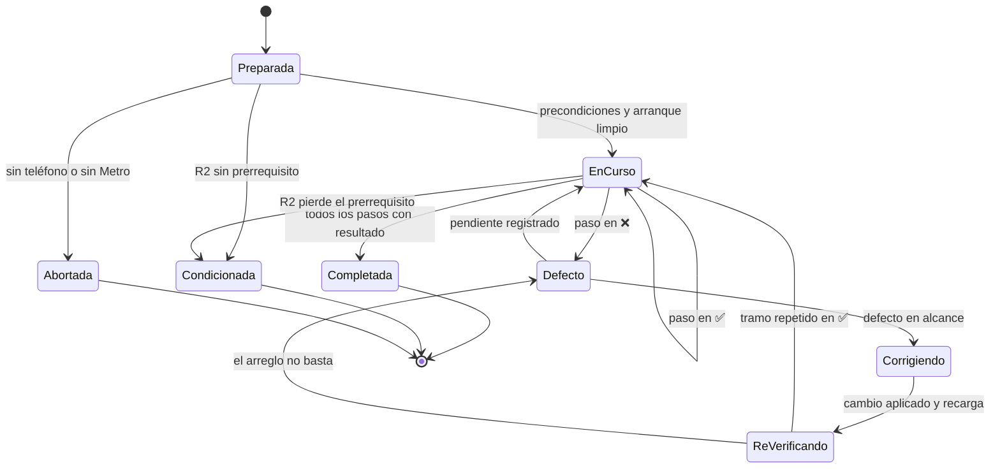

# Especificación funcional — U6 `u6-walkthrough`

> **Provenance**: deriva de `inception/units-generation/unit-of-work.md` (U6), `inception/units-generation/unit-of-work-story-map.md` (US11.1, US11.2), `inception/user-stories/stories.md` (AC11.1.1–AC11.1.5, AC11.2.1–AC11.2.3), `inception/requirements-analysis/requirements.md` (FR11.1–FR11.6, FR12.1, FR12.2, RC-05, RC-09, NFR1, NFR6, NFR7, A6), `inception/refined-mockups/mockups.md` (§ Matriz de estados, § Responsive), `inception/refined-mockups/interaction-spec.md`, `inception/contract-design/contract-summary.md` (C1–C8), `inception/domain-design/decisions.md` (ADR-010, ADR-012), `inception/delivery-planning/bolt-plan.md` (Bolt 6) e `inception/delivery-planning/external-dependency-map.md`.
> Fecha: 2026-11-20. Etapa: Functional Design · Unidad: `u6-walkthrough` · Tipo: `ui`.

## Alcance de esta especificación

Esta unidad no construye una pantalla: define **cómo se demuestra** que las seis pantallas construidas en U1–U5 cumplen el criterio de terminado del MVP, y **qué se hace** con lo que aparezca durante esa demostración. La especificación fija cuatro cosas:

1. Las **pasadas** que se ejecutan, en qué orden y en qué condiciones (BR25, BR26).
2. El **catálogo de pasos** de cada pasada, con el resultado esperado de cada uno y la AC que verifica.
3. El **registro** que queda de cada pasada y cómo se clasifica y corrige un fallo (BR27).
4. El **criterio de cierre** de la unidad, incluida la mitad con sesión de Spotify y su salida condicionada (BR28).

No entra aquí ninguna función nueva, ninguna pantalla nueva y ningún cambio de contrato. Si el recorrido destapa una función que falta, se registra como pendiente; si destapa un defecto que rompe una AC, un estado o una prohibición, se corrige con el cambio mínimo (BR25.1, BR27.2, BR27.4).

## Vocabulario

| Término | Qué es |
|---|---|
| **Recorrido** | La demostración completa de las seis pantallas en el teléfono, en una de sus dos formas: **R1** sin sesión de Spotify o **R2** con sesión conectada. |
| **Pasada** | Una ejecución concreta de un recorrido, con un tema fijo: **P1** (R1 claro), **P2** (R1 oscuro), **P3** (R2 claro) y **P4** (R2 oscuro). |
| **Paso** | Una comprobación con identificador estable (`W01`… para R1, `S01`… para R2): pantalla o vista, acción, resultado esperado y resultado obtenido. |
| **Vista de paso** | Pantalla que se abre desde una de las seis y se comprueba dentro del paso que la abre: detalle de opinión, detalle de obra y hoja de comentarios. |
| **Defecto** | Un paso que termina en ❌ porque incumple una AC, un estado de la matriz o una prohibición vigente. Entra en el bucle de corrección. |
| **Pendiente** | Un hallazgo que pide una función, un rediseño o una mejora cosmética. Se registra y no se construye en U6. |
| **Evidencia** | La fila del registro más la captura que la respalda. Sin evidencia no hay paso demostrado. |
| **Condicionada** | Pasada que no se pudo ejecutar por un prerrequisito externo, con constancia exacta del motivo. Solo aplica a R2. |

## Modelo de datos

U6 no posee entidades ni introduce datos nuevos. El contenido que se recorre es el de C3 (`ContentStore`) y C4 (`Catalog`), y la actividad es la vista derivada de C8. Esta especificación es autocontenida a propósito: la unidad es `ui` y no produce `entities.md`, porque no hay nada que modelar que no exista ya en los contratos construidos.

Lo único que la unidad **crea** es un registro de ejecución por pasada (`walkthrough-p1.md` … `walkthrough-p4.md`) con la forma que fija § El registro de la pasada. No es una entidad del producto: es evidencia de la verificación y vive en el registro del intento, no en la app.

## Precondiciones

Antes de la primera pasada:

| # | Precondición | Cómo se comprueba | Si no se cumple |
|---|---|---|---|
| 1 | Teléfono Android físico con Expo Go instalado | Se abre Expo Go en el teléfono | No se ejecuta ninguna pasada; se registra el bloqueo (BR25.2) |
| 2 | Metro levantado en el equipo, con la app publicada en la misma red | `npm start` en `app/` y el QR o la URL abiertos en el teléfono | Se resuelve la red antes de empezar; no se sustituye por emulador |
| 3 | App abierta sobre el commit que se va a entregar | La pantalla de Expo Go muestra el proyecto y la recarga funciona | Se recarga y se anota el commit en la cabecera del registro |
| 4 | Sesión de la app cerrada | Si la app abre en Inicio, se cierra sesión desde Perfil (cuenta como W13) | Se cierra antes de empezar (BR25.3) |
| 5 | Tema del sistema en claro para P1 y en oscuro para P2 | Ajustes del teléfono | Se cambia el tema antes de la pasada |
| 6 | `EXPO_PUBLIC_SPOTIFY_CLIENT_ID` definido (solo R2) | La tarjeta de Spotify no muestra el estado «sin configurar» | Se ejecuta S01 igualmente y se registra el estado `notConfigured`; después se aplica BR26.7 |
| 7 | Redirect exacto cargado en el panel de Spotify (solo R2) | El valor que resuelve la app está pegado en el panel | Se ejecuta S01 igualmente y se registra el estado y el mensaje del panel; después se aplica BR26.7 |

El contenido de partida es la siembra de C4 (ocho a diez opiniones, cuatro o cinco autores, seis a ocho obras, tres opiniones propias, dos seguidos, dos me gusta y tres comentarios recibidos). Una recarga completa de la app la devuelve intacta, porque el contenido vive en memoria (ADR-010).

## Las pasadas

### Secuencia

```
P1 (R1, claro) → P2 (R1, oscuro) → P3 (R2, claro) → P4 (R2, oscuro)
                                      │
                                      └─ si BR25.4 falla: P3 y P4 quedan «condicionadas»
```

P1 y P2 son obligatorias y cubren US11.1. P3 y P4 cubren US11.2 y dependen del prerrequisito de Spotify. El orden no es negociable: R2 se apoya en que R1 ya demostró que la app funciona sin sesión, y si R1 falla no tiene sentido conectar Spotify.

### R1 — Sin sesión de Spotify

| ID | Pantalla o vista | Acción | Resultado esperado | Verifica |
|---|---|---|---|---|
| W01 | Login | Abrir la app con la sesión de la app cerrada | Se ven «Melodify», «Usuario», «Contraseña», «Entrar» y la pista «Demo: usuario y contraseña: demo»; no hay barra inferior | AC1.1.1, AC11.1.1 |
| W02 | Login | Escribir credenciales distintas de `demo` / `demo` y tocar «Entrar» | Mensaje en línea en español bajo el campo; se sigue en Login y lo escrito se conserva | AC1.1.3 |
| W03 | Login → Inicio | Escribir `demo` / `demo` y tocar «Entrar» | Se abre Inicio con el feed completo | AC1.1.2, AC11.1.1 |
| W04 | Inicio | Leer el feed sin tocar nada | «Para ti», entre ocho y diez tarjetas, portadas de bloque (sin Spotify), chip «Conectar»; sin huecos rotos | AC11.1.1, US2.2 |
| W05 | Detalle de opinión | Tocar una tarjeta y volver | Se abre el texto completo; «‹ Volver» regresa al feed en la misma posición | US2.3, AC11.1.1 |
| W05b | Hoja de comentarios | Desde el detalle de opinión, tocar el icono de comentarios, escribir uno y enviarlo; después cerrar | La hoja muestra la lista con los comentarios recibidos o su estado vacío, el campo con contador, el envío confirma («Comentario publicado») y el comentario nuevo aparece en la lista; «Cerrar» devuelve al detalle | US7.3, AC11.1.1 |
| W06 | Explorar | Leer la pantalla sin sesión y buscar | Tarjeta de conexión y sugerencias del catálogo de ejemplo; desde dos caracteres aparecen resultados; una búsqueda sin coincidencias lo dice | US3.2, AC11.1.1 |
| W06b | Detalle de obra | Tocar una sugerencia y volver | Se abre la obra con sus opiniones; «‹ Volver» regresa a Explorar | AC11.1.1, US4.1 |
| W07 | Crear | Elegir una obra del catálogo de ejemplo, escribir una opinión, valorar y publicar | La opinión se publica y la app lo confirma; no se pide Spotify | AC11.1.2, US5.2 |
| W08 | Crear | Intentar publicar con el texto vacío y, después, sin valoración | Mensaje en línea en español en cada caso; no se publica nada | US5.2, AC11.1.3 |
| W09 | Inicio | Volver al feed | La opinión recién publicada está en Inicio, con su portada de bloque | AC11.1.2 |
| W10 | Actividad | Abrir Actividad y tocar la fila de la publicación | El evento «Publicaste tu opinión de «…»» está arriba del grupo de hoy; tocarlo abre el detalle y «‹ Volver» regresa a la lista | AC11.1.2, AC8.1.4 |
| W11 | Perfil | Abrir Perfil | La opinión nueva está en la lista propia y los contadores suben; la tarjeta de Spotify dice «Sin conectar» | AC11.1.2, US9.1 |
| W12 | Inicio | Activar el modo avión y volver a Inicio | Aparece el aviso «Sin conexión. Estás viendo lo último que cargamos.» con «Reintentar», y lo cargado sigue visible | AC11.1.4, FR11.4 |
| W12b | Inicio | Con el modo avión puesto, tocar «Reintentar» | La app no se cierra ni se queda en blanco; el aviso sigue mientras no hay red y la lista sigue ahí | AC11.1.4, FR11.4 |
| W12c | Crear | Con el modo avión puesto, entrar en Crear | El aviso de sin conexión se pinta **sin** acción, porque el catálogo de ejemplo es local y no hay nada que reintentar; el formulario sigue usable | AC11.1.4, BR15.4 |
| W13 | Perfil → Login | Desactivar el modo avión, comprobar que el aviso ya no está y tocar «Cerrar sesión» | El aviso desaparece al volver la red; se vuelve a Login, y al reabrir la app se abre en Login | AC1.3.1, AC1.3.3 |
| W14 | Todas | Repasar los textos vistos en la pasada | Todo está en español; ningún mensaje técnico ni en inglés | AC11.1.3, FR11.5 |

**P2 (oscuro)** repite W01–W14, con sus variantes W05b, W06b, W12b y W12c, en el tema oscuro del sistema. Cada paso lleva su fila: el resultado funcional puede apoyarse en P1, pero la fila registra el resultado visual en oscuro. Las capturas de P2 son obligatorias para las seis pantallas (BR26.5).

### R2 — Con sesión de Spotify

| ID | Pantalla o vista | Acción | Resultado esperado | Verifica |
|---|---|---|---|---|
| S01 | Perfil o Explorar | Tocar «Conectar con Spotify» y autorizar en el navegador | Se abre la autorización con PKCE S256, se vuelve a la app y la tarjeta queda en «Conectado». Si la conexión no se completa, se anota el estado exacto de la tarjeta —`connectionError` «No pudimos conectar con Spotify.» o `notConfigured` «La conexión con Spotify no está configurada en esta instalación.», con su «Reintentar»— y que Inicio y Explorar siguen usables | AC11.2.1, AC11.2.3, FR10.1 |
| S02 | Explorar | Buscar una obra real desde dos caracteres | Aparecen resultados del catálogo real, con portadas reales | AC11.2.1, US3.1 |
| S03 | Crear | Elegir una obra real encontrada y publicar | La opinión se publica sobre la obra real | AC11.2.2 |
| S04 | Inicio | Volver al feed | La opinión nueva aparece con portada real; las demás obras reales también la muestran | AC11.2.2, FR10.4 |
| S05 | Actividad y Perfil | Abrir ambas | El evento y la opinión aparecen con portada real, sin huecos | AC11.2.2 |
| S06 | App | Cerrar y reabrir la app | Sigue conectada y las portadas reales siguen ahí | FR10.2, `project.md` § Mandated |
| S07 | Explorar | Activar el modo avión y buscar | «No pudimos buscar en Spotify.» con «Reintentar»; al recuperar la red, «Reintentar» devuelve resultados y el recorrido sigue | AC11.1.4, FR11.2 |
| S08 | Perfil | Tocar «Desconectar» y reabrir | La tarjeta vuelve a «Sin conectar», las portadas vuelven a bloque y al reabrir sigue desconectado (token borrado) | US10.2, `project.md` § Mandated |

**P4 (oscuro)** repite S01–S08 con el tema oscuro, con las mismas reglas que P2.

### Salida condicionada de R2

Si en S01 el panel de Spotify rechaza el redirect, o si falta el client ID, se aplica BR26.7:

1. **S01 se ha ejecutado igualmente**: se anota el estado exacto de la tarjeta de Spotify con su texto literal y su «Reintentar» (`connectionError` o `notConfigured`), y que Inicio y Explorar siguen usables después del intento. Sin esa observación no hay salida condicionada válida.
2. Se anota en el registro el valor literal que la app resuelve como redirect, el mensaje del panel o del navegador y la fecha.
3. Se anota el mismo valor y motivo en `inception/delivery-planning/external-dependency-map.md`, en la fila del redirect.
4. P3 y P4 quedan `condicionadas`: S01 conserva el ❌ observado con su motivo en la nota y S02–S08 se marcan N/A con «prerrequisito externo no resuelto».
5. AC11.2.1–AC11.2.3 se cierran como condicionadas, no como cumplidas, y el pendiente queda con su dependencia.
6. U6 puede cerrarse con R1 (BR28.1). No se improvisa un build propio ni `expo-dev-client` (CT-05, `team.md` § Deployment).

## El registro de la pasada

Cada pasada deja **su propio** fichero en `<record>/construction/u6-walkthrough/code-generation/`, nombrado por la pasada — `walkthrough-p1.md`, `walkthrough-p2.md`, `walkthrough-p3.md` y `walkthrough-p4.md`—, y las capturas se adjuntan al PR y se referencian por nombre. Un fichero único con cuatro tablas dentro se vuelve ilegible y no permite cerrar una pasada sin tocar las demás. Su forma es fija:

```markdown
# Recorrido — {P1 | P2 | P3 | P4} — {fecha}

- **Dispositivo**: {modelo} · **Android**: {versión} · **Expo Go**: {versión}
- **Commit**: {sha corto} · **Tema**: {claro | oscuro} · **Spotify**: {sin sesión | conectado}
- **Client ID configurado**: {sí | no} · **Metro**: {levantado desde app/}

| Paso | Pantalla | Acción | Esperado | Obtenido | Resultado | Nota |
|---|---|---|---|---|---|---|
| W01 | Login | Abrir la app | Los cinco textos y sin barra | … | ✅ | — |

## Defectos

| ID | Paso | Síntoma | AC o regla | Decisión | Commit |
|---|---|---|---|---|---|
| D-01 | W09 | … | AC11.1.2 | Corregido | `abc1234` |

## Veredicto

{Completada | Condicionada | Abortada} — {una frase con lo que falta, si falta algo}
```

Reglas del registro:

- Una fila por paso; `Resultado` solo admite ✅, ❌ o N/A, y un N/A lleva su motivo en `Nota` (BR27.5).
- Un ❌ aparece también en la tabla de defectos, con su clasificación y, si se corrigió, el commit (BR27.2, BR27.3). Un ❌ de S01 en una pasada condicionada se clasifica como «condicionado por dependencia externa» y no como pendiente.
- El veredicto no se escribe hasta que no quedan celdas vacías.
- Las capturas se nombran `p{1|2|3|4}-{pantalla}-{claro|oscuro}.png` y se adjuntan al PR; el registro las referencia por ese nombre (BR27.1).
- Capturas obligatorias: **doce de R1** —las seis pantallas en claro (P1) y las seis en oscuro (P2)— y **doce de R2** cuando R2 se ejecuta (P3 y P4, ya con portadas reales). Si R2 queda condicionada, en su lugar va **una** captura de la tarjeta de Spotify en el estado observado en S01. El nombre del fichero ya dice a qué pasada y a qué tema pertenece, así que no hace falta una convención aparte para R2.

## Defectos: clasificación y bucle

```
Paso en ❌
   │
   ├─ Rompe una AC de US11.1/US11.2, una regla BR26.x (navegación, vista de paso,
   │  registro), un estado de la matriz o una prohibición
   │     → DEFECTO EN ALCANCE → corregir el mínimo → recargar → repetir el tramo
   │       → anotar commit → pasada final completa
   │
   └─ Pide función nueva, rediseño o mejora cosmética
         → PENDIENTE → anotar qué falta y de qué depende → seguir el recorrido
```

Un defecto en alcance no se aplaza: si se deja para el final, contamina todos los pasos siguientes y la única pasada final puede destapar otro fallo tarde (Q3 = A). Un pendiente no se corrige en U6 aunque sea fácil: cambiaría el alcance de la unidad sin revisión (BR25.1, BR27.2).

**Límite del arreglo.** El cambio mínimo debe caber en las props y estados que el contrato ya declara. Si exige tocar C1–C8, añadir una pantalla, un token o un componente, o introducir un módulo nativo, deja de ser un arreglo de verificación y se convierte en una decisión pendiente (BR27.4).

## Máquina de estados de la pasada



**Alternativa en texto**: una pasada empieza `Preparada`; con las precondiciones cumplidas y el arranque limpio pasa a `EnCurso`. Cada paso en ✅ la mantiene `EnCurso`; un ❌ la lleva a `Defecto`. Si el defecto está en alcance, pasa a `Corrigiendo`, luego a `ReVerificando` y vuelve a `EnCurso` cuando el tramo se repite en ✅; si el arreglo no basta, vuelve a `Defecto`. Un pendiente la devuelve a `EnCurso` sin corrección. Cuando todos los pasos tienen resultado, queda `Completada`. R2 puede quedar `Condicionada` si falta el prerrequisito; cualquier pasada queda `Abortada` si no hay teléfono o Metro.

Estados terminales: `Completada`, `Condicionada`, `Abortada`. Solo `Completada` cuenta como demostración plena; `Condicionada` cuenta para R1 y deja R2 como pendiente; `Abortada` no cuenta y se reanuda.

## Criterio de cierre

La unidad se cierra cuando se cumple todo esto (BR28):

- [ ] P1 completa, con W01–W14 y sus variantes (W05b, W06b, W12b, W12c) en ✅ o N/A justificado.
- [ ] P2 completa en tema oscuro, con las seis pantallas capturadas.
- [ ] Doce capturas de R1 —seis pantallas en claro y seis en oscuro— adjuntas al PR.
- [ ] P3 y P4 completas con sus doce capturas **o** condicionadas con S01 observada, una captura de la tarjeta, el redirect literal y el motivo anotados en el registro y en el mapa de dependencias externas.
- [ ] Un `walkthrough-p{1..4}.md` por pasada ejecutada, sin celdas vacías y con su veredicto.
- [ ] Tabla de defectos cerrada: cada defecto con su commit y su repetición; cada pendiente con qué falta y de qué depende.
- [ ] `npm run typecheck`, `npm run lint` y `npm test` en verde, con el suelo de 80 % de líneas intacto.
- [ ] PR a `develop` con Conventional Commits, la plantilla del repositorio y la evidencia adjunta.

## Trazabilidad a las historias

| Historia | Criterio | Cómo se demuestra | Regla |
|---|---|---|---|
| **US11.1** — Recorrer sin sesión | AC11.1.1 | P1 y P2, pasos W01–W14 con sus variantes, incluidas la hoja de comentarios (W05b) y las vistas de paso, sin cierres ni blancos | BR25.2, BR25.3, BR26.1 |
| | AC11.1.2 | W07–W11: la opinión publicada se ve en Inicio, Actividad y Perfil | BR26.2 |
| | AC11.1.3 | W14 y repaso de cada pantalla y estado | BR26.3 |
| | AC11.1.4 | W12–W12c (aviso sin conexión y su «Reintentar» probado en R1) y S07 (error de contenido con «Reintentar»); si R2 se condiciona, el error de contenido se anota como cubierto por ADR-012/FR11.6 | BR26.4 |
| | AC11.1.5 | P1 y P2 completas, con contraste medido cuando hay duda y áreas táctiles revisadas | BR26.5 |
| **US11.2** — Recorrer con sesión | AC11.2.1 | P3 y P4, S01–S02 y S06 | BR25.4, BR26.6 |
| | AC11.2.2 | S03–S05: publicación real y portadas reales en las tres pantallas | BR26.6 |
| | AC11.2.3 | Si el prerrequisito no está: S01 ejecutada y observada, constancia exacta, R1 válido y pendiente registrado | BR26.7, BR28.2 |

## Assumptions & Open Questions

- `[assumption]` El teléfono Android físico usado en U1–U5 sigue disponible y es el mismo para las cuatro pasadas; el registro guarda su modelo y versión para que la demostración sea reproducible.
- `[assumption]` La app de Spotify ya está registrada (Q8 = D de Delivery Planning) y solo falta cargarle el redirect que la app resuelve; el riesgo de que el panel rechace el redirect de Expo Go sigue abierto y lo cubre BR26.7.
- `[assumption]` El contenido de la siembra (ocho a diez opiniones) es suficiente para recorrer las pantallas sin fabricar datos; U6 no añade contenido.
- `[assumption]` El vacío, la carga y el error de contenido no se fuerzan en el teléfono: FR11.6 y ADR-012 los cubren con pruebas, y el recorrido comprueba los estados que se provocan de verdad (modo avión, credenciales erróneas, sin Spotify, tema). Q2 = A lo deja anotado en el registro.
- `[assumption]` La hoja de comentarios se abre desde el detalle de opinión con el icono de la barra social, y se prueba al menos en una opinión con comentarios y en una sin ellos; su contenido vive en C3, así que el comentario enviado en P1 se pierde al recargar y no arrastra estados entre pasadas.
- `[assumption]` El «Reintentar» de R1 es el del aviso de sin conexión, que ya existe en Inicio, Actividad y Perfil; sin Spotify no hay error de contenido que provoque el otro camino, y por eso ese se prueba en R2 (BR26.4).
- `[assumption]` Las capturas se adjuntan al PR en lugar de commitearse al árbol: el registro del PR es el que la práctica del equipo nombra, y así el repositorio no crece con binarios de una demostración. Cuando R2 se condiciona, su única captura es la de la tarjeta en S01 y sustituye a las doce de P3/P4.
- `[assumption]` Una corrección que exija cambiar un contrato compartido no se hace aquí: se convierte en pendiente y se decide fuera de U6 (BR27.4).
- `None.`

## Sources

- `unit-of-work` — `inception/units-generation/unit-of-work.md` (U6).
- `unit-of-work-story-map` — `inception/units-generation/unit-of-work-story-map.md` (US11.1, US11.2).
- `stories` — `inception/user-stories/stories.md` (AC11.1.1–AC11.1.5, AC11.2.1–AC11.2.3).
- `requirements` — `inception/requirements-analysis/requirements.md` (FR11.1–FR11.6, FR12.1, FR12.2, NFR1, NFR6, NFR7, RC-05, RC-09, A6).
- `components` — `inception/domain-design/components.md` (`AppShell`, `DesignSystem`, `ContentStore`, `Catalog`, `Connectivity`, `AppSession`, `SpotifyAuth`).
- `contract-summary` — `inception/contract-design/contract-summary.md` (C1–C8).
- `decisions` — `inception/domain-design/decisions.md` (ADR-010, ADR-012).
- `mockups` — `inception/refined-mockups/mockups.md` (§ Matriz de estados, § Responsive).
- `interaction-spec` — `inception/refined-mockups/interaction-spec.md` (textos y estados de los componentes).
- `delivery-planning` — `inception/delivery-planning/bolt-plan.md` (Bolt 6) e `inception/delivery-planning/external-dependency-map.md`.
- `team-practices` — `aidlc/spaces/default/memory/team.md` (§ Way of Working, § Deployment, § Testing Posture) y `aidlc/spaces/default/memory/project.md` (§ Mandated).
- `rules` — `construction/u6-walkthrough/functional-design/rules.md` (BR25–BR28).
