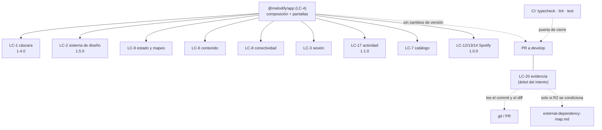

# Componentes lógicos — U6 `u6-walkthrough`

> **Provenance**: deriva de `inception/domain-design/components.md` (AppShell, DesignSystem, ContentStore, Catalog, Connectivity, AppSession, SpotifyAuth, ActivityFeed), de `inception/contract-design/contract-summary.md` (§ Estructura del monorepo, C1 1.5.0, C2 1.4.0, C3 1.1.0, C4 1.2.0, C5 1.2.0, C6 1.0.0, C7 1.0.0, C8 1.1.0), de `nfr-requirements/tech-stack-decisions.md` (TS-44 a TS-48, NFR5.13, NFR7.9), de `nfr-requirements/performance-requirements.md` (NFR8.19, NFR8.20, NFR2.15, NFR1.19, NFR1.20), de `nfr-requirements/security-requirements.md` (NFR3.24, NFR3.25, NFR4.12, NFR9.9), de `functional-design/frontend-components.md` (§ Comprobaciones transversales, § Qué cuenta como «ajuste»), de `functional-design/functional-spec.md` (§ El registro de la pasada, § Criterio de cierre), de `construction/u5-activity/nfr-design/logical-components.md` (LC-1 a LC-19, inventario heredado) y de `performance-design.md` / `security-design.md` de esta misma etapa.
> Fecha: 2026-11-20. Etapa: NFR Design · Unidad: `u6-walkthrough` · Agente: aidlc-architect-agent · Profundidad: Standard.

## Qué describe este archivo

`logical-components.md` pide un inventario de componentes, dominios de fallo y radio de impacto. U6 es la unidad más rara de las seis: **no añade ni un componente de producto**. No hay pantalla nueva, ni paquete nuevo, ni pieza nueva en el sistema de diseño, ni hook nuevo. Lo que añade es **evidencia**: cuatro registros de pasada y las capturas que los acompañan, más una línea condicional en el mapa de dependencias externas.

El inventario continúa la numeración de U1–U5 (que cierra en LC-19) para que las seis unidades se puedan leer juntas; **LC-20 es el único componente nuevo y no se ejecuta**. Que la unidad no toque ningún componente de producto es el hecho que este archivo tiene que hacer visible: si U6 necesitara uno, habría dejado de verificar.

## Alcance: qué se diseña y qué no

- **Escalabilidad** (`scalability-design`): no se diseña. `requirements.md` no fija objetivo y U6 no introduce ninguno: el contenido vive en memoria, no hay servidor y la app la usa una persona (RC-02, RC-03). Su ausencia es una decisión, no un olvido.
- **Fiabilidad** (`reliability-design`): filtrada por `produces_kinds`; se diseña en `performance-design.md` § NFR1 (la máquina de estados de la pasada y la integridad de la evidencia).
- **Observabilidad** (`observability-design`): filtrada igual; se diseña en `security-design.md` § NFR9 (el registro es evidencia, no telemetría).
- **Rendimiento, usabilidad y accesibilidad**: `performance-design.md`; **seguridad, privacidad y diagnóstico**: `security-design.md`.

## Inventario

| ID | Componente lógico | Dónde vive | Responsabilidad | Estado en U6 | Dueño |
|---|---|---|---|---|---|
| **LC-1** | Cáscara y navegación | `packages/app-shell/` (`@melodify/app-shell` 1.4.0) | `AppShell`, barra de cinco pestañas, pilas, `ShellServices`, `openOpinionDetail` | **Sin cambios**: el recorrido usa lo que hay | U1; U4 publicó la 1.4.0 |
| **LC-2** | Sistema de diseño | `packages/design-system/` (1.5.0) | Tokens, temas y las piezas de U1–U5 | **Sin cambios**: ningún token, prop ni pieza nueva (TS-44) | U1; U5 publicó la 1.5.0 |
| **LC-3** | Sesión de la app | `packages/app-session/` (1.1.0) | `getSession`, `signIn`, `signOut`, `subscribeSession` | **Sin cambios**; W13 demuestra que el cierre de sesión persiste | U1 |
| **LC-4** | Arranque y composición | `app/src/bootstrap/` | `session.ts`, `instances.ts`, `ports.ts`, `shell-services.ts`, `logger.ts`, `App.tsx` | **Sin cambios**: no hay instancia nueva que cablear | U1–U5 |
| **LC-5** | Diagnóstico | `app/src/bootstrap/logger.ts` | El logger del proyecto y `AppLogCode` | **Sin cambios, por diseño**: el registro del recorrido no es un canal de logs (NFR9.9) | U1; U2–U5 ampliaron el vocabulario |
| **LC-6** | Contenido | `packages/content-store/` (1.2.0) | Opiniones, autores, me gusta, comentarios y seguimientos | **Sin cambios**; el recorrido escribe en memoria al publicar y al comentar, y la recarga vuelve a la siembra | U2 |
| **LC-7** | Catálogo | `packages/catalog/` (1.2.0) | Obras, búsqueda, portadas y tipos de los puertos | **Sin cambios** | U2; U4 publicó la 1.2.0 |
| **LC-8** | Conectividad | `packages/connectivity/` (1.0.0) | «En línea / sin conexión» y `subscribeNetwork` | **Sin cambios**; W12, W12b, W12c y S07 lo provocan con el modo avión | U2 |
| **LC-9** | Estado y mapeo de la interfaz | `app/src/state/` | Hooks de U2–U5 (`useActividad` entre ellos) | **Sin cambios** | U2/U3/U4/U5 |
| **LC-10** | Comentarios: el controlador de la hoja | `app/src/comments/` | Estado de la hoja y sus operaciones | **Sin cambios**; W05b la recorre | U3 |
| **LC-11** | Crear y su estado | `app/src/screens/crear/` | `CrearScreen`, `CrearView`, `useCrear` | **Sin cambios**, salvo arreglo de un criterio que falle (BR27.4) | U3 |
| **LC-12** | Autenticación con Spotify | `packages/spotify/src/auth/` | PKCE, token y almacén seguro; `resolveRedirectUri` | **Sin cambios**: S01 autoriza, S08 borra el token | U4 |
| **LC-13** | Catálogo de Spotify | `packages/spotify/src/catalog/` | Cliente HTTP, búsqueda y resolución | **Sin cambios**: S02–S07 lo recorren | U4 |
| **LC-14** | Superficie y tipos del paquete de Spotify | `packages/spotify/src/` | `exports` con tres entradas y tipos de C7 | **Sin cambios** de versión (1.0.0) | U4 |
| **LC-15** | Explorar y su estado | `app/src/screens/explorar/` | `ExplorarScreen`, `ExplorarView`, `useExplorar` | **Sin cambios**, salvo arreglo en alcance | U4 |
| **LC-16** | Piezas de Spotify en el sistema de diseño | `packages/design-system/src/` | `SpotifyCard`, `ArtistResultRow`, `WorkResultRow.kind?` | **Sin cambios**: la tarjeta ya pinta sus tres estados | U4 |
| **LC-17** | Actividad (C8) | `packages/activity/` (1.1.0) | Derivación de eventos, agrupación por día y `subscribeActivity` | **Sin cambios**: W10 la recorre | U5 |
| **LC-18** | Actividad y su estado | `app/src/screens/actividad/`, `app/src/state/useActividad.ts` | `ActividadScreen`, `ActividadView`, `activityModel.ts`, `useActividad` | **Sin cambios**, salvo arreglo en alcance | U5 |
| **LC-19** | Piezas de Actividad en el sistema de diseño | `packages/design-system/src/` | `ActivityRow`, `DayHeader` | **Sin cambios** | U5 |
| **LC-20** | **Evidencia del recorrido** | `<record>/construction/u6-walkthrough/code-generation/walkthrough-p{1..4}.md` + capturas del PR + línea condicional en `inception/delivery-planning/external-dependency-map.md` | Registrar cada pasada con su cabecera de ocho datos, una fila por paso, la tabla de defectos y el veredicto; referenciar las capturas por nombre; mantener la constancia del redirect cuando R2 se condiciona | **Nuevo en U6**; no se ejecuta, no se importa y no entra en el bundle | **U6** |

**Lo que no es un componente propio**: el acta del PR, la tabla de defectos y la línea del mapa de dependencias externas son partes de LC-20, no piezas con ciclo de vida. Tampoco lo es la cabecera de la pasada: es la primera sección del registro, no un módulo.

**Por qué LC-20 no es un componente de producto.** Si LC-20 se ejecutara —un script que recorre, un test que captura, una pantalla que mide—, la unidad habría añadido una tecnología que ninguna AC pide y que TS-44 prohíbe. LC-20 es un **artefacto de proceso**: vive en el árbol del intento, se lee con los ojos y se adjunta al PR.

## Dependencias entre componentes

**Respaldo en texto**: la app sigue conociendo a todos sus paquetes y siendo el único punto que los conecta, exactamente como en U1–U5. **Ninguna flecha nueva sale de la app**: U6 no añade una arista de ejecución, ni un import, ni una instancia. LC-20 es un nodo aislado del grafo de ejecución: solo lee el commit y el `diff` (para la cabecera y para la revisión de secretos) y escribe en el árbol del intento; la única arista hacia un artefacto del producto es la línea condicional del mapa de dependencias externas. La puerta de cierre es el CI, y el CI no toca el teléfono: ejecuta los tres comandos que ya existían (TS-48).

**La propiedad que importa**: el grafo de ejecución de U6 es **idéntico** al de U5. Si el `diff` de la unidad mostrara una arista nueva —un import, una dependencia, un paquete—, el cambio no sería de verificación y pasaría a pendiente (BR27.4, TS-44).

## Reglas de importación y su compuerta

| Regla | Qué la hace cumplir | Por qué |
|---|---|---|
| **U6 no añade ningún import nuevo en `app/src/**` ni en `packages/*/src/**`** | Revisión del `diff`; `npm run typecheck` y `npm run lint` en verde | Una verificación no necesita una dependencia nueva; si la necesitara, sería un pendiente |
| **La evidencia no se importa desde la app** | Los registros viven en `<record>/construction/u6-walkthrough/`, fuera de `app/` y de `packages/`; ningún `import` los referencia | Evitar que el bundle incluya documentación y que una prueba dependa de la evidencia (TS-45) |
| **`packages/*` sigue sin importar `@melodify/app` ni `app/`** | La regla de ESLint de U2, intacta | U6 no relaja ninguna frontera |
| **`AppLogCode` no crece** | `app/src/bootstrap/logger.ts` sin cambios en el `diff` | El registro no es un canal de logs (NFR9.9, NFR3.25) |
| **`jest.config.js` y `eslint.config.js` no cambian** | `git diff --stat` vacío de ambos ficheros | El suelo del 80 % y las reglas vigentes son la puerta, no una sugerencia (NFR5.13) |
| **Ningún `package.json` ni lockfile cambia** | `git diff --stat` de los nueve `package.json` y `package-lock.json` | Nada nuevo que instalar ni compilar (NFR7.9) |
| **Solo `app/src/bootstrap/` construye instancias** | Revisión del PR y el propio diseño | U6 no construye una segunda instancia ni una fuente paralela (TS-05, TS-18) |

La regla nueva es la segunda, y es la única que esta unidad necesita: **la evidencia es un artefacto, no un módulo**. No hay una regla de linter que la compruebe porque no hay código que comprobar; la compuerta es la ubicación —fuera de `app/` y de `packages/`— y la revisión del `diff`.

## Dominios de fallo y radio de impacto

| Qué falla | Qué se degrada | Qué **no** se degrada | Por qué |
|---|---|---|---|
| Un arreglo en una pantalla concreta | Esa pantalla, hasta que el tramo se repite en ✅ | Las demás pantallas y los paquetes que no se tocaron | BR27.4 limita el cambio a props y estados existentes |
| Un arreglo que exigiría un contrato | **Nada en ejecución**: no se hace, se registra como pendiente | La unidad, que cierra con R1 | BR25.1 y BR27.4: la última unidad no cambia C1–C8 |
| Metro se cae a mitad de una pasada | La pasada, que queda `Abortada` | El repositorio y las pasadas ya cerradas | Sin Metro no hay pasada (BR25.2, NFR1.19) |
| El teléfono no está disponible | La pasada, `Abortada` con bloqueo escrito | Todo lo demás | Es el único motivo de aborto junto con Metro |
| El panel de Spotify rechaza el redirect | R2, que queda `Condicionada` con S01 observada | R1, que sigue cerrando la unidad | BR26.7, BR28.2 |
| Una captura se pierde o se adjunta mal | El veredicto de esa pasada, que no se escribe | Las demás pasadas | Sin captura obligatoria no hay evidencia completa (NFR1.20) |
| Un secreto se cuela en el `diff` | El PR, que se detiene | Nada más: se corrige y se repite la revisión | NFR3.24 y `project.md` § Forbidden |
| El CI se pone en rojo por un arreglo | El merge del PR | La rama `develop`, que no recibe el cambio | `team.md` § Way of Working: un rojo bloquea |

**El radio de impacto más grande de U6 es el PR, y es el que se quiere**: la unidad puede bloquear su propia entrega, pero no puede degradar la app que ya está en `develop`. Es la ventaja de una unidad que no añade aristas de ejecución y cuyo único producto es evidencia.

## Superficie, cobertura y compatibilidad

| Requisito | Cómo se cumple | Dónde |
|---|---|---|
| **NFR5.13** | El suelo del **80 % de líneas sobre `app/src/**`** y sobre cada `packages/*/src/**` no se baja ni se amplía; los tres comandos del CI siguen siendo la puerta; un arreglo que cambie lógica añade su prueba dirigida y la suite entera se ejecuta al final | `jest.config.js` (sin cambios), `.github/workflows/ci.yml` (sin pasos nuevos) |
| **NFR7.9** | Ningún módulo, dependencia ni versión nuevos; el entorno sigue siendo Android físico + Expo Go + Metro, sin build, sin EAS y sin `expo-dev-client` | Los nueve `package.json`, `package-lock.json` (sin cambios) |
| **NFR6.11** | El contraste se mide con `contrastRatio` sobre los tokens del tema activo y el 44×44 se comprueba con la altura declarada en C1 | `packages/design-system/src/tokens.ts`, `contrast.ts`; ver `performance-design.md` § NFR6.11 |
| **NFR3.25** | Cuatro compuertas: superficie, dependencias, contrato y código de demo | `security-design.md` § NFR3.25 |

**Las declaraciones de versión que mueve la unidad: ninguna.** Los nueve paquetes se quedan como los dejó U5 y `@melodify/app` sigue en 0.0.0. Un cambio de versión de un paquete interno sería la señal de que U6 dejó de verificar y empezó a construir; si un defecto lo exigiera, el cambio sería de contrato y pasaría a pendiente (TS-44).

**Compatibilidad**: U6 no cambia la superficie de ningún paquete, así que no hay consumidor que actualizar. El recorrido se ejecuta sobre el mismo árbol que el CI valida, y el commit de la cabecera es el que permite volver a él.

## Assumptions & Open Questions

- `[assumption]` LC-20 no necesita una carpeta propia en `app/`: la evidencia vive en el árbol del intento, y mezclarla con el producto haría que el bundle y las pruebas la vieran.
- `[assumption]` La línea condicional del mapa de dependencias externas es parte de LC-20 y no un componente de Delivery Planning: se escribe una vez, con fecha, y solo si R2 se condiciona.
- `[assumption]` Los cuatro registros se escriben a mano. Un script que los generara automatizaría lo que Q1 = A decidió hacer a mano y no demostraría el teléfono (TS-44).
- **Open question para el cierre del workflow**: si un defecto obligara a tocar una pieza compartida de C1, el arreglo dejaría de caber en U6; la unidad lo registraría como pendiente y el cierre del MVP diría qué quedó fuera.

## Sources

- `components` — `inception/domain-design/components.md` (AppShell, DesignSystem, ContentStore, Catalog, Connectivity, AppSession, SpotifyAuth, ActivityFeed).
- `contract-summary` — `inception/contract-design/contract-summary.md` (§ Estructura del monorepo, C1 1.5.0, C2 1.4.0, C3 1.1.0, C4 1.2.0, C5 1.2.0, C6 1.0.0, C7 1.0.0, C8 1.1.0).
- `tech-stack-decisions` — `construction/u6-walkthrough/nfr-requirements/tech-stack-decisions.md` (TS-44–TS-48, NFR5.13, NFR7.9).
- `performance-requirements` — `construction/u6-walkthrough/nfr-requirements/performance-requirements.md` (NFR8.19, NFR8.20, NFR2.15, NFR1.19, NFR1.20).
- `security-requirements` — `construction/u6-walkthrough/nfr-requirements/security-requirements.md` (NFR3.24, NFR3.25, NFR4.12, NFR9.9).
- `frontend-components` — `construction/u6-walkthrough/functional-design/frontend-components.md` (§ Comprobaciones transversales, § Qué cuenta como «ajuste»).
- `functional-spec` — `construction/u6-walkthrough/functional-design/functional-spec.md` (§ El registro de la pasada, § Criterio de cierre).
- `performance-design` / `security-design` — `construction/u6-walkthrough/nfr-design/` (esta misma etapa).
