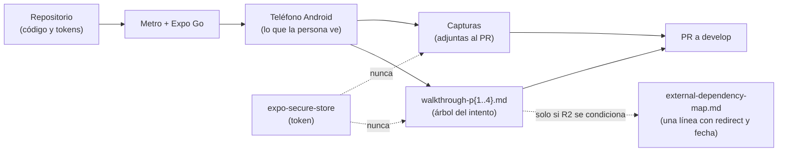

# Diseño de seguridad, privacidad y diagnóstico — U6 `u6-walkthrough`

> **Provenance**: deriva de `nfr-requirements/security-requirements.md` (NFR3.24, NFR3.25, NFR4.12, NFR9.9 y los heredados NFR3.1–NFR3.23, NFR4.1–NFR4.11, NFR9.1–NFR9.8), de `nfr-requirements/performance-requirements.md` (NFR1.19, NFR1.20, para la integridad de la evidencia desde el lado de la fiabilidad), de `nfr-requirements/tech-stack-decisions.md` (TS-44, TS-45, TS-48, NFR7.9), de `aidlc/spaces/default/memory/project.md` (§ Forbidden: client secret, backend, autenticación real, persistencia, `.env` y tokens; § Mandated: recorrido sin Spotify, token en almacenamiento seguro, PKCE, Expo Go, textos en español, degradar con mensaje y acción) y `team.md` (§ Way of Working, § Deployment, § Code Style), de `functional-design/functional-spec.md` (§ Las pasadas, § Salida condicionada de R2, § El registro de la pasada, § Criterio de cierre), de `functional-design/rules.md` (BR25.4, BR26.3, BR26.7, BR27.1–BR27.5, BR28.2, BR28.4) y de `inception/contract-design/contract-summary.md` (C1 1.5.0, C2 1.4.0, C3 1.1.0, C4 1.2.0, C7 1.0.0, C8 1.1.0).
> Fecha: 2026-11-20. Etapa: NFR Design · Unidad: `u6-walkthrough` · Agente: aidlc-architect-agent · Profundidad: Standard.

## Fronteras de confianza de esta unidad

U6 no mueve ninguna frontera de ejecución: no hay red nueva, ni almacenamiento nuevo, ni permiso nuevo. La frontera que esta unidad sí tiene es **entre lo que la app muestra y lo que la evidencia conserva**. Todo lo demás es la app que U1–U5 ya entregaron.

**Respaldo en texto**: la persona mira el teléfono; de ahí salen dos copias —la captura y la fila del registro—, y ambas terminan en el PR. El token vive en el almacén seguro del dispositivo y **no tiene flecha** hacia la evidencia: la app no lo pinta y el registro no lo lee. La única escritura fuera del registro es la línea del mapa de dependencias externas, y solo cuando R2 se condiciona. No hay flecha desde la evidencia hacia la app: la evidencia no se importa, no se ejecuta y no entra en el bundle.

## NFR3.24 — La evidencia no lleva un secreto

Cuatro superficies de evidencia y una regla por superficie:

| Superficie | Qué puede contener | Control de diseño | Cómo se verifica |
|---|---|---|---|
| **Capturas** | Solo lo que la app pinta: pantallas, textos, portadas, estado de la tarjeta de Spotify | El token no se renderiza en ninguna pantalla; `SpotifyCard` pinta estado y texto, nunca credenciales | Revisión de las 24 capturas (13 si R2 se condiciona) contra la lista de pantallas del catálogo |
| **Registros `walkthrough-pN.md`** | Estado observado, texto literal de la pantalla, resultado y nota | Ni token, ni contenido de `expo-secure-store`, ni valor del client ID; el client ID se anota como «configurado: sí/no» | Búsqueda de `Bearer`, `access_token`, `refresh_token` en los cuatro ficheros: **cero resultados** |
| **PR** | Registros, capturas, plantilla rellena | La plantilla incluye la casilla de que no viaja ningún secreto (BR28.4) | Checklist del PR + `git status` sin `.env`, `.p12`, `.jks` ni fichero de token |
| **Repositorio** | Código, tokens de diseño, `.env.example` | `.env` sigue ignorado y sin rastrear; el client secret no existe (PKCE S256, CT-04) | `git ls-files` sin `.env`; `git diff --stat` del PR sin `.env` |

**El riesgo de U6 no está en el código que se ejecuta, sino en el material que se entrega.** La app no puede filtrar el token por la interfaz porque nunca lo pinta; lo que sí puede filtrarlo es una captura mal elegida, un registro que copie el contenido del almacén seguro o un `.env` que se cuele en el commit. Por eso el control es de evidencia y no de runtime.

### El redirect literal: cuándo se anota y dónde

La revisión de NFR Requirements dejó aquí un Major (R-01): NFR3.24 y NFR4.12 pedían anotar el redirect literal «siempre», mientras BR26.7, BR28.2, el functional-spec y TS-44 lo piden **solo si R2 se condiciona**, y el mapa de dependencias externas no tiene columna donde guardar «valor y fecha». Este diseño cierra la contradicción con una lectura única y ejecutable:

| Desenlace | Qué se anota | Dónde | Qué se comprueba |
|---|---|---|---|
| **R2 se completa** | Nada del redirect: no hay prerrequisito pendiente | Ni el registro ni el mapa | No hay línea que comparar; el criterio de igualdad se cumple por ausencia en ambos |
| **R2 se condiciona** | El valor literal, el mensaje del panel o del navegador y la fecha | (1) Nota de S01 en `walkthrough-p3.md` y `walkthrough-p4.md`; (2) **una línea inmediatamente debajo de la tabla** de `inception/delivery-planning/external-dependency-map.md`, con la forma `Redirect URI de PKCE — <valor literal> — <mensaje del panel o del navegador> — <fecha>` | Mismo valor, mismo mensaje y misma fecha en los dos sitios, y la fecha es la de la pasada |

- **Sin columna nueva y sin fila nueva en el registro.** El mapa es un artefacto de Delivery Planning y su tabla tiene cinco columnas pensadas para planificar; añadir una sexta cambiaría su forma por una constancia puntual. Una línea bajo la tabla dice lo mismo sin tocar el esquema, y BR28.2 pide en los dos sitios **el valor exacto, el mensaje del panel y la fecha**, así que la línea lleva los tres datos y la comprobación los compara los tres.
- **Sin campo nuevo en la cabecera.** La cabecera tiene ocho datos (NFR1.20) y ninguno es el redirect; meterlo ahí rompería el recuento y obligaría a escribirlo en las cuatro pasadas, incluidas las que no lo necesitan.
- **De dónde sale el valor.** Es el que la app resuelve con `resolveRedirectUri()`: `exp://<host>:8081/--/spotify-callback`, o el de `EXPO_PUBLIC_SPOTIFY_REDIRECT_URI` si está definido. Se lee del parámetro `redirect_uri` de la URL de autorización que abre el navegador, o del mensaje del panel cuando lo rechaza; nunca del almacén seguro ni de un fichero de token.
- **Por qué no es un secreto.** Es una URL de retorno con la IP privada del equipo: una dirección de red local, no una credencial. Aun así se anota una sola vez y con fecha, no en cada fila.

**Cómo se verifica (redacción definitiva).** Revisión del `diff` del PR sin `.env`, sin fichero de token y sin `.p12`/`.jks`; revisión de las capturas contra la lista —**24** cuando R2 se ejecuta, **13** cuando se condiciona—; búsqueda de las tres cadenas de token en los cuatro registros, que debe dar cero; revisión de `app/src/**` de que ninguna pantalla lee el token para pintarlo; y, **si y solo si** el mapa lleva la línea del redirect, comprobación de que el registro lleva **el mismo valor, el mismo mensaje del panel o del navegador y la misma fecha**.

## NFR3.25 — Un arreglo de U6 no abre una puerta nueva

El diseño del «arreglo» es lo que separa una unidad de verificación de una unidad de construcción encubierta. Cuatro compuertas, y cada una se puede comprobar sin juicio:

| Compuerta | Qué prohíbe | Qué la comprueba |
|---|---|---|
| **Superficie** | Red, almacenamiento, permiso, módulo nativo o estado nuevo en una pantalla (BR27.4) | Revisión del `diff` de cada commit de la tabla de defectos contra las props y estados que C1–C8 ya declaran |
| **Dependencias** | Un `package.json` o un lockfile con una dependencia nueva o una versión movida | `git diff --stat package.json app/package.json packages/*/package.json package-lock.json` vacío |
| **Contrato** | Un token, una prop pública, un estado o un código de diagnóstico nuevos | `git diff --stat eslint.config.js jest.config.js` vacío; `AppLogCode` sin cambios; `npm run typecheck` en verde prueba que ninguna firma pública se movió sin actualizar consumidores |
| **Código solo para la demo** | Un conmutador para vaciar el almacén, una pantalla de estados, un reloj visible, instrumentación | Revisión del `diff`; Q2 = A lo dejó fuera y TS-44 lo prohíbe |

**La regla de decisión, en una línea**: si el cambio mínimo exige tocar C1–C8, añadir una pantalla o un componente, o introducir un módulo nativo, **no es un arreglo**: se registra como pendiente con qué falta y de qué depende (BR27.2, BR27.4, BR28.3). La última unidad no es el lugar para cambiar un contrato que cinco unidades anteriores ya consumieron.

**El logger no se toca.** `AppLogCode` quedó cerrado en U5; un defecto que necesitara un diagnóstico nuevo sería una decisión de contrato, no una nota del registro (NFR9.9). La comprobación es directa: `app/src/bootstrap/logger.ts` no aparece en el `diff`.

**Una sola instancia de cada fuente sigue siendo la regla** (TS-05, TS-18): el recorrido no construye una segunda instancia ni una fuente de prueba paralela para «poder provocar» un estado. Los estados que no se pueden provocar en el teléfono —carga, vacío, error de contenido— se cubren con las pruebas que ya existen y se anotan como tales en el registro (Q2 = A, FR11.6, ADR-012).

## NFR4.12 — La evidencia no expone más que la pantalla

| Dato | Se conserva | Dónde | Por qué | Cuánto dura |
|---|---|---|---|---|
| Pantallas con el contenido de la siembra | Sí | Capturas del PR | Es la demostración de `AC11.1.1` y `AC11.1.5` | El PR; no se commitea |
| Autores y handles sembrados (`lucia`, `ana`, `bruno`) | Solo cuando la fila reproduce lo que la pantalla muestra | Capturas y nota de la fila | Son datos de ejemplo y la pantalla ya los enseña (US2.3) | El PR |
| Texto de un comentario recibido | **No** | — | Se lee en la pantalla y en su captura; copiarlo no añade evidencia | — |
| Títulos y portadas reales de Spotify (R2) | Sí, si R2 se ejecuta | Capturas del PR | Catálogo público; la AC pide demostrar portadas reales (AC11.2.2) | El PR |
| Historial de escucha, perfil, correo o nombre de la cuenta de Spotify | **Nada** | — | La app no lo pide ni lo pinta; el token solo autoriza catálogo (FR10.4) | — |
| Modelo de teléfono y versión de Android | Sí | Cabecera de los cuatro registros | Reproducibilidad (NFR1.20); no identifica a una persona | El registro, versionado con el intento |
| IP privada en el redirect | Sí: valor literal, mensaje y fecha | Registro y mapa, **solo si R2 se condiciona** | BR26.7 y BR28.2 lo exigen; es una dirección de red local | Ficheros del intento |
| Token y almacén seguro | **No** | — | NFR3.24 | — |

### La búsqueda de handles: qué resultado espera

La revisión de NFR Requirements (R-03) señaló que la comprobación pedía buscar handles «fuera de las capturas» sin decir qué resultado espera, y que eso choca con la tabla del propio requisito. Este diseño fija el resultado esperado:

- **Los handles solo aparecen en dos sitios**: dentro de una captura —donde los pinta la app— y en la nota de una fila que **reproduce literalmente** lo que la pantalla muestra (por ejemplo, el texto completo de la opinión que se está mirando).
- **La búsqueda espera cero handles en cualquier otro sitio**: ni en la columna `Acción`/`Esperado`, ni en el veredicto, ni en la tabla de defectos, ni en las notas que describen el síntoma. Un handle narrativo —«la opinión de lucia falló»— es un defecto del registro y se reescribe como «la primera tarjeta falló».
- **El texto de un comentario no se busca «a ver si aparece»: no puede aparecer**, ni siquiera entre comillas. La comprobación es cero resultados en los cuatro ficheros.
- **La razón de la asimetría**: el handle es un identificador de ejemplo que la pantalla enseña y que hace verificable una fila; el texto de un comentario no aporta nada que la captura no dé, y copiarlo convierte la evidencia en una transcripción de contenido ajeno.

**Cómo se verifica (redacción definitiva).** Revisión de capturas y registros contra la tabla; búsqueda del texto de un comentario sembrado en los cuatro ficheros, que debe dar cero; búsqueda de los handles sembrados, que solo puede dar resultados dentro de notas que reproduzcan la pantalla; revisión de que el registro de R2 no incluye ningún dato de la cuenta de Spotify distinto de lo que la app pinta; y la igualdad condicional del redirect descrita en § NFR3.24.

## NFR9.9 — El registro no es telemetría

| Situación | Se muestra a la persona | Se registra en la evidencia |
|---|---|---|
| Un paso termina en ✅ | El estado esperado | La fila con el obtenido y ✅ |
| Un paso termina en ❌ | Lo que la app muestra (mensaje y acción) | La fila, la tabla de defectos y su commit |
| Un paso queda N/A | — | La fila con el motivo (un N/A siempre explica por qué) |
| Error de búsqueda de Spotify (S07) | «No pudimos buscar en Spotify.» + «Reintentar» | El texto visible y la acción; **no** el `ContentErrorCode` ni la traza |
| Tarjeta de Spotify en S01 | El texto literal de su estado y «Reintentar» | El nombre del estado de contrato (`connected`, `connectionError`, `notConfigured`) y su texto |
| Pasada condicionada | Lo que se observó en S01 | El redirect literal, el mensaje, la fecha y el motivo |
| Cualquier otra fila | — | Solo lo observado: sin códigos internos, sin trazas, sin contenido de terceros |

- **El registro lo leen personas, no un colector.** No hay envío, ni almacenamiento remoto, ni agregación. Llamarlo «observabilidad» sería confundir la evidencia de una verificación con la telemetría de un producto que no la tiene.
- **Se anota el síntoma, no el dato.** Un defecto de portada se describe como «el bloque quedó vacío», no con el título de la obra; un fallo de búsqueda se describe con el mensaje que la pantalla dio, no con la consulta de la persona.
- **Los nombres de estado del contrato sí se escriben**: son el vocabulario de `SpotifyCard` y lo que hace verificable BR26.7. No son mensajes para la persona —esos van en español— sino el identificador de lo observado.
- **Si un defecto necesitara un diagnóstico nuevo, no se inventa aquí**: sería un cambio de `AppLogCode` y una decisión de contrato (NFR3.25), no una nota del registro.

**Cómo se verifica.** Revisión de la tabla de defectos y de las notas de cada fila: sin códigos internos, sin trazas, sin contenido de terceros; `app/src/bootstrap/logger.ts` sin cambios en el `diff`; ninguna captura ni registro con el token.

## Lo heredado sigue valiendo

| Lo que U1–U5 ya fijó | Sigue igual en U6 | Dónde se comprueba |
|---|---|---|
| Sin backend, sin autenticación real, sin persistencia del contenido (ADR-010, ADR-012, `project.md` § Forbidden) | U6 no añade ninguna de las tres | `git diff --stat` del PR y revisión de la tabla de dependencias |
| Token de Spotify en `expo-secure-store`, borrado al desconectar | S08 es la comprobación de que el borrado ocurre | S08 en P3/P4 |
| PKCE S256 sin client secret | No se toca la autorización; el redirect se anota, no se cambia | `packages/spotify/src/auth/` sin cambios |
| `expo-secure-store`, `expo-network` y `AsyncStorage` prohibidos fuera de sus adaptadores | Ninguna regla de ESLint se relaja | `eslint.config.js` sin cambios |
| Textos en español, sin códigos ni inglés | W14 y cada estado provocado | P1 y P2 |

## Amenazas de la unidad y qué las cierra

| Amenaza | Cómo la cierra esta unidad |
|---|---|
| Un token acaba en una captura o en un registro | La app no lo pinta; se revisan las 24 capturas (13) y se buscan tres cadenas de token, que deben dar cero |
| Un `.env` con el valor real se cuela en el commit | Revisión del `diff` y checklist del PR (`.env` ignorado y sin rastrear) |
| Un arreglo introduce un módulo nativo o una dependencia | BR27.4, TS-44 y `git diff --stat` de los `package.json` y del lockfile |
| Queda código de depuración que solo servía a la demo | Q2 = A: los estados no se fuerzan con un conmutador; revisión del `diff` |
| El registro copia contenido de otras personas | La evidencia es la pantalla; la única copia es la captura, y el texto de un comentario no se transcribe |
| La IP privada del equipo queda publicada | Se anota una vez, con fecha y solo si R2 se condiciona; es una dirección local |
| Se declara «con sesión demostrada» sin fila que lo respalde | Un veredicto exige filas sin celdas vacías y una captura por pantalla (BR28.2) |
| Un fallo se disfraza de pendiente | BR27.2 y la tabla de defectos con su clasificación (NFR1.19) |
| El diagnóstico del producto se ensancha para cubrir la demo | `AppLogCode` no cambia; el registro no es un canal de logs |

## Cómo se demuestra cada requisito

| Requisito | Mecanismo de diseño | Comprobación ejecutable |
|---|---|---|
| **NFR3.24** | Cuatro superficies con control propio + regla condicional del redirect | Búsqueda de `Bearer`/`access_token`/`refresh_token` = 0; `git ls-files` sin `.env`; capturas revisadas |
| **NFR3.25** | Cuatro compuertas (superficie, dependencias, contrato, código de demo) | `git diff --stat` de `package.json`, lockfile, `eslint.config.js` y `jest.config.js` vacío; `logger.ts` sin cambios |
| **NFR4.12** | Inventario de datos + regla de handles y comentarios | Búsqueda de handles y de texto de comentario con el resultado esperado; igualdad condicional del redirect |
| **NFR9.9** | Tabla de qué se anota por situación; el registro no es un canal de logs | Revisión de notas y defectos; `logger.ts` sin cambios |

## Riesgos asumidos y su porqué

- **Las capturas están fuera del repositorio.** Viven en el PR, así que su retención es la del PR y no la del árbol. Se asume porque el equipo ya trabaja así y porque commitear binarios de una demostración engorda el repositorio sin añadir verificabilidad (TS-45).
- **La IP privada del equipo queda escrita cuando R2 se condiciona.** Es inevitable para que el panel pueda aceptar el redirect y para que el pendiente sea reproducible; se acota a una línea y una fecha.
- **R2 usa la cuenta real de quien recorre.** Lo único que la app lee es el catálogo bajo su token, y el token se borra al desconectar (S08). La evidencia no copia nada de la cuenta.
- **La revisión de secretos es manual.** No hay un escáner en el CI y U6 no añade un paso (`team.md` § Deployment, TS-48). Se asume con una checklist explícita en el PR y tres cadenas de búsqueda concretas.
- **El contenido demo se trata como si fuera real.** La cuenta es `demo` y el contenido es de ejemplo, pero el inventario se escribe como si fueran datos de personas: el día que existan cuentas, el hábito de no copiar contenido ajeno ya estará en el procedimiento.

## Assumptions & Open Questions

- `[assumption]` El redirect se anota solo si R2 se condiciona, y la igualdad de NFR4.12 se lee como «si el mapa lo lleva, el registro lo lleva igual y con la misma fecha». Sin ese condicionante, el criterio de cierre pediría escribir en un artefacto de planificación una constancia que el camino normal no necesita.
- `[assumption]` El mapa de dependencias externas admite una línea bajo su tabla sin cambiar de forma; si el equipo prefiriera una columna, sería un cambio de Delivery Planning y no de esta unidad.
- `[assumption]` Los handles sembrados pueden aparecer en la nota de una fila cuando esta reproduce la pantalla; el texto de un comentario, nunca.
- **Open question para el cierre del workflow**: si R2 se condiciona, la unidad cierra con R1 y deja la mitad con sesión como deuda con dependencia externa. El veredicto debe decir qué mitad no se demostró y enlazar la línea del redirect; no puede afirmar «con sesión demostrada».

## Sources

- `security-requirements` — `construction/u6-walkthrough/nfr-requirements/security-requirements.md` (NFR3.24, NFR3.25, NFR4.12, NFR9.9).
- `performance-requirements` — `construction/u6-walkthrough/nfr-requirements/performance-requirements.md` (NFR1.19, NFR1.20).
- `tech-stack-decisions` — `construction/u6-walkthrough/nfr-requirements/tech-stack-decisions.md` (TS-44, TS-45, TS-48).
- `functional-spec` — `construction/u6-walkthrough/functional-design/functional-spec.md` (§ Salida condicionada de R2, § El registro de la pasada, § Criterio de cierre).
- `rules` — `construction/u6-walkthrough/functional-design/rules.md` (BR25.4, BR26.3, BR26.7, BR27.1–BR27.5, BR28.2, BR28.4).
- `project.md` / `team.md` — `aidlc/spaces/default/memory/project.md` (§ Forbidden, § Mandated), `aidlc/spaces/default/memory/team.md` (§ Way of Working, § Deployment, § Code Style).
- `contract-summary` — `inception/contract-design/contract-summary.md` (C1 1.5.0, C2 1.4.0, C3 1.1.0, C4 1.2.0, C7 1.0.0, C8 1.1.0).
- `auth` — `packages/spotify/src/auth/device.ts` (`resolveRedirectUri`), `app/src/bootstrap/logger.ts` (`AppLogCode`, sin cambios), `.github/pull_request_template.md` (checklist de calidad).
- `review` — `construction/u6-walkthrough/nfr-requirements/reviews/review-01.md` (R-01, R-02, R-03 y R-05, resueltos en este diseño).
