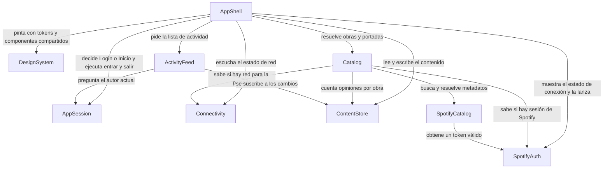

# Componentes — Melodify

> **Provenance**: deriva de `inception/requirements-analysis/requirements.md` (`requirements`), `inception/user-stories/stories.md` (`stories`), `inception/practices-discovery/team-practices.md` (`team-practices`), del diseño aprobado en `inception/refined-mockups/` (`mockups`, `interaction-spec`, `design-system-mapping`) y de las respuestas de `domain-design-questions.md` (Q1–Q7 y su confirmación).
> Fecha: 2026-11-09. Etapa: Domain Design. Agente: aidlc-architect-agent. Profundidad: Standard.

## Cómo leer este documento

El bloque `yaml` de abajo es la fuente de verdad del catálogo; las tablas que siguen son la misma información puesta para leerla. Un **componente** es código que se escribe: un módulo con su responsabilidad, sus datos y su ciclo de vida. Una base de datos, la API de Spotify o el almacenamiento del dispositivo son **dependencias**, no componentes.

Estas piezas son módulos internos de una sola app Expo, no servicios: Units Generation decide después si se agrupan en una unidad o en varias. Este documento **no** fija el esquema de datos (tipos, validaciones, cardinalidades: eso es Functional Design) ni el stack de NFR; solo la propiedad de cada entidad, su identificador, sus atributos por nombre y sus referencias.

```yaml
components:
  - name: AppShell
    summary: Navegación de la app, pantallas como contenedores finos, tema montado y avisos globales.
    behaviour: >
      Compone la navegación de cinco pestañas —Inicio, Explorar, Crear, Actividad y Perfil— y
      las vistas de detalle apiladas dentro de la pestaña de origen. Ejecuta la pantalla de entrada
      que decide `AppSession`: Login cuando no hay sesión recordada, Inicio cuando la hay. Monta el
      tema activo y presenta el banner de sin conexión, el snackbar y la hoja de comentarios sobre la
      pantalla actual, sin cambiar de pestaña. Presenta también los estados de carga, vacío y error de
      las dos pantallas que se calculan en local —Actividad y Perfil— con su acción de reintento. No
      posee datos de dominio ni reglas de negocio: lee y escribe a través de los componentes que
      consume. Login no muestra barra inferior.
    responsibilities:
      - Navegación de pestañas y de detalle dentro de la pestaña
      - Composición de las seis pantallas y sus estados visibles
      - Presentación de banner, snackbar y hoja de comentarios
      - Ejecución de la pantalla de entrada que decide AppSession
    depends_on:
      - component: DesignSystem
        interaction: renderiza la interfaz con sus tokens y componentes compartidos
        style: sync
      - component: AppSession
        interaction: decide Login o Inicio y ejecuta entrar y cerrar sesión
        style: sync
      - component: Connectivity
        interaction: se suscribe al estado de red para mostrar u ocultar el aviso
        style: event
      - component: Catalog
        interaction: resuelve obras y portadas para las pantallas
        style: sync
      - component: ContentStore
        interaction: lee y escribe opiniones, me gusta, comentarios y seguimientos
        style: sync
      - component: ActivityFeed
        interaction: pide la lista de actividad de la pantalla Actividad
        style: sync
      - component: SpotifyAuth
        interaction: muestra el estado de conexión y lanza conectar y desconectar
        style: sync
    dependents: []
    external_dependencies: []
    entities: []

  - name: DesignSystem
    summary: Tema claro y oscuro con tokens y los componentes visuales compartidos de la app.
    behaviour: >
      Expone los tokens de color, tipografía, espaciado, radios y tamaños de los mockups
      refinados y los resuelve al tema del sistema. Implementa **todo** el inventario de
      `design-system-mapping.md` § «Inventario de componentes y tokens», que es la lista
      autoritativa: `AppHeader`, `BottomTabBar`, `OpinionCard` —única tarjeta de opinión, con sus
      formas feed, compacta y detalle y la marca de opinión propia como propiedad `isOwn`, nunca
      como variante—, `CoverArt`, `RatingStars`, `RatingInput`, `Avatar`, `SocialActionBar`,
      `ConnectionCard`, `SpotifyCard`, `EmptyState`, `ErrorState`, `Skeleton`, `Snackbar`,
      `CommentSheet`, `SearchField`, `TextField`/`MultilineField`, `PrimaryButton`/`SecondaryButton`/
      `TextButton`, `WorkResultRow`, `ActivityRow`, `DayHeader` y `Banner`. Ninguna pantalla
      reimplementa una de estas piezas. El `Snackbar` se pinta aquí y lo presenta `AppShell`, que es
      quien decide cuándo hay algo que confirmar. Ningún componente consume tokens crudos: todos
      pasan por el tema activo. No conoce reglas de negocio ni llama a nadie.
    responsibilities:
      - Tokens de color, tipografía, espaciado, radios y tamaños
      - Inventario completo de componentes visuales compartidos, con la tarjeta de opinión única
      - Resolución del tema claro u oscuro del sistema
    depends_on: []
    dependents:
      - component: AppShell
        interaction: usa sus tokens y componentes para pintar la interfaz
    external_dependencies: []
    entities: []

  - name: AppSession
    summary: Sesión simulada de la app; recuerda que la persona entró y la olvida al cerrar sesión.
    behaviour: >
      Acepta solo las credenciales de demostración demo/demo; cualquier otra combinación se
      rechaza sin abandonar la pantalla de Login. Al entrar, recuerda la sesión en el
      almacenamiento del dispositivo y al arrancar la app decide si abrir Login o Inicio. Cerrar
      sesión borra ese recuerdo y vuelve a Login. No guarda ni toca el token de Spotify: son dos
      sesiones distintas y cerrar la de la app no desconecta Spotify. El autor de la sesión es el
      autor demo —`authorId` `demo`, una constante—: sus credenciales son las únicas válidas, así que
      `AppSession` no consulta `ContentStore`; el contenido siembra ese autor y quien necesite saber
      cuál es el autor actual pregunta aquí. Esta es la única decisión de arranque entre Login e Inicio.
    responsibilities:
      - Validación de las credenciales de demostración
      - Recuerdo y borrado de la sesión de la app en el dispositivo
      - Decisión de arranque entre Login e Inicio y autor actual de la app
    depends_on: []
    dependents:
      - component: AppShell
        interaction: le pregunta si hay sesión y ejecuta entrar y cerrar sesión
      - component: ActivityFeed
        interaction: le pide el autor actual para saber qué actividad es «mía»
    external_dependencies:
      - name: Almacenamiento seguro del dispositivo (expo-secure-store)
        kind: other
        purpose: recordar la sesión de la app entre reinicios, con una clave propia distinta de la del token de Spotify
    entities:
      - name: Session
        identifier: authorId
        attributes: [startedAt, remembered]
        references:
          - entity: Author
            owned_by: ContentStore
            relationship: la sesión representa al autor demo del contenido; la referencia es por identificador (`demo`) y no consulta a ContentStore

  - name: SpotifyAuth
    summary: Autorización PKCE con Spotify y ciclo de vida del token en almacenamiento seguro.
    behaviour: >
      Construye la autorización con PKCE y challenge S256, sin client secret y sin pedir
      permisos de usuario. Lee el client ID de EXPO_PUBLIC_SPOTIFY_CLIENT_ID; si falta o no es
      válido, no intenta autorizar y expone el estado de instalación sin configurar. Intercambia
      el código por un token, lo guarda en el almacenamiento seguro del dispositivo y lo borra al
      desconectar. Al arrancar recupera el token guardado, de modo que la conexión persiste entre
      reinicios. Detecta un token inválido o caducado y lo expone en lenguaje llano. Publica su
      estado —desconectado, conectando, conectado, error de conexión, token inválido o sin
      configurar— a quien lo consume.
    responsibilities:
      - Autorización PKCE y intercambio de código
      - Guardado, recuperación y borrado del token en almacenamiento seguro
      - Estado de la conexión de Spotify y sus fallos
    depends_on: []
    dependents:
      - component: SpotifyCatalog
        interaction: obtiene un access token válido antes de cada llamada
      - component: AppShell
        interaction: muestra el estado de conexión y lanza conectar y desconectar
    external_dependencies:
      - name: Spotify Accounts API
        kind: third-party-api
        purpose: autorización PKCE y emisión del token
      - name: Almacenamiento seguro del dispositivo (expo-secure-store)
        kind: other
        purpose: guardar el token de Spotify fuera del alcance de otras apps, con su propia clave
    entities:
      - name: SpotifyToken
        identifier: tokenKey
        attributes: [accessToken, refreshToken, expiresAt, obtainedAt]
        references: []

  - name: SpotifyCatalog
    summary: Adaptador de la Web API de Spotify para buscar obras y resolver metadatos y portadas.
    behaviour: >
      Traduce la búsqueda de texto a la Web API de Spotify y normaliza cada resultado al modelo
      interno de obra —identificador, título, artista y URL de portada—, sin exponer la forma de
      la respuesta de Spotify al resto de la app. Resuelve metadatos y portadas de una obra
      conocida. No lanza peticiones sin un token válido y traduce cualquier fallo a un error en
      lenguaje llano que la interfaz pueda mostrar con «Reintentar». No decide qué se muestra ni
      guarda resultados: eso es del catálogo.
    responsibilities:
      - Búsqueda de obras en la Web API de Spotify
      - Resolución de metadatos y portadas
      - Normalización de la respuesta de Spotify al modelo interno
    depends_on:
      - component: SpotifyAuth
        interaction: obtiene un access token válido antes de cada llamada
        style: sync
    dependents:
      - component: Catalog
        interaction: le pide búsquedas y metadatos cuando hay sesión de Spotify
    external_dependencies:
      - name: Spotify Web API
        kind: third-party-api
        purpose: búsqueda de obras, metadatos y portadas
    entities: []

  - name: Catalog
    summary: Dueño de la obra musical; reúne el catálogo de ejemplo con los resultados de Spotify.
    behaviour: >
      Posee todas las obras de la app. Mantiene el catálogo de ejemplo local de seis a ocho obras
      reales, disponible siempre, con o sin sesión de Spotify, y añade las obras que llegan de la
      búsqueda. Resuelve una obra por su identificador para las pantallas de detalle. Decide qué
      portada se puede mostrar: la real cuando hay sesión y metadatos resueltos, el bloque de
      inicial cuando no hay sesión, la portada falla o no hay red; para eso consulta a `SpotifyAuth`
      si hay sesión y a `Connectivity` si hay red, y no adivina ninguna de las dos cosas por el
      último error. Guarda en memoria el resultado de cada búsqueda por consulta normalizada
      mientras dure la app, de modo que repetir una búsqueda no vuelva a pedir y no muestre
      indicador de carga. Cuenta las opiniones de cada obra leyendo `ContentStore` para el
      «N opiniones» de los resultados.
    responsibilities:
      - Propiedad de la obra y del catálogo de ejemplo
      - Mezcla de catálogo de ejemplo y resultados de Spotify
      - Caché en memoria de búsquedas y decisión de portada disponible
      - Recuento de opiniones por obra para los resultados
    depends_on:
      - component: SpotifyCatalog
        interaction: busca y resuelve metadatos cuando hay sesión de Spotify
        style: async
      - component: ContentStore
        interaction: cuenta las opiniones de cada obra para el «N opiniones»
        style: sync
      - component: SpotifyAuth
        interaction: sabe si hay sesión de Spotify activa antes de pedir portada real
        style: sync
      - component: Connectivity
        interaction: sabe si hay red para decidir entre portada real y bloque de inicial
        style: event
    dependents:
      - component: AppShell
        interaction: resuelve obras y portadas para las pantallas
    external_dependencies: []
    entities:
      - name: Work
        identifier: workId
        attributes: [title, artist, coverUrl, origin]
        references: []

  - name: ContentStore
    summary: Dueño del contenido en memoria — opiniones, autores, me gusta, comentarios y seguimientos.
    behaviour: >
      Es el único lugar donde viven las opiniones, los autores, los me gusta, los comentarios y
      los seguimientos, y todo vive en memoria: se pierde al recargar la app y la interfaz no
      promete lo contrario. Impone una sola opinión por obra y persona; editar actualiza esa misma
      opinión y sella la fecha de modificación, de modo que la de creación no cambia. Publicar
      inserta la opinión al principio del feed. Los contadores de me gusta y comentarios viven con
      la opinión y solo este componente los escribe. Siembra al arrancar el contenido de ejemplo:
      de ocho a diez opiniones de cuatro a cinco autores sobre seis a ocho obras, tres opiniones
      del usuario demo, dos autores seguidos, y los me gusta y comentarios recibidos con su fecha
      —dos me gusta recibidos y tres comentarios recibidos, como fija AC8.1.2—. Notifica cada cambio
      a quien escucha.
    responsibilities:
      - Opiniones: crear, editar, listar por obra y por autor, con fechas
      - Me gusta, comentarios y seguimientos
      - Autores y contenido de ejemplo sembrado, con los me gusta y comentarios recibidos ya fechados
      - Contadores de la tarjeta y del perfil
    depends_on: []
    dependents:
      - component: AppShell
        interaction: lee y escribe opiniones, me gusta, comentarios y seguimientos
      - component: ActivityFeed
        interaction: se suscribe a sus cambios para derivar la actividad
      - component: Catalog
        interaction: le cuenta las opiniones de cada obra para el «N opiniones»
    external_dependencies: []
    entities:
      - name: Author
        identifier: authorId
        attributes: [displayName, handle, isDemoUser]
        references: []
      - name: Opinion
        identifier: opinionId
        attributes: [workId, workTitle, workArtist, authorId, text, rating, createdAt, updatedAt]
        references:
          - entity: Work
            owned_by: Catalog
            relationship: cada opinión trata sobre una obra del catálogo
          - entity: Author
            owned_by: ContentStore
            relationship: cada opinión la escribe un autor
      - name: Comment
        identifier: commentId
        attributes: [opinionId, authorId, text, createdAt]
        references:
          - entity: Opinion
            owned_by: ContentStore
            relationship: cada comentario pertenece a una opinión
          - entity: Author
            owned_by: ContentStore
            relationship: cada comentario lo escribe un autor
      - name: Like
        identifier: likeId
        attributes: [opinionId, authorId, createdAt]
        references:
          - entity: Opinion
            owned_by: ContentStore
            relationship: cada me gusta recae sobre una opinión
          - entity: Author
            owned_by: ContentStore
            relationship: cada me gusta lo da un autor
      - name: Follow
        identifier: followId
        attributes: [followerId, authorId, createdAt]
        references:
          - entity: Author
            owned_by: ContentStore
            relationship: cada seguimiento une a un autor seguidor con un autor seguido

  - name: ActivityFeed
    summary: Vista de solo lectura que deriva la actividad de lo recibido a partir del contenido.
    behaviour: >
      No guarda eventos propios: al abrir Actividad calcula la lista a partir de ContentStore.
      Produce tres tipos de evento —publicación propia, me gusta recibido y comentario recibido—,
      ordena de más reciente a más antiguo y agrupa por día en Hoy, Ayer y fecha. Un me gusta o un
      comentario que la persona da a la opinión de otra persona no genera evento. Se recalcula
      cuando el contenido cambia, así que publicar añade el evento sin recargar la app. No escribe
      nada ni llama a la red. Expone un contrato de estados explícito para que FR8.4 y los mockups
      tengan dónde observarse: `loading` en el primer montaje, mientras el contenido termina de
      sembrarse; `ready` con los grupos por día; `empty` cuando no hay ningún evento recibido; y
      `error` si la derivación no puede completarse o la siembra falla, con el texto de los mockups
      y una acción de reintento que vuelve a derivar. El error es defensivo —el contenido vive en
      memoria— pero es una ruta real y comprobable con un doble que falle. Para saber qué es «mío»
      pregunta el autor actual a `AppSession`, que es el único sitio que lo decide.
    responsibilities:
      - Derivación de los eventos de actividad recibidos
      - Orden cronológico y agrupación por día
      - Contrato de estados `loading`, `ready`, `empty` y `error` con reintento
      - Recalculo al cambiar el contenido
    depends_on:
      - component: ContentStore
        interaction: se suscribe a sus cambios y lee opiniones, me gusta y comentarios
        style: event
      - component: AppSession
        interaction: le pregunta el autor actual para saber qué actividad es «mía»
        style: sync
    dependents:
      - component: AppShell
        interaction: pide la lista de actividad de la pantalla Actividad
    external_dependencies: []
    entities: []

  - name: Connectivity
    summary: Fuente única del estado de conexión a internet del dispositivo.
    behaviour: >
      Escucha el estado de red del sistema y lo expone como una sola señal: con conexión o sin
      conexión. Distingue «sin conexión» de «la petición ha fallado», de modo que la interfaz
      puede conservar lo cargado y avisar en la cabecera en lugar de pintar un error de servidor.
      Avisa de cada cambio para que las pantallas reaccionen sin volver a preguntar. No hace
      peticiones propias ni guarda datos.
    responsibilities:
      - Estado de red del dispositivo como fuente única
      - Aviso de cambios de conectividad
    depends_on: []
    dependents:
      - component: AppShell
        interaction: se suscribe para mostrar u ocultar el aviso de sin conexión
      - component: Catalog
        interaction: consulta si hay red para decidir entre portada real y bloque de inicial
    external_dependencies:
      - name: Estado de red del sistema operativo
        kind: other
        purpose: saber si el dispositivo tiene conexión a internet
    entities: []
```

## Diagrama de componentes

Cada flecha va del componente que llama al que responde, con la razón del enganche.



**Lectura del grafo**: la interfaz (`AppShell`) es la única que conoce a todo el mundo y no tiene dependientes; `DesignSystem` no conoce a nadie; la cadena de Spotify es unidireccional —`AppShell` y `Catalog` nunca hablan con la API directamente—; `Catalog` es el segundo punto con más aristas porque la obra necesita saber tres cosas para decidir su portada —si hay sesión, si hay red y cuántas opiniones tiene—; y `ActivityFeed` cuelga de `ContentStore` y de `AppSession`. No hay ciclos: `AppSession`, `ContentStore`, `Connectivity` y `SpotifyAuth` no llaman a nadie, y `Catalog` solo llama hacia abajo.

## Resumen de componentes

| Componente | Propósito | Depende de | Dependientes | Entidades |
|---|---|---|---|---|
| `AppShell` | Navegación, pantallas, avisos globales | DesignSystem, AppSession, Connectivity, Catalog, ContentStore, ActivityFeed, SpotifyAuth | — | — |
| `DesignSystem` | Tema y componentes compartidos | — | AppShell | — |
| `AppSession` | Login simulado y recuerdo de sesión | — | AppShell, ActivityFeed | Session |
| `SpotifyAuth` | PKCE y ciclo de vida del token | — | SpotifyCatalog, AppShell, Catalog | SpotifyToken |
| `SpotifyCatalog` | Adaptador de la Web API de Spotify | SpotifyAuth | Catalog | — |
| `Catalog` | Dueño de la obra y del catálogo de ejemplo | SpotifyCatalog, ContentStore, SpotifyAuth, Connectivity | AppShell | Work |
| `ContentStore` | Contenido y estado social en memoria | — | AppShell, ActivityFeed, Catalog | Author, Opinion, Comment, Like, Follow |
| `ActivityFeed` | Actividad derivada, de solo lectura | ContentStore, AppSession | AppShell | — |
| `Connectivity` | Estado de red como fuente única | — | AppShell, Catalog | — |

## Propiedad de entidades

| Entidad | Componente dueño | Identificador | Atributos | Referencias |
|---|---|---|---|---|
| `Session` | `AppSession` | `authorId` | `startedAt`, `remembered` | `Author` (`ContentStore`) |
| `SpotifyToken` | `SpotifyAuth` | `tokenKey` | `accessToken`, `refreshToken`, `expiresAt`, `obtainedAt` | — |
| `Work` | `Catalog` | `workId` | `title`, `artist`, `coverUrl`, `origin` | — |
| `Author` | `ContentStore` | `authorId` | `displayName`, `handle`, `isDemoUser` | — |
| `Opinion` | `ContentStore` | `opinionId` | `workId`, `workTitle`, `workArtist`, `authorId`, `text`, `rating`, `createdAt`, `updatedAt` | `Work` (`Catalog`), `Author` (`ContentStore`) |
| `Comment` | `ContentStore` | `commentId` | `opinionId`, `authorId`, `text`, `createdAt` | `Opinion`, `Author` |
| `Like` | `ContentStore` | `likeId` | `opinionId`, `authorId`, `createdAt` | `Opinion`, `Author` |
| `Follow` | `ContentStore` | `followId` | `followerId`, `authorId`, `createdAt` | `Author` |

Toda entidad tiene un solo dueño y un identificador propio. `workId` **es** el identificador de Spotify de la obra —el del catálogo de ejemplo también, porque son obras reales (A2)—, así que `Opinion.workId` es exactamente la referencia «por su identificador de Spotify» que pide FR3.2; no hay un segundo campo `spotifyId` que pueda discrepar. Las opiniones guardan además `workTitle` y `workArtist` como resumen del estado de la obra en el momento de escribir: así la tarjeta se pinta sin sesión de Spotify, sin red y sin consultar el catálogo (FR3.2).

## Dependencias externas

| Componente | Dependencia | Tipo | Propósito |
|---|---|---|---|
| `AppSession` | Almacenamiento seguro del dispositivo (`expo-secure-store`) | `other` | Recordar la sesión de la app entre reinicios, con una clave propia |
| `SpotifyAuth` | Spotify Accounts API | `third-party-api` | Autorización PKCE y emisión del token |
| `SpotifyAuth` | Almacenamiento seguro del dispositivo (`expo-secure-store`) | `other` | Guardar y borrar el token de Spotify, con su propia clave |
| `SpotifyCatalog` | Spotify Web API | `third-party-api` | Búsqueda, metadatos y portadas |
| `Connectivity` | Estado de red del sistema | `other` | Saber si el dispositivo tiene internet |

Ninguna de estas dependencias es un componente: son cosas que se usan, no código que se escribe.

## Rationale

| Componente | Por qué es un bloque aparte |
|---|---|
| `AppShell` | Es el único punto que conoce la navegación y la composición; aislarlo permite cambiar de pantalla o de navegador sin tocar reglas de negocio, y evita que seis contenedores finos fingan ser componentes con vida propia. |
| `DesignSystem` | Tiene un ciclo de vida distinto del de las pantallas: cambia cuando cambian los tokens o un componente compartido, no cuando cambia una función. Es lo que impide que la tarjeta de opinión se reimplemente en cuatro pantallas. |
| `AppSession` | La sesión de la app es la única puerta de entrada y tiene su propia regla (una sola credencial válida) y su propia persistencia; mezclarla con la sesión de Spotify haría que cerrar sesión desconectara la cuenta, cosa que no se pidió. |
| `SpotifyAuth` | Concentra la superficie de seguridad —PKCE, token, almacenamiento seguro, caducidad— y sus fallos; ningún otro componente toca el token, lo que hace verificable NFR3 con un solo doble de `expo-secure-store`. |
| `SpotifyCatalog` | Es el adaptador que traduce Spotify al modelo interno. Aislado, la forma de la API de Spotify solo se conoce aquí y las pruebas pueden sustituirlo sin red ni credenciales. |
| `Catalog` | La obra existe con y sin Spotify, así que no puede pertenecer al adaptador remoto; además concentra la caché de búsqueda y la decisión de portada, que son reglas del producto y no de la API. |
| `ContentStore` | Opiniones, me gusta, comentarios y seguimientos comparten una única invariante —una opinión por obra y persona— y unos contadores que viven en la misma tarjeta; separarlos obligaría a coordinarlos en cada pantalla y a mantener dos copias del mismo contador. |
| `ActivityFeed` | La actividad es una lectura derivada, no un almacén: tenerla aparte deja claro que no escribe, que no puede desincronizarse y que no genera eventos por acciones dadas. Además es el sitio donde vive el contrato de estados que FR8.4 pide, aunque el cálculo sea local. |
| `Connectivity` | El aviso de sin conexión tiene que ser el mismo en todas las pantallas y no depender de qué petición falló primero; una sola fuente de verdad hace que el estado sea observable y sustituible en pruebas. |

### Alternativas rechazadas en el reparto

- **Un solo componente de estado para todo** (incluida la sesión de la app y la de Spotify): menos piezas, pero mezcla seguridad, persistencia y contenido en el mismo sitio y hace imposible probar una sin las otras.
- **`ContentStore` partido en opiniones y social**: los contadores de la tarjeta viven con la opinión; dos almacenes obligarían a escribir en dos sitios por cada me gusta y a mantener la sincronización a mano.
- **La obra como propiedad de `SpotifyCatalog` o de `ContentStore`**: dejaría fuera el catálogo de ejemplo o duplicaría los metadatos. `Catalog` es el único sitio donde conviven las dos fuentes.
- **Un único `SpotifyClient`**: sencillo al principio, pero el token y la búsqueda tienen fallos, superficies de seguridad y ritmos de cambio distintos; separarlos cuesta una frontera y ahorra un doble de pruebas frágil.
- **Una componente por pantalla**: seis componentes sin entidades ni reglas propias, que siempre cambian juntos y añaden ruido al catálogo; las pantallas viven como contenedores dentro de `AppShell`.
- **Actividad como registro de eventos**: introduce una segunda copia de la verdad que hay que sembrar y mantener en cada acción; derivarla del contenido hace imposible que se desincronice.

## Assumptions & Open Questions

- `[assumption]` El usuario demo es un autor más del contenido (`authorId` `demo`): así sus opiniones, sus seguimientos y la identidad de Perfil salen de un único sitio y no hay dos versiones del mismo nombre. `AppSession` guarda ese identificador como constante y no consulta `ContentStore`; `ActivityFeed` y Perfil preguntan a `AppSession` cuál es el autor actual.
- `[assumption]` `workId` es el identificador de Spotify de la obra, también para el catálogo de ejemplo (son obras reales, A2). No hay un campo `spotifyId` aparte: la referencia de la opinión es la que pide FR3.2 y no puede discrepar consigo misma.
- `[assumption]` Los me gusta recibidos y los comentarios recibidos del contenido de ejemplo se siembran con fecha y en las cifras que fija AC8.1.2 —dos y tres—, porque sin ellos la actividad derivada no tendría nada que mostrar al arrancar (FR3.7, AC8.1.2).
- `[assumption]` La búsqueda se guarda en caché en `Catalog`, no en `SpotifyCatalog`: es una regla del producto (repetir una consulta no pide ni muestra carga) y sobrevive a que cambie el adaptador.
- `[assumption]` Los estados de carga y error de Actividad y Perfil son defensivos: el contenido vive en memoria y no hay red de por medio, pero el contrato existe, se pinta con el texto de los mockups y se prueba con un doble que falle. Es la salida elegida para FR8.4, AC8.1.6 y AC8.1.7 frente a corregir esos criterios como se corrige AC7.1.3 (ADR-012).
- **Riesgos heredados de los mockups refinados que esta etapa no resuelve**: R-01 (el error de conexión de Spotify solo tiene superficie en Perfil), R-02 (Explorar no define «sin sesión + sin conexión»), R-07 (falta el token de portada de 48), R-08 (barra lateral sin tokens), R-10 (`own` fuera de `variant`) y R-11 (rol del chip) siguen aceptados como riesgo. El catálogo de componentes no los empeora: `SpotifyAuth` expone un único estado de conexión que cualquier superficie puede mostrar, `Catalog` tiene el catálogo de ejemplo local —así que el estado combinado de R-02 existe técnicamente— y `DesignSystem` recibe la marca de opinión propia como propiedad, no como variante. Dónde se pinta cada cosa se cierra en Functional Design o en una revisión de diseño, no aquí.
- **Ninguna pregunta abierta bloquea la construcción.** El redirect URI de PKCE (A6) y los límites de texto (OQ1) pertenecen a Functional Design y no cambian qué componentes existen.

## Sources

- `requirements` — `inception/requirements-analysis/requirements.md` (FR1–FR12, NFR1–NFR9, RC-01–RC-09, A1–A6, OQ1–OQ4).
- `stories` — `inception/user-stories/stories.md` (24 historias, 112 criterios de aceptación).
- `team-practices` — `inception/practices-discovery/team-practices.md` (organización por dominio, test-after, cobertura, CI).
- `mockups` — `inception/refined-mockups/mockups.md` (pantallas, estados, tarjeta compartida).
- `interaction-spec` — `inception/refined-mockups/interaction-spec.md` (comportamiento de los componentes compartidos).
- `design-system-mapping` — `inception/refined-mockups/design-system-mapping.md` (tokens y organización de `theme/`).
- `domain-design-questions` — `inception/domain-design/domain-design-questions.md` (Q1–Q7 y confirmación del resumen).
