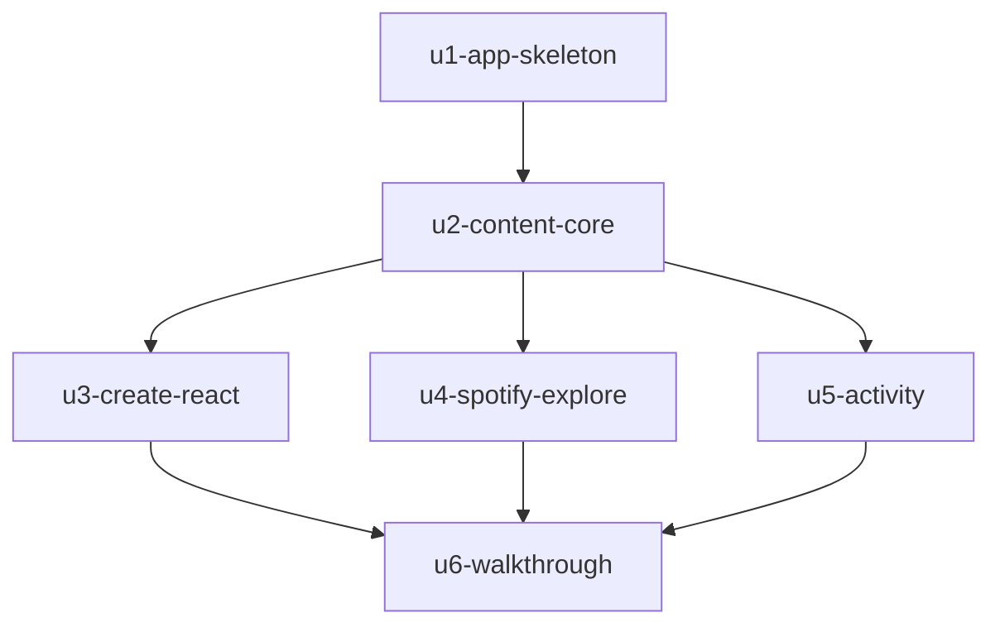

# Dependencias entre unidades — Melodify

> **Provenance**: deriva de `inception/domain-design/components.md` (`components`), `inception/domain-design/decisions.md` (`decisions`), `inception/requirements-analysis/requirements.md` (`requirements`), `inception/user-stories/stories.md` (`stories`) y de `unit-of-work.md`.
> Fecha: 2026-11-09. Etapa: Units Generation. Agente: aidlc-architect-agent.

Este documento fija **qué puede depender de qué**, no qué se construye primero: la secuencia de entrega es de Delivery Planning.

## Grafo



```yaml
units:
  - name: u1-app-skeleton
    kind: ui
    depends_on: []
  - name: u2-content-core
    kind: ui
    depends_on: [u1-app-skeleton]
  - name: u3-create-react
    kind: ui
    depends_on: [u2-content-core]
  - name: u4-spotify-explore
    kind: ui
    depends_on: [u2-content-core]
  - name: u5-activity
    kind: ui
    depends_on: [u2-content-core]
  - name: u6-walkthrough
    kind: ui
    depends_on: [u3-create-react, u4-spotify-explore, u5-activity]
```

## Aristas y por qué existen

| De | A | Por qué | Qué viaja |
|---|---|---|---|
| U1 | U2 | U2 pinta sobre el tema, la navegación y la sesión que crea U1; sin ellos no hay dónde montar las pantallas. | Tokens y componentes compartidos, navegación, `AppSession`, el proyecto Expo y su configuración. |
| U2 | U3 | U3 escribe en el contenido que U2 posee y usa sus pantallas como punto de entrada. | `ContentStore` con sus acciones, `Catalog`, la tarjeta de opinión y las pantallas donde se reacciona. |
| U2 | U4 | U4 cambia de dónde salen las obras y las portadas, pero el catálogo y las pantallas ya existen en U2. | `Catalog`, la decisión de portada, Inicio y Detalle. |
| U2 | U5 | U5 deriva de los datos que U2 siembra y de la identidad que U1/U2 dejan establecida. | `ContentStore`, la siembra con me gusta y comentarios fechados, el autor demo. |
| U3 | U6 | El recorrido incluye publicar, editar y reaccionar; sin U3 no se puede recorrer. | Pantallas Crear/Editar, hoja de comentarios, me gusta, seguir y snackbar. |
| U4 | U6 | El recorrido con sesión exige conectar Spotify y buscar; sin U4 no existe. | `SpotifyAuth`, `SpotifyCatalog` y Explorar. |
| U5 | U6 | El recorrido pasa por Actividad; sin U5 esa pestaña está vacía. | `ActivityFeed` y la pantalla Actividad. |

## Puntos de integración

- **Contrato**: las interfaces de componente del Domain Design —props, contexto y estados publicados—. No se añaden contratos nuevos entre unidades; Contract Design verifica lo que cruza.
- **U1 → todas**: tema (`DesignSystem`), navegación y composición (`AppShell`), sesión (`AppSession`).
- **U2 → U3, U4, U5**: `ContentStore` (lectura y escritura), `Catalog` (obra y portada), `Connectivity` (estado de red).
- **U4 → resto**: `SpotifyAuth` publica su estado de conexión; `Catalog` lo consulta para decidir la portada.
- **U5**: `ActivityFeed` publica `loading`/`ready`/`empty`/`error`; `AppShell` los pinta.

## Qué se puede construir a la vez

Tras U2, **U3, U4 y U5 no dependen entre sí**: son tres ramas que pueden ir en paralelo, cada una en su copia del proyecto, con U1 y U2 ya presentes. U6 espera a las tres. U1 y U2 son secuenciales: U2 necesita el proyecto, el tema y la navegación que crea U1.

## El esqueleto como tramo integrado

El alcance `mvp` activa el walking skeleton y la primera unidad del grafo —U1— es ese tramo: proyecto Expo, tema, navegación de cinco pestañas, login demo con sesión recordada e Inicio con una tarjeta de opinión de ejemplo. Corre de verdad en el teléfono Android físico antes de que exista cualquier otra unidad, y su aprobación es un checkpoint humano (team.md § Walking Skeleton). No es un documento de diseño ni una capa aislada: se recorre.

## Assumptions & Open Questions

- `[assumption]` Ninguna unidad depende de una que no esté ya en el proyecto: las aristas coinciden con las interfaces declaradas en `components.md`, y ninguna introduce un ciclo.
- `[assumption]` U6 no aporta interfaces nuevas; solo recorre y ajusta. Si un ajuste cambia una interfaz de componente, se trata como cambio de la unidad que la posee.
- **Sin decisiones abiertas**: el grafo no depende de OQ1, A1 ni A6.

## Sources

- `components` — `inception/domain-design/components.md`.
- `decisions` — `inception/domain-design/decisions.md` (ADR-001…ADR-012).
- `requirements` — `inception/requirements-analysis/requirements.md`.
- `stories` — `inception/user-stories/stories.md`.
- `unit-of-work` — `inception/units-generation/unit-of-work.md` (definición de cada unidad).
