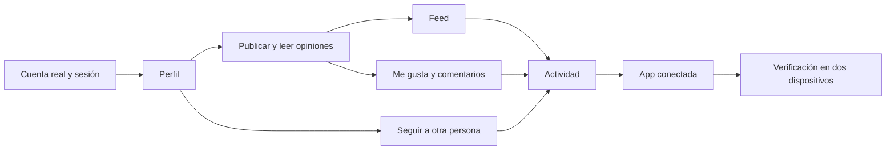

# Documento de Alcance — Backend de Melodify

## Fuentes

- `intent-statement.md`: cuentas reales, contenido compartido y métrica de éxito (publicar, comentar, dar me gusta y seguir desde un segundo dispositivo).
- `feasibility-assessment.md`: servicio local, LFPDPPP y contenido de los teléfonos descartado.
- `constraint-register.md`: restricciones CT-01 a CT-09.
- `raid-log.md`: riesgos R-01 a R-05, supuestos A-01 a A-05 e incidencias I-01 a I-04.
- `scope-definition-questions.md`: decisiones Q1 a Q5.

## Objetivo de esta entrega

Que lo que publica una persona lo vean otras desde un segundo dispositivo, y que siga disponible al reinstalar la app o cambiar de teléfono. Se mide con uso real, no con cifras de audiencia.

## Dentro del alcance

| ID | Capacidad | Por qué entra |
|---|---|---|
| SC-01 | Cuentas reales con identidad y sesión propia. | La métrica de éxito exige autores reales; CT-07. |
| SC-02 | Perfiles que identifican a cada autor. | Las opiniones, los seguimientos y la actividad necesitan un autor reconocible. |
| SC-03 | Publicar y leer opiniones sobre contenido musical. | Es el contenido central que debe dejar de perderse; Q1. |
| SC-04 | Feed con las opiniones compartidas. | Es el mecanismo por el que una persona ve lo que publican otras. |
| SC-05 | Me gusta y comentarios sobre opiniones. | Parte explícita de la métrica de éxito; Q1. |
| SC-06 | Seguir a otra persona. | Parte explícita de la métrica de éxito; Q1. |
| SC-07 | Actividad reciente de cada cuenta. | Cierra el recorrido de uso real pedido en la descripción inicial. |
| SC-08 | Conexión de la app al servicio real, conservando el respaldo local de solo lectura. | Q2: la entrega incluye el recorrido desde el teléfono. |
| SC-09 | Consentimiento, borrado y retención bajo LFPDPPP. | CT-03 y CT-09: hay datos personales desde el primer usuario. |
| SC-10 | Verificación con dos dispositivos reales en la misma red local. | Q4 y R-04: demuestra la métrica sin desplegar nada. |

## Fuera del alcance

- Migrar o subir el contenido simulado que hoy vive en los teléfonos: se descarta (Q3, CT-02).
- Gestionar tokens de Spotify, client secret o reproducción de audio en el servicio: PKCE sigue en la app (CT-04, CT-05).
- Desplegar a un servidor, staging, nube, tiendas de aplicaciones o compilación propia (CT-01, CT-05).
- Panel de administración, moderación, roles de administrador ni notificaciones push (CT-05).
- Backend gestionado, migración de cuentas a un proveedor externo ni cambio de tecnología (CT-06).
- Login simulado en el servicio (CT-07).
- Objetivos numéricos de mercado, audiencia o rendimiento: el éxito es funcional (A-05).

## Frontera del MVP

Entra todo lo que pide la métrica de éxito: cuentas, publicar, leer, comentar, dar me gusta, seguir, feed y actividad, con la app conectada al servicio real. Queda fuera cualquier capacidad de administración, despliegue o entretenimiento que no esté en esa métrica. La fecha de demostración existe pero no reduce capacidades (Q5 B).

## Mapa de flujo de valor

Texto de respaldo: cuenta real y sesión → perfil → publicar y leer opiniones → feed, me gusta y comentarios, y seguir a otra persona → actividad → app conectada → verificación con dos dispositivos en la misma red.

## Secuencia y dependencias

El orden elegido es por dependencias (Q3 C). Primero los contratos y la base de datos; después la identidad, el perfil y la privacidad; luego las opiniones; y sobre ellas el feed, las interacciones y la actividad. La conexión de la app avanza en cuanto existen contratos y sesión, y la verificación con dos dispositivos cierra el recorrido.

Esta secuencia es una preferencia de ordenación, no un calendario y no una división en unidades de implementación. El estado real de `apps/api` se comprueba antes de convertir estas capacidades en unidades de trabajo (R-01, I-04).

## Verificación de la métrica

Dos dispositivos reales alcanzan el servicio local desde la misma red (Q4 A). En ambos se publica, comenta, da me gusta y sigue a otra persona; el contenido aparece en el feed y en la actividad del segundo dispositivo, y sigue ahí tras reinstalar la app. No se levanta ningún entorno público ni túnel (CT-01).

## Contradicciones resueltas

- `intent-statement.md` dejaba abierto el contenido local; Q3 lo cierra: se descarta, sin migración.
- `market-trends.md` asumía RGPD; Q2 confirma LFPDPPP (I-01).
- La métrica pedía un segundo dispositivo y Q1 fijó el servicio en el portátil; Q4 cierra la verificación con dos dispositivos en la misma red local (R-04).
- Q5 confirma una fecha de demostración sin recorte de capacidades; no se inventa una fecha concreta ni un efecto sobre el alcance.

## Assumptions & Open Questions

- [assumption] El servicio existente en `apps/api` es ampliable; se comprueba antes de dividir el trabajo (R-01).
- [assumption] Un segundo dispositivo real alcanza el servicio local por la misma red (A-03, Q4).
- [assumption] Existe una fecha de demostración pero no consta en los artefactos; no reduce capacidades (Q5 B).
- [assumption] No hay objetivo numérico de audiencia ni de rendimiento (A-05).
- Abierto: plazos concretos de consentimiento, borrado y retención bajo LFPDPPP (I-03).
- Abierto: dirección de acceso del portátil en la red local; se resuelve al preparar la verificación, sin cambiar el alcance.
