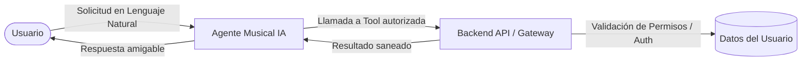

# 🧠 03. Integración con IA, Agentes y MCP

Este documento define la estrategia, arquitectura de privacidad y hoja de ruta para la incorporación de Inteligencia Artificial en **Melodify**.

---

## 1.3.1. IA Generativa

La IA generativa se concibe como una **función complementaria y opcional** para producir resúmenes narrativos personalizados de la actividad y preferencias musicales del usuario.

### Funcionalidad Propuesta
- **Resúmenes narrativos periódicos**: Redacción de textos estilo "recapitulaciones musicales" que describan los artistas más frecuentes, las obras mejor calificadas o las tendencias de géneros durante una semana, mes o año.
- **Procesamiento de datos agregados**: La IA **no procesará** el historial sin procesar (raw log) de cada escucha. El backend de Melodify previamente calculará estadísticas agregadas (ej. recuentos, promedios de calificación, géneros top) y enviará únicamente este resumen al proveedor de IA.
- **Activación voluntaria (Opt-in)**: La función se ejecuta exclusivamente bajo petición explícita del usuario (`on-demand`).

### Políticas de Privacidad y Seguridad
Para proteger la privacidad de la comunidad, la integración cumple con los siguientes lineamientos:
1. **Transparencia activa**: Se informará explícitamente cuándo se enviarán datos a un proveedor externo de IA (ej. OpenAI, Anthropic, Google Gemini) y qué categorías exactas de información serán compartidas.
2. **Anonimización y saneamiento**: Quedan estrictamente excluidos identificadores directos (correo electrónico, nombre real, ID de usuario), credenciales, tokens de acceso o metadatos innecesarios.
3. **No persistencia innecesaria**: No se almacenarán prompts ni respuestas por defecto en servicios externos, salvo que exista una justificación comunicada y consentida.
4. **Independencia del MVP**: Las funciones sociales y de calificación de Melodify operan al 100% sin necesidad de activar la generación con IA.

---

## 1.3.2. Agentes de IA

Como evolución posterior al MVP, se plantea el diseño de un **Agente Musical Inteligente** capaz de procesar instrucciones en lenguaje natural del usuario.

### Principios de Operación del Agente:
- **Intermediario controlado**: El agente no accede de forma directa ni irrestricta a la base de datos de producción.
- **Límite de privilegios (Principio de Menor Privilegio)**: Solo puede invocar funciones autorizadas para el usuario autenticado. No tiene facultades para acceder a datos ajenos ni alterar estados críticos sin confirmación.
- **Herramientas de consulta**: Capacitado exclusivamente para tareas de consulta y agregación (ej. *"¿Cuál fue mi disco de rock mejor calificado este mes?"* o *"Genera un resumen de mis artistas favoritos"*).

---

## 1.3.3. MCP (Model Context Protocol)

En fases posteriores, se adoptará el estándar abierto **Model Context Protocol (MCP)** para desacoplar y estandarizar la conexión entre modelos de lenguaje/agentes y las capacidades del backend de Melodify.

### Herramientas MCP Propuestas (Tools)

| Herramienta | Tipo | Propósito | Restricciones de Seguridad |
| :--- | :--- | :--- | :--- |
| `consultar_estadisticas_propias` | Lectura | Retorna estadísticas musicales agregadas del usuario en sesión. | Requiere token de sesión válido; datos agregados únicamente. |
| `generar_resumen_musical` | Generación | Genera el prompt enriquecido y ejecuta el resumen narrativo. | Solo opera con datos previamente autorizados por el usuario. |
| `consultar_calificaciones_propias` | Lectura | Recupera las calificaciones y notas asignadas por el propio usuario. | Filtro estricto por `user_id` autenticado; solo lectura. |

> [!WARNING]
> **Límites de Seguridad de MCP:**  
> Las herramientas de consulta de Melodify **no deberán** permitir modificar calificaciones, publicar contenido en el muro ni acceder a datos de terceros sin autorización explícita.

---

## 1.3.4. Alcance y Fases de Implementación

- **Fase 1 (MVP)**: Prioridad absoluta en la arquitectura móvil (React Native), catálogo de Spotify, sistema de calificaciones, reseñas y muro social básico.
- **Fase 2**: Integración de resúmenes narrativos opcionales mediante IA Generativa (llamadas a endpoints dedicados con agregaciones previas).
- **Fase 3**: Implementación del servidor MCP y Agentes musicales interactivos.
