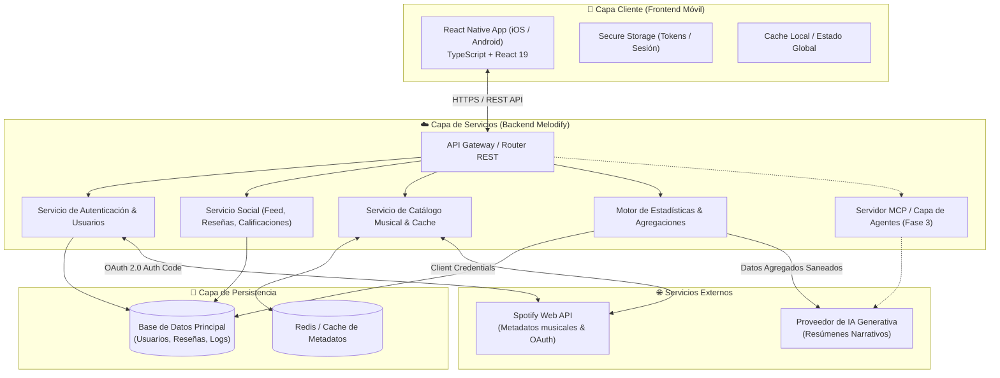
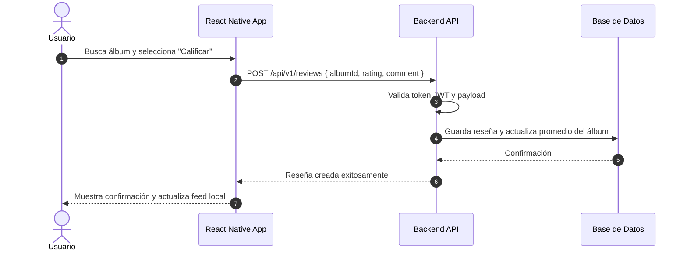
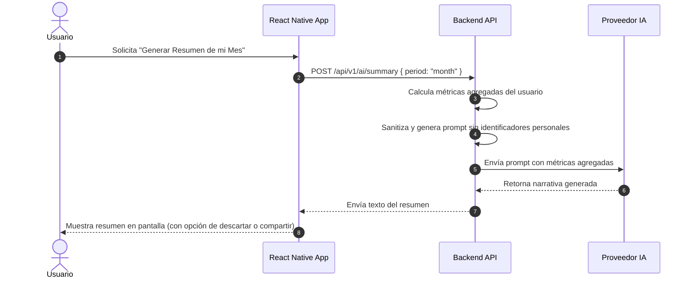

# 🏛️ 04. Arquitectura Básica del Sistema

Este documento describe la arquitectura global, las capas de software, el flujo de datos y los componentes técnicos que integran **Melodify**.

---

## 4.1. Diagrama de Arquitectura Global



---

## 4.2. Capa Cliente (Aplicación Móvil)

La aplicación está construida sobre **React Native**:
- **Framework**: React Native `0.87.x` con React `19.x`.
- **Lenguaje**: TypeScript en modo estricto (`tsc --noEmit`).
- **Gestión de Estilos y UI**:
  - `react-native-safe-area-context` para manejo de áreas seguras (notches, barras del sistema).
  - Tema adaptativo claro/oscuro (`useColorScheme`).
- **Arquitectura Interna Recomendada**:
  ```text
  app/src/
  ├── api/             # Clientes HTTP y llamadas a endpoints
  ├── assets/          # Íconos, imágenes estáticas y fuentes
  ├── components/      # Componentes reutilizables (Botones, Estrellas, Cards)
  ├── navigation/      # Stacks y Bottom Tabs de navegación
  ├── screens/         # Pantallas principales (Feed, Perfil, Detalle Álbum, etc.)
  ├── hooks/           # Custom hooks de lógica reutilizable
  ├── services/        # Servicios de autenticación y conectividad
  └── types/           # Definiciones de TypeScript (User, Review, Album, Track)
  ```

---

## 4.3. Capa de Backend y Servicios

El backend actúa como un intermediario seguro para orquestar la lógica de negocio y proteger credenciales sensibles:

1. **Servicio de Autenticación**:
   - Registro e inicio de sesión seguro (JWT / Tokens con rotación).
   - Gestión de vinculación OAuth 2.0 con Spotify.
2. **Servicio de Catálogo Musical**:
   - Abstracción de llamadas hacia la **Spotify Web API**.
   - Almacenamiento en caché de álbumes, canciones y artistas consultados frecuentemente para optimizar la cuota de peticiones.
3. **Servicio Social y Reseñas**:
   - CRUD de calificaciones (1 a 5 estrellas) y reseñas textuales.
   - Algoritmo de feed o muro social basado en relaciones de seguimiento (`followers` / `following`).
4. **Motor de Estadísticas y Privacidad**:
   - Agregación previa de métricas musicales (frecuencias, notas promedio, artistas más escuchados).
   - Filtrado de PII (Información Personal Identificable) antes de interactuar con modelos de IA.

---

## 4.4. Flujo de Datos Típico

### Flujo 1: Calificación y Reseña de un Álbum


### Flujo 2: Generación de Resumen Musical con IA


---

## 4.5. Configuración y Seguridad

- **Variables de Entorno**: Se definen en [app/.env.example](../app/.env.example).
- **Secretos de API**: Las llaves privadas (`SPOTIFY_CLIENT_SECRET`, API keys de IA) **nunca** residen en el cliente móvil; se resguardan en las variables del servidor backend.
- **Tokens de Usuario**: En el dispositivo móvil se resguardan utilizando almacenamiento seguro cifrado (Keychain en iOS, Keystore / EncryptedSharedPreferences en Android).
